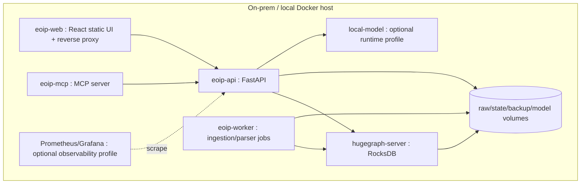

# Specification Audit and Requirement Enhancements

**Project:** Enterprise Ontology & Intelligence Platform (EOIP)  
**Baseline:** 0.1.0-architecture-baseline  
**Date:** 2026-10-01  
**Status:** Architecture baseline / engineering handoff  
**Purpose:** Resolve ambiguities/conflicts before implementation

> This document is normative for its scope. Where it conflicts with the master specification, the master non-negotiable constraints win. “MVP” means the Phase 1 integrated vertical slice, not a mock-up.

## Executive assessment

The source specification is directionally strong and unusually explicit about local-first operation, HugeGraph authority, provenance, safety, phased delivery and a real MVP. The largest implementation risk is not missing features; it is allowing coding teams/agents to make incompatible assumptions in areas the source leaves open. This baseline therefore resolves those assumptions without weakening any non-negotiable constraint.

## Ambiguities, conflicts and resolutions

| # | Source ambiguity / risk | Resolution in this baseline | Reason |
|---|---|---|---|
| A01 | “Multiple logical graph domains” could be interpreted as many physical graph databases. | Phase 1 uses **one physical HugeGraph graph with explicit logical domains**. | Cross-domain Jira→code paths remain native traversals; no cross-DB join layer. |
| A02 | Apache HugeGraph is authoritative, but raw capture/checkpoints/DLQ also need persistence. | Use mounted local files for raw immutable events, DLQ, checkpoints and exports; they are operational evidence/state, not an alternative truth database. | Keeps HugeGraph authoritative while enabling replay/recovery. |
| A03 | No actual Jira JSON was supplied with the master prompt. | Do **not** claim it was analyzed. Define configurable mapping plus synthetic fixture. | Required by the source-material rule. |
| A04 | “Git repository/GitLab ingestion” can imply internet access. | Local Git is mandatory; GitLab adapter supports on-prem endpoint and offline fixture mode. | Preserves no-cloud/offline MVP. |
| A05 | GraphRAG often implies a vector DB. | No vector DB is mandatory in P1. Graph/metadata/linked text retrieval is enough for the demonstrator; local embeddings remain pluggable. | Minimizes infrastructure and avoids duplicate source-of-truth concerns. |
| A06 | RDF/OWL/SPARQL could be mistaken as native HugeGraph behavior. | Implement export/translation adapter in P2; do not document native SPARQL. | Prevents unsupported capability claims. |
| A07 | No RBAC, yet an admin application exists. | P1 uses single-user/profile authentication and network controls; route names are navigation only. RBAC is P7. | Meets “no RBAC” without creating an unauthenticated admin plane. |
| A08 | Many RAG patterns are listed. | Implement one strategy interface and graph-first MVP strategies; add variants only after evaluation in P3. | Avoids pattern-by-name architecture bloat. |
| A09 | Self-learning/evolving/writing agents are listed. | Disabled until P8+; earlier phases may only produce reviewed proposals/artifacts in sandboxes. | Aligns with the explicit controlled-capability rule. |
| A10 | JEV is undefined. | Model JEV as an internal capability adapter/contract only. | Avoids inventing a false external specification. |
| A11 | Natural-language query could generate Gremlin. | NL produces typed `QueryPlan`; only named, parameterized, bounded templates execute. | Enforces safety and testability. |
| A12 | Performance objectives are required but no dataset/hardware is specified. | Define a benchmark dataset/hardware profile and provisional thresholds; label them targets until measured. | Avoids arbitrary performance claims. |
| A13 | “Backup/restore” spans graph, raw evidence and config. | Graph uses HugeGraph-supported backup/restore; app/raw/config has checksummed archive procedure. | Recovery must reconstruct a complete demonstrator, not just vertices. |
| A14 | The MVP asks for one useful agent but not its authority. | `TraceImpactAgent` is read-only and composes query/retrieval tools. | Demonstrates agent value without write-risk governance. |
| A15 | Graph versions/snapshots could greatly inflate MVP. | P1 stores version/validity/journal metadata and supports reproducible rebuild; full snapshot/diff/reconstruction is P5. | Preserves forward compatibility without derailing MVP. |
| A16 | PDFs/web pages can introduce parser/security complexity. | P1 supports controlled local text/Markdown/JSON plus metadata; rich PDF/web extraction is staged behind file connector after parser-security tests. | Prioritizes end-to-end correctness. |

## Missing requirements added

- Canonical-id algorithm/versioning and collision handling.
- Immutable raw capture before mutation.
- Explicit checkpoint commit semantics and DLQ schema.
- Model-down and external-network-down degradation behavior.
- QueryPlan schema, relationship allowlists and result/depth/time bounds.
- Single physical graph decision for the MVP and migration trigger for physical partitioning.
- Explicit read-only MCP/agent MVP surface.
- Local source-path allowlisting and symlink/path traversal controls.
- Benchmark workload/hardware manifest and “target vs measured” distinction.
- Backup manifest/checksum/verification queries.
- Frontend graph expansion limits.
- Evidence coverage acceptance criteria for cross-domain links.
- API error taxonomy/correlation IDs.
- Offline staging/air-gap release manifest.
- Model/provider capability discovery and fail-closed external-provider policy.

## Conflict hierarchy

1. Non-negotiable constraints in the master specification.
2. Security/data-boundary constraints.
3. Stable external contracts and canonical identity/provenance invariants.
4. MVP acceptance criteria.
5. Architecture decisions in ADRs.
6. Implementation convenience.

If a later feature conflicts with a higher item, the lower-priority design must change rather than weakening the constraint.

## MVP architecture after enhancement

## Phase 1 security baseline

- Runtime egress is denied by default; model/images/dependencies are staged before restricted deployment.
- HugeGraph and local-model ports stay on an internal Docker network; only the web/API edge is exposed as configured.
- Non-loopback profiles require local authentication; the current codebase now includes local RBAC/ABAC primitives, policy evaluation, role/user export, signed token checks and `/api/v1/authz/*` management/evaluation routes. Production multi-user authorization still requires release hardening and Phase 8 security receipts.
- Secrets are file-mounted/referenced and redacted from logs; example files contain placeholders only.
- Source paths are allowlisted roots; path traversal/symlink escape/oversized input is rejected.
- Model/retrieved text is untrusted data. It cannot create new tool permissions, arbitrary Gremlin or shell commands.
- QueryPlan bounds and read-only Gremlin templates are enforced for UI, agent and MCP equally.
- Audit events record ingestion, queries, agent/tool calls, admin operations, backup/restore and policy denials; hidden chain-of-thought is never stored.
- Write/destructive MCP/agent tools are not registered in the MVP.

## MVP benchmark definition (targets, not measured claims)

Representative baseline dataset: approximately 2,000 Jira work items, 10 Git repositories, 15,000 commits, 25,000 files/symbols, 5,000 document sections and 150,000–300,000 relationships. Reference developer workstation: 8 physical/logical CPU cores available to Docker, 32 GiB RAM and local NVMe/SSD. Record the exact hardware in every benchmark result.

Initial engineering targets are acceptance thresholds to validate after implementation: indexed entity lookup p95 ≤ 500 ms; bounded path/impact query p95 ≤ 2 s at configured depth/result limits; standard user API p95 ≤ 1 s excluding local-model generation; `docker compose up` readiness ≤ 120 s after images are locally available. These are not product performance claims until the benchmark suite measures them.
