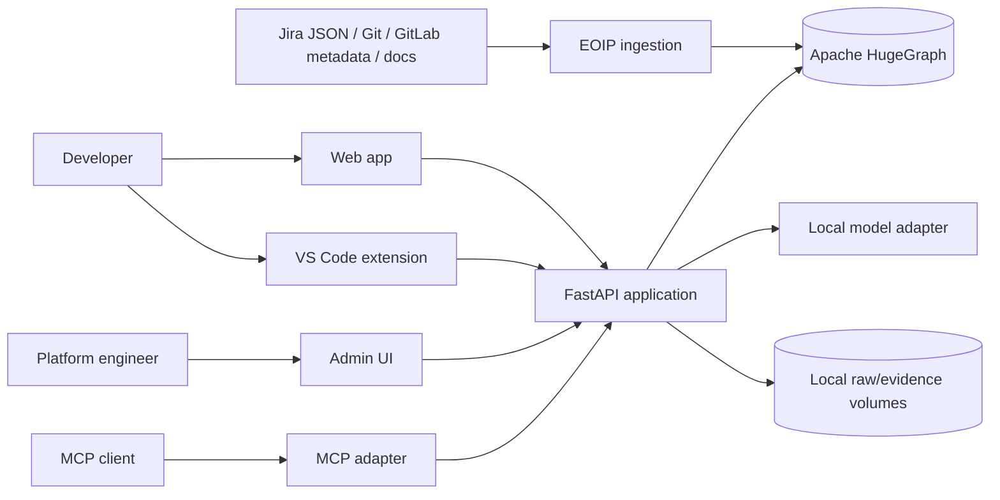
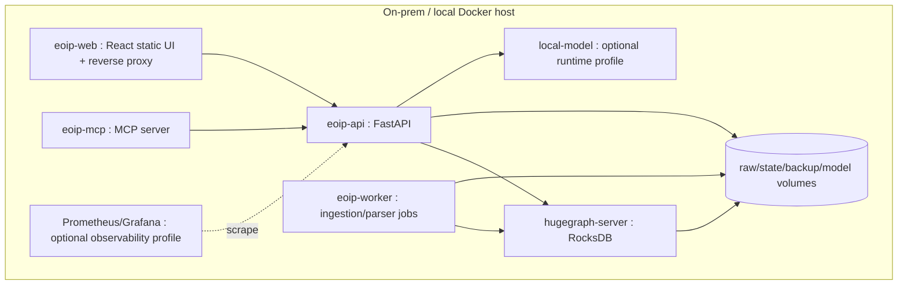

# Target Architecture

**Project:** Enterprise Ontology & Intelligence Platform (EOIP)  
**Baseline:** 0.1.0-architecture-baseline  
**Date:** 2026-10-01  
**Status:** Architecture baseline / engineering handoff  
**Purpose:** Define system context and target architecture

> This document is normative for its scope. Where it conflicts with the master specification, the master non-negotiable constraints win. “MVP” means the Phase 1 integrated vertical slice, not a mock-up.

## Scope and design intent

EOIP turns fragmented enterprise work, code, delivery and knowledge artifacts into a provenance-preserving operational knowledge graph. Its first measurable outcome is answering “what implements this requirement?”, “what changes if this symbol changes?”, and “why do we believe this relationship?” from persisted evidence. The platform is intentionally useful without generative AI; AI adds query interpretation, summarization and agent orchestration rather than replacing deterministic graph engineering.

All externally ingested facts first become immutable `SourceEvent` envelopes with content hashes. Mappers generate versioned canonical entities and relationships. HugeGraph stores operational truth; local raw capture preserves source fidelity and replay. The canonical model is stable across connector implementations and includes source identity, provenance, creation status, confidence, temporal fields and version metadata.

The application exposes domain query services rather than database access. Exact identifier search anchors graph operations. Natural-language interpretation produces a typed QueryPlan, validated against ontology/schema and policy, then executes a named bounded Gremlin template. Depth, edge classes, result size and timeout are explicit inputs with hard maximums.

RAG is a retrieval framework, not a synonym for vector search. The MVP retrieval router chooses direct graph, linked code/doc context or graph+text hybrid based on intent. A local model may synthesize an answer, but the evidence package is independently returned. Advanced CRAG/Self-RAG/Adaptive/Agentic/Multi-hop strategies are plugins evaluated in P3.

The MVP agent is `TraceImpactAgent`, a bounded read-only workflow. It composes search, path, impact and evidence retrieval tools and may use the local model only to interpret/summarize. Tool allowlists, step/time budgets and a circuit breaker prevent open-ended autonomy. Self-modification and write actions are deliberately absent.

Security is designed for a local trusted-network MVP without pretending that trusted means safe. The system minimizes exposed ports, runs components least-privileged, protects secrets, validates inputs, prevents prompt/tool injection from bypassing policies, denies outbound enterprise-data egress and records auditable actions.

## Architecture decisions

1. **One physical HugeGraph graph in the MVP; multiple logical graph domains.** Jira, code, documentation, CI/CD, provenance, meta, identity and agent/action domains are separated by explicit labels/properties and meta-graph records. This preserves direct cross-domain Gremlin traversal and avoids an artificial cross-database join layer. Physical graph-space separation is a later scaling/isolation option, not an MVP assumption.
2. **HugeGraph is the only mandatory database.** Local files/volumes are used for immutable raw capture, DLQ, checkpoints, configuration, model artifacts and exports; they are not an alternative source-of-truth graph database.
3. **RocksDB standalone mode for the MVP.** It is appropriate for a single-node development/demo vertical slice. HStore/distributed topology is a Phase 7 decision based on measured capacity, HA and scale requirements.
4. **Modular monolith first.** A single Python codebase exposes API, worker and MCP entry points while maintaining strict package boundaries. Separate processes/containers may use the same image. Microservice extraction requires an independently deployable/scalable/security boundary and evidence that the split reduces risk/cost.
5. **No mandatory vector database in Phase 1.** Graph traversal, indexed identifiers, linked document sections and local lexical retrieval prove the platform. A local embedding provider is pluggable; a dedicated vector index becomes optional only after retrieval benchmarks show value.
6. **Deterministic parsing/linking before LLM inference.** Tree-sitter/AST, Git metadata, issue keys, commit SHAs, paths and configured identifiers are primary. Inferred relationships are explicitly marked, scored and evidence-backed.
7. **Safe query compilation.** Natural language produces a typed `QueryPlan`; it never produces directly executable unrestricted Gremlin. The query policy enforces depth/result/timeout/relationship bounds and read-only behavior.
8. **Read-only AI/MCP MVP.** The MVP agent and MCP surface only read/search/analyze. Source-system/code mutations are deferred until human-control and write-tool governance are implemented.
9. **Local model is optional to core graph utility.** The demo can show a local model, but search, path, impact, provenance and graph visualization continue to work when the model is stopped.
10. **No RBAC does not mean no security.** Phase 1 has environment/profile-aware authentication, network isolation, secret handling, audit, input/query/action policy and safe defaults. `/app` vs `/admin` is navigation, never an authorization boundary.

## Applicable requirements

| ID | Requirement | Phase | Completion signal |
|---|---|---|---|
| FR-GRAPH-001 | HugeGraph authoritative store | P1-MVP | All demo graph paths survive service restart. |
| FR-GRAPH-002 | Logical graph domains | P1-MVP | Every business vertex/edge belongs to a valid domain. |
| FR-GRAPH-006 | Cross-domain bridge edges | P1-MVP | Jira→MR→Commit→File→Function→Dependency→Pipeline→Doc path is traversable. |
| FR-QUERY-001 | Structured QueryPlan | P1-MVP | All NL and structured requests compile to validated QueryPlan. |
| FR-RAG-003 | Local model abstraction | P1-MVP | Core search/path/impact remains usable with model service stopped. |
| FR-AGENT-002 | Bounded agent runtime | P1-MVP | Agent cannot exceed configured execution envelope. |
| NFR-MAINT-001 | Modular monolith boundary | P1-MVP | Core can later split without changing external contracts. |

## Engineering rules

- Configuration is versioned; secrets are references, never committed values.
- Every persistent fact carries canonical identity and provenance where applicable.
- Every failure path returns a stable error category, logs a correlation ID, and avoids partial silent success.
- MVP behavior must remain functional without an external network and, for graph features, without a local LLM.
- New implementation work must add/adjust automated tests and traceability entries.

## Validation / definition of done

- Normative interfaces are implemented and documented.
- Automated tests mapped to the listed requirement IDs pass.
- Error, security, logging and configuration paths are exercised.
- Acceptance evidence is reproducible from a clean documented environment.
- Deferred capabilities remain behind stable interfaces and are not represented as already implemented.
