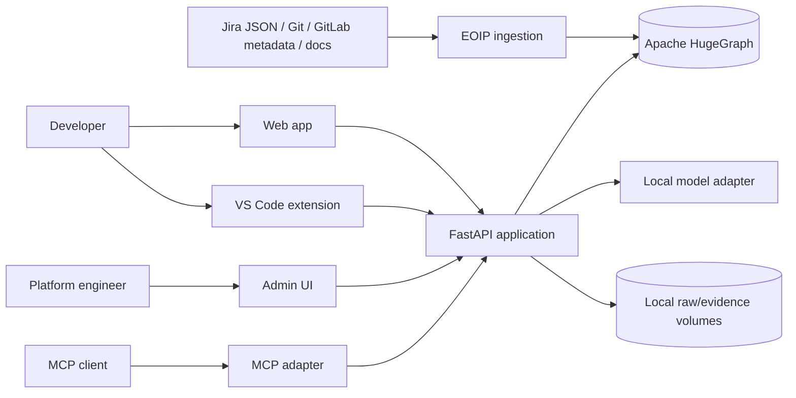
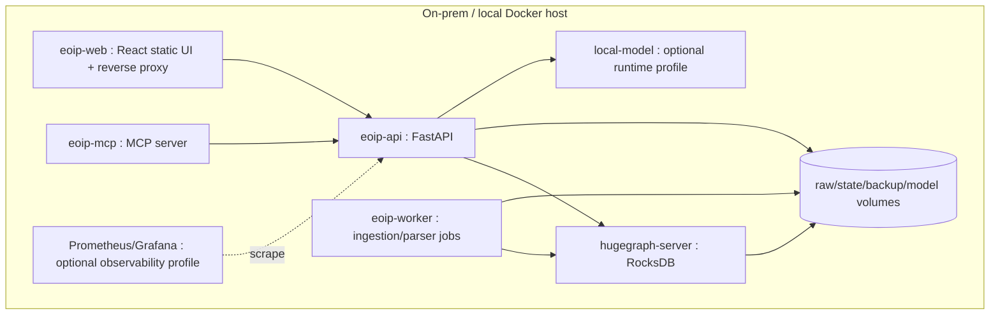

# Target Architecture

**Project:** Enterprise Ontology & Intelligence Platform (EOIP)  
**Baseline:** 0.1.0-architecture-baseline  
**Date:** 2026-10-01  
**Updated:** 2026-10-06 — Pass 5: implementation reference merged in; multi-backend GraphStore, federation planner, ops preflight  
**Status:** Architecture baseline / engineering handoff  
**Purpose:** Define system context, target architecture, and verified implementation reference

> This document is normative for its scope. Where it conflicts with the master specification, the master non-negotiable constraints win. "MVP" means the Phase 1 integrated vertical slice, not a mock-up.

---

## Scope and Design Intent

EOIP turns fragmented enterprise work, code, delivery and knowledge artifacts into a provenance-preserving operational knowledge graph. Its first measurable outcome is answering "what implements this requirement?", "what changes if this symbol changes?", and "why do we believe this relationship?" from persisted evidence. The platform is intentionally useful without generative AI; AI adds query interpretation, summarization and agent orchestration rather than replacing deterministic graph engineering.

All externally ingested facts first become immutable `SourceEvent` envelopes with content hashes. Mappers generate versioned canonical entities and relationships. HugeGraph stores operational truth; local raw capture preserves source fidelity and replay. The canonical model is stable across connector implementations and includes source identity, provenance, creation status, confidence, temporal fields and version metadata.

The application exposes domain query services rather than database access. Exact identifier search anchors graph operations. Natural-language interpretation produces a typed QueryPlan, validated against ontology/schema and policy, then executes a named bounded Gremlin template. Depth, edge classes, result size and timeout are explicit inputs with hard maximums.

RAG is a retrieval framework, not a synonym for vector search. The MVP retrieval router chooses direct graph, linked code/doc context or graph+text hybrid based on intent. A local model may synthesize an answer, but the evidence package is independently returned. Advanced CRAG/Self-RAG/Adaptive/Agentic/Multi-hop strategies are plugins evaluated in P3.

The MVP agent is `TraceImpactAgent`, a bounded read-only workflow. It composes search, path, impact and evidence retrieval tools and may use the local model only to interpret/summarize. Tool allowlists, step/time budgets and a circuit breaker prevent open-ended autonomy. Self-modification and write actions are deliberately absent.

Security is designed for a local trusted-network MVP without pretending that trusted means safe. The system minimizes exposed ports, runs components least-privileged, protects secrets, validates inputs, prevents prompt/tool injection from bypassing policies, denies outbound enterprise-data egress and records auditable actions.

---

## Architecture Decisions

1. **One physical HugeGraph graph in the MVP; multiple logical graph domains.** Jira, code, documentation, CI/CD, provenance, meta, identity and agent/action domains are separated by explicit labels/properties and meta-graph records. This preserves direct cross-domain Gremlin traversal and avoids an artificial cross-database join layer. Physical graph-space separation is a later scaling/isolation option, not an MVP assumption.
2. **HugeGraph is the default mandatory database; additional backends are pluggable.** Local files/volumes are used for immutable raw capture, DLQ, checkpoints, configuration, model artifacts and exports. Amazon Neptune (openCypher) and an in-process Memory backend are registered alternates selected via `config/graph-store.yaml`. See `76-multi-backend.md` for full details.
3. **RocksDB standalone mode for the MVP.** It is appropriate for a single-node development/demo vertical slice. HStore/distributed topology is a Phase 7 decision based on measured capacity, HA and scale requirements.
4. **Modular monolith first.** A single Python codebase exposes API, worker and MCP entry points while maintaining strict package boundaries. Separate processes/containers may use the same image. Microservice extraction requires an independently deployable/scalable/security boundary and evidence that the split reduces risk/cost.
5. **No mandatory vector database in Phase 1.** Graph traversal, indexed identifiers, linked document sections and local lexical retrieval prove the platform. A local embedding provider is pluggable; a dedicated vector index becomes optional only after retrieval benchmarks show value.
6. **Deterministic parsing/linking before LLM inference.** Tree-sitter/AST, Git metadata, issue keys, commit SHAs, paths and configured identifiers are primary. Inferred relationships are explicitly marked, scored and evidence-backed.
7. **Safe query compilation.** Natural language produces a typed `QueryPlan`; it never produces directly executable unrestricted Gremlin. The query policy enforces depth/result/timeout/relationship bounds and read-only behavior.
8. **Read-only AI/MCP MVP.** The MVP agent and MCP surface only read/search/analyze. Source-system/code mutations are deferred until human-control and write-tool governance are implemented.
9. **Local model is optional to core graph utility.** The demo can show a local model, but search, path, impact, provenance and graph visualization continue to work when the model is stopped.
10. **No RBAC does not mean no security.** Phase 1 has environment/profile-aware authentication, network isolation, secret handling, audit, input/query/action policy and safe defaults. `/app` vs `/admin` is navigation, never an authorization boundary.

---

## Architecture Diagrams





---

## Implementation Reference

> This section documents the verified current implementation as of Pass 5 (2026-10-06). It supplements the normative spec above with concrete module names, service ports, and flow diagrams derived from the codebase.

### Docker Services

| Service | Port | Responsibility |
|---------|------|---------------|
| `hugegraph-server` | Internal | HugeGraph 1.7.0 with RocksDB; authoritative graph store |
| `hubble` | 8088 | Hubble 1.7.0; schema browser, graph viz, Gremlin console |
| `hubble-init` | — | Idempotent connection registration (one-shot) |
| `schema-init` | — | One-time idempotent vertex/edge/index bootstrap |
| `eoip-api` | 8000 | FastAPI: query, RAG, agents, admin, metrics |
| `eoip-worker` | — | Single-worker durable filesystem queue; ingestion jobs |
| `eoip-web` | 8080 | React SPA (Nginx); same-origin proxy to API |
| `eoip-mcp` | 8001 | FastMCP; 17 read-only tools, TokenBoundary auth |

### Application Packages (`packages/eoip/`)

| Subpackage | Files | Purpose |
|------------|-------|---------|
| `connectors/` | 36 | 24 source connectors + SDK infrastructure |
| `graph/` | 40 | GraphStore protocol, HugeGraph/Neptune/memory adapters, algorithms, evolution, formats |
| `agents/` | 20 | 20 bounded agents with runtime + circuit breaker |
| `ingestion/` | 16 | Source-specific ingestion services, DLQ, replay |
| `ontology/` | 9 | Manifest, schema gen, SKOS, RDF, embedding drift |
| `query/` | 9 | QueryPlan executor, NLQ, EQL, query languages |
| `retrieval/` | 5 | RAG retrieval, strategy registry, eval |
| `codegraph/` | 3 | AST parser, diff hunk, language support |
| `contracts/` | 14 | Typed Pydantic contracts: events, entities, agents, tools |
| `provenance/` | 4 | Evidence model, lineage service |
| `identity/` | 3 | Deterministic identity resolution, candidate queue |
| `validation/` | — | Validation engine, gates, quality metrics |
| `audit/` | 3 | Audit sink, redaction |
| `models/` | 4 | LocalModelProvider (Ollama), graceful fallback |
| `fileparse/` | 12 | File format parsers (Office, text, media, PDF) |
| `federation/` | 1 | Federated query planner (GAP-FABRIC-001..008) |
| `ops/` | 2 | Preflight checks, ops bundle (GAP-OPS-001) |

### Data Flows

#### 1. Source Ingestion Path

```
External System
      ↓
SourceConnector.discover() → DiscoveryResult
      ↓
SourceConnector.extract(checkpoint) → SourceEventV2 (immutable, payload_hash, captured_at)
      ↓
AcquisitionPolicy (dry_run, resume, checkpoint validation)
      ↓
Ingestion Service (jira.py, gitlab.py, code.py, etc.)
  → NormalizedEntity / NormalizedRelationship (typed, confidence, creation_status)
      ↓
IngestionGraphStore (validation boundary)
  → validate NormalizedEntity/NormalizedRelationship
      ↓
GraphStore.upsert_vertex() / upsert_edge()  OR  GraphEvolutionEngine.evolve_entity()
      ↓
HugeGraph (RocksDB) — canonical_id → SHA-256 vertex_id
      ↓
ChangeJournal (hash-chained NDJSON) → SemanticEventBus (pub/sub)
```

#### 2. Query Path

```
HTTP POST /api/v1/query
      ↓
QueryPlan (intent, anchors, depth, timeout, evidence_mode)
      ↓
QueryPolicy.validate() (max_depth=8, max_results=500, timeout=30s)
      ↓
QueryExecutor.execute()
  ├─ SEARCH → scan by canonical_id / name / issue_key / path
  ├─ PATH → BFS / Yen's k-shortest paths
  ├─ IMPACT → blast-radius + rationale per entity
  ├─ NLQ → NL→QueryPlan (rule-based fast path + Ollama fallback)
  └─ EQL → EOIP Query Language parser
      ↓
GraphResult (nodes, edges, paths, evidence list, partial flag)
```

#### 3. RAG Path

```
HTTP POST /api/v1/rag
      ↓
RAGRouter.select_strategy() (17 routing patterns)
      ↓
RetrievalStrategy (7 modes: GRAPH, KEYWORD, HYBRID, SEMANTIC, EVIDENCE, LINEAGE, AGENT)
      ↓
StrategyRegistry.execute_chain() (4 built-in strategies: GraphDepth, EvidenceWeight, DomainFocus, Freshness)
      ↓
LocalModelProvider.generate() (Ollama) OR structured fallback
      ↓
EvidenceManifest (stable URN citations: canonical_id + source_ref)
```

#### 4. Agent Path

```
HTTP POST /api/v1/agents/{type}
      ↓
AgentRuntime (budget clamping, circuit breaker, step/tool/recursion limits)
      ↓
Agent.run() (READ_TOOLS frozenset only — no write tools)
      ↓
Tool calls: graph query, RAG, validation, metrics, algorithms
      ↓
ExplanationEnvelope (evidence_refs, calibrated confidence, rationale)
```

### Graph Schema

#### Authoritative Domains (14)

`CODE`, `WORK`, `CICD`, `KNOWLEDGE`, `PEOPLE`, `INFRASTRUCTURE`, `SECURITY`, `COMPLIANCE`, `CATALOG`, `QUALITY`, `TEMPORAL`, `PROVENANCE`, `META`, `TRUST`

#### Core Vertex Labels (40+)

Work: `WorkItem`, `Sprint`, `Epic`, `Project`  
Code: `Repository`, `File`, `CodeSymbol`, `Commit`, `MergeRequest`, `Pipeline`  
People: `Person`, `Team`, `Organisation`  
Knowledge: `Document`, `DocumentSection`, `KnowledgeArticle`  
Infrastructure: `Service`, `Endpoint`, `Container`, `Deployment`  
Provenance: `Evidence`, `DataSource`, `IngestionRun`  
Meta: `GraphDomain`, `OntologyVersion`, `ValidationRun`, `Finding`

#### Core Edge Labels (30+)

`IMPLEMENTS`, `REFERENCES`, `DOCUMENTS`, `PRODUCED_BY`, `TRACES_TO`, `BELONGS_TO_DOMAIN`,  
`ASSIGNED_TO`, `CONTAINS`, `DECLARES`, `CALLS`, `IMPORTS`, `DEPENDS_ON`,  
`COMMITTED_TO`, `MERGED_VIA`, `DEPLOYED_BY`, `EVIDENCE_FOR`, `AUTHORED_BY`

#### Index Strategy (12+ indexes)

- `UNIQUE` on `canonical_id` for all vertex types
- Composite on `(domain, label)` for domain scans
- Single-column on `created_at`, `updated_at` for temporal access
- Full-text on `name`, `description` for search

### Security Architecture

| Layer | Implementation |
|-------|---------------|
| Authentication | Single-user EOIP_API_TOKEN; non-loopback requires token |
| Data egress | No outbound calls — Ollama only; `tests/security/test_no_egress.py` |
| Secret isolation | `audit/redaction.py` scrubs secrets from audit records + repr() |
| Input safety | Path validation, size limits, traversal rejection in fileparse + connectors |
| Injection defense | Template injection prevention (forbids `{}$\` in params); retrieved content as data |
| Container | Non-root user, read-only filesystem, dropped capabilities |
| Audit | Persistent audit sink for auth/ingestion/query/agent/admin/backup events |

### Observability

| Concern | Implementation |
|---------|---------------|
| Metrics | Prometheus-format `GET /metrics` — counters (requests, operations, failures), histograms (duration, job_duration) |
| Logging | `packages/eoip/observability.py` — JsonLogFormatter, correlation ID middleware |
| Health | `/health/live`, `/health/ready` endpoints |
| Tracing | Correlation IDs propagated through all request-scoped operations |
| Audit | `packages/eoip/audit/sink.py` — persistent audit event sink |

### Storage

| Data | Location | Format |
|------|---------|--------|
| Graph vertices/edges | HugeGraph + RocksDB (Docker volume) | Property graph |
| Raw source events | Worker filesystem (Docker volume) | SourceEventV2 NDJSON |
| Dead-letter queue | Worker filesystem | DLQ NDJSON |
| Job records | Worker filesystem | JobQueue NDJSON |
| Change journal | Worker filesystem | Hash-chained NDJSON |
| Snapshots | Worker filesystem | Checksummed archive |
| Connector state | `state/connectors/{source}.json` | Checkpoint JSON |
| Corpus/documents | Worker filesystem | Document + chunk records |
| Neptune (optional) | Amazon Neptune cluster (external) | openCypher HTTPS — configured via `config/graph-store.yaml` |

### Multi-Backend GraphStore

EOIP supports pluggable graph storage backends, configured via `config/graph-store.yaml` or environment variable:

| Backend | Module | Default | Notes |
|---------|--------|---------|-------|
| HugeGraph | `graph/hugegraph.py` | Yes | Gremlin REST — default Docker service |
| Amazon Neptune | `graph/neptune.py` | No | openCypher HTTPS — requires AWS endpoint |
| Memory | `graph/memory.py` | No | In-process — tests and local harnesses |

`create_graph_store()` in `packages/eoip/graph/backends.py` is the single factory entry point. Switch backends with `EOIP_GRAPH_BACKEND=neptune|hugegraph|memory`. Full configuration reference: `76-multi-backend.md`.

### Federated Query Planner (`packages/eoip/federation/planner.py`)

Routes queries across multiple registered sources with cost-aware fragment selection. Implements GAP-FABRIC-001..008.

- **SourceCapability** — describes each source's entity types, pushdown support, freshness, and mode (`LIVE`, `CACHE_TTL`, `MATERIALIZED`, `HYBRID`)
- **Fragment pushdown** — filter and projection predicates are pushed to capable sources
- **Cost-aware routing** — prefers local/materialized sources (authority + locality scores)
- **Per-row provenance** — every result row carries its source reference
- **Offline degradation** — marks unavailable sources and returns partial results
- **Explainable RoutingPlan** — fragment-level explanation of routing decisions
- Built-in adapters: `InMemoryDemoAdapter`, `LocalGraphStoreAdapter`

### Deployment Reference

Local Docker deployment via `.\scripts\docker.ps1 up`. See `59-docker-deployment.md` for full instructions.

All ports bind to `127.0.0.1` — not exposed to the network. This is a local development model.

---

## Applicable Requirements

| ID | Requirement | Phase | Completion signal |
|---|---|---|---|
| FR-GRAPH-001 | HugeGraph authoritative store | P1-MVP | All demo graph paths survive service restart. |
| FR-GRAPH-002 | Logical graph domains | P1-MVP | Every business vertex/edge belongs to a valid domain. |
| FR-GRAPH-006 | Cross-domain bridge edges | P1-MVP | Jira→MR→Commit→File→Function→Dependency→Pipeline→Doc path is traversable. |
| FR-GRAPH-011 | Multi-backend GraphStore registry | P2 | HugeGraph, Neptune, Memory backends all pass GraphStore protocol tests. |
| FR-QUERY-001 | Structured QueryPlan | P1-MVP | All NL and structured requests compile to validated QueryPlan. |
| FR-RAG-003 | Local model abstraction | P1-MVP | Core search/path/impact remains usable with model service stopped. |
| FR-AGENT-002 | Bounded agent runtime | P1-MVP | Agent cannot exceed configured execution envelope. |
| NFR-MAINT-001 | Modular monolith boundary | P1-MVP | Core can later split without changing external contracts. |
| GAP-FABRIC-001..008 | Federated query planner | P2 | `federation/planner.py` — all 8 capability items verified. |
| GAP-OPS-001 | Ops preflight checks | P2 | `ops/preflight.py` — never raises, returns CheckResult list. |

---

## Engineering Rules

- Configuration is versioned; secrets are references, never committed values.
- Every persistent fact carries canonical identity and provenance where applicable.
- Every failure path returns a stable error category, logs a correlation ID, and avoids partial silent success.
- MVP behavior must remain functional without an external network and, for graph features, without a local LLM.
- New implementation work must add/adjust automated tests and traceability entries.

---

## Validation / Definition of Done

- Normative interfaces are implemented and documented.
- Automated tests mapped to the listed requirement IDs pass.
- Error, security, logging and configuration paths are exercised.
- Acceptance evidence is reproducible from a clean documented environment.
- Deferred capabilities remain behind stable interfaces and are not represented as already implemented.
