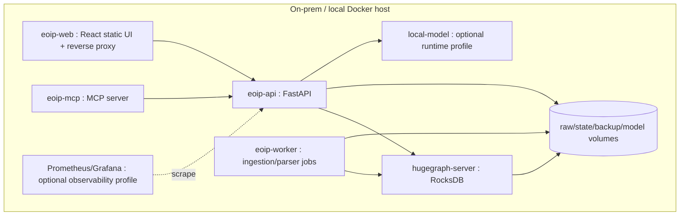

# Deployment Architecture

**Project:** Enterprise Ontology & Intelligence Platform (EOIP)  
**Baseline:** 0.1.0-architecture-baseline  
**Date:** 2026-10-01  
**Status:** Architecture baseline / engineering handoff  
**Purpose:** Define local Docker deployment and network topology

> This document is normative for its scope. Where it conflicts with the master specification, the master non-negotiable constraints win. “MVP” means the Phase 1 integrated vertical slice, not a mock-up.

## Scope and design intent

Security is designed for a local trusted-network MVP without pretending that trusted means safe. The system minimizes exposed ports, runs components least-privileged, protects secrets, validates inputs, prevents prompt/tool injection from bypassing policies, denies outbound enterprise-data egress and records auditable actions.

The runbook assumes a restricted local environment: stage images/models, provision secrets, start Compose, verify readiness/schema, load demo or enterprise mappings, monitor job and graph quality, run smoke queries, back up before destructive maintenance, and capture diagnostics with correlation IDs. Recovery instructions favor replay/idempotency over manual graph surgery.

Scale follows evidence. P1 is single-node RocksDB. Before adopting distributed HStore, measure graph size, write rate, p95/p99, recovery objectives and HA requirements. External API/contracts, canonical IDs and schema manifests are designed so storage topology can change without rewriting clients.

## Architecture decisions

1. **One physical HugeGraph graph in the MVP; multiple logical graph domains.** Jira, code, documentation, CI/CD, provenance, meta, identity and agent/action domains are separated by explicit labels/properties and meta-graph records. This preserves direct cross-domain Gremlin traversal and avoids an artificial cross-database join layer. Physical graph-space separation is a later scaling/isolation option, not an MVP assumption.
2. **HugeGraph is the only mandatory database.** Local files/volumes are used for immutable raw capture, DLQ, checkpoints, configuration, model artifacts and exports; they are not an alternative source-of-truth graph database.
3. **RocksDB standalone mode for the MVP.** It is appropriate for a single-node development/demo vertical slice. HStore/distributed topology is a Phase 7 decision based on measured capacity, HA and scale requirements.
4. **Modular monolith first.** A single Python codebase exposes API, worker and MCP entry points while maintaining strict package boundaries. Separate processes/containers may use the same image. Microservice extraction requires an independently deployable/scalable/security boundary and evidence that the split reduces risk/cost.
5. **No mandatory vector database in Phase 1.** Graph traversal, indexed identifiers, linked document sections and local lexical retrieval prove the platform. A local embedding provider is pluggable; a dedicated vector index becomes optional only after retrieval benchmarks show value.
6. **Deterministic parsing/linking before LLM inference.** Tree-sitter/AST, Git metadata, issue keys, commit SHAs, paths and configured identifiers are primary. Inferred relationships are explicitly marked, scored and evidence-backed.
7. **Safe query compilation.** Natural language produces a typed `QueryPlan`; it never produces directly executable unrestricted Gremlin. The query policy enforces depth/result/timeout/relationship bounds and read-only behavior.
8. **Read-only AI/MCP MVP.** The MVP agent and MCP surface only read/search/analyze. Source-system/code mutations are deferred until human-control and write-tool governance are implemented.
9. **Local model is optional to core graph utility.** The demo can show a local model, but search, path, impact, provenance and graph visualization continue to work when the model is stopped.
10. **No RBAC does not mean no security.** Phase 1 has environment/profile-aware authentication, network isolation, secret handling, audit, input/query/action policy and safe defaults. `/app` vs `/admin` is navigation, never an authorization boundary.

## Applicable requirements

| ID | Requirement | Phase | Completion signal |
|---|---|---|---|
| FR-GRAPH-001 | HugeGraph authoritative store | P1-MVP | All demo graph paths survive service restart. |
| NFR-SEC-001 | No outbound enterprise-data egress | P1-MVP | Demo succeeds with external network disabled. |
| NFR-SEC-006 | Container hardening | P1-MVP | HugeGraph/model not exposed externally by default. |
| NFR-OPS-001 | Structured logging and health | P1-MVP | Failure can be followed by correlation ID. |

## Engineering rules

- Configuration is versioned; secrets are references, never committed values.
- Every persistent fact carries canonical identity and provenance where applicable.
- Every failure path returns a stable error category, logs a correlation ID, and avoids partial silent success.
- MVP behavior must remain functional without an external network and, for graph features, without a local LLM.
- New implementation work must add/adjust automated tests and traceability entries.

## Validation / definition of done

- Normative interfaces are implemented and documented.
- Automated tests mapped to the listed requirement IDs pass.
- Error, security, logging and configuration paths are exercised.
- Acceptance evidence is reproducible from a clean documented environment.
- Deferred capabilities remain behind stable interfaces and are not represented as already implemented.
