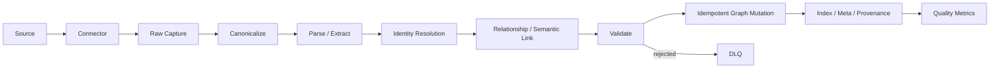

# Ingestion Architecture

**Project:** Enterprise Ontology & Intelligence Platform (EOIP)  
**Baseline:** 0.1.0-architecture-baseline  
**Date:** 2026-10-01  
**Status:** Architecture baseline / engineering handoff  
**Purpose:** Define capture-to-quality pipeline

> This document is normative for its scope. Where it conflicts with the master specification, the master non-negotiable constraints win. “MVP” means the Phase 1 integrated vertical slice, not a mock-up.

## Scope and design intent

The ingestion worker is restart-safe and replayable. Capture precedes mutation; checkpoints advance only after committed graph batches. Mapping/parser failures are isolated to records and recorded in a local DLQ. A dry run executes parsing/mapping/validation without writing graph facts.

All externally ingested facts first become immutable `SourceEvent` envelopes with content hashes. Mappers generate versioned canonical entities and relationships. HugeGraph stores operational truth; local raw capture preserves source fidelity and replay. The canonical model is stable across connector implementations and includes source identity, provenance, creation status, confidence, temporal fields and version metadata.

Validation has pre-mutation hard invariants and post-ingestion soft-quality rules. Findings are first-class records with severity, affected fact, evidence, remediation and run ID. Quality metrics are derived from these facts so dashboards cannot invent “health” percentages.

## Applicable requirements

| ID | Requirement | Phase | Completion signal |
|---|---|---|---|
| FR-INGEST-001 | Raw capture | P1-MVP | Every graph mutation references a captured event. |
| FR-INGEST-002 | Canonicalization | P1-MVP | Same source record maps deterministically for same mapper version. |
| FR-INGEST-003 | Idempotent mutation | P1-MVP | Second identical run does not increase logical entity/edge counts. |
| FR-INGEST-004 | Ingestion job lifecycle | P1-MVP | Admin UI reflects actual backend run state. |
| FR-INGEST-005 | Dead-letter processing | P1-MVP | Rejected records are inspectable and replayable. |

## Engineering rules

- Configuration is versioned; secrets are references, never committed values.
- Every persistent fact carries canonical identity and provenance where applicable.
- Every failure path returns a stable error category, logs a correlation ID, and avoids partial silent success.
- MVP behavior must remain functional without an external network and, for graph features, without a local LLM.
- New implementation work must add/adjust automated tests and traceability entries.

## Validation / definition of done

- Normative interfaces are implemented and documented.
- Automated tests mapped to the listed requirement IDs pass.
- Error, security, logging and configuration paths are exercised.
- Acceptance evidence is reproducible from a clean documented environment.
- Deferred capabilities remain behind stable interfaces and are not represented as already implemented.
