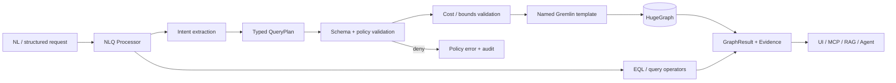

# Query Engine Implementation

**Project:** Enterprise Ontology & Intelligence Platform (EOIP)  
**Baseline:** 0.1.0-architecture-baseline  
**Date:** 2026-10-01  
**Status:** Architecture baseline / engineering handoff  
**Purpose:** Implementation design for QueryPlan and Gremlin templates

> This document is normative for its scope. Where it conflicts with the master specification, the master non-negotiable constraints win. “MVP” means the Phase 1 integrated vertical slice, not a mock-up.

## Scope and design intent

The application exposes domain query services rather than database access. Exact identifier search anchors graph operations. Natural-language interpretation produces a typed QueryPlan, validated against ontology/schema and policy, then executes a named bounded Gremlin template. Depth, edge classes, result size and timeout are explicit inputs with hard maximums.

## NLQ processor design

`packages/eoip/query/nlq.py` provides the public natural-language query processor used by `POST /api/v1/query/nl`.

- It first handles deterministic graph fact questions with EQL (`COUNT`, `DOMAINS`, `LABELS`, `EDGE LABELS`).
- It routes explanatory questions to existing query operators (`WHY`, `WHY NOT`, `WHAT CHANGED`, `CONTEXT`).
- It delegates traversal/search questions to `packages/eoip/query/nl.py`, which compiles natural language into bounded `QueryPlan` objects.
- It executes plans only through `QueryExecutor`, so query policy limits still control depth, result count, timeout and relationship bounds.
- It composes deterministic answer text from the returned graph facts and includes confidence, highlights, warnings and follow-up suggestions.
- It uses graph-domain search fallback only for unresolved questions containing graph concepts, keeping unrelated questions in clarification mode.

## Applicable requirements

| ID | Requirement | Phase | Completion signal |
|---|---|---|---|
| FR-QUERY-001 | Structured QueryPlan | P1-MVP | All NL and structured requests compile to validated QueryPlan. |
| FR-QUERY-002 | Path query | P1-MVP | Demo Jira-to-function path returns expected ordered edges. |
| FR-QUERY-003 | Impact analysis | P1-MVP | Demo function change returns expected dependents with paths. |
| FR-GRAPH-007 | Gremlin repository | P1-MVP | No UI/agent endpoint can execute arbitrary mutation Gremlin. |

## Engineering rules

- Configuration is versioned; secrets are references, never committed values.
- Every persistent fact carries canonical identity and provenance where applicable.
- Every failure path returns a stable error category, logs a correlation ID, and avoids partial silent success.
- MVP behavior must remain functional without an external network and, for graph features, without a local LLM.
- New implementation work must add/adjust automated tests and traceability entries.

## Validation / definition of done

- Normative interfaces are implemented and documented.
- Automated tests mapped to the listed requirement IDs pass.
- Error, security, logging and configuration paths are exercised.
- Acceptance evidence is reproducible from a clean documented environment.
- Deferred capabilities remain behind stable interfaces and are not represented as already implemented.
