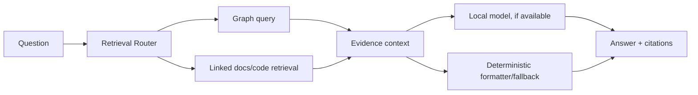

# RAG Architecture

**Project:** Enterprise Ontology & Intelligence Platform (EOIP)  
**Baseline:** 0.1.0-architecture-baseline  
**Date:** 2026-10-01  
**Status:** Architecture baseline / engineering handoff  
**Purpose:** Define modular graph-first local RAG

> This document is normative for its scope. Where it conflicts with the master specification, the master non-negotiable constraints win. “MVP” means the Phase 1 integrated vertical slice, not a mock-up.

## Scope and design intent

RAG is a retrieval framework, not a synonym for vector search. The MVP retrieval router chooses direct graph, linked code/doc context or graph+text hybrid based on intent. A local model may synthesize an answer, but the evidence package is independently returned. Advanced CRAG/Self-RAG/Adaptive/Agentic/Multi-hop strategies are plugins evaluated in P3.

The application exposes domain query services rather than database access. Exact identifier search anchors graph operations. Natural-language interpretation produces a typed QueryPlan, validated against ontology/schema and policy, then executes a named bounded Gremlin template. Depth, edge classes, result size and timeout are explicit inputs with hard maximums.

The local model provider is behind a small generation/embedding interface. The recommended demo profile can use a locally hosted runtime such as Ollama or another approved OpenAI-compatible endpoint on the Docker network. Model choice is configuration, not an architecture dependency; no enterprise payload is routed externally in MVP.

## Applicable requirements

| ID | Requirement | Phase | Completion signal |
|---|---|---|---|
| FR-RAG-001 | Retrieval router | P1-MVP | Known MVP questions route without external service. |
| FR-RAG-002 | GraphRAG evidence retrieval | P1-MVP | Demo GraphRAG answer cites graph/source references. |
| FR-RAG-003 | Local model abstraction | P1-MVP | Core search/path/impact remains usable with model service stopped. |
| FR-RAG-004 | No mandatory vector DB in MVP | P1-MVP | MVP starts and demos without vector database. |
| FR-RAG-005 | RAG evaluation harness | P1-MVP | Baseline report is reproducible locally. |
| FR-RAG-006 | Adaptive RAG strategy framework | P3 | P3 can add strategy plugin without changing callers. |

## Engineering rules

- Configuration is versioned; secrets are references, never committed values.
- Every persistent fact carries canonical identity and provenance where applicable.
- Every failure path returns a stable error category, logs a correlation ID, and avoids partial silent success.
- MVP behavior must remain functional without an external network and, for graph features, without a local LLM.
- New implementation work must add/adjust automated tests and traceability entries.

## Validation / definition of done

- Normative interfaces are implemented and documented.
- Automated tests mapped to the listed requirement IDs pass.
- Error, security, logging and configuration paths are exercised.
- Acceptance evidence is reproducible from a clean documented environment.
- Deferred capabilities remain behind stable interfaces and are not represented as already implemented.
