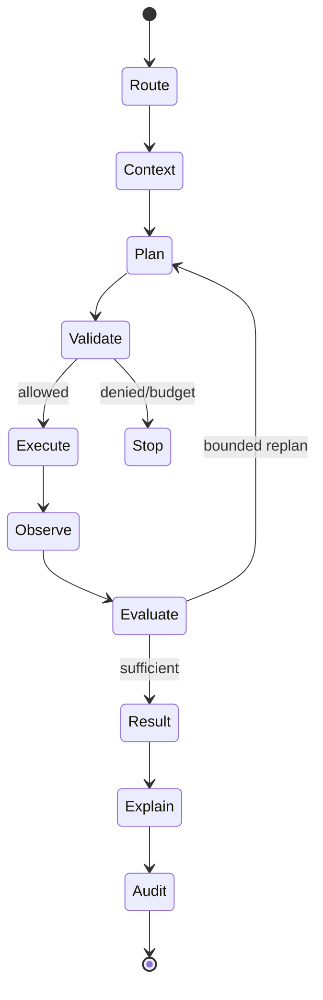

# Agent Architecture

**Project:** Enterprise Ontology & Intelligence Platform (EOIP)  
**Baseline:** 0.1.0-architecture-baseline  
**Date:** 2026-10-01  
**Status:** Architecture baseline / engineering handoff  
**Purpose:** Define bounded enterprise agent runtime

> This document is normative for its scope. Where it conflicts with the master specification, the master non-negotiable constraints win. “MVP” means the Phase 1 integrated vertical slice, not a mock-up.

## Scope and design intent

The MVP agent is `TraceImpactAgent`, a bounded read-only workflow. It composes search, path, impact and evidence retrieval tools and may use the local model only to interpret/summarize. Tool allowlists, step/time budgets and a circuit breaker prevent open-ended autonomy. Self-modification and write actions are deliberately absent.

Human-control acronyms in the source specification are treated as platform-defined policy vocabulary unless an external standard is explicitly cited. They map to concrete dimensions—initiator, approver, supervisor, intervention timing, risk, reversibility, timeout and evidence. Phase 1 is effectively human-commanded/read-only for actions; richer policies arrive in P6.

Explainability is evidence-centric. The platform exposes source facts, graph paths, retrieval context, rule decisions, tool invocations, confidence/uncertainty and concise decision summaries. It neither requests nor stores hidden model chain-of-thought.

## Applicable requirements

| ID | Requirement | Phase | Completion signal |
|---|---|---|---|
| FR-AGENT-001 | Agent contract | P1-MVP | Every enabled agent has a validated contract. |
| FR-AGENT-002 | Bounded agent runtime | P1-MVP | Agent cannot exceed configured execution envelope. |
| FR-AGENT-003 | TraceImpact agent | P1-MVP | Same demo question works via UI/API/MCP context. |
| FR-AGENT-004 | Write/action approval boundary | P1-MVP | No MVP agent can mutate source systems or code. |
| FR-AGENT-005 | Controlled self-modification | P8+ | No production self-modification path exists before P8+. |

## Engineering rules

- Configuration is versioned; secrets are references, never committed values.
- Every persistent fact carries canonical identity and provenance where applicable.
- Every failure path returns a stable error category, logs a correlation ID, and avoids partial silent success.
- MVP behavior must remain functional without an external network and, for graph features, without a local LLM.
- New implementation work must add/adjust automated tests and traceability entries.

## Validation / definition of done

- Normative interfaces are implemented and documented.
- Automated tests mapped to the listed requirement IDs pass.
- Error, security, logging and configuration paths are exercised.
- Acceptance evidence is reproducible from a clean documented environment.
- Deferred capabilities remain behind stable interfaces and are not represented as already implemented.
