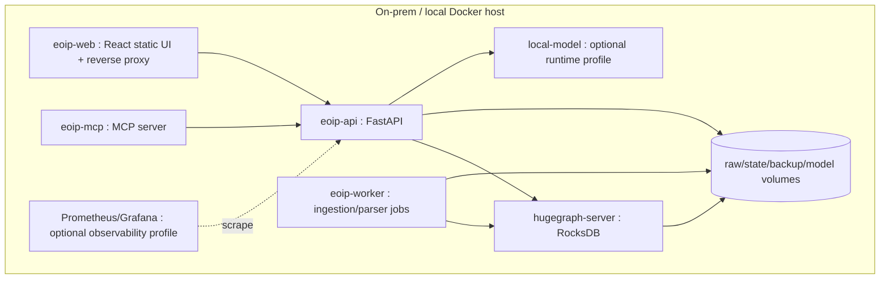

# Docker Deployment

**Project:** Enterprise Ontology & Intelligence Platform (EOIP)  
**Baseline:** 0.1.0-architecture-baseline  
**Date:** 2026-10-01  
**Status:** Architecture baseline / engineering handoff  
**Purpose:** Define Docker Compose, profiles, volumes and networks

> This document is normative for its scope. Where it conflicts with the master specification, the master non-negotiable constraints win. “MVP” means the Phase 1 integrated vertical slice, not a mock-up.

## Scope and design intent

The runbook assumes a restricted local environment: stage images/models, provision secrets, start Compose, verify readiness/schema, load demo or enterprise mappings, monitor job and graph quality, run smoke queries, back up before destructive maintenance, and capture diagnostics with correlation IDs. Recovery instructions favor replay/idempotency over manual graph surgery.

Security is designed for a local trusted-network MVP without pretending that trusted means safe. The system minimizes exposed ports, runs components least-privileged, protects secrets, validates inputs, prevents prompt/tool injection from bypassing policies, denies outbound enterprise-data egress and records auditable actions.

## Applicable requirements

| ID | Requirement | Phase | Completion signal |
|---|---|---|---|
| FR-GRAPH-001 | HugeGraph authoritative store | P1-MVP | All demo graph paths survive service restart. |
| NFR-SEC-001 | No outbound enterprise-data egress | P1-MVP | Demo succeeds with external network disabled. |
| NFR-SEC-006 | Container hardening | P1-MVP | HugeGraph/model not exposed externally by default. |
| NFR-OPS-001 | Structured logging and health | P1-MVP | Failure can be followed by correlation ID. |

## Engineering rules

- Configuration is versioned; secrets are references, never committed values.
- Every persistent fact carries canonical identity and provenance where applicable.
- Every failure path returns a stable error category, logs a correlation ID, and avoids partial silent success.
- MVP behavior must remain functional without an external network and, for graph features, without a local LLM.
- New implementation work must add/adjust automated tests and traceability entries.

## Validation / definition of done

- Normative interfaces are implemented and documented.
- Automated tests mapped to the listed requirement IDs pass.
- Error, security, logging and configuration paths are exercised.
- Acceptance evidence is reproducible from a clean documented environment.
- Deferred capabilities remain behind stable interfaces and are not represented as already implemented.
