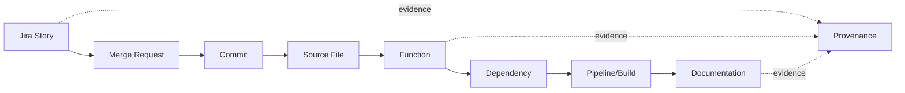

# Demo Playbook

**Project:** Enterprise Ontology & Intelligence Platform (EOIP)  
**Baseline:** 0.1.0-architecture-baseline  
**Date:** 2026-10-01  
**Status:** Architecture baseline / engineering handoff  
**Purpose:** Define the repeatable MVP demonstration

> This document is normative for its scope. Where it conflicts with the master specification, the master non-negotiable constraints win. “MVP” means the Phase 1 integrated vertical slice, not a mock-up.

## Scope and design intent

Phase 1 proves one end-to-end vertical slice rather than breadth. Jira JSON, local Git/GitLab-style metadata, Python/TypeScript code and linked documentation are sufficient to prove ingestion, canonicalization, code parsing, cross-domain linking, provenance, validation, query, GraphRAG, UI, VS Code, MCP, observability and recovery. Confluence, ServiceNow, sophisticated temporal reconstruction, many RAG variants, distributed HugeGraph and write-capable agents are deferred with interfaces prepared now.

The user experience has Simple, Advanced, Graph, Developer and Architecture modes over the same API contracts. Search, node/edge details, evidence, path and impact are primary. Graph expansion is server-bounded to protect the browser and graph database.

The extension is context-aware but read-only in Phase 1. It maps workspace/repository/path/current symbol to canonical graph entities, then displays Jira origin, commits, callers/callees/dependencies, related docs, provenance and impact. Failure to reach EOIP never blocks normal editing.

MCP is an interface, not an authority boundary. The MCP server calls the same application/query policy as REST. Phase 1 advertises read-only search/entity/path/impact/code/Jira/document/lineage/evidence tools. Write/action tools are a separate future registry with human approval and are not advertised in the MVP.

## Applicable requirements

| ID | Requirement | Phase | Completion signal |
|---|---|---|---|
| FR-GRAPH-006 | Cross-domain bridge edges | P1-MVP | Jira→MR→Commit→File→Function→Dependency→Pipeline→Doc path is traversable. |
| FR-QUERY-002 | Path query | P1-MVP | Demo Jira-to-function path returns expected ordered edges. |
| FR-QUERY-003 | Impact analysis | P1-MVP | Demo function change returns expected dependents with paths. |
| FR-RAG-002 | GraphRAG evidence retrieval | P1-MVP | Demo GraphRAG answer cites graph/source references. |
| FR-VSCODE-001 | VS Code context extension | P1-MVP | Opening demo function retrieves correct graph context. |
| FR-MCP-001 | MCP read server | P1-MVP | MCP returns same graph evidence as REST for demo case. |

## Engineering rules

- Configuration is versioned; secrets are references, never committed values.
- Every persistent fact carries canonical identity and provenance where applicable.
- Every failure path returns a stable error category, logs a correlation ID, and avoids partial silent success.
- MVP behavior must remain functional without an external network and, for graph features, without a local LLM.
- New implementation work must add/adjust automated tests and traceability entries.

## Validation / definition of done

- Normative interfaces are implemented and documented.
- Automated tests mapped to the listed requirement IDs pass.
- Error, security, logging and configuration paths are exercised.
- Acceptance evidence is reproducible from a clean documented environment.
- Deferred capabilities remain behind stable interfaces and are not represented as already implemented.
