# Architecture Diagram Catalog

**Project:** Enterprise Ontology & Intelligence Platform (EOIP)  
**Baseline:** 0.1.0-architecture-baseline  
**Date:** 2026-10-01  
**Status:** Architecture baseline / engineering handoff  
**Purpose:** All Mermaid diagrams requested by the master specification

> This document is normative for its scope. Where it conflicts with the master specification, the master non-negotiable constraints win. “MVP” means the Phase 1 integrated vertical slice, not a mock-up.

## 01-system-context

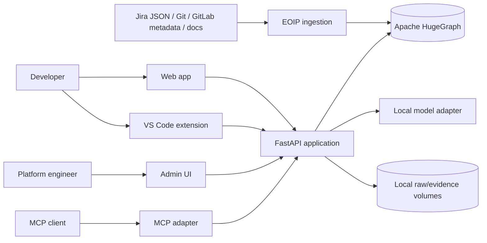

## 02-container-architecture

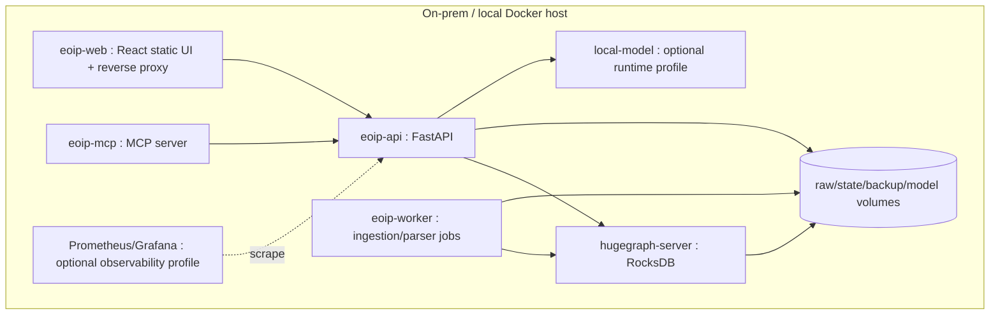

## 03-ingestion-pipeline

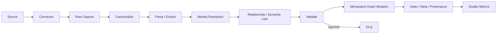

## 04-enterprise-graph-architecture

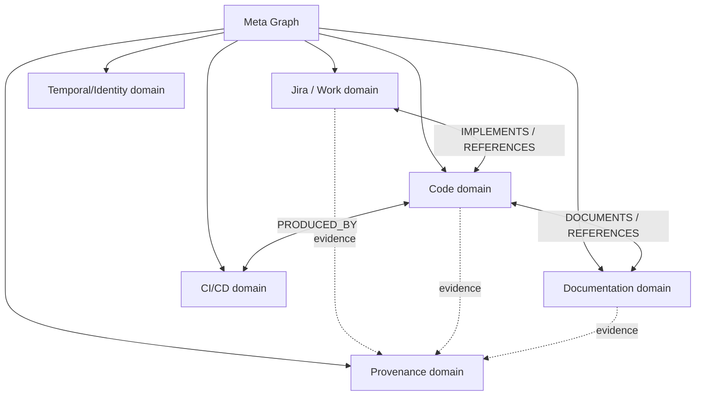

## 05-meta-graph

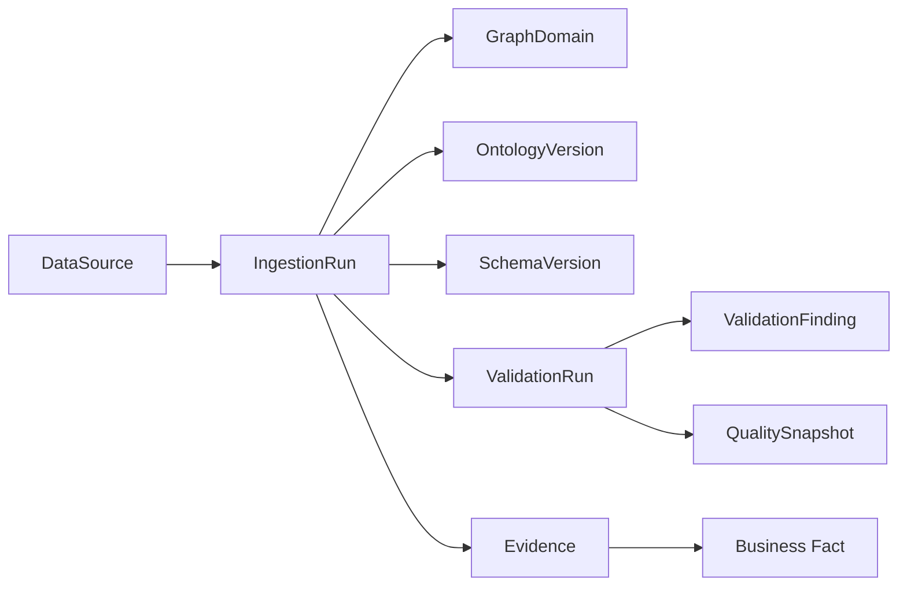

## 06-code-graph

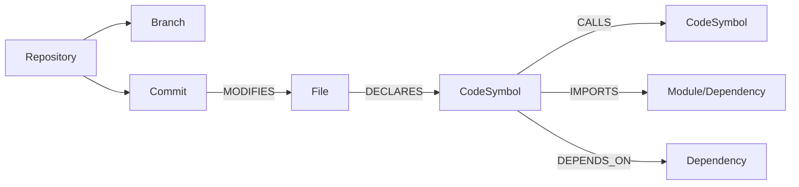

## 07-cross-domain-relationship-graph

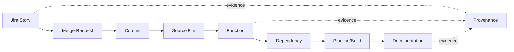

## 08-query-execution

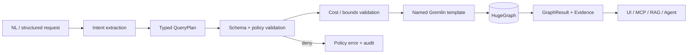

## 09-graphrag

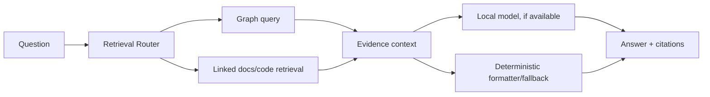

## 10-agent-runtime

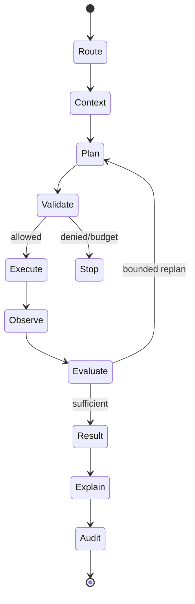

## 11-multi-agent-orchestration

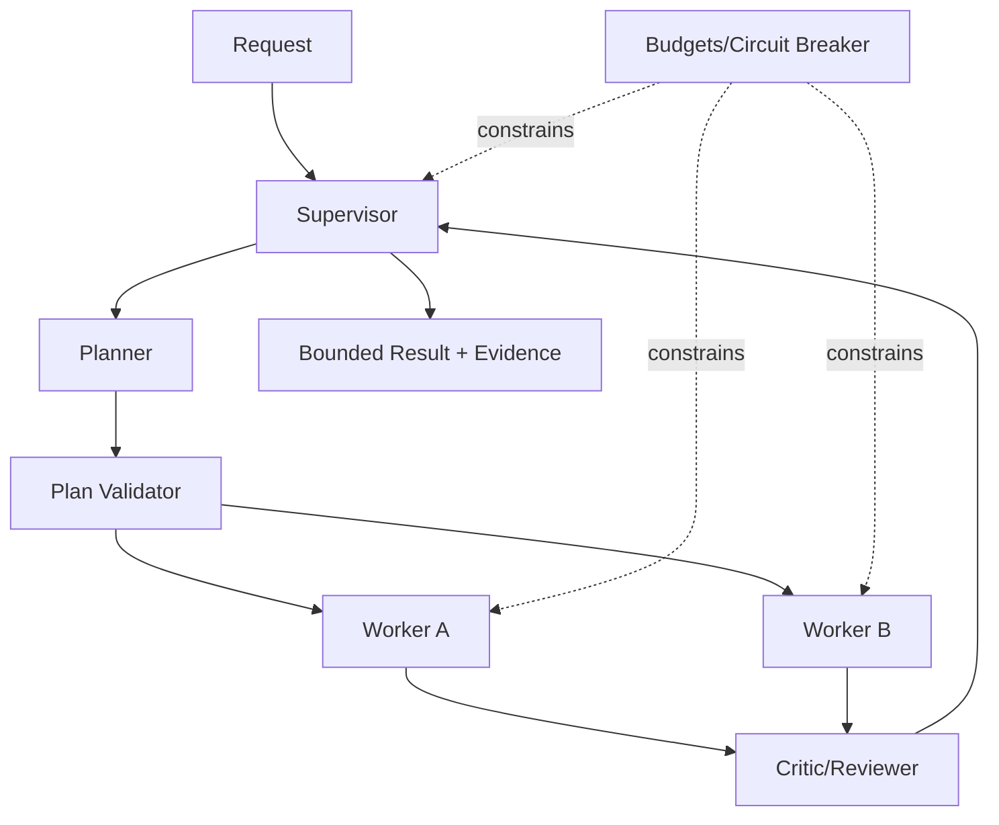

## 12-mcp-architecture

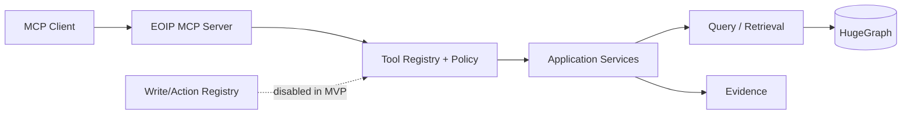

## 13-human-control-architecture

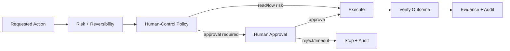

## 14-web-ui-architecture

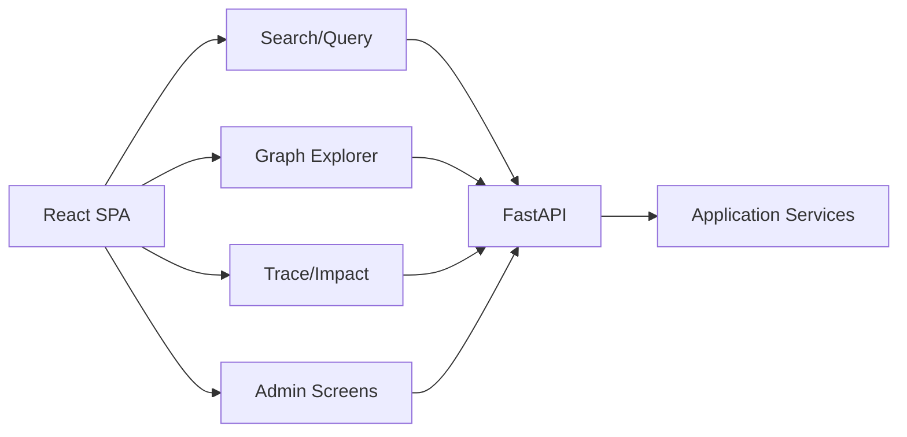

## 15-vscode-architecture

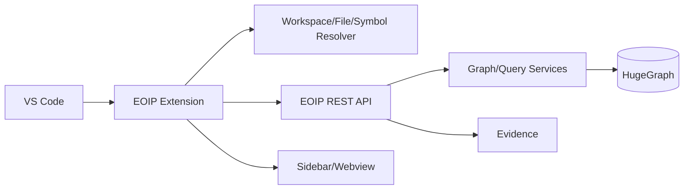

## 16-deployment

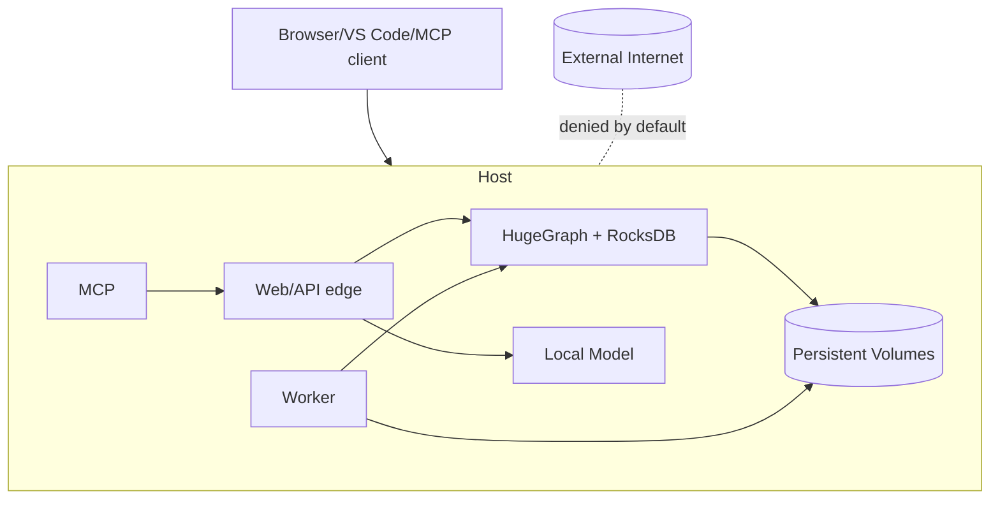

## 17-mvp-e2e-flow

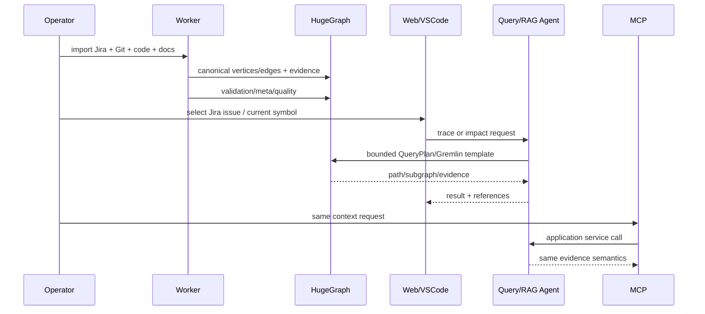
