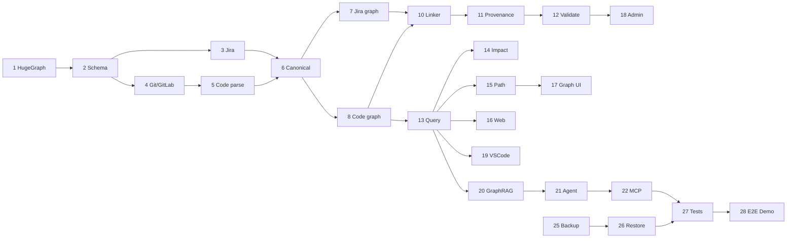

# MVP Implementation Plan

**Project:** Enterprise Ontology & Intelligence Platform (EOIP)  
**Baseline:** 0.1.0-architecture-baseline  
**Date:** 2026-10-01  
**Status:** Architecture baseline / engineering handoff  
**Purpose:** Build-order plan for the fully integrated Phase 1 vertical slice

> This document is normative for its scope. Where it conflicts with the master specification, the master non-negotiable constraints win. “MVP” means the Phase 1 integrated vertical slice, not a mock-up.

## Architecture baseline


## Architecture decisions

1. **One physical HugeGraph graph in the MVP; multiple logical graph domains.** Jira, code, documentation, CI/CD, provenance, meta, identity and agent/action domains are separated by explicit labels/properties and meta-graph records. This preserves direct cross-domain Gremlin traversal and avoids an artificial cross-database join layer. Physical graph-space separation is a later scaling/isolation option, not an MVP assumption.
2. **HugeGraph is the only mandatory database.** Local files/volumes are used for immutable raw capture, DLQ, checkpoints, configuration, model artifacts and exports; they are not an alternative source-of-truth graph database.
3. **RocksDB standalone mode for the MVP.** It is appropriate for a single-node development/demo vertical slice. HStore/distributed topology is a Phase 7 decision based on measured capacity, HA and scale requirements.
4. **Modular monolith first.** A single Python codebase exposes API, worker and MCP entry points while maintaining strict package boundaries. Separate processes/containers may use the same image. Microservice extraction requires an independently deployable/scalable/security boundary and evidence that the split reduces risk/cost.
5. **No mandatory vector database in Phase 1.** Graph traversal, indexed identifiers, linked document sections and local lexical retrieval prove the platform. A local embedding provider is pluggable; a dedicated vector index becomes optional only after retrieval benchmarks show value.
6. **Deterministic parsing/linking before LLM inference.** Tree-sitter/AST, Git metadata, issue keys, commit SHAs, paths and configured identifiers are primary. Inferred relationships are explicitly marked, scored and evidence-backed.
7. **Safe query compilation.** Natural language produces a typed `QueryPlan`; it never produces directly executable unrestricted Gremlin. The query policy enforces depth/result/timeout/relationship bounds and read-only behavior.
8. **Read-only AI/MCP MVP.** The MVP agent and MCP surface only read/search/analyze. Source-system/code mutations are deferred until human-control and write-tool governance are implemented.
9. **Local model is optional to core graph utility.** The demo can show a local model, but search, path, impact, provenance and graph visualization continue to work when the model is stopped.
10. **No RBAC does not mean no security.** Phase 1 has environment/profile-aware authentication, network isolation, secret handling, audit, input/query/action policy and safe defaults. `/app` vs `/admin` is navigation, never an authorization boundary.


## Repository structure

```text
eoip/
├─ apps/
│  ├─ api/                 # FastAPI composition root
│  ├─ worker/              # ingestion/parse job entry point
│  ├─ mcp/                 # MCP façade
│  ├─ web/                 # React/TypeScript SPA
│  └─ vscode-extension/    # VS Code extension
├─ packages/
│  ├─ contracts/           # Pydantic/versioned JSON contracts
│  ├─ connectors/          # SDK + jira/git/gitlab/file adapters
│  ├─ ingestion/           # capture/canonicalize/checkpoint/DLQ
│  ├─ ontology/            # ontology vocabulary + schema manifest
│  ├─ graph/               # HugeGraph client/schema/mutations
│  ├─ codegraph/           # parser plugins + symbol graph
│  ├─ identity/            # resolution policies
│  ├─ provenance/          # evidence/lineage
│  ├─ validation/          # rule engine + quality metrics
│  ├─ query/               # QueryPlan, policy, Gremlin templates
│  ├─ retrieval/           # RAG router/context builder
│  ├─ models/              # local model abstraction
│  ├─ agents/              # registry/runtime/TraceImpact agent
│  ├─ audit/               # audit event sink/redaction
│  └─ observability/       # logs/metrics/tracing helpers
├─ config/
│  ├─ ontology/
│  ├─ mappings/
│  ├─ query-policies/
│  └─ agents/
├─ deploy/
│  ├─ docker-compose.yml
│  ├─ docker-compose.observability.yml
│  └─ secrets.example/
├─ examples/
│  ├─ jira/
│  ├─ gitlab/
│  └─ demo-repo/
├─ tests/
│  ├─ unit/ contract/ integration/ e2e/ security/ performance/
├─ scripts/
│  ├─ bootstrap_schema.py
│  ├─ backup.py
│  ├─ restore.py
│  └─ demo_reset.py
└─ docs/
```

## Service boundaries


| Runtime | Responsibility | Public exposure | Persistent state |
|---|---|---|---|
| `eoip-web` | Serve React SPA, route `/app/*` and `/admin/*`, reverse proxy API | localhost / controlled LAN | none |
| `eoip-api` | Application/query/search/validation/RAG/agent APIs | via web proxy | none except mounted config |
| `eoip-worker` | Connectors, raw capture, code parsing, mutation, validation jobs | none | raw/DLQ/checkpoint volumes + graph |
| `eoip-mcp` | Read-only MCP façade over application services | localhost/configured | none |
| `hugegraph-server` | Authoritative property graph + RocksDB | internal Docker network only | HugeGraph/RocksDB volume |
| `local-model` | Optional local generation/embedding provider | internal Docker network only | model cache/artifacts |
| `prometheus/grafana` | Optional metrics profile | localhost only | optional volumes |


## Build dependency graph



## Implementation tasks

### T01 — HugeGraph foundation
**Maps to:** MVP-FR-001; FR-GRAPH-001  
**Objective:** Implement apache hugegraph local docker as production-oriented MVP capability.  
**Dependencies:** None  
**Files/modules:** `deploy/docker-compose.yml`, `deploy/hugegraph/`, `scripts/wait_for_hugegraph.py`  
**Interfaces:** HugeGraph REST/Gremlin internal endpoint  
**Implementation steps:**
1. Pin HugeGraph release/image for the implementation baseline.
2. Configure RocksDB volume and internal-only network.
3. Enable configured auth profile and health check.
4. Prove persistence across container restart.
**Tests:** Startup and persistence tests..  
**Acceptance criteria:** MVP-FR-001 acceptance in `MVP-requirements.md` plus all parent requirement completion signals.  
**Expected output:** Versioned code/config/tests and reproducible evidence for T01.  
**Failure handling:** Fail explicitly with stable error category/correlation ID; preserve last committed graph state; checkpoint/retry only when safe; never substitute mock domain data.

### T02 — Schema bootstrap
**Maps to:** MVP-FR-002; FR-GRAPH-003  
**Objective:** Implement automatic graph schema initialization as production-oriented MVP capability.  
**Dependencies:** T01  
**Files/modules:** `packages/ontology/schema_manifest.py`, `packages/graph/schema_bootstrap.py`, `scripts/bootstrap_schema.py`  
**Interfaces:** HugeGraph schema REST client  
**Implementation steps:**
1. Encode property/vertex/edge/index manifest.
2. Implement compare-and-apply idempotent bootstrap.
3. Record schema and ontology version meta nodes.
4. Fail safely on incompatible change.
**Tests:** Fresh/repeat/incompatible schema tests..  
**Acceptance criteria:** MVP-FR-002 acceptance in `MVP-requirements.md` plus all parent requirement completion signals.  
**Expected output:** Versioned code/config/tests and reproducible evidence for T02.  
**Failure handling:** Fail explicitly with stable error category/correlation ID; preserve last committed graph state; checkpoint/retry only when safe; never substitute mock domain data.

### T03 — Jira JSON connector
**Maps to:** MVP-FR-003; FR-CONN-002  
**Objective:** Implement jira json ingestion as production-oriented MVP capability.  
**Dependencies:** T02  
**Files/modules:** `packages/connectors/jira_json.py`, `config/mappings/jira-mvp.yaml`, `examples/jira/sample-jira.json`  
**Interfaces:** Connector SDK, SourceEvent v1  
**Implementation steps:**
1. Define canonical expected Jira schema and mapping aliases.
2. Capture raw events before mapping.
3. Map project/work item/person fields.
4. Quarantine malformed records and record counts.
**Tests:** Fixture, malformed, duplicate, resume tests..  
**Acceptance criteria:** MVP-FR-003 acceptance in `MVP-requirements.md` plus all parent requirement completion signals.  
**Expected output:** Versioned code/config/tests and reproducible evidence for T03.  
**Failure handling:** Fail explicitly with stable error category/correlation ID; preserve last committed graph state; checkpoint/retry only when safe; never substitute mock domain data.

### T04 — Git/GitLab ingestion
**Maps to:** MVP-FR-004; FR-CONN-003, FR-CONN-004  
**Objective:** Implement git repository/gitlab ingestion as production-oriented MVP capability.  
**Dependencies:** T02  
**Files/modules:** `packages/connectors/git_local.py`, `packages/connectors/gitlab.py`, `examples/gitlab/`  
**Interfaces:** Connector SDK, local git executable/library  
**Implementation steps:**
1. Scan local repo refs/commits/changed files.
2. Load MR/pipeline fixture and optional on-prem endpoint adapter.
3. Extract issue keys/commit SHA links deterministically.
4. Checkpoint source versions.
**Tests:** Temporary repository integration tests.; Mock API and fixture contract tests..  
**Acceptance criteria:** MVP-FR-004 acceptance in `MVP-requirements.md` plus all parent requirement completion signals.  
**Expected output:** Versioned code/config/tests and reproducible evidence for T04.  
**Failure handling:** Fail explicitly with stable error category/correlation ID; preserve last committed graph state; checkpoint/retry only when safe; never substitute mock domain data.

### T05 — Code parsing
**Maps to:** MVP-FR-005; FR-CODE-001, FR-CODE-002  
**Objective:** Implement code parsing as production-oriented MVP capability.  
**Dependencies:** T04  
**Files/modules:** `packages/codegraph/parser.py`, `packages/codegraph/languages/python.py`, `packages/codegraph/languages/typescript.py`  
**Interfaces:** Parser plugin contract  
**Implementation steps:**
1. Add Tree-sitter grammar adapters.
2. Extract files/symbols/ranges/imports/calls.
3. Preserve parser version and parse findings.
4. Do not infer dynamic calls as facts.
**Tests:** Golden parser fixtures.; Language-specific fixtures..  
**Acceptance criteria:** MVP-FR-005 acceptance in `MVP-requirements.md` plus all parent requirement completion signals.  
**Expected output:** Versioned code/config/tests and reproducible evidence for T05.  
**Failure handling:** Fail explicitly with stable error category/correlation ID; preserve last committed graph state; checkpoint/retry only when safe; never substitute mock domain data.

### T06 — Canonical model
**Maps to:** MVP-FR-006; FR-INGEST-002, FR-GRAPH-004  
**Objective:** Implement canonical entity generation as production-oriented MVP capability.  
**Dependencies:** T03, T04, T05  
**Files/modules:** `packages/contracts/canonical.py`, `packages/ingestion/canonicalize.py`  
**Interfaces:** NormalizedEntity v1, NormalizedRelationship v1  
**Implementation steps:**
1. Version canonical ID namespace.
2. Normalize shared properties and evidence references.
3. Create deterministic edge keys.
4. Add collision/duplicate detection.
**Tests:** Golden mapping tests.; Collision/idempotency tests..  
**Acceptance criteria:** MVP-FR-006 acceptance in `MVP-requirements.md` plus all parent requirement completion signals.  
**Expected output:** Versioned code/config/tests and reproducible evidence for T06.  
**Failure handling:** Fail explicitly with stable error category/correlation ID; preserve last committed graph state; checkpoint/retry only when safe; never substitute mock domain data.

### T07 — Jira graph
**Maps to:** MVP-FR-007; FR-ONTO-001, FR-GRAPH-002  
**Objective:** Implement jira graph as production-oriented MVP capability.  
**Dependencies:** T06  
**Files/modules:** `packages/ontology/work.py`, `packages/graph/mutations.py`  
**Interfaces:** GraphMutation v1  
**Implementation steps:**
1. Upsert Project/WorkItem/Person vertices.
2. Write containment/assignment/reference edges.
3. Attach domain/provenance/meta edges.
**Tests:** Ontology conformance tests.; Domain integrity tests..  
**Acceptance criteria:** MVP-FR-007 acceptance in `MVP-requirements.md` plus all parent requirement completion signals.  
**Expected output:** Versioned code/config/tests and reproducible evidence for T07.  
**Failure handling:** Fail explicitly with stable error category/correlation ID; preserve last committed graph state; checkpoint/retry only when safe; never substitute mock domain data.

### T08 — Code graph
**Maps to:** MVP-FR-008; FR-CODE-001, FR-CODE-004  
**Objective:** Implement code graph as production-oriented MVP capability.  
**Dependencies:** T06  
**Files/modules:** `packages/ontology/code.py`, `packages/codegraph/mutations.py`  
**Interfaces:** GraphMutation v1  
**Implementation steps:**
1. Upsert repository/ref/commit/file/symbol/dependency vertices.
2. Write DECLARES/CALLS/IMPORTS/DEPENDS_ON/MODIFIES edges.
3. Attach source locations/evidence.
**Tests:** Golden parser fixtures.; Static-call fixtures..  
**Acceptance criteria:** MVP-FR-008 acceptance in `MVP-requirements.md` plus all parent requirement completion signals.  
**Expected output:** Versioned code/config/tests and reproducible evidence for T08.  
**Failure handling:** Fail explicitly with stable error category/correlation ID; preserve last committed graph state; checkpoint/retry only when safe; never substitute mock domain data.

### T09 — Meta graph
**Maps to:** MVP-FR-009; FR-GRAPH-005  
**Objective:** Implement meta graph as production-oriented MVP capability.  
**Dependencies:** T02, T07, T08  
**Files/modules:** `packages/ontology/meta.py`, `packages/ingestion/job_state.py`  
**Interfaces:** IngestionRun, GraphDomain, OntologyVersion  
**Implementation steps:**
1. Create data-source/domain/version/run nodes.
2. Record counts/checkpoint/status/timings.
3. Link mutations to ingestion runs/domains.
**Tests:** Meta traversal tests..  
**Acceptance criteria:** MVP-FR-009 acceptance in `MVP-requirements.md` plus all parent requirement completion signals.  
**Expected output:** Versioned code/config/tests and reproducible evidence for T09.  
**Failure handling:** Fail explicitly with stable error category/correlation ID; preserve last committed graph state; checkpoint/retry only when safe; never substitute mock domain data.

### T10 — Cross-domain semantic linker
**Maps to:** MVP-FR-010; FR-GRAPH-006  
**Objective:** Implement cross-graph linking as production-oriented MVP capability.  
**Dependencies:** T07, T08  
**Files/modules:** `packages/ingestion/linkers/issue_code.py`  
**Interfaces:** NormalizedRelationship v1  
**Implementation steps:**
1. Link issue keys found in branch/MR/commit metadata.
2. Link commits to changed files/symbols.
3. Link pipeline/docs fixtures.
4. Store DETERMINISTIC vs INFERRED creation status.
**Tests:** Synthetic E2E path assertions..  
**Acceptance criteria:** MVP-FR-010 acceptance in `MVP-requirements.md` plus all parent requirement completion signals.  
**Expected output:** Versioned code/config/tests and reproducible evidence for T10.  
**Failure handling:** Fail explicitly with stable error category/correlation ID; preserve last committed graph state; checkpoint/retry only when safe; never substitute mock domain data.

### T11 — Provenance
**Maps to:** MVP-FR-011; FR-PROV-001, FR-PROV-002  
**Objective:** Implement provenance as production-oriented MVP capability.  
**Dependencies:** T03, T04, T05, T10  
**Files/modules:** `packages/provenance/evidence.py`, `packages/provenance/lineage.py`  
**Interfaces:** Evidence v1  
**Implementation steps:**
1. Hash raw source events.
2. Create evidence references for canonical facts.
3. Expose reverse lineage to source/run/version.
4. Compute provenance coverage.
**Tests:** Provenance coverage tests.; Lineage API E2E..  
**Acceptance criteria:** MVP-FR-011 acceptance in `MVP-requirements.md` plus all parent requirement completion signals.  
**Expected output:** Versioned code/config/tests and reproducible evidence for T11.  
**Failure handling:** Fail explicitly with stable error category/correlation ID; preserve last committed graph state; checkpoint/retry only when safe; never substitute mock domain data.

### T12 — Validation and quality
**Maps to:** MVP-FR-012; FR-VALID-001, FR-VALID-002  
**Objective:** Implement graph validation as production-oriented MVP capability.  
**Dependencies:** T07, T08, T09, T11  
**Files/modules:** `packages/validation/rules/`, `packages/validation/engine.py`, `packages/validation/quality.py`  
**Interfaces:** ValidationRun/Finding  
**Implementation steps:**
1. Implement hard endpoint/domain/type/provenance checks.
2. Implement orphan/duplicate/stale/disconnected soft rules.
3. Persist findings and metric snapshots.
**Tests:** Seeded-invalid-graph tests.; Hard/soft rule tests..  
**Acceptance criteria:** MVP-FR-012 acceptance in `MVP-requirements.md` plus all parent requirement completion signals.  
**Expected output:** Versioned code/config/tests and reproducible evidence for T12.  
**Failure handling:** Fail explicitly with stable error category/correlation ID; preserve last committed graph state; checkpoint/retry only when safe; never substitute mock domain data.

### T13 — Query API
**Maps to:** MVP-FR-013; FR-QUERY-001, FR-QUERY-006  
**Objective:** Implement query api as production-oriented MVP capability.  
**Dependencies:** T07, T08, T09, T11  
**Files/modules:** `packages/query/plan.py`, `packages/query/policy.py`, `packages/query/templates.py`, `apps/api/routes/query.py`  
**Interfaces:** QueryPlan v1, GraphResult v1  
**Implementation steps:**
1. Define intent/anchor/filter/depth/limit schemas.
2. Implement policy maximums and read-only template registry.
3. Return evidence/correlation IDs.
4. Generate OpenAPI.
**Tests:** Schema/property-based tests.; Boundary/fuzz tests..  
**Acceptance criteria:** MVP-FR-013 acceptance in `MVP-requirements.md` plus all parent requirement completion signals.  
**Expected output:** Versioned code/config/tests and reproducible evidence for T13.  
**Failure handling:** Fail explicitly with stable error category/correlation ID; preserve last committed graph state; checkpoint/retry only when safe; never substitute mock domain data.

### T14 — Impact analysis
**Maps to:** MVP-FR-014; FR-QUERY-003  
**Objective:** Implement impact analysis query as production-oriented MVP capability.  
**Dependencies:** T13  
**Files/modules:** `packages/query/impact.py`  
**Interfaces:** POST /api/v1/impact  
**Implementation steps:**
1. Define impact edge allowlist/direction policy.
2. Implement bounded cycle-safe traversal.
3. Rank results by path/evidence.
4. Return partial marker on timeout.
**Tests:** Cyclic graph and golden blast-radius tests..  
**Acceptance criteria:** MVP-FR-014 acceptance in `MVP-requirements.md` plus all parent requirement completion signals.  
**Expected output:** Versioned code/config/tests and reproducible evidence for T14.  
**Failure handling:** Fail explicitly with stable error category/correlation ID; preserve last committed graph state; checkpoint/retry only when safe; never substitute mock domain data.

### T15 — Path query
**Maps to:** MVP-FR-015; FR-QUERY-002  
**Objective:** Implement path query as production-oriented MVP capability.  
**Dependencies:** T13  
**Files/modules:** `packages/query/path.py`  
**Interfaces:** POST /api/v1/path  
**Implementation steps:**
1. Implement bounded path template.
2. Support forward/reverse relationship allowlists.
3. Return ordered vertices/edges/evidence.
**Tests:** Known/unknown/over-depth tests..  
**Acceptance criteria:** MVP-FR-015 acceptance in `MVP-requirements.md` plus all parent requirement completion signals.  
**Expected output:** Versioned code/config/tests and reproducible evidence for T15.  
**Failure handling:** Fail explicitly with stable error category/correlation ID; preserve last committed graph state; checkpoint/retry only when safe; never substitute mock domain data.

### T16 — Search/query web experience
**Maps to:** MVP-FR-016; FR-UI-001  
**Objective:** Implement search/query ui as production-oriented MVP capability.  
**Dependencies:** T13, T15  
**Files/modules:** `apps/web/src/features/search/`, `apps/web/src/features/query/`  
**Interfaces:** /api/v1/search, /api/v1/query  
**Implementation steps:**
1. Build search and query forms.
2. Render result/evidence/error states.
3. Remove all hardcoded domain answers.
**Tests:** Component + Playwright E2E..  
**Acceptance criteria:** MVP-FR-016 acceptance in `MVP-requirements.md` plus all parent requirement completion signals.  
**Expected output:** Versioned code/config/tests and reproducible evidence for T16.  
**Failure handling:** Fail explicitly with stable error category/correlation ID; preserve last committed graph state; checkpoint/retry only when safe; never substitute mock domain data.

### T17 — Graph visualizer
**Maps to:** MVP-FR-017; FR-UI-002  
**Objective:** Implement graph visualizer as production-oriented MVP capability.  
**Dependencies:** T13, T15  
**Files/modules:** `apps/web/src/features/graph/`  
**Interfaces:** GraphResult v1  
**Implementation steps:**
1. Bundle Cytoscape locally.
2. Render typed nodes/edges and path highlight.
3. Enforce expansion caps and filters.
**Tests:** Visual E2E + API bounds..  
**Acceptance criteria:** MVP-FR-017 acceptance in `MVP-requirements.md` plus all parent requirement completion signals.  
**Expected output:** Versioned code/config/tests and reproducible evidence for T17.  
**Failure handling:** Fail explicitly with stable error category/correlation ID; preserve last committed graph state; checkpoint/retry only when safe; never substitute mock domain data.

### T18 — Admin ingestion/validation UI
**Maps to:** MVP-FR-018; FR-ADMIN-001, FR-ADMIN-002  
**Objective:** Implement admin ingestion/validation ui as production-oriented MVP capability.  
**Dependencies:** T09, T12  
**Files/modules:** `apps/api/routes/admin.py`, `apps/web/src/features/admin/`  
**Interfaces:** /api/v1/ingestion, /api/v1/validation  
**Implementation steps:**
1. Show real run state/counts/errors.
2. Expose dry-run/replay controls with confirmation.
3. Show validation/quality/schema version.
**Tests:** Admin E2E.; Fixture reconciliation tests..  
**Acceptance criteria:** MVP-FR-018 acceptance in `MVP-requirements.md` plus all parent requirement completion signals.  
**Expected output:** Versioned code/config/tests and reproducible evidence for T18.  
**Failure handling:** Fail explicitly with stable error category/correlation ID; preserve last committed graph state; checkpoint/retry only when safe; never substitute mock domain data.

### T19 — VS Code extension
**Maps to:** MVP-FR-019; FR-VSCODE-001, FR-VSCODE-002  
**Objective:** Implement vs code extension as production-oriented MVP capability.  
**Dependencies:** T13, T14, T15  
**Files/modules:** `apps/vscode-extension/src/`  
**Interfaces:** EOIP REST client, VS Code Extension API  
**Implementation steps:**
1. Resolve workspace repo/path/current symbol.
2. Fetch graph context/evidence.
3. Render sidebar/webview and trace/impact commands.
4. Keep editing functional when EOIP offline.
**Tests:** Extension host tests.; Command E2E..  
**Acceptance criteria:** MVP-FR-019 acceptance in `MVP-requirements.md` plus all parent requirement completion signals.  
**Expected output:** Versioned code/config/tests and reproducible evidence for T19.  
**Failure handling:** Fail explicitly with stable error category/correlation ID; preserve last committed graph state; checkpoint/retry only when safe; never substitute mock domain data.

### T20 — Local GraphRAG
**Maps to:** MVP-FR-020; FR-RAG-001, FR-RAG-002, FR-RAG-003  
**Objective:** Implement local graphrag as production-oriented MVP capability.  
**Dependencies:** T13, T15  
**Files/modules:** `packages/retrieval/router.py`, `packages/retrieval/context.py`, `packages/models/`  
**Interfaces:** RetrievalResult, ModelRequest/Response  
**Implementation steps:**
1. Implement deterministic retrieval router.
2. Assemble graph/doc evidence context.
3. Integrate configured local model adapter.
4. Provide model-down deterministic fallback.
**Tests:** Router table tests.; Golden question/evidence tests.; No-egress/model-down tests..  
**Acceptance criteria:** MVP-FR-020 acceptance in `MVP-requirements.md` plus all parent requirement completion signals.  
**Expected output:** Versioned code/config/tests and reproducible evidence for T20.  
**Failure handling:** Fail explicitly with stable error category/correlation ID; preserve last committed graph state; checkpoint/retry only when safe; never substitute mock domain data.

### T21 — TraceImpactAgent
**Maps to:** MVP-FR-021; FR-AGENT-003  
**Objective:** Implement useful read-only agent workflow as production-oriented MVP capability.  
**Dependencies:** T14, T15, T20  
**Files/modules:** `packages/agents/runtime.py`, `packages/agents/trace_impact.py`, `config/agents/trace-impact.yaml`  
**Interfaces:** AgentContract, AgentRequest/Result  
**Implementation steps:**
1. Register allowlisted read tools.
2. Implement bounded plan/execute/observe/evaluate state machine.
3. Enforce step/time/tool/model budgets.
4. Return decision summary and evidence, not hidden reasoning.
**Tests:** Golden E2E agent tests..  
**Acceptance criteria:** MVP-FR-021 acceptance in `MVP-requirements.md` plus all parent requirement completion signals.  
**Expected output:** Versioned code/config/tests and reproducible evidence for T21.  
**Failure handling:** Fail explicitly with stable error category/correlation ID; preserve last committed graph state; checkpoint/retry only when safe; never substitute mock domain data.

### T22 — MCP read server
**Maps to:** MVP-FR-022; FR-MCP-001, FR-MCP-002  
**Objective:** Implement mcp core graph access as production-oriented MVP capability.  
**Dependencies:** T13, T14, T15, T21  
**Files/modules:** `apps/mcp/server.py`, `apps/mcp/tools/`  
**Interfaces:** MCP tools/resources  
**Implementation steps:**
1. Expose search/entity/path/impact/code/jira/document/lineage/evidence.
2. Call application services rather than HugeGraph directly.
3. Do not advertise write/action tools.
**Tests:** MCP contract/E2E tests.; Capability-list tests..  
**Acceptance criteria:** MVP-FR-022 acceptance in `MVP-requirements.md` plus all parent requirement completion signals.  
**Expected output:** Versioned code/config/tests and reproducible evidence for T22.  
**Failure handling:** Fail explicitly with stable error category/correlation ID; preserve last committed graph state; checkpoint/retry only when safe; never substitute mock domain data.

### T23 — Structured logging
**Maps to:** MVP-FR-023; NFR-OPS-001  
**Objective:** Implement logging as production-oriented MVP capability.  
**Dependencies:** T01, T03, T13, T21  
**Files/modules:** `packages/observability/logging.py`, `packages/audit/`  
**Interfaces:** JSON logs, AuditEvent v1  
**Implementation steps:**
1. Add correlation IDs/redaction.
2. Instrument ingestion/query/agent/admin/backup.
3. Separate safe audit summaries from private reasoning.
**Tests:** Health/log tests..  
**Acceptance criteria:** MVP-FR-023 acceptance in `MVP-requirements.md` plus all parent requirement completion signals.  
**Expected output:** Versioned code/config/tests and reproducible evidence for T23.  
**Failure handling:** Fail explicitly with stable error category/correlation ID; preserve last committed graph state; checkpoint/retry only when safe; never substitute mock domain data.

### T24 — Metrics and health
**Maps to:** MVP-FR-024; NFR-OPS-002  
**Objective:** Implement metrics as production-oriented MVP capability.  
**Dependencies:** T01, T03, T13, T21  
**Files/modules:** `packages/observability/metrics.py`, `apps/api/routes/health.py`  
**Interfaces:** /health/live, /health/ready, /metrics  
**Implementation steps:**
1. Expose readiness dependency checks.
2. Add ingestion/query/model/agent counters/histograms.
3. Keep Prometheus/Grafana optional profile.
**Tests:** Metric scrape tests..  
**Acceptance criteria:** MVP-FR-024 acceptance in `MVP-requirements.md` plus all parent requirement completion signals.  
**Expected output:** Versioned code/config/tests and reproducible evidence for T24.  
**Failure handling:** Fail explicitly with stable error category/correlation ID; preserve last committed graph state; checkpoint/retry only when safe; never substitute mock domain data.

### T25 — Backup
**Maps to:** MVP-FR-025; NFR-REL-002  
**Objective:** Implement backup as production-oriented MVP capability.  
**Dependencies:** T01, T02, T09  
**Files/modules:** `scripts/backup.py`, `deploy/tooling/`  
**Interfaces:** Backup manifest  
**Implementation steps:**
1. Invoke supported HugeGraph backup tooling.
2. Archive application config/raw state/checkpoints needed for demo recovery.
3. Generate checksums/manifest/version metadata.
4. Run verification query/count.
**Tests:** Backup/restore E2E..  
**Acceptance criteria:** MVP-FR-025 acceptance in `MVP-requirements.md` plus all parent requirement completion signals.  
**Expected output:** Versioned code/config/tests and reproducible evidence for T25.  
**Failure handling:** Fail explicitly with stable error category/correlation ID; preserve last committed graph state; checkpoint/retry only when safe; never substitute mock domain data.

### T26 — Restore
**Maps to:** MVP-FR-026; NFR-REL-002  
**Objective:** Implement restore as production-oriented MVP capability.  
**Dependencies:** T25  
**Files/modules:** `scripts/restore.py`  
**Interfaces:** Restore manifest  
**Implementation steps:**
1. Validate backup checksum/versions.
2. Restore into clean graph mode/target.
3. Restore app state as appropriate.
4. Run golden count/path/impact verification.
**Tests:** Backup/restore E2E..  
**Acceptance criteria:** MVP-FR-026 acceptance in `MVP-requirements.md` plus all parent requirement completion signals.  
**Expected output:** Versioned code/config/tests and reproducible evidence for T26.  
**Failure handling:** Fail explicitly with stable error category/correlation ID; preserve last committed graph state; checkpoint/retry only when safe; never substitute mock domain data.

### T27 — Automated test system
**Maps to:** MVP-FR-027; NFR-MAINT-001  
**Objective:** Implement automated tests as production-oriented MVP capability.  
**Dependencies:** T02, T03, T05, T10, T12, T13, T20, T21, T22, T26  
**Files/modules:** `tests/`, `pyproject.toml`, `apps/web/`, `apps/vscode-extension/`  
**Interfaces:** pytest, frontend tests, Playwright/extension tests  
**Implementation steps:**
1. Create unit/contract/integration/security suites.
2. Create Compose startup test.
3. Create backup/restore and model-down tests.
4. Emit requirement-tagged test report.
**Tests:** Dependency/lint tests..  
**Acceptance criteria:** MVP-FR-027 acceptance in `MVP-requirements.md` plus all parent requirement completion signals.  
**Expected output:** Versioned code/config/tests and reproducible evidence for T27.  
**Failure handling:** Fail explicitly with stable error category/correlation ID; preserve last committed graph state; checkpoint/retry only when safe; never substitute mock domain data.

### T28 — End-to-end demo release
**Maps to:** MVP-FR-028; FR-GRAPH-006, FR-AGENT-003  
**Objective:** Implement end-to-end demo as production-oriented MVP capability.  
**Dependencies:** T27  
**Files/modules:** `examples/`, `scripts/demo_reset.py`, `docs/61-demo-playbook.md`  
**Interfaces:** Clean demo command/playbook  
**Implementation steps:**
1. Create deterministic fixtures and golden expectations.
2. Reset environment from documented command.
3. Execute ingestion→trace→impact→UI→VS Code→RAG→MCP.
4. Backup, destroy state, restore and repeat golden queries.
**Tests:** Synthetic E2E path assertions.; Golden E2E agent tests..  
**Acceptance criteria:** MVP-FR-028 acceptance in `MVP-requirements.md` plus all parent requirement completion signals.  
**Expected output:** Versioned code/config/tests and reproducible evidence for T28.  
**Failure handling:** Fail explicitly with stable error category/correlation ID; preserve last committed graph state; checkpoint/retry only when safe; never substitute mock domain data.


## Security controls


## Phase 1 security baseline

- Runtime egress is denied by default; model/images/dependencies are staged before restricted deployment.
- HugeGraph and local-model ports stay on an internal Docker network; only the web/API edge is exposed as configured.
- Non-loopback profiles require local authentication; the current codebase now includes local RBAC/ABAC primitives, policy evaluation, role/user export, signed token checks and `/api/v1/authz/*` management/evaluation routes. Production multi-user authorization still requires release hardening and Phase 8 security receipts.
- Secrets are file-mounted/referenced and redacted from logs; example files contain placeholders only.
- Source paths are allowlisted roots; path traversal/symlink escape/oversized input is rejected.
- Model/retrieved text is untrusted data. It cannot create new tool permissions, arbitrary Gremlin or shell commands.
- QueryPlan bounds and read-only Gremlin templates are enforced for UI, agent and MCP equally.
- Audit events record ingestion, queries, agent/tool calls, admin operations, backup/restore and policy denials; hidden chain-of-thought is never stored.
- Write/destructive MCP/agent tools are not registered in the MVP.


## Performance gate


## MVP benchmark definition (targets, not measured claims)

Representative baseline dataset: approximately 2,000 Jira work items, 10 Git repositories, 15,000 commits, 25,000 files/symbols, 5,000 document sections and 150,000–300,000 relationships. Reference developer workstation: 8 physical/logical CPU cores available to Docker, 32 GiB RAM and local NVMe/SSD. Record the exact hardware in every benchmark result.

Initial engineering targets are acceptance thresholds to validate after implementation: indexed entity lookup p95 ≤ 500 ms; bounded path/impact query p95 ≤ 2 s at configured depth/result limits; standard user API p95 ≤ 1 s excluding local-model generation; `docker compose up` readiness ≤ 120 s after images are locally available. These are not product performance claims until the benchmark suite measures them.

## Definition of done

A task is DONE only when implementation exists, interfaces are documented, automated tests pass, failure paths/logging/configuration/security are addressed, acceptance criteria pass and the requirement→component→task→test→acceptance traceability entry exists. The MVP is DONE only after T28 executes from a clean documented environment and the backup/restore cycle reproduces golden queries.
