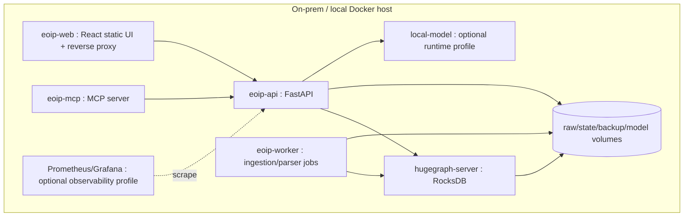
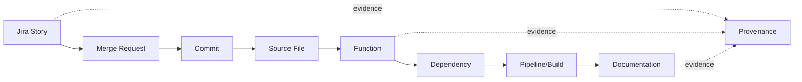

# MVP Requirements

**Project:** Enterprise Ontology & Intelligence Platform (EOIP)  
**Baseline:** 0.1.0-architecture-baseline  
**Date:** 2026-10-01  
**Status:** Architecture baseline / engineering handoff  
**Purpose:** Normative requirements for the fully functional demonstrable Phase 1 vertical slice

> This document is normative for its scope. Where it conflicts with the master specification, the master non-negotiable constraints win. “MVP” means the Phase 1 integrated vertical slice, not a mock-up.

## Product outcome

From a clean local environment the operator starts the stack, loads synthetic Jira + Git/GitLab metadata + demo repository/document data, produces persisted HugeGraph entities/edges, validates the graph, then demonstrates a real evidence path:

`Jira Story → Merge Request → Commit → Source File → Function → Dependency → Pipeline/Build → Documentation`.

The same persisted context is consumable from the web application, VS Code extension, GraphRAG workflow and MCP. No domain answer may be hardcoded in UI/demo code.

## Non-negotiable MVP boundaries

- No cloud/SaaS dependency at runtime.
- Apache HugeGraph is authoritative; RocksDB standalone is the default P1 storage profile.
- External LLM endpoints are disabled.
- No RBAC; use local/single-user authentication profiles and network isolation. URL namespaces are not security boundaries.
- Read-only user/agent/MCP graph operations; administrative ingestion/backup/schema functions are explicit application operations, not arbitrary Gremlin.
- System remains useful with local model stopped.
- Synthetic Jira data is used until a real supplied schema is mapped; the documentation does not claim unseen source data was analyzed.

## Runtime architecture

| Runtime | Responsibility | Public exposure | Persistent state |
|---|---|---|---|
| `eoip-web` | Serve React SPA, route `/app/*` and `/admin/*`, reverse proxy API | localhost / controlled LAN | none |
| `eoip-api` | Application/query/search/validation/RAG/agent APIs | via web proxy | none except mounted config |
| `eoip-worker` | Connectors, raw capture, code parsing, mutation, validation jobs | none | raw/DLQ/checkpoint volumes + graph |
| `eoip-mcp` | Read-only MCP façade over application services | localhost/configured | none |
| `hugegraph-server` | Authoritative property graph + RocksDB | internal Docker network only | HugeGraph/RocksDB volume |
| `local-model` | Optional local generation/embedding provider | internal Docker network only | model cache/artifacts |
| `prometheus/grafana` | Optional metrics profile | localhost only | optional volumes |

## Mandatory MVP capabilities

### MVP-FR-001 — Apache HugeGraph local Docker
**Parent requirements:** FR-GRAPH-001  
**Requirement:** Deliver this capability as an integrated part of the P1 architecture.  
**Acceptance:** HugeGraph starts from Compose, persists through restart, and is reachable only through the internal network by default.  
**Failure behavior:** Failure is explicit, logged/audited where applicable, and must not silently substitute hardcoded data.

### MVP-FR-002 — Automatic graph schema initialization
**Parent requirements:** FR-GRAPH-003  
**Requirement:** Deliver this capability as an integrated part of the P1 architecture.  
**Acceptance:** Fresh startup creates the expected schema automatically and repeat startup is idempotent.  
**Failure behavior:** Failure is explicit, logged/audited where applicable, and must not silently substitute hardcoded data.

### MVP-FR-003 — Jira JSON ingestion
**Parent requirements:** FR-CONN-002  
**Requirement:** Deliver this capability as an integrated part of the P1 architecture.  
**Acceptance:** Synthetic Jira fixture imports to Project/WorkItem/Person/evidence records with configurable mapping and per-record validation.  
**Failure behavior:** Failure is explicit, logged/audited where applicable, and must not silently substitute hardcoded data.

### MVP-FR-004 — Git repository/GitLab ingestion
**Parent requirements:** FR-CONN-003, FR-CONN-004  
**Requirement:** Deliver this capability as an integrated part of the P1 architecture.  
**Acceptance:** Local demo repository plus GitLab-style MR/pipeline fixture produces repository/ref/commit/MR/pipeline facts and links.  
**Failure behavior:** Failure is explicit, logged/audited where applicable, and must not silently substitute hardcoded data.

### MVP-FR-005 — Code parsing
**Parent requirements:** FR-CODE-001, FR-CODE-002  
**Requirement:** Deliver this capability as an integrated part of the P1 architecture.  
**Acceptance:** Python and TypeScript demo files produce symbols/source ranges/import or call/dependency edges without LLM parsing.  
**Failure behavior:** Failure is explicit, logged/audited where applicable, and must not silently substitute hardcoded data.

### MVP-FR-006 — Canonical entity generation
**Parent requirements:** FR-INGEST-002, FR-GRAPH-004  
**Requirement:** Deliver this capability as an integrated part of the P1 architecture.  
**Acceptance:** Every imported canonical entity has stable canonical_id; identical re-ingestion creates no logical duplicate.  
**Failure behavior:** Failure is explicit, logged/audited where applicable, and must not silently substitute hardcoded data.

### MVP-FR-007 — Jira graph
**Parent requirements:** FR-ONTO-001, FR-GRAPH-002  
**Requirement:** Deliver this capability as an integrated part of the P1 architecture.  
**Acceptance:** Jira project/work-item subgraph is queryable with provenance.  
**Failure behavior:** Failure is explicit, logged/audited where applicable, and must not silently substitute hardcoded data.

### MVP-FR-008 — Code graph
**Parent requirements:** FR-CODE-001, FR-CODE-004  
**Requirement:** Deliver this capability as an integrated part of the P1 architecture.  
**Acceptance:** Repository→file→symbol plus code dependency subgraph is queryable with exact source locations.  
**Failure behavior:** Failure is explicit, logged/audited where applicable, and must not silently substitute hardcoded data.

### MVP-FR-009 — Meta graph
**Parent requirements:** FR-GRAPH-005  
**Requirement:** Deliver this capability as an integrated part of the P1 architecture.  
**Acceptance:** Sources, runs, domains, schema/ontology versions and validation/quality records are queryable as meta graph.  
**Failure behavior:** Failure is explicit, logged/audited where applicable, and must not silently substitute hardcoded data.

### MVP-FR-010 — Cross-graph linking
**Parent requirements:** FR-GRAPH-006  
**Requirement:** Deliver this capability as an integrated part of the P1 architecture.  
**Acceptance:** The complete demo cross-domain path is traversable forward and reverse with evidence.  
**Failure behavior:** Failure is explicit, logged/audited where applicable, and must not silently substitute hardcoded data.

### MVP-FR-011 — Provenance
**Parent requirements:** FR-PROV-001, FR-PROV-002  
**Requirement:** Deliver this capability as an integrated part of the P1 architecture.  
**Acceptance:** Cross-domain edges have evidence and creation status; lineage endpoint traces them to source capture/run.  
**Failure behavior:** Failure is explicit, logged/audited where applicable, and must not silently substitute hardcoded data.

### MVP-FR-012 — Graph validation
**Parent requirements:** FR-VALID-001, FR-VALID-002  
**Requirement:** Deliver this capability as an integrated part of the P1 architecture.  
**Acceptance:** Seeded invalid data produces expected validation findings and hard invalid edges are prevented/quarantined.  
**Failure behavior:** Failure is explicit, logged/audited where applicable, and must not silently substitute hardcoded data.

### MVP-FR-013 — Query API
**Parent requirements:** FR-QUERY-001, FR-QUERY-006  
**Requirement:** Deliver this capability as an integrated part of the P1 architecture.  
**Acceptance:** Versioned REST APIs return real entity/search/query/evidence results and enforce query policy.  
**Failure behavior:** Failure is explicit, logged/audited where applicable, and must not silently substitute hardcoded data.

### MVP-FR-014 — Impact analysis query
**Parent requirements:** FR-QUERY-003  
**Requirement:** Deliver this capability as an integrated part of the P1 architecture.  
**Acceptance:** Changing the demo function yields the golden blast-radius set and path evidence within configured bounds.  
**Failure behavior:** Failure is explicit, logged/audited where applicable, and must not silently substitute hardcoded data.

### MVP-FR-015 — Path query
**Parent requirements:** FR-QUERY-002  
**Requirement:** Deliver this capability as an integrated part of the P1 architecture.  
**Acceptance:** Jira issue→function path matches golden ordered vertex/edge sequence.  
**Failure behavior:** Failure is explicit, logged/audited where applicable, and must not silently substitute hardcoded data.

### MVP-FR-016 — Search/query UI
**Parent requirements:** FR-UI-001  
**Requirement:** Deliver this capability as an integrated part of the P1 architecture.  
**Acceptance:** Search/query UI uses real APIs; API shutdown produces an error state rather than demo fallback data.  
**Failure behavior:** Failure is explicit, logged/audited where applicable, and must not silently substitute hardcoded data.

### MVP-FR-017 — Graph visualizer
**Parent requirements:** FR-UI-002  
**Requirement:** Deliver this capability as an integrated part of the P1 architecture.  
**Acceptance:** Graph explorer renders bounded real subgraphs, edge types and highlighted paths/provenance.  
**Failure behavior:** Failure is explicit, logged/audited where applicable, and must not silently substitute hardcoded data.

### MVP-FR-018 — Admin ingestion/validation UI
**Parent requirements:** FR-ADMIN-001, FR-ADMIN-002  
**Requirement:** Deliver this capability as an integrated part of the P1 architecture.  
**Acceptance:** Admin screens show actual run counts/status, graph stats, validation findings and quality values.  
**Failure behavior:** Failure is explicit, logged/audited where applicable, and must not silently substitute hardcoded data.

### MVP-FR-019 — VS Code extension
**Parent requirements:** FR-VSCODE-001, FR-VSCODE-002  
**Requirement:** Deliver this capability as an integrated part of the P1 architecture.  
**Acceptance:** Opening the demo symbol retrieves Jira/commit/dependency/doc/evidence context and exact source range.  
**Failure behavior:** Failure is explicit, logged/audited where applicable, and must not silently substitute hardcoded data.

### MVP-FR-020 — Local GraphRAG
**Parent requirements:** FR-RAG-001, FR-RAG-002, FR-RAG-003  
**Requirement:** Deliver this capability as an integrated part of the P1 architecture.  
**Acceptance:** GraphRAG retrieves real graph/doc evidence and returns citations; with model down it returns structured evidence/fallback.  
**Failure behavior:** Failure is explicit, logged/audited where applicable, and must not silently substitute hardcoded data.

### MVP-FR-021 — Useful read-only agent workflow
**Parent requirements:** FR-AGENT-003  
**Requirement:** Deliver this capability as an integrated part of the P1 architecture.  
**Acceptance:** TraceImpactAgent answers the demo trace/impact request using allowlisted read tools and remains within execution budgets.  
**Failure behavior:** Failure is explicit, logged/audited where applicable, and must not silently substitute hardcoded data.

### MVP-FR-022 — MCP core graph access
**Parent requirements:** FR-MCP-001, FR-MCP-002  
**Requirement:** Deliver this capability as an integrated part of the P1 architecture.  
**Acceptance:** MCP client obtains the same entity/path/impact/evidence semantics as REST; no write tool is advertised.  
**Failure behavior:** Failure is explicit, logged/audited where applicable, and must not silently substitute hardcoded data.

### MVP-FR-023 — Logging
**Parent requirements:** NFR-OPS-001  
**Requirement:** Deliver this capability as an integrated part of the P1 architecture.  
**Acceptance:** Correlation-aware structured logs cover startup, ingestion, query, validation, RAG/agent and failures without secrets.  
**Failure behavior:** Failure is explicit, logged/audited where applicable, and must not silently substitute hardcoded data.

### MVP-FR-024 — Metrics
**Parent requirements:** NFR-OPS-002  
**Requirement:** Deliver this capability as an integrated part of the P1 architecture.  
**Acceptance:** Machine-readable metrics expose ingestion/query/model/agent/failure counters/latencies locally.  
**Failure behavior:** Failure is explicit, logged/audited where applicable, and must not silently substitute hardcoded data.

### MVP-FR-025 — Backup
**Parent requirements:** NFR-REL-002  
**Requirement:** Deliver this capability as an integrated part of the P1 architecture.  
**Acceptance:** A checksummed graph/application backup artifact is generated from the demo environment.  
**Failure behavior:** Failure is explicit, logged/audited where applicable, and must not silently substitute hardcoded data.

### MVP-FR-026 — Restore
**Parent requirements:** NFR-REL-002  
**Requirement:** Deliver this capability as an integrated part of the P1 architecture.  
**Acceptance:** Restore into a clean graph reproduces expected counts and golden path/impact queries.  
**Failure behavior:** Failure is explicit, logged/audited where applicable, and must not silently substitute hardcoded data.

### MVP-FR-027 — Automated tests
**Parent requirements:** NFR-MAINT-001  
**Requirement:** Deliver this capability as an integrated part of the P1 architecture.  
**Acceptance:** Unit, contract, integration, security and E2E suites execute locally and produce a report.  
**Failure behavior:** Failure is explicit, logged/audited where applicable, and must not silently substitute hardcoded data.

### MVP-FR-028 — End-to-end demo
**Parent requirements:** FR-GRAPH-006, FR-AGENT-003  
**Requirement:** Deliver this capability as an integrated part of the P1 architecture.  
**Acceptance:** A documented clean-reset demo executes ingestion→graph→query→UI→VS Code→GraphRAG→MCP→backup/restore from persisted data.  
**Failure behavior:** Failure is explicit, logged/audited where applicable, and must not silently substitute hardcoded data.

## Demo flow

## Phase 1 security baseline

- Runtime egress is denied by default; model/images/dependencies are staged before restricted deployment.
- HugeGraph and local-model ports stay on an internal Docker network; only the web/API edge is exposed as configured.
- Non-loopback profiles require local authentication; the current codebase now includes local RBAC/ABAC primitives, policy evaluation, role/user export, signed token checks and `/api/v1/authz/*` management/evaluation routes. Production multi-user authorization still requires release hardening and Phase 8 security receipts.
- Secrets are file-mounted/referenced and redacted from logs; example files contain placeholders only.
- Source paths are allowlisted roots; path traversal/symlink escape/oversized input is rejected.
- Model/retrieved text is untrusted data. It cannot create new tool permissions, arbitrary Gremlin or shell commands.
- QueryPlan bounds and read-only Gremlin templates are enforced for UI, agent and MCP equally.
- Audit events record ingestion, queries, agent/tool calls, admin operations, backup/restore and policy denials; hidden chain-of-thought is never stored.
- Write/destructive MCP/agent tools are not registered in the MVP.

## MVP benchmark definition (targets, not measured claims)

Representative baseline dataset: approximately 2,000 Jira work items, 10 Git repositories, 15,000 commits, 25,000 files/symbols, 5,000 document sections and 150,000–300,000 relationships. Reference developer workstation: 8 physical/logical CPU cores available to Docker, 32 GiB RAM and local NVMe/SSD. Record the exact hardware in every benchmark result.

Initial engineering targets are acceptance thresholds to validate after implementation: indexed entity lookup p95 ≤ 500 ms; bounded path/impact query p95 ≤ 2 s at configured depth/result limits; standard user API p95 ≤ 1 s excluding local-model generation; `docker compose up` readiness ≤ 120 s after images are locally available. These are not product performance claims until the benchmark suite measures them.

## MVP exit gate

Phase 1 exits only when a fresh clone/offline-ready package can execute `docker compose up`, become ready, initialize schema, ingest the fixtures, pass automated tests, run the documented demo, create a backup, destroy/recreate graph state, restore it, and rerun golden trace/impact queries successfully.
