# 14 — Implementation Roadmap (KnowGridFlow / EOIP)

| Field | Value |
|---|---|
| Document | 14-IMPLEMENTATION-ROADMAP.md |
| Supersedes | The 2026-10-19 placeholder pass at this path (12 invented WP-IDs, fabricated acceptance numbers such as "55 FPS", "nDCG@10 >= 0.82", no REQ/GAP traceability; overwritten in full per this pass's brief) |
| Inputs | `11-REQUIREMENTS-FINAL.md` (57 requirements, P0 14 / P1 25 / P2 12 / P3 6), `07-GAP-REGISTER.md` (46 gaps), `10-TARGET-REFERENCE-ARCHITECTURE.md` §4/§7, `15-VALIDATION-BENCHMARK-PLAN.md` (BM-01..22), `18-ADRS/*.md` (12 ADRs), `02-TECHNOLOGY-REGISTRY.md` §3 |
| Method | Every WP-ID inherits its REQ-IDs' priority, effort and tests verbatim from `11-REQUIREMENTS-FINAL.md`; nothing is renumbered or re-scored. Sequencing (not priority) follows two structural dependency chains the target architecture surfaces and the gap register does not capture (see §1). |
| Work packages | **52** (`WP-KG3-01` .. `WP-KG3-52`) across 4 phases: Phase 0 (12 WPs, 14 P0 reqs + 2 early-start P1 reqs), Phase 1 (22 WPs, remaining 23 P1 reqs), Phase 2 (12 WPs, 12 P2 reqs), Research track (6 WPs, 6 P3 reqs) |
| Status | Nothing in this roadmap is implemented; every WP is PROPOSED |

---

## 1. Sequencing principles

The default order is P0 -> P1 -> P2 -> P3/Research, exactly as `11-REQUIREMENTS-FINAL.md` §0 defines the four tiers and their release phases. Within that default order, two structural dependency chains from `10-TARGET-REFERENCE-ARCHITECTURE.md` §4 and §7 **override raw priority scores where the two conflict**, because a priority score measures customer value and evidence strength, not build order:

1. **GAP-04 (portable query IR, REQ-QRY-03) is structurally prior to GAP-01 (adapter defects, REQ-STOR-01) and GAP-05 (injection defences, REQ-SEC-06).** Architecture §5 and §7 row 1 make the query-IR compiler (`query/ast_compiler.py`, ADR-KG3-12) "the structural decision the rest of the backend layer depends on." REQ-QRY-03 is scored P1 in `11-REQUIREMENTS-FINAL.md` (GAP-04's own score of 2.9 is below the normal P1 cut and is carried forward as a documented override), while REQ-STOR-01 and REQ-SEC-06 are forced P0. This roadmap resolves the apparent conflict the way `10-TARGET-REFERENCE-ARCHITECTURE.md` §4 point 3 and ADR-KG3-05's own Reversibility section both state explicitly: *"the dependency on GAP-04's structural fix is tracked, not blocking — this ADR's near-term fixes do not wait on ADR-KG3-12 to ship."* Concretely: REQ-STOR-01's three named point-patches (JanusGraph `p_`-prefix, Neptune SigV4, HugeGraph Groovy-closure removal) run as an independent Phase-0 track (`WP-KG3-09`) because they do not touch query construction; REQ-QRY-03 is **pulled forward** into Phase 0 scheduling as an early-start work package (`WP-KG3-08`) — its REQ-ID keeps its inherited P1/"Phase 1" label untouched, but its *build order* starts in Phase 0 because `WP-KG3-10` (REQ-SEC-06, forced P0) cannot close without it, per REQ-SEC-06's own `Dependencies` field (`REQ-QRY-03`) in `11-REQUIREMENTS-FINAL.md`. See §9 for the one genuine documentation inconsistency this uncovered.
2. **GAP-03 (tenant isolation, REQ-TEN-01) is structurally prior to GAP-02 (source-ACL enforcement, REQ-SEC-04/05/07) and GAP-07 (epistemic planes, REQ-GOV-01).** Architecture §3.6 states the ACL pre-filter and the epistemic-planes mandatory stage both sit downstream of the tenancy plane — a permission check inside a tenant boundary is meaningless if the graph adapter itself has no tenant boundary to check within (§3.5: "zero occurrences of `tenant`" in every graph adapter at HEAD). `11-REQUIREMENTS-FINAL.md` already encodes half of this chain as a formal dependency (REQ-SEC-04 `Dependencies` = REQ-TEN-01), but the GAP-03 -> GAP-07 half is **not** captured anywhere in `07-GAP-REGISTER.md`'s own tables (REQ-GOV-01's `Dependencies` field is "—"). This roadmap adds that missing edge explicitly: `WP-KG3-06` (REQ-TEN-01) precedes both `WP-KG3-07` (REQ-SEC-04/05/07) and `WP-KG3-11` (REQ-GOV-01).

Outside these two chains, WPs follow the inherited priority tier and the module-affinity groupings `11-REQUIREMENTS-FINAL.md`'s `Owning module` column already implies (e.g. every ontology-governance requirement sits behind `ontology/gitops.py` and `ontology/governance.py`, so those WPs chain on each other regardless of tier).

**Effort scale** (inherited from `11-REQUIREMENTS-FINAL.md`'s S/M/L column, summed per WP and rounded to the nearest bucket for reporting): S ~= 1-2 engineer-weeks, M ~= 3-6 engineer-weeks, L ~= 7-12 engineer-weeks. A WP's reported effort is the arithmetic sum of its REQ-IDs' efforts, shown inline (e.g. "M+M -> L").

---

## 2. Phase 0 — Foundation/correctness (12 WPs, 14 P0 requirements + 2 early-start P1 requirements)

Every P0 requirement lands in Phase 0. Two P1 requirements (REQ-OPS-05, REQ-QRY-03) are pulled forward because a forced-P0 requirement structurally depends on each of them (REQ-OPS-01 -> REQ-OPS-05 per its own `Dependencies` field; REQ-SEC-06 -> REQ-QRY-03 per §1 chain 1). Their priority label is untouched; only their build order moves.

| WP-ID | Title | REQ-IDs (tier) | Depends on | Effort | Go/no-go gate | Owning architecture layer |
|---|---|---|---|---|---|---|
| WP-KG3-01 | Unified evaluation harness | REQ-OPS-03 (P0) | none | M | BM-22: harness executes BM-01..21 unattended, pass/fail/PROPOSED report, no manual step | Cross-cutting release infrastructure (§1 principles 5-6; precondition for every other gate below) |
| WP-KG3-02 | Supply-chain gates: SBOM/signing pipeline + licence allow-list CI gate | REQ-OPS-05 (P1, early-start), REQ-OPS-01 (P0) | WP-KG3-01 | S+S -> M | BM-20: CI gate fails 100% of the time on a blocked-licence dependency; SBOM lists every `requirements.lock` entry; tampered image fails `cosign verify` offline | §6 deployment tiers (cross-tier release gate); §8 non-goals (licence allow-list, ADR-KG3-11) |
| WP-KG3-03 | AEAD egress vault | REQ-SEC-01 (P0) | none | S | BM-18: zero known-plaintext recovery against the replacement AEAD cipher | §3.4 security plane (ADR-KG3-03) |
| WP-KG3-04 | Harden local model runtime | REQ-OPS-02 (P0) | none | S | BM-14: zero known-exploitable CVEs on the pinned model-runtime image, re-checked every release | §5 interfaces (ModelPort); §6 deployment tiers (ADR-KG3-10) |
| WP-KG3-05 | MCP OAuth 2.1 resource-server auth + tool ACL annotations/signed manifests | REQ-SEC-02 (P0), REQ-SEC-03 (P0) | none | M+M -> L | BM-18: 100% of tool calls attributable to a real end-user principal; manifest-digest mismatch denies the call | §2 agent/MCP surface box; §3.4 security plane (ADR-KG3-04) |
| WP-KG3-06 | Mandatory tenant context in the `GraphStore` protocol | REQ-TEN-01 (P0) | none | L | BM-05: zero cross-tenant leakage across data, index, cache, log and memory, on HugeGraph/Neo4j/Neptune, for every isolation placement (SILO/BRIDGE/POOL) | §3.5 tenancy plane (ADR-KG3-02). **Chain-1 anchor: precedes WP-KG3-07 and WP-KG3-11.** |
| WP-KG3-07 | Write-path ACL tagging, read-path mandatory enforcement, policy-epoch consistency tokens | REQ-SEC-04 (P0), REQ-SEC-05 (P0), REQ-SEC-07 (P0) | WP-KG3-06 | L+L+M -> L | BM-04: zero leaked facts/citations/cache entries/memory across two disjoint-permission users, across keyword/vector/hybrid/graph-traversal modes and all four call sites (`/api/v1/rag`, `/api/v1/retrieval`, `agents/governed.py`, MCP); revoke-then-query returns zero forbidden hits | §3.4 security plane (ADR-KG3-01); §3.6 (J5 ordering: ACL pre-filter before evidence-plane citation assembly) |
| WP-KG3-08 | Portable query-IR compiler as the sole production query path | REQ-QRY-03 (P1, early-start) | WP-KG3-09 (per REQ-QRY-03's own `Dependencies` field) | L | BM-01, BM-07: no production route calls a backend with a hand-built query string; zero successful injections from the mutation corpus | §4 multi-backend layer; §5 interfaces (QueryPlan -> AST -> dialect, ADR-KG3-12). **Chain-1 anchor: precedes WP-KG3-10.** |
| WP-KG3-09 | Backend adapter defect patches (JanusGraph `p_`-prefix, Neptune SigV4, HugeGraph Groovy-closure) + live conformance gate | REQ-STOR-01 (P0) | none (explicitly independent of WP-KG3-08 per ADR-KG3-05 Reversibility) | M | BM-01: zero result-set mismatches across HugeGraph/Neo4j/Neptune/JanusGraph for identical logical queries, after documented semantic differences are excluded | §4 multi-backend layer (ADR-KG3-05) |
| WP-KG3-10 | Parameterised queries (two named call sites) + classifier-layer injection defence | REQ-SEC-06 (P0) | WP-KG3-08 | M | BM-18: zero successful injections in the malicious property-key/label corpus | §3.4 security plane (ADR-KG3-08) |
| WP-KG3-11 | Storage-level epistemic-state enforcement | REQ-GOV-01 (P0) | WP-KG3-06 (chain 2; not a formal REQ dependency — added per architecture §3.6 J8 ordering) | M | BM-15: zero successful "approved" writes bypassing promotion, across every ingestion path; zero predictions reaching the fact plane without recorded human approval | §2 epistemic-planes box; §3.3 evidence plane (ADR-KG3-06) |
| WP-KG3-12 | Governed agent-memory records | REQ-MEM-01 (P0) | WP-KG3-07, WP-KG3-11 | M | BM-04, BM-05 extended to memory: a revoked user's prior memory access counter reads zero immediately, not eventually | §3.4/§3.5 (agent memory as a governed epistemic type, ADR-KG3-09) |

---

## 3. Phase 1 (22 WPs, 23 remaining P1 requirements; REQ-OPS-05 and REQ-QRY-03 already delivered in Phase 0 above)

| WP-ID | Title | REQ-IDs | Depends on | Effort | Go/no-go gate | Owning architecture layer |
|---|---|---|---|---|---|---|
| WP-KG3-13 | Backend restore drills | REQ-OPS-04 | WP-KG3-09 | S | BM-16: restored graph byte-for-byte equivalent (modulo PITR cutoff) to source; first green run becomes baseline | §6 deployment tiers (cross-tier gate) |
| WP-KG3-14 | SHACL conformance oracle (pySHACL) | REQ-GOV-02 | none | S | BM-08: 100% pass on W3C SHACL Core test cases the in-house engine claims to support | §3.2 control plane (mutation-gateway SHACL gate) |
| WP-KG3-15 | Verified air-gap install bundle | REQ-OPS-06 | WP-KG3-04, WP-KG3-02 | M | BM-19: zero outbound network calls during the entire drill; self-test passes with no manual patching | §6 deployment tiers (one-node, air-gapped) |
| WP-KG3-16 | Persistent VectorPort + local embeddings (LanceDB default, BGE-M3) | REQ-QRY-01 | WP-KG3-07 (in-index ACL) | M | BM-06: dimension-mismatch hard errors; no silent fallback to the hashing embedder in production | §5 interfaces (VectorPort) |
| WP-KG3-17 | PII recognisers (Presidio) + secret scanning (gitleaks) at ingest | REQ-SEC-08, REQ-SEC-09 | REQ-SEC-08 feeds REQ-SEC-09 internally | S+S -> M | BM-04: zero secrets reach the search/vector index in the labelled corpus | §3.1 data plane |
| WP-KG3-18 | Measured one-node sizing profiles | REQ-OPS-07 | WP-KG3-01 | S | BM-02, BM-19: profiles reproducible from a documented dataset generator; no SLO asserted before a first run | §6 deployment tiers (one-node sizing release gate) |
| WP-KG3-19 | Digital-thread acceptance journeys J1/J9/J10 | REQ-ING-01 | WP-KG3-21 (REQ-ING-04), WP-KG3-09 (REQ-STOR-01) | M | BM-12: J1/J9/J10 return a materially correct, evidence-complete answer set; reindex leaves unrelated relationships byte-identical | §3.2/§3.3 (digital thread, enterprise graph-of-graphs) |
| WP-KG3-20 | Persistent claims and contradictions (TruthStore) | REQ-GOV-03 | WP-KG3-11 | M | BM-11: 100% agreement with the hand-built oracle on as-of reconstruction; zero silent overwrite of a second claim | §3.3 evidence plane |
| WP-KG3-21 | SCIP-based compiler-grade code symbols | REQ-ING-04 | none | M | BM-12: resolution tier (compiler-grade vs syntactic) queryable on every returned code fact | §3.3 evidence plane (code graph) |
| WP-KG3-22 | Ontology proposal wired into governance | REQ-ING-02 | WP-KG3-23 (REQ-GOV-04) | M | BM-10: every proposed entity/relationship reaches `GovernedPullRequest` with evidence; zero silent auto-promotion | §2 ingest pipeline stage 6; §3.2 control plane |
| WP-KG3-23 | Git-persisted ontology/data branches | REQ-GOV-04 | none | M | BM-17: branch state survives process restart; diff/merge history is Git-auditable | §3.2 control plane (ontology-as-code lifecycle) |
| WP-KG3-24 | Mount ontology-governance PR flow (`GovernedPullRequest`) | REQ-GOV-05 | WP-KG3-23, WP-KG3-14 | M | BM-17: a self-approved or single-steward change is rejected, not merely discouraged | §3.2 control plane |
| WP-KG3-25 | Tamper-evident audit log (hash-chain) | REQ-SEC-10 | none | S | BM-18: a single modified historical audit record breaks the chain verifiably | §3.4 security plane |
| WP-KG3-26 | Parser-neutral evidence-span anchors (Docling-pattern) | REQ-ING-03 | none | M | BM-06 (citation accuracy sub-measure): span drift on re-parse is measured and bounded | §3.3 evidence plane |
| WP-KG3-27 | Typed NL-query plan candidates | REQ-QRY-02 | WP-KG3-08 | M | BM-07: a rejected (unsafe/malformed) candidate never reaches execution; top-3 suggestion accuracy matches the deterministic-tier baseline | §2 retrieval stack box; §5 interfaces (QueryPlan) |
| WP-KG3-28 | Deterministic identity keys for all entity types | REQ-ING-05 | WP-KG3-06 | S | BM-09: identical source records always resolve to the same canonical ID across ingestion runs | §2 ingest pipeline stage 4 (identity plane) |
| WP-KG3-29 | Integrated probabilistic entity resolution (Splink) | REQ-ING-06 | WP-KG3-28 | M | BM-09: a wrong merge is reversible without data loss; review workflow triggers in 100% of high-impact cases | §2 ingest pipeline stage 4; §5 interfaces (ER port) |
| WP-KG3-30 | General-enterprise connector breadth (SharePoint/Slack/Salesforce/Workday) | REQ-ING-07 | none | L | BM-03: new connectors emit `SourceEvent v2` identically to existing ones; connectors remain strictly read-only | §3.1 data plane |
| WP-KG3-31 | Per-connector permission-sync verification | REQ-SEC-11 | WP-KG3-30, WP-KG3-07 | M | BM-03, BM-04: every connector's permission-sync status is a published, tested fact, not an assumption | §3.1 data plane / §3.4 security plane |
| WP-KG3-32 | ModelPort CPU-only llama.cpp alternative | REQ-ML-01 | WP-KG3-04 | S | BM-14: switching providers requires a config change only | §5 interfaces (ModelPort) |
| WP-KG3-33 | Neptune Streams-based index freshness | REQ-ING-08 | WP-KG3-09 | M | BM-03: out-of-band writes detected within a bounded window | §4 multi-backend layer (Neptune-specific) |
| WP-KG3-34 | LDBC SNB backend-parity workload | REQ-OPS-08 | WP-KG3-01, WP-KG3-09 | M | BM-02: workload runs unmodified against every supported backend; results labelled "not LDBC Benchmark Results" per trademark terms | §6 deployment tiers (scale evidence) |

---

## 4. Phase 2 (12 WPs, 12 P2 requirements)

| WP-ID | Title | REQ-ID | Depends on | Effort | Go/no-go gate | Owning architecture layer |
|---|---|---|---|---|---|---|
| WP-KG3-35 | Dry-run ontology migration with rollback | REQ-GOV-06 | WP-KG3-24, WP-KG3-08 | M | BM-17: rollback restores exact pre-migration state, verified | §3.2 control plane (migration protocol) |
| WP-KG3-36 | Parameterised virtualisation queries (+ optional Ontop) | REQ-QRY-04 | WP-KG3-10 | M | BM-06: zero successful injection in the federation-specific corpus | §4/§5 (federation/virtualisation) |
| WP-KG3-37 | Measured large-graph rendering (Cytoscape/Sigma FPS curve) | REQ-VIZ-01 | none | S | BM-13: documented FPS curve per renderer and node count, gating any library change | §2 UI box (measure before migrate) |
| WP-KG3-38 | ELK sidecar for OWL EL reasoning | REQ-GOV-07 | none | S | BM-08: no adapter returns a fixed "consistent" result without reasoning | §4 (OWL reasoning row); §8 non-goals |
| WP-KG3-39 | Explicit path modes (ANY/SHORTEST/TRAIL) with push-down | REQ-QRY-05 | WP-KG3-08 | M | BM-02, BM-12: latency budget met at 1M+ node fixture (measured) | §5 interfaces (QueryPlan path modes) |
| WP-KG3-40 | Typed mutation-gateway constraint layer (cardinality/role/value-range) | REQ-GOV-08 | WP-KG3-11 | M | BM-17, BM-03: constraint violations rejected with a typed, actionable error | §3.2 control plane |
| WP-KG3-41 | Indexed, oracle-tested bitemporal reads (XTDB as oracle) | REQ-GOV-09 | none | M | BM-11: reconstruction latency measured at realistic revision-history depth | §3.2/§3.3 (bitemporal model) |
| WP-KG3-42 | Opt-in OpenLineage interoperability | REQ-GOV-10 | none | S | BM-03: round-trip OpenLineage events validate against the OpenLineage schema | §3.3 evidence plane (lineage) |
| WP-KG3-43 | Benchmark HippoRAG-style PPR retrieval | REQ-QRY-06 | WP-KG3-16 | M | BM-06: adoption conditional on a measured win over strong plain-RAG baseline | §2 retrieval stack box (EXPERIMENT branch) |
| WP-KG3-44 | ACL-scoped GraphRAG community summaries *(conditional — activates only if WP-KG3-43's benchmark is positive)* | REQ-QRY-07 | WP-KG3-43, WP-KG3-07 | M | BM-06: zero cross-ACL leakage through a community summary | §2 retrieval stack box |
| WP-KG3-45 | AlgoPort on tenant-filtered snapshots (rustworkx) | REQ-ML-02 | WP-KG3-06 | M | BM-02: algorithm results match the NetworkX oracle within documented tolerance | §5 interfaces (AlgoPort) |
| WP-KG3-46 | Backend-native bulk loaders with provenance | REQ-STOR-02 | WP-KG3-11, WP-KG3-07 | M | BM-03: throughput measured per backend; no record enters without a traceable `SourceEvent` | §4 multi-backend layer |

---

## 5. Research track (6 WPs, 6 P3 requirements — not phase-gated; demand/evidence-gated per Master Prompt §13's "distinguish product priority from research priority")

| WP-ID | Title | REQ-ID | Depends on | Effort | Go/no-go gate | Owning architecture layer | Gate condition to leave research track |
|---|---|---|---|---|---|---|---|
| WP-KG3-47 | Degree-aware supernode traversal budgets | REQ-QRY-08 | WP-KG3-08, WP-KG3-39 | S | BM-02 (skewed degree): budget-exceeded result flagged `partial`, never silently truncated | §5 interfaces | Evidence of a real hub-entity production incident |
| WP-KG3-48 | Mounted read-only SPARQL endpoint | REQ-STD-01 | WP-KG3-07 | S | BM-08: zero ACL bypass via SPARQL | §4 (RDF sidecar, optional interoperability module) | Demonstrated semantic-web consumer demand |
| WP-KG3-49 | RML-conformant mapping import | REQ-STD-02 | none | S | BM-08: documented pass/fail against the RML W3C test-case corpus | §4 (RDF sidecar) | Customer request for standard R2RML/RML reuse |
| WP-KG3-50 | Clean-room OCEL 2.0 process import | REQ-GOV-11 | WP-KG3-11 | M | BM-22: scope explicitly bounded before implementation starts | §8 non-goals (wisdom/decision layer, EXPERIMENT) | A named, bounded J15 use case with a customer sponsor |
| WP-KG3-51 | Calibrated CPU-only link prediction | REQ-ML-03 | WP-KG3-11 | L | BM-15: must beat a tabular baseline before any promotion path opens | §8 non-goals (GNN/link-prediction, EXPERIMENT) | Open uncertainty U-13 (torch CPU-wheel decision) resolved |
| WP-KG3-52 | Native Datalog subset with derivation ledger | REQ-GOV-12 | WP-KG3-11 | L | BM-08 (+ equivalence tests): incremental maintenance equivalent to full re-materialisation | §8 non-goals (incremental Datalog, EXPERIMENT) | Correctness proof of incremental maintenance exists |

---

## 6. Migration strategy

Four WPs change a live contract or schema; each is paired with the backward-compatibility approach, rollback condition and the governing ADR's own Reversibility rating.

- **WP-KG3-06 (REQ-TEN-01, `GraphStore` protocol).** `graph/store.py:56`'s method signatures gain a *required* tenant-context parameter — deliberately a breaking change, so bypassing tenancy requires bypassing the protocol entirely (per the requirement's own `Out of scope` note). **Backward compatibility:** none offered at the protocol level by design; a deployment upgrades all adapters in the same release. **Rollback condition:** ADR-KG3-02 rates reversibility **Medium** — reverting the protocol change itself is cheap, but a POOL deployment already provisioned under one backend's native isolation unit (e.g. HugeGraph graph spaces) requires a data migration, not a config flip, to move to another backend's isolation primitive. Roll back only before any tenant has been provisioned under the new isolation unit.
- **WP-KG3-07 (REQ-SEC-04, `acl_principals` on every fact/chunk/edge).** The ingestion/mutation gateway starts rejecting any write missing `acl_principals` once this lands, mirroring REQ-GOV-01's pattern. **Backward compatibility:** existing facts written before this WP lack the field; a backfill pass (deriving `acl_principals` from `PermissionMetadata.principal_refs` where still resolvable) must run before enforcement flips from "warn" to "reject" — this two-step (shadow-mode warn, then enforce) is the standard rollout the `Observability` field for REQ-SEC-04 implies ("an ingestion-time counter... should trend to zero"). **Rollback condition:** reverting to optional tagging reopens the exact leak REQ-SEC-05 exists to close — ADR-KG3-01's own Reversibility section is explicit that any rollback here "would silently reopen the leak it closed" and must be accompanied by re-running BM-04 to confirm the regression is deliberate.
- **WP-KG3-11 (REQ-GOV-01, `epistemic_state` as a mandatory backend-persisted property).** `validation/gate.py` starts refusing any mutation missing `epistemic_state`. **Backward compatibility:** data written under the current, application-only enum needs a one-time migration to stamp a backend-native label/namespace per adapter (HugeGraph vertex-label partition, Neo4j label, Neptune property + query-time filter, RDF named graph — per the per-backend applicability row in `11-REQUIREMENTS-FINAL.md`). **Rollback condition:** ADR-KG3-06 rates the required-property gate reversibility **high** (cheap to add/remove) but the per-backend label/namespace separation **medium** — once facts exist under the new labelling, reverting means a data migration back to an undifferentiated label space, not a config change.
- **WP-KG3-12 (REQ-MEM-01, `MemoryRecord` schema).** `contracts/memory.py MemoryRecord` gains `acl_principals`, `tenant_id`, `evidence_ref`, `valid_from`/`valid_to`. **Backward compatibility:** existing memory records without these fields are treated as maximally restrictive (no ACL principals resolvable -> inaccessible to any caller but the original owner) until backfilled, never defaulted to "visible to all," per the same precedent REQ-SEC-04 sets. **Rollback condition:** ADR-KG3-09 rates the schema addition **low-risk/reversible**, but routing memory writes through the shared mutation gateway (REQ-GOV-01's propose-not-write pattern) is **medium** — reverting after agents depend on the gateway's validation would silently reopen the governance gap.
- **WP-KG3-03 (REQ-SEC-01, egress vault token format).** The on-disk token format changes from an XOR-keystream blob to an AEAD ciphertext (nonce + tag + ciphertext). **Backward compatibility:** existing tokenised values need a one-time re-tokenisation pass, tracked as a migration note, never silently dropped. **Rollback condition:** ADR-KG3-03 states this is a one-way door "by design: there is no scenario under which reverting to XOR is the correct choice" — rollback is only ever a pre-migration revert, never a post-migration one.
- **WP-KG3-23 (REQ-GOV-04, ontology/data branches Git-persisted).** `OntologyGitOpsWorkflow` branches move from an in-memory dict to Git persistence. **Backward compatibility:** any in-flight branch held only in memory at cutover is lost unless drained (merged or explicitly discarded) before the release; the WP's rollout note should require a "zero open branches" check as a pre-condition, not an assumption. **Rollback condition:** reverting to in-memory branches after Git history has accrued real diffs would discard that audit trail — treat as a one-way door in practice even though no ADR formally rates it (GAP-17 has no dedicated ADR; this is an engineering judgement call flagged here for steward review).

---

## 7. Phase-level dependency diagram

```mermaid
flowchart TD
    subgraph Phase0["Phase 0 — Foundation/correctness"]
        WP01["WP-KG3-01<br/>Eval harness"]
        WP02["WP-KG3-02<br/>SBOM+licence gate"]
        WP03["WP-KG3-03<br/>AEAD vault"]
        WP04["WP-KG3-04<br/>Harden model runtime"]
        WP05["WP-KG3-05<br/>MCP OAuth+ACL annot."]
        WP06["WP-KG3-06<br/>Tenant context (GraphStore)"]
        WP07["WP-KG3-07<br/>ACL tag+enforce+epoch"]
        WP08["WP-KG3-08<br/>Query-IR compiler (early-start P1)"]
        WP09["WP-KG3-09<br/>Adapter defects+conformance"]
        WP10["WP-KG3-10<br/>Parameterised queries+classifier"]
        WP11["WP-KG3-11<br/>Epistemic-state enforcement"]
        WP12["WP-KG3-12<br/>Governed agent memory"]

        WP01 --> WP02
        WP09 --> WP08
        WP08 --> WP10
        WP06 --> WP07
        WP06 --> WP11
        WP07 --> WP12
        WP11 --> WP12
    end

    subgraph Phase1["Phase 1 — 22 WPs (representative edges shown)"]
        WP16["WP-KG3-16<br/>VectorPort"]
        WP19["WP-KG3-19<br/>Digital-thread journeys"]
        WP21["WP-KG3-21<br/>SCIP code symbols"]
        WP23["WP-KG3-23<br/>Git-persisted branches"]
        WP24["WP-KG3-24<br/>Governance PR flow"]
        WP27["WP-KG3-27<br/>NL-query plan candidates"]
        WP28["WP-KG3-28<br/>Deterministic ID keys"]
        WP29["WP-KG3-29<br/>Splink probabilistic ER"]
        WP30["WP-KG3-30<br/>Connector breadth"]
        WP31["WP-KG3-31<br/>Permission-sync verification"]
        WP33["WP-KG3-33<br/>Neptune Streams"]
        WP34["WP-KG3-34<br/>LDBC SNB workload"]
        OTHER1["...11 more Phase 1 WPs<br/>(OPS-04,06,07; GOV-02,03; SEC-08/09/10; ING-03; ML-01)"]
    end

    subgraph Phase2["Phase 2 — 12 WPs"]
        WP35["WP-KG3-35<br/>Dry-run migration"]
        WP43["WP-KG3-43<br/>HippoRAG PPR benchmark"]
        WP44["WP-KG3-44<br/>ACL-scoped summaries (conditional)"]
        WP45["WP-KG3-45<br/>AlgoPort (rustworkx)"]
        OTHER2["...8 more Phase 2 WPs<br/>(QRY-04; VIZ-01; GOV-07/09/10; GOV-08; STOR-02)"]
    end

    subgraph Research["Research track — 6 WPs (demand/evidence-gated)"]
        WP47["WP-KG3-47<br/>Supernode budgets"]
        WP48["WP-KG3-48<br/>SPARQL endpoint"]
        WP51["WP-KG3-51<br/>Link prediction (torch-gated)"]
        OTHER3["...3 more research WPs<br/>(STD-02, GOV-11, GOV-12)"]
    end

    WP07 --> WP16
    WP09 --> WP19
    WP21 --> WP19
    WP06 --> WP28
    WP28 --> WP29
    WP23 --> WP24
    WP08 --> WP27
    WP30 --> WP31
    WP07 --> WP31
    WP09 --> WP33
    WP01 --> WP34
    WP09 --> WP34

    WP24 --> WP35
    WP08 --> WP35
    WP16 --> WP43
    WP43 --> WP44
    WP07 --> WP44
    WP06 --> WP45

    WP08 --> WP47
    WP07 --> WP48
    WP11 --> WP51
```

---

## 8. Explicit non-sequencing

Requirements and capabilities intentionally left unscheduled, and why:

- **REQ-QRY-07 (ACL-scoped GraphRAG community summaries, `WP-KG3-44`)** does not activate unless `WP-KG3-43`'s HippoRAG-style PPR benchmark shows a measured win over strong plain-RAG on BM-06, per the requirement's own `Out of scope` note ("ships only if REQ-QRY-06's benchmark is positive").
- **REQ-ML-03 (calibrated CPU-only link prediction, `WP-KG3-51`)** is blocked on open uncertainty U-13 (`22-OPEN-QUESTIONS-AND-ASSUMPTIONS.md`: a torch CPU-wheel packaging decision) before it can even execute, independent of priority.
- **REQ-GOV-12 (native Datalog subset, `WP-KG3-52`)** stays research-tier pending a correctness proof of incremental maintenance equivalence against full re-materialisation; no shipped feature is implied by its presence in this roadmap.
- **REQ-GOV-11 (OCEL 2.0 process import, `WP-KG3-50`)** requires a named, bounded J15 use case with a customer sponsor before scope is finalised — the gap register's own uncertainty column calls this out explicitly ("Scope must be defined").
- **CAP-05 (distributed scale-out) has no REQ-ID in this requirements set at all** and is therefore absent from this roadmap by construction, not oversight — `10-TARGET-REFERENCE-ARCHITECTURE.md` §8 names it a documented non-goal, demand-gated on BM-02 evidence at 10M+ nodes, matching GAP-30's sibling decision (REQ-OPS-07, `WP-KG3-18`) not to build scale-out speculatively.
- **CAP-16/CAP-17 (SQL/PGQ, GraphQL server as first-class surfaces)** and **CAP-72 (real-time multi-user co-editing)** are architecture-level DEFER decisions (§7 rows 6, 15; §8) with no corresponding REQ-ID, so they carry no WP-ID either.

---

## 9. Traceability footnote

- **52 WP-IDs map to all 57 REQ-IDs; every REQ-ID appears in exactly one WP** (two WPs — `WP-KG3-02`, `WP-KG3-07`, `WP-KG3-17` — each cover two or three REQ-IDs that share owning-module infrastructure and are not independently releasable; no REQ-ID is split across two WPs).
- **Phase breakdown:** Phase 0 = 12 WPs / 14 P0 reqs + 2 early-start P1 reqs; Phase 1 = 22 WPs / 23 P1 reqs; Phase 2 = 12 WPs / 12 P2 reqs; Research track = 6 WPs / 6 P3 reqs. 12+22+12+6 = 52 WPs; 14+25+12+6 = 57 reqs.
- **Documentation inconsistency found and resolved (reported per this brief's final-reply instruction):** `11-REQUIREMENTS-FINAL.md`'s own `Dependencies` column has REQ-QRY-03 (GAP-04) depending on REQ-STOR-01 (GAP-01) — the opposite direction from `10-TARGET-REFERENCE-ARCHITECTURE.md`'s prose claim that "GAP-04 is structurally prior to GAP-01." Reading `10-TARGET-REFERENCE-ARCHITECTURE.md` §4 point 3 and ADR-KG3-05's Reversibility section together resolves this: GAP-01 has two independently releasable slices — near-term point patches (REQ-STOR-01, not blocked by GAP-04, confirmed by ADR-KG3-05 verbatim: "this ADR's near-term fixes do not wait on ADR-KG3-12 to ship") and the long-term by-construction elimination of the defect class (which does depend on GAP-04). The gap register itself has no `Dependencies` column at all, so neither chain is literally "contradicted" by `07-GAP-REGISTER.md` — they are simply absent from it, exactly as the brief's input note says, and this roadmap is the first document to make both chains explicit.
