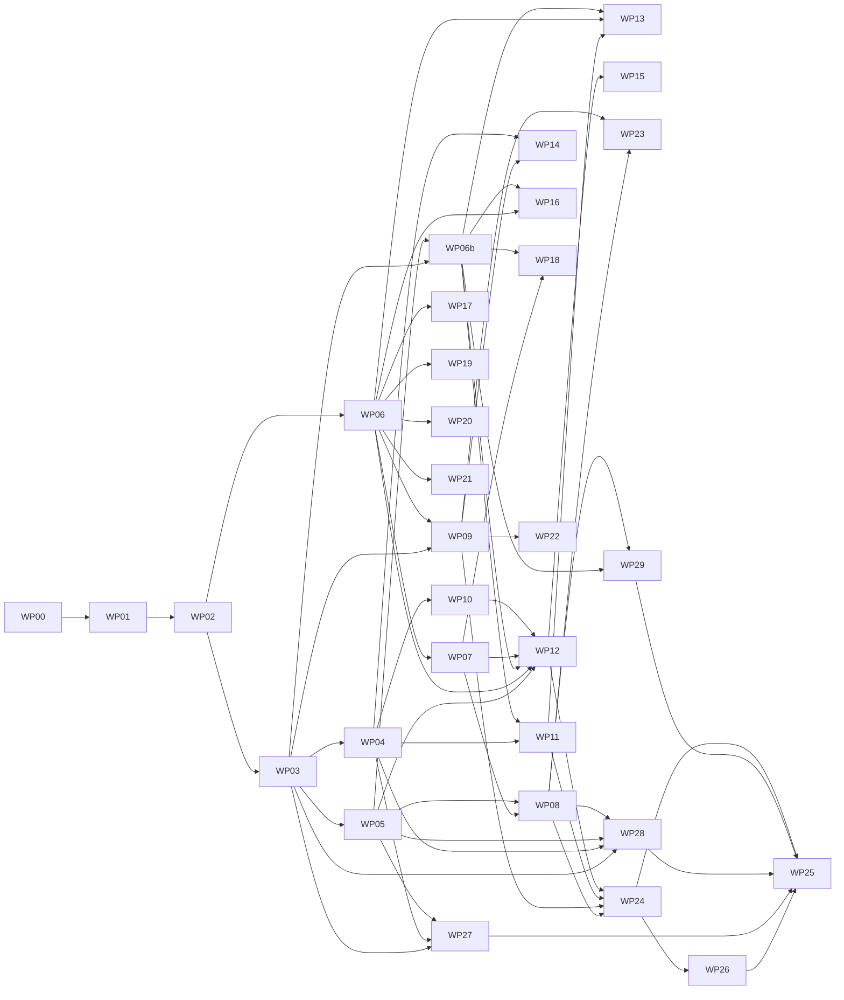

# ip-requirements-implementation-plan.md
## KGF / EOIP — Implementation Plan for `ip-requirements.md`

| Field | Value |
|---|---|
| Document | `ip-requirements-implementation-plan.md` |
| Implements | `ip-requirements.md` v1.1 (all requirement IDs) |
| Date | 2026-10-17 |
| Change log | 1.1 (2026-10-17): added WP-26 (companion disciplines and maturity), WP-27 (Commitment Engineering), WP-28 (Dissent Engineering), WP-29 (Reflex rules); seed data §4.5; end-to-end steps 13–17; new risks. WP-25 now runs last, after WP-26 to WP-29. 1.0 (2026-10-16): first issue. |
| Audience | The AI coding agent building KGF, and the independent verifier |
| Completion rule | A work package is done only when every requirement it covers is `VERIFIED` with an accepted Evidence Pack. Code, test files, commit hashes and green CI are never proof on their own. |

---

## 0. How to use this plan

1. Read `ip-requirements.md` fully, then this plan fully, before writing code.
2. Execute work packages (WPs) in the order of §3. A WP may start only when every WP it depends on has reached its exit gate.
3. Inside a WP, execute tasks in the listed order. Do not skip tasks; do not reorder across dependencies.
4. After every task, update the progress ledger (§6). After every WP, produce Evidence Packs (§5) and request verification.
5. If your context resets, resume using the protocol in §1.4. Never restart a WP from scratch without reading the ledger.

---

## 1. Rules of engagement for the coding agent

### 1.1 Non-negotiable rules

1. **Work inside the existing KGF repository and architecture.** Reuse KGF's graph abstraction, ontology store, ingestion pipeline, model abstraction, auth/RBAC, front-end shell and design system. Create new modules only for the components named in `ip-requirements.md` §4.1.
2. **No stubs on production paths.** Forbidden on any non-test code path: `TODO`/`FIXME`, `NotImplemented`, empty or `pass`-only bodies, hard-coded results, mocks/fakes, random or constant model outputs, always-on/always-off flags. The stub scan (§5.6) enforces this.
3. **Everything behind its feature flag**, default off (`ip-requirements.md` §19.1). Flag off must restore pre-feature behaviour.
4. **Local-first and private.** No calls to external model endpoints or internet services. No tenant data leaves the deployment. Models are local files.
5. **No public release.** Do not push to public remotes, publish packages, or publish docs while `ip.public_release_allowed=false` (REQ-IPH-001). Do not write "patent", "patented", "novel" in code or docs (REQ-IPH-004).
6. **Exact names.** Use the schema fields, enum values, endpoint paths, event topics, metric names, config keys, error codes and permission names exactly as written in `ip-requirements.md`.
7. **No invented behaviour.** If something is not specified, apply the absent-capability rule in the requirement. If none applies, write a Decision Record (DR) proposing the smallest option consistent with the requirements, mark the requirement `BLOCKED` until the DR is recorded as accepted in the ledger by the owner, and continue with other tasks.
8. **Small, traceable changes.** One branch per WP (`ip/WP-NN-short-name`). Commit messages start with requirement IDs (`REQ-WCA-001 REQ-WCA-002: implement compose()`).
9. **Tests are necessary, not sufficient.** Write unit, property-based, integration and end-to-end tests as listed per WP, run the kill-switch control (§5.5), then produce the Evidence Pack from a running instance.

### 1.2 Status values

Use exactly: `NOT-STARTED`, `IN-PROGRESS`, `CODE-COMPLETE`, `EVIDENCED`, `VERIFIED`, `BLOCKED` (definitions in `ip-requirements.md` §0.2). Only `VERIFIED` counts toward completion.

### 1.3 Conflict protocol

If existing code or another requirements document in the repository contradicts `ip-requirements.md`:

1. Add `CONFLICT-IP-NNN` to the ledger: both citations (`file:line`), the requirement IDs affected, and your proposed resolution.
2. Mark only the affected requirements `BLOCKED`.
3. Continue other work.

### 1.4 Resume protocol (after context loss)

1. Read `docs/ip/ip-progress-ledger.md` top to bottom.
2. Read `docs/ip/ip-binding-map.md` and all DRs in `docs/ip/decisions/`.
3. Find the first WP not at its exit gate; within it, the first task not `VERIFIED`/`CODE-COMPLETE`.
4. Run `git status` and the WP's test suite to confirm the recorded state matches reality; if not, correct the ledger first, citing what you observed.
5. Continue from that task.

---

## 2. Artifacts the agent creates and maintains

| Path | Purpose | Created in |
|---|---|---|
| `docs/ip/ip-binding-map.md` | Maps each component and integration point to real repository paths, languages, existing modules reused, and the KGF API base/tenant convention | WP-00 |
| `docs/ip/ip-progress-ledger.md` | One row per requirement ID with status, branch, evidence path, verifier, dates, notes | WP-00 |
| `docs/ip/decisions/DR-IP-NNN.md` | Decision Records | as needed |
| `docs/ip/reference-hardware.md` | CPU, RAM, GPU (if any), OS, database versions used for all performance acceptance | WP-00 |
| `schemas/warrant.schema.json`, `schemas/events/*.json`, `schemas/openapi/ip.yaml` | Canonical schemas | WP-01–WP-03 |
| `evals/**` | Benchmark datasets named in the requirements | WP-01 (seed) and owning WPs |
| `seed/ip-demo/**` | Seeded demo tenant generator (§4) | WP-01 |
| `evidence/<REQ-ID>/**` | Evidence Packs | every WP |
| `docs/ip/verification/WP-NN-report.md` | Independent verification reports | every WP |
| `<module>/INVENTION.md` | Internal invention record (REQ-IPH-005) | each invention WP |

---

## 3. Work package overview and order

| WP | Name | Requirements covered | Depends on |
|---|---|---|---|
| WP-00 | Discovery, binding map, ledger, reference hardware | REQ-PLT-004 (mapping only), §0.4 setup | — |
| WP-01 | Platform foundations | REQ-PLT-001..010, REQ-IPH-001..005, §19.1–19.6 infrastructure, seeded demo tenant | WP-00 |
| WP-02 | Warrant schema, store, record contract, migration | REQ-WAR-001..023 | WP-01 |
| WP-03 | Operator registry, A1, checkpoints, SDK, verification tasks, laundering detection | REQ-OPR-*, REQ-WCA-*, REQ-CHK-*, REQ-SDK-001..003, REQ-VER-*, REQ-LIN-001 | WP-02 |
| WP-04 | SASI (A2) | REQ-SAS-* | WP-03 |
| WP-05 | Change stream, leases, LVC (A3), half-lives (A7) | REQ-LSE-*, REQ-LVC-*, REQ-HLF-* | WP-03 |
| WP-06 | Neural foundation | REQ-NEU-* | WP-02 |
| WP-06b | Shadow branches (Inv 19) | REQ-SHB-* | WP-03, WP-05 |
| WP-07 | Impact engine (Inv 2) | REQ-IMP-* | WP-06, WP-03 |
| WP-08 | Blast-radius budgets (A4, Inv 14) | REQ-BRB-* | WP-07, WP-05 |
| WP-09 | Derivation guard (A5, Inv 16) | REQ-DCG-* | WP-03, WP-06 |
| WP-10 | Status-preserving consolidation (Inv 18) | REQ-MET-001..003 | WP-04 |
| WP-11 | Meaning migration (A6, Inv 17) | REQ-MMG-* | WP-04, WP-06b |
| WP-12 | Metabolism metrics, Brain Health, Neural Ontology Heartbeat (Inv 1) | REQ-MET-010..012, REQ-INV1-* | WP-05, WP-06, WP-06b, WP-07, WP-10 |
| WP-13 | Ontology Advisor (Inv 4) | REQ-INV4-* | WP-06, WP-06b, WP-11 |
| WP-14 | Ask the Brain metapath QA (Inv 3) | REQ-INV3-* | WP-04, WP-06, WP-09 |
| WP-15 | Entity Health (Inv 7) | REQ-INV7-* | WP-05, WP-06, WP-12 |
| WP-16 | Causal layer (Inv 8) | REQ-INV8-* | WP-06, WP-06b |
| WP-17 | Incident forensics (Inv 5) | REQ-INV5-* | WP-06 |
| WP-18 | Smart Dedup (Inv 11) | REQ-INV11-* | WP-06, WP-06b, WP-07 |
| WP-19 | Semantic zoom (Inv 12) | REQ-INV12-* | WP-06 |
| WP-20 | Smart layout (Inv 9) | REQ-INV9-* | WP-06 |
| WP-21 | Federated learning (Inv 6) | REQ-INV6-* | WP-06 |
| WP-22 | Signed export and replay (Inv 10 → 13) | REQ-EXP-* | WP-03, WP-09 |
| WP-23 | MCP wrapper for external agents | REQ-SDK-004 | WP-03, WP-05, WP-08, WP-09 |
| WP-24 | Governance processes and discipline metrics | REQ-PRC-*, REQ-LIN-002, §16 | WP-08, WP-09, WP-11, WP-12 |
| WP-26 | Companion disciplines catalogue and Warrant Engineering maturity | REQ-DSC-*, new §16 metrics for meaning and inference | WP-24 |
| WP-27 | Commitment Engineering (Inv 21) | REQ-CMT-*, REQ-PRC-007 | WP-03, WP-04, WP-05 |
| WP-28 | Dissent Engineering (Inv 22) | REQ-DIS-*, REQ-PRC-008 | WP-03, WP-04, WP-05, WP-08 |
| WP-29 | Reflex rules (feature) | REQ-RFX-*, REQ-PRC-009 | WP-03, WP-06b, WP-08 |
| WP-25 | Hardening, performance, security, end-to-end verification (runs last) | §21 of requirements | all, including WP-26 to WP-29 |

Dependency graph:



Parallel tracks are allowed where the graph permits (e.g., WP-06 alongside WP-03).

---

## 4. Seeded demo tenant (`seed/ip-demo`)

All evidence runs use this tenant so results are reproducible. The generator is deterministic (fixed random seed `20261016`) and idempotent.

### 4.1 Ontology

Types (with `kgf:criticality`, `kgf:domain`): `Person` (1, people), `Team` (2, people), `BusinessCapability` (4, business), `Feature` (3, product), `ApplicationService` (4, software), `API` (3, software), `Class` (2, software), `Rule` (3, software), `TestCase` (2, quality), `Database` (5, infrastructure), `Server` (3, infrastructure), `Container` (2, infrastructure), `ServiceAccount` (5, security), `Deployment` (3, delivery), `Commit` (1, delivery), `Incident` (4, operations), `LayoffPlan` (5, people, `kgf:protected=true`), `TravelBooking` (1, people), `CalendarHold` (1, people), `AccessReview` (3, security).

Relations (with `kgf:impactWeight`, `kgf:impactDirection`): `DEPENDS_ON` (0.9, reverse), `CALLS` (0.8, reverse), `USES` (0.7, reverse), `AUTHENTICATES_WITH` (0.9, reverse), `IMPLEMENTS` (0.6, reverse), `CONTAINS` (0.5, both), `DEPLOYED_TO` (0.6, reverse), `OWNED_BY` (0.2, forward), `MEMBER_OF` (0.1, forward), `TESTS` (0.8, forward), `CHANGED_BY` (0.1, forward), `CAUSED_BY` (0.9, forward), `SUPPORTS` (0.7, reverse), `SUBJECT_OF` (0.0, forward), `BOOKED_FOR` (0.0, forward), `HOLDS` (0.0, forward), `REVIEWS` (0.0, forward). `MEMBER_OF` across tenants and `OWNED_BY` → `Person` are `kgf:blastBarrier=true` for impact.

Rules: property chain `BOOKED_FOR ∘ ...` scenario rules for the derivation guard (§4.4).

### 4.2 Instance data

| Item | Count |
|---|---|
| Entities | 5,000 (distribution recorded in the generator README) |
| Edges | 25,000 |
| History | 365 days of change events with planted exponential lifetimes per type (half-lives: Commit 2 d, Deployment 7 d, Container 10 d, Server 120 d, Database 365 d, Person 400 d, others 60 d) |
| Change → affected pairs | 600 pairs from 120 incidents, 300 test failures, 60 rollbacks, all linked to Commits/Deployments |
| Incidents | 120 with recorded root causes, for Invention 5 |
| Duplicates | 200 planted duplicate pairs with property variations, 200 near-miss non-duplicates |
| Drift injection script | Adds 300 assertions from a new source labelling containers as `Server` (REQ-INV1-009) |
| Causal synthetic set | Separate generator: 20 planted causal links, 200 correlated non-causal pairs (REQ-INV8-006) |
| Agent artifacts | 40 prompts, 10 skills, 15 tool schemas (each with `simulate`), 200 memory records, 150 eval cases, 30 saved queries, 10 report templates — all referencing ontology terms |
| Protected-fact scenarios | 50 leak scenarios (2–4 permitted facts imply a protected fact) and 50 benign scenarios (REQ-DCG-013) |
| Principals | `alice` (tenant admin), `bob` (steward), `carol` (approver), `dave` (analyst, restricted), `agent-std-1` (STANDARD_AGENT), `agent-elev-1` (ELEVATED_AGENT), `agent-ro-1` (READ_ONLY_AGENT) |

### 4.3 Scale dataset

A second generator produces 1,000,000 nodes / 5,000,000 edges with the same ontology for performance acceptance (REQ-IMP-005, REQ-LSE-003). It is not loaded by default.

### 4.4 Second tenant

`beta-demo`: 500 entities, same ontology, used only for tenant-isolation tests.

### 4.5 Seed additions for v1.1

| Item | Content |
|---|---|
| Agent conversations | 300 agent outputs to people and other agents, of which 120 contain promises (40 with explicit dates, 20 conditional), 60 contain near-miss non-promises ("you could…", reported speech), labelled; source for `evals/commitment/extract-v1` (REQ-CMT-003) |
| Commitments | 30 active commitments across `agent-std-1` and `agent-elev-1`, including one `ABOUT` svc-payments due tomorrow 18:00, one already overdue, one conditional on an incident being resolved |
| Credential-rotation tool | A registered tool `rotate_credentials` that returns an `OBSERVED` receipt naming the service account, with `simulate` implemented |
| Deliberation tasks | 100 synthetic decision tasks with a planted decisive fact visible to only one participant (`evals/dissent/minority-v1`), plus 100 hand-labelled stance changes (grounded vs ungrounded) |
| Model families | Two local model families registered so deliberations can satisfy `dissent.diversity_key = model_family`; record which in a DR |
| Replication-lag fact | An `OBSERVED` property `replication_lag_seconds` on customer-db used by REQ-DIS-011 |
| Reflex scenario | Property `compromised` on `ServiceAccount`; tool `disable_tokens` (`EXTERNAL_WRITE`, with `simulate`); 7 days of past events for the dry run (REQ-RFX-003); a burst generator producing 25 matching events in one hour (REQ-RFX-006) |

---

## 5. Evidence protocol

### 5.1 Evidence Pack layout

```text
evidence/<REQ-ID>/
  README.md          what, environment (commit, build id, flags, config), date, who ran it
  run.sh             reproduces the demonstration from a fresh seeded deployment
  transcript/        HTTP request/response pairs (*.http or HAR), trace ids, secrets redacted
  state/             exported persisted state: graph query results, DB rows, warrant JSON, ledger rows
  negative/          negative-path run(s) with error codes
  ui/                screenshots (PNG) or recording (MP4/WebM) incl. empty/loading/error/denied states
  metrics/           /metrics scrape excerpts before and after
  logs/              audit events filtered by trace id
  tests.md           test commands, pass/fail counts, kill-switch control result
  benchmarks/        benchmark command, dataset version, results (when the requirement has thresholds)
```

### 5.2 `run.sh` conventions

- Starts from `make ip-demo-up` (WP-01 creates this target): starts KGF locally with a fresh database, loads `seed/ip-demo`, enables only the flags the requirement needs.
- Uses only public KGF APIs and UI automation (Playwright for UI). No direct database writes except reading state for `state/`.
- Exits non-zero if any expected outcome is not observed. Expected outcomes are asserted inside the script, not described in prose.
- Prints the trace ids it produced.

### 5.3 What counts as evidence

| Accepted | Not accepted on its own |
|---|---|
| Responses captured from a running instance | Pointing to the code that "would" produce the response |
| Persisted state exported after the run | Unit test asserting an in-memory object |
| Negative path observed live | A test named `test_blocks_x` |
| UI screenshot of the real screen with seeded data | Storybook screenshot of a component |
| Metric values scraped from `/metrics` | A metric declaration in code |
| Benchmark run output with dataset version | A claim that performance is adequate |

### 5.4 UI evidence

For each screen: populated state, empty state, loading state (throttled network), error state (backend returning an error via a fault-injection flag), permission-denied state (log in as `dave`), keyboard-only navigation recording, dark theme screenshot.

### 5.5 Kill-switch control

WP-01 implements a test-only flag override (`KGF_TEST_FLAG_OVERRIDE=<flag>=off,…`) that is ignored in production builds. For each requirement:

1. Run the requirement's tests with the flag on. Record pass counts.
2. Run the same tests with the flag off (or, for pure functions, with the implementation swapped for a no-op via dependency injection in the test harness). The behaviour-asserting tests MUST fail.
3. Record both runs in `tests.md`. A suite that passes in both runs is rejected; strengthen it.

### 5.6 Stub scan

WP-01 adds `make ip-stub-scan`, which fails if any IP module path (excluding test folders) matches:

```text
TODO|FIXME|XXX|NotImplemented|raise NotImplementedError|throw new Error\(['"]not implemented|pass\s*$  (in Python function bodies)
mock|fake|dummy|stub  (identifiers in non-test code)
return (0\.5|0|1|true|false|None|null|\[\]|\{\})\s*$  (flagged for manual review in functions documented to compute results)
random\.(random|rand)|Math\.random  (in model inference paths)
@skip|xit\(|it\.skip|pytest\.mark\.skip
```

Every flagged line must be removed or justified in the verification report (e.g., `return []` for a genuinely empty result path covered by a test).

### 5.7 Independent verification procedure

The verifier is a separate agent session (no access to the implementing session) or a human.

1. Check out the WP branch at the recorded commit. Build from scratch.
2. Run `make ip-demo-up`.
3. For each requirement in the WP: run `evidence/<REQ-ID>/run.sh`; compare its output with `transcript/` and `state/` (ids and timestamps may differ; values, decisions, counts and error codes must match).
4. Inspect `ui/` against the live UI for at least one state per screen.
5. Run `make ip-stub-scan` and the kill-switch control for the WP.
6. Review DRs used by the WP.
7. Write `docs/ip/verification/WP-NN-report.md` (template §7.2). Set each requirement to `VERIFIED` or back to `IN-PROGRESS` with reasons.

---

## 6. Progress ledger

`docs/ip/ip-progress-ledger.md` contains one row per requirement ID (generated in WP-00 by parsing `ip-requirements.md` for `REQ-` IDs; the parser's output count is recorded at the top of the ledger and re-checked in WP-25).

```markdown
| REQ ID | WP | Status | Branch / commit | Evidence | Verifier / report | Updated | Notes / DR / CONFLICT |
|---|---|---|---|---|---|---|---|
| REQ-WCA-001 | WP-03 | VERIFIED | ip/WP-03-warrant-core @ 3f2a9c1 | evidence/REQ-WCA-001 | verifier-2 / WP-03-report.md | 2026-11-02 | DR-IP-004 |
```

Top of the ledger: totals by status, by WP, and the date of the last full reconciliation.

---

## 7. Templates

### 7.1 Decision Record

```markdown
# DR-IP-NNN: <title>
- Date:
- Requirements affected:
- Context: (what the repository has / lacks, with file:line citations)
- Options considered:
- Decision:
- Consequences:
- Owner acceptance: (pending | accepted on <date> by <name>)
```

### 7.2 Verification report

```markdown
# WP-NN verification report
- Verifier:            - Date:            - Commit:
- Environment: reference hardware per docs/ip/reference-hardware.md
| REQ ID | run.sh result | transcript match | state match | UI checked | kill-switch | stub scan | Verdict | Notes |
|---|---|---|---|---|---|---|---|---|
- DRs reviewed:
- Issues found:
- Overall WP verdict: PASS | FAIL
```

---

## 8. Work packages in detail

Each WP lists: goal, inputs, tasks, tests, evidence demonstrations and exit gate. "Implement REQ-X" means implement exactly what `ip-requirements.md` specifies for that ID.

### WP-00 — Discovery, binding map, ledger, reference hardware

**Goal:** know exactly where every component goes before writing feature code.

Tasks:

1. Inventory the repository: languages, frameworks, backend services, front-end app, graph database adapters, vector store adapters, ontology store, ingestion pipeline, NL query/LLM features, model abstraction, agent runtime (if any), auth/RBAC, audit, event/messaging, job scheduler, configuration system, feature-flag system, CI. Record each with `file:line` citations.
2. For every row of `ip-requirements.md` §4.2, record what exists and which absent-capability rule applies. Write DRs where a rule offers a choice.
3. Record the API base path and tenant scoping convention; the OpenAPI generation method; the test frameworks; the UI test framework.
4. Record reference hardware in `docs/ip/reference-hardware.md`.
5. Generate the ledger from `ip-requirements.md` (all `REQ-` IDs, status `NOT-STARTED`). Record the total count.
6. Run the existing KGF test suites and record the baseline pass/fail counts (needed for §21.5 of requirements).
7. Create `docs/ip/ip-binding-map.md` with: component → module path, language, reused existing modules, integration points, absent capabilities and DR references.

Exit gate: binding map and ledger committed; baseline test results recorded; owner notified of DRs needing acceptance. No feature code in this WP.

### WP-01 — Platform foundations

**Goal:** the shared plumbing every later WP relies on.

Tasks:

1. **Feature flags** (REQ-PLT-002, §19.1): tenant-scoped flags with runtime toggling, dependency checks (`FLAG_DEPENDENCY`), `GET /flags`, `PUT /flags/{flag}`; test-only override `KGF_TEST_FLAG_OVERRIDE` disabled in production builds (assert at startup).
2. **Configuration keys** (§19.6): register every key with default, type, validation and tenant scope; admin API to read/update with audit.
3. **Tenant guard** (REQ-PLT-001): platform-layer enforcement for all new stores; a test that attempts cross-tenant reads on every new store must fail.
4. **Event infrastructure** (§19.2): topic registry, JSON Schemas in `schemas/events/`, producer/consumer library with at-least-once delivery and idempotency keys. If KGF has no broker, use the transactional-outbox + local broker decision from WP-00 DR.
5. **Audit chain** (§19.4): append-only, hash-chained per tenant; `GET /audit`, `GET /audit/verify-chain`; tamper test (modify one row in a test DB → verify-chain reports the break position).
6. **Observability** (REQ-PLT-009): health, readiness, metrics endpoints for new services; OpenTelemetry propagation; metric naming helper enforcing `kgf_ip_` prefix and `tenant` label.
7. **Permissions** (§19.3): add to RBAC with seed role mappings (tenant admin: all; steward: verification, meaning manage, drift, ontology advise, dedup, commitment manage and transfer, decision record; approver: escalation decide, branch merge, processes sign-off, reflex approve; analyst: read-only, including dissent view and disciplines view).
8. **Error model** (§19.5): shared error type and HTTP mapping.
9. **IP CI gate** (REQ-IPH-001): CI job checks `ip.public_release_allowed` (from a repository-level config file) and fails publishing/public-push jobs with `IP_RELEASE_BLOCKED`; test it with a dry-run publish job.
10. **Licence headers** (REQ-IPH-002) checker for IP module paths.
11. **Stub scan** target `make ip-stub-scan` (§5.6) and **demo targets** `make ip-demo-up`, `make ip-demo-down`.
12. **Seed generator** `seed/ip-demo` (§4) for `acme-demo` and `beta-demo`, plus the scale generator; deterministic; documented.
13. **Evaluation dataset scaffolding** under `evals/` with dataset versioning (content hash in file name or manifest).

Tests: flag dependency matrix; config validation; cross-tenant access attempts; audit chain tamper detection; CI gate dry run; seed determinism (two runs produce identical content hashes).

Evidence demonstrations: toggle a flag at runtime via API and show behaviour change without restart; cross-tenant read attempt denied; audit chain verify before and after tampering; CI gate failing a publish attempt.

Exit gate: all REQ-PLT-* and REQ-IPH-* `VERIFIED`.

### WP-02 — Warrant schema, store, record contract, migration

Tasks:

1. Add `schemas/warrant.schema.json` exactly as in requirements §5.2; generate typed models for every backend language.
2. Implement status order configuration and comparison (REQ-WAR-001/002).
3. Implement warrant persistence: graph nodes `Warrant` with `JUSTIFIES` and `DERIVED_FROM` edges via the graph abstraction for assertion warrants; runtime warrant store with retention (REQ-WAR-013).
4. Implement schema validation on write with JSON-pointer errors (REQ-WAR-010) and immutability (REQ-WAR-011).
5. Implement RFC 8785 canonicalization and sha256 subject hashing (REQ-WAR-012). Test against the RFC 8785 published test vectors.
6. Extend the assertion record contract (§5.3) in the ingestion write path; create warrants transactionally or via outbox (REQ-WAR-020).
7. Enforce REQ-WAR-022 in the graph write path for every database adapter.
8. Implement the migration with dry-run, resumability, idempotency and per-status counts (REQ-WAR-021).
9. Implement `GET /graph/as-of` bitemporal reconstruction (REQ-WAR-023).
10. Implement `GET /warrants/{id}` and `GET /warrants/{id}/lineage` with the latency target (REQ-WAR-014).
11. UI: Warrant Inspector skeleton with real data for stored assertion warrants (18.1: parts available so far).

Tests: schema conformance (valid/invalid fixtures for every field); immutability; downgrade-write rejection on each DB adapter; migration dry run vs real counts on the seeded tenant; as-of reconstruction against the seeded 365-day history (pick 10 timestamps, compare with an independent replay of change events); lineage latency benchmark.

Evidence demonstrations: ingest a JSON record → assertion and `OBSERVED` warrant visible via API and Inspector; attempt a `PREDICTED` overwrite → `WAR_STATUS_DOWNGRADE_WRITE`; migration report counts; as-of query output for a past date.

Exit gate: REQ-WAR-* `VERIFIED`.

### WP-03 — Operator registry, A1, checkpoints, SDK, verification tasks

Tasks:

1. Operator registry store and APIs; approval workflow hook (feeds WP-24); OBSERVER-class validation (REQ-OPR-001..004).
2. Implement `compose()` (A1) as a pure function exactly per requirements §6.2, including scope intersection using the ontology subtype relation (cached).
3. Property-based tests (≥ 10,000 cases each) for no-upgrade, no-widening authority, validity bounds (REQ-WCA-002..004). Use the property-testing library standard for the language (e.g., Hypothesis, fast-check, jqwik).
4. `POST /warrants/compose` (REQ-WCA-006); latency benchmark (REQ-WCA-005).
5. Action-class configuration and minimum-status table (REQ-CHK-001/002).
6. Checkpoint evaluation service and `POST /checkpoints/{checkpoint}/evaluate` with decisions, reasons, events and metrics (REQ-CHK-003..005). At this WP, lease, SASI and κ checks are called through interfaces whose implementations arrive in WP-04/05/08; until then the checkpoint returns `ESCALATE` with reason `DEPENDENCY_NOT_ENABLED` when those flags are off. (This is specified behaviour, not a stub.)
7. Checkpoint SDK in the backend language (REQ-SDK-001/002), plus any other language hosting KGF LLM features.
8. Migrate every existing KGF LLM feature to the SDK (REQ-SDK-003): list each in the binding map with before/after call paths.
9. Answer warrant for every KGF answer and export (REQ-CHK-006).
10. Verification task store, APIs and resolution logic (REQ-VER-001..003).
11. Laundering detection on rejected compositions (REQ-LIN-001).
12. UI: Warrant Inspector complete except export/verify (18.1); Verification Tasks (18.3); Operator Registry (18.19).

Tests: A1 table-driven tests for every operator class; scope intersection cases (subtype, wildcard, selector AND); SDK integration test running a seeded agent flow through all six checkpoints; migrated-feature regression tests (existing KGF tests must still pass); verification resolution creates correct statuses.

Evidence demonstrations: an NL answer in KGF now shows its answer warrant; a handoff from `agent-std-1` to `agent-elev-1` shows authority intersection (receiver cannot exceed sender scopes); an unregistered operator's output capped to `GENERATED` with `OPR_UNREGISTERED`; a verification task resolved by attestation produces an `ATTESTED` warrant.

Exit gate: REQ-OPR-*, REQ-WCA-*, REQ-CHK-*, REQ-SDK-001..003, REQ-VER-*, REQ-LIN-001 `VERIFIED`.

### WP-04 — SASI (A2)

Tasks:

1. Select and package local models for extraction, embedding and NLI; record ids, licences and sizes in a DR; load through `ModelPort`.
2. Implement A2 steps 1–6 exactly (requirements §6.3), including the numbers/dates/identifiers guard with a documented normalizer (number formats, date formats, case, Unicode normalization).
3. Batch NLI inference; latency target (REQ-SAS-005).
4. Fail-closed degradation (REQ-SAS-006) with alert.
5. Wire SASI into the `rewrite` checkpoint for every generator call (REQ-SAS-002).
6. Build `evals/sasi/laundering-v1.jsonl` (≥ 300 hand-checked items: supported paraphrase, unsupported addition, altered number, altered name, merged hearsay, each ≥ 50); benchmark script reporting precision of inheritance and recall of laundering detection (REQ-SAS-004).
7. UI: status-annotated spans with legend, icons and text labels; hover grounds; "verify this" action (18.2).

Tests: unit tests per step; adversarial cases (number changed, entity swapped, negation added); degraded-mode test (NLI container stopped).

Evidence demonstrations: an LLM summary in KGF that adds an unsupported claim shows that claim as `GENERATED` while supported claims keep `OBSERVED`; benchmark report meeting ≥ 0.95 / ≥ 0.90; degraded mode notice.

Exit gate: REQ-SAS-* `VERIFIED`.

### WP-05 — Change stream, leases, LVC (A3), half-lives (A7)

Tasks:

1. Graph change publisher (REQ-LSE-001/002): outbox or CDC per adapter per WP-00 DR; ordered per subject; idempotent consumers.
2. Throughput/lag benchmark at 1,000 changes/s on the scale dataset (REQ-LSE-003).
3. Lease store with the two indexes, sweep job (REQ-LSE-010..012); lease issuance at the `retrieval` checkpoint within a `plan_id` context.
4. Revocation consumer (REQ-LSE-011) with latency measurement.
5. A3 implementation including plan dependency graph handling and partial re-planning in the SDK (REQ-LVC-001..003).
6. Stale-commit metric (REQ-LVC-004).
7. A7: censored exponential fit, Weibull fallback, defaults, nightly refit, history store (REQ-HLF-001), verification-task generation with rate limit (REQ-HLF-002), APIs (REQ-HLF-003).
8. Synthetic recovery tests (REQ-HLF-004) and validation on seeded planted half-lives (each type within 15%).
9. UI: Lease Monitor (18.4); half-life table in Brain Health (18.9, partial).

Tests: revocation ordering under concurrent writes; lease expiry; A3 re-plans only affected steps (plan DAG fixtures with 3 branches, revoke a fact used by one branch); A7 statistical tests.

Evidence demonstrations: REQ-LVC-005 scenario end-to-end via API and Lease Monitor; half-life table showing fitted values for seeded types next to planted values.

Exit gate: REQ-LSE-*, REQ-LVC-*, REQ-HLF-* `VERIFIED`.

### WP-06 — Neural foundation

Tasks:

1. Snapshot exporter for three levels to Parquet with metadata (REQ-NEU-001); respects data classes (REQ-NEU-003).
2. Feature pipeline with versioning (REQ-NEU-002).
3. Training/inference runtime: PyTorch + PyTorch Geometric (or DR), CPU mandatory, GPU optional, neighbour sampling for memory limits (REQ-NEU-010/011).
4. Leakage test harness: for each temporal task, assert no feature timestamp ≥ the prediction time (REQ-NEU-012).
5. Embedding store with versioning and ANN search through the vector abstraction (REQ-NEU-020); Procrustes alignment with stored matrices (REQ-NEU-021).
6. Model registry (REQ-NEU-030..032) with encrypted artifacts, promotion gate hook and rollback.
7. Warranted predictions wrapper: every model inference produces `MODEL`-class warrants (REQ-NEU-013).
8. APIs `/ml/*`.
9. Train a baseline self-supervised link-prediction model on `acme-demo` to prove the pipeline end to end.

Tests: snapshot round-trip (export → load → counts and hashes match); feature version change invalidates caches; Procrustes alignment recovers a known rotation within 1e-6; registry promotion/rollback; restricted-class exclusion.

Evidence demonstrations: snapshot listing; baseline model trained, registered as CANDIDATE, promoted with approval, rolled back; a prediction appears in the graph as a `PREDICTED` assertion beside the observed one.

Exit gate: REQ-NEU-* `VERIFIED`.

### WP-06b — Shadow branches (Invention 19)

Tasks:

1. Copy-on-write branch overlay at the abstraction layer (or native branching per DR) (REQ-SHB-001).
2. `simulate` contract for tools; registry flag for rehearsable tools; seeded tools implement `simulate` (REQ-SHB-002).
3. Plan execution on branch with simulated tools; diff; impact and κ hooks (impact/κ return `DEPENDENCY_NOT_ENABLED` until WP-07/08; SHACL validation required now) (REQ-SHB-003).
4. Merge through the normal commit checkpoint, discard, TTL expiry (REQ-SHB-004).
5. Isolation tests (REQ-SHB-005).
6. UI: Shadow Branches (18.14).
7. `INVENTION.md` for Inv 19.

Tests: branch reads/writes; concurrent branches; merge with leases revoked in between (must re-plan); isolation under 50 concurrent readers.

Evidence demonstrations: an agent plan rehearsed on a branch, diff shown, merged after approval; another plan discarded; branch invisible to `dave` during rehearsal.

Exit gate: REQ-SHB-* `VERIFIED` (κ/impact parts re-verified in WP-08).

### WP-07 — Impact engine (Invention 2)

Tasks:

1. Add `kgf:impactDirection` and other annotations (§4.4) to the ontology store; seed values.
2. Implement prior-mode propagation exactly (requirements §9.1), with gates, bridges (identity in prior mode), decay, noisy-OR, hop limit and ε cut-off.
3. Training dataset builder from change→affected pairs (incidents, test failures, rollbacks, steward reviews) with chronological split and negative sampling.
4. Train R-GAT and HGT candidates; choose by validation AUPRC (DR); learn per-relation decay and per-domain-pair bridge MLPs.
5. Learned-mode gate (REQ-IMP-004) with AUPRC and ECE report; per-tenant mode switch.
6. `POST /impact/propagate` and `GET /impact/runs/{id}` with stored, reproducible runs (REQ-IMP-002/003); deterministic inference (fixed seeds, deterministic kernels or CPU path).
7. Test checklist ranking; summary text through the SDK (warranted).
8. Performance on the scale dataset (REQ-IMP-005).
9. Barrier and tenant-boundary proofs (REQ-IMP-006).
10. UI: Impact Studio (18.5) with ripple animation by hop (reduced-motion alternative), ranked list, checklist, mode/model display, export.
11. `INVENTION.md` for Inv 2.

Tests: hand-computed propagation on a 12-node fixture graph (expected probabilities to 1e-9); barrier zero-mass test; determinism (run twice, identical); learned vs prior gate logic.

Evidence demonstrations: "What is impacted if ServiceAccount `svc-payments` is deleted?" on `acme-demo` → ranked list, checklist, ripple UI; learned-mode gate report; scale benchmark.

Exit gate: REQ-IMP-* `VERIFIED`.

### WP-08 — Blast-radius budgets (A4, Invention 14)

Tasks:

1. κ computation exactly per A4 with union semantics for plans.
2. Budget store per agent identity and class with refill; atomic check-and-debit (row lock / compare-and-swap) (REQ-BRB-002).
3. `POST /actions/authorize`; wire into the `commit` checkpoint (REQ-BRB-001).
4. Escalations store, APIs, approval creating `ATTESTED` warrants (REQ-BRB-003).
5. Budget admin APIs and history (REQ-BRB-004); overrun metric (REQ-BRB-005).
6. Connect κ to shadow-branch diff (WP-06b task 3).
7. UI: Budgets and Escalations (18.6).
8. `INVENTION.md` for Inv 14.

Tests: κ fixture calculations; refill over simulated time; 100 concurrent authorizations without double spend; IRREVERSIBLE always escalates.

Evidence demonstrations: REQ-BRB-006 scenario; concurrency test output; branch rehearsal now showing κ.

Exit gate: REQ-BRB-* `VERIFIED`; REQ-SHB-003 re-verified with κ and impact.

### WP-09 — Derivation guard (A5, Invention 16)

Tasks:

1. Protected-fact registry with pattern syntax, auto-generation from `kgf:protected`, APIs, audit (REQ-DCG-001/002).
2. Rule engine integration (existing or embedded per DR) loading tenant ontology rules (REQ-DCG-011).
3. Link-prediction rules from the WP-06 model above threshold.
4. Session knowledge store and incremental closure cache.
5. A5 exactly, including minimum hitting set (exact for ≤ 20 candidate facts; greedy with logged approximation flag above that, record DR) and fail-closed timeout.
6. Wire into the `retrieval` checkpoint and NL answers (REQ-DCG-010); `POST /derivation/check`, `GET /derivation/blocks` (REQ-DCG-012).
7. Build `evals/dcg/inference-leak-v1` from seeded scenarios; benchmark (REQ-DCG-013); performance test (REQ-DCG-014).
8. UI: Derivation Guard (18.7).
9. `INVENTION.md` for Inv 16.

Tests: each leak scenario blocked; benign scenarios allowed; timeout path; restricted principal vs admin difference.

Evidence demonstrations: `agent-std-1` reads travel bookings and calendar holds (allowed) and the access-review fact that would complete a layoff inference is withheld, with the derivation tree shown in the UI; benchmark report.

Exit gate: REQ-DCG-* `VERIFIED`.

### WP-10 — Status-preserving consolidation (Invention 18)

Tasks:

1. `POST /memory/consolidate` and SDK method implementing REQ-MET-001 (a)–(e).
2. Status markers in exported context (REQ-MET-002).
3. Route every existing memory summarization/compression path in KGF through it (list in binding map).
4. Build `evals/metabolism/consolidation-v1` (≥ 100 sets) and benchmark (REQ-MET-003).
5. `INVENTION.md` for Inv 18.

Tests: mixed-status inputs never merged; lost-support detection creates verification tasks.

Evidence demonstrations: consolidate a memory containing an observed fact, a prediction and hearsay; output keeps three separately warranted statements; benchmark report.

Exit gate: REQ-MET-001..003 `VERIFIED`.

### WP-11 — Meaning migration (A6, Invention 17)

Tasks:

1. Agent-artifact registry and ingestion of all seeded and existing KGF artifacts (REQ-MMG-001).
2. Term extraction (exact, alias, multilingual labels, embedding similarity) and `USED_BY` edges; event-driven and nightly refresh (REQ-MMG-002/003).
3. Ontology diff computation between versions (rename/split/merge/deprecate/constraint/enum).
4. A6 exactly: scoring, rewrite proposals (SPLIT via SDK with SASI), regression eval runner, gate.
5. Release lifecycle, APIs, atomic publish, rollback within target (REQ-MMG-010..013).
6. Orphaned-term metric (REQ-MMG-014).
7. UI: Meaning Release Studio (18.8).
8. `INVENTION.md` for Inv 17.

Tests: diff detection fixtures; rewrite correctness for rename/merge; gate blocks on eval regression; rollback restores hashes.

Evidence demonstrations: REQ-MMG-015 rename and split scenarios end-to-end in the UI.

Exit gate: REQ-MMG-* `VERIFIED`.

### WP-12 — Metabolism metrics, Brain Health, Neural Ontology Heartbeat (Invention 1)

Tasks:

1. Metabolism metrics computation and daily snapshots (REQ-MET-010), APIs (REQ-MET-011).
2. Three-level embeddings per snapshot (REQ-INV1-001) using WP-06.
3. Drift scores with Procrustes alignment, adaptive thresholds (REQ-INV1-002/003).
4. Rule-based drift classifier with documented signals; labelling API; trained-classifier path with gate (REQ-INV1-004).
5. Cross-level correlation (REQ-INV1-005).
6. Self-healing proposal generators with simulated impact on shadow branch (REQ-INV1-006); auto-apply rules (REQ-INV1-007); APIs (REQ-INV1-008).
7. Brain Health score (REQ-MET-012).
8. UI: Brain Health and Metabolism (18.9) with drift hotspots and proposal drill-down.
9. `INVENTION.md` for Inv 1.

Tests: drift detection on synthetic rotations (aligned embeddings with no drift produce no flags; injected shifts flagged); each rule class fixture; auto-apply guard conditions.

Evidence demonstrations: REQ-INV1-009 contamination scenario across two snapshot cycles; Brain Health score changing before/after the fix.

Exit gate: REQ-MET-010..012, REQ-INV1-* `VERIFIED`.

### WP-13 — Ontology Advisor (Invention 4)

Tasks: usage-path mining (REQ-INV4-001); HDBSCAN new-type proposals with stability check (REQ-INV4-002); relation splitting (REQ-INV4-003); subtype/merge proposals (REQ-INV4-004); shadow-branch impact simulation and meaning-release draft creation (REQ-INV4-005); APIs (REQ-INV4-006); UI 18.11; `INVENTION.md`.

Seed support: add to `acme-demo` a relation `CONNECTS_TO` used for three distinct meanings (auth, API call, network) with ≥ 40 edges each, and 60 untyped entities forming two clusters.

Evidence demonstrations: the advisor proposes splitting `CONNECTS_TO` into three relations and two new types; steward approves one → a meaning release draft appears in 18.8.

Exit gate: REQ-INV4-* `VERIFIED`.

### WP-14 — Ask the Brain metapath QA (Invention 3)

Tasks: decomposition and entity linking via SDK (REQ-INV3-001); metapath enumeration (002); scorer Phase 1 and trained scorer path (003); subgraph extraction through derivation guard (004); deterministic query generation for each query language KGF supports, shown to the user (005a); neural path (005b); fusion with warrants and disagreement display (006); SHACL validation (007); eval set ≥ 150 questions and benchmark (008); streaming API and suggested queries from metapaths (009); UI integration with 18.2; `INVENTION.md`.

Evidence demonstrations: each of the five documented question types answered on `acme-demo` with warrants, the generated query, selected metapaths, and (for one question) a visible disagreement between paths; benchmark report.

Exit gate: REQ-INV3-* `VERIFIED`.

### WP-15 — Entity Health (Invention 7)

Tasks: vitality vector job (REQ-INV7-001); event labelling and Cox model; neural survival path with gate (002); outputs and steward queue (003); decision labels (004); APIs (005); evaluation (006); UI 18.17 and vitality badge in explorer; `INVENTION.md`.

Evidence demonstrations: queue showing at-risk critical entities with survival curves and suggested actions; a decision recorded; concordance report ≥ 0.70.

Exit gate: REQ-INV7-* `VERIFIED`.

### WP-16 — Causal layer (Invention 8)

Tasks: candidate pairs (REQ-INV8-001); VAR/Granger with AIC lag selection and BH correction (002); counterfactual removal on shadow branch with the temporal predictor (003); causal layer storage separate from observed relations (004); APIs and Causal lens (005); synthetic validation (006); `INVENTION.md`.

Evidence demonstrations: synthetic set results (recall ≥ 0.7, precision ≥ 0.8); Causal lens in the explorer showing only `CAUSES` edges labelled predicted; a what-if query result.

Exit gate: REQ-INV8-* `VERIFIED`.

### WP-17 — Incident forensics (Invention 5)

Tasks: typed topology-diff vectors and subgraph embeddings (REQ-INV5-001); fingerprint library from seeded incidents (002); matching with graph-diff explanation (003); APIs (004); trade-secret storage (005); UI 18.15.

Evidence demonstrations: hold out 20 seeded incidents; for each, top-5 matches include an incident with the same root-cause type in ≥ 14 of 20 (report the actual number); UI explanation screenshot.

Exit gate: REQ-INV5-* `VERIFIED`.

### WP-18 — Smart Dedup (Invention 11)

Tasks: blocking and ANN candidates (REQ-INV11-001); merge simulation on shadow branch with query replay, SHACL and impact (002); preview, merge via checkpoint, unmerge (003); τ calibration (004); APIs (005); UI 18.16; `INVENTION.md`.

Evidence demonstrations: on the 200 planted duplicates and 200 near-misses, precision ≥ 0.95 and recall ≥ 0.85 at default τ (REQ-INV11-006); a merge preview showing changed query results; merge then unmerge restoring the original state (state hashes).

Exit gate: REQ-INV11-* `VERIFIED`.

### WP-19 — Semantic zoom (Invention 12)

Tasks: pyramid construction (REQ-INV12-001); aligned per-level embeddings with reported alignment (002); cross-level query (003); explorer level switching with morph animation and reduced-motion alternative (004); APIs (005); `INVENTION.md`.

Evidence demonstrations: recording of zooming from L3 to L0 on `acme-demo`; cross-level query at L2 with drill-down; alignment report per level ≥ 0.8.

Exit gate: REQ-INV12-* `VERIFIED`.

### WP-20 — Smart layout (Invention 9)

Tasks: feature extraction (REQ-INV9-001); candidate layouts list from the front-end (002); Phase 1 scorer in a Web Worker and Phase 2 learned path with rating capture (`POST /layout/feedback`) and gate (003); recommendation API and Smart layout toggle (004); registry-only weights (005).

Evidence demonstrations: three different subgraphs (hierarchical dependency chain, dense community, timeline) each get a different top layout with scores shown; rating captured.

Exit gate: REQ-INV9-* `VERIFIED`.

### WP-21 — Federated learning (Invention 6)

Tasks: opt-in settings per class (REQ-INV6-001); local training jobs per tenant (002); DP-SGD with per-class accountant (Opacus or equivalent; DR) (003); secure aggregation and self-hosted coordinator (004); candidate comparison and promotion (005); ledger and audit (006); UI 18.18.

Evidence demonstrations: three federated rounds between `acme-demo` and `beta-demo` (plus a third synthetic tenant) where `beta-demo` opts out of `confidential`; ε ledger per tenant; coordinator logs show only aggregated updates; restricted class never present in any update (inspection of update provenance records).

Exit gate: REQ-INV6-* `VERIFIED`.

### WP-22 — Signed export and replay (Invention 10 folded into 13)

Tasks: tenant signing keys with rotation and public-key endpoint (REQ-EXP-001); export bundle in JSON and PDF with embedded bundle and footer (002); verify and replay against as-of snapshot (003); derivation guard on bundle contents (004); export/verify buttons in 18.1.

Evidence demonstrations: export an Ask-the-Brain answer, verify `MATCH`; alter one byte → signature failure; change underlying data then replay → still `MATCH` against the recorded snapshot; export by `dave` omits facts he cannot read.

Exit gate: REQ-EXP-* `VERIFIED`.

### WP-23 — MCP wrapper for external agents

Tasks: MCP server exposing KGF read tools (results carry warrants) and write tools (require warrants; run commit checkpoint, leases, κ, derivation guard) (REQ-SDK-004).

Evidence demonstrations: an external MCP client reads a fact (warrant returned), attempts a write with a `GENERATED` premise for an `EXTERNAL_WRITE` tool → `CHK_MIN_STATUS`; with an attested premise → allowed and debited.

Exit gate: REQ-SDK-004 `VERIFIED`.

### WP-24 — Governance processes and discipline metrics

Tasks: the six processes with triggers, queues, signed reports and sign-off (REQ-PRC-001..006); laundering audit sampling (REQ-LIN-002); all metrics in requirements §16 with labels; Governance Processes screen (18.12) and Discipline Metrics dashboard (18.13).

Evidence demonstrations: run each process once on `acme-demo`; signed reports listed and verified; dashboard showing every metric with non-zero values from earlier scenarios.

Exit gate: REQ-PRC-*, REQ-LIN-002 and §16 metrics `VERIFIED`.

### WP-26 — Companion disciplines catalogue and maturity

**Goal:** one place where a tenant sees each discipline, its metrics and how far Warrant Engineering is adopted.

Tasks:

1. Implement the new §16 metrics not yet emitted: `kgf_ip_meaning_release_lead_time_hours`, `kgf_ip_meaning_post_release_regression_ratio` (scheduled job 7 days after each publish), `kgf_ip_protected_coverage_ratio`, `kgf_ip_inference_check_coverage_ratio`, `kgf_ip_derivation_false_block_ratio` (needs a "report false block" action in 18.7 and a steward confirmation step).
2. `discipline-registry` with definitions as configuration (REQ-DSC-001), metric time series (REQ-DSC-002).
3. Maturity computation exactly per REQ-DSC-003, as a daily job plus on-demand endpoint (REQ-DSC-004); each criterion returns its measured value and threshold.
4. Permission `ip.disciplines.view` (REQ-DSC-005).
5. UI 18.23 with unmet-criteria links.

Tests: maturity fixtures for each level boundary (tenant states that are exactly at, just above and just below each threshold); metric formulas on hand-built data.

Evidence demonstrations: on `acme-demo`, maturity starts at L0 with all flags off; enabling flags and running the earlier scenarios moves it to L1, L2 and L3 with the criteria view updating; the L4 criteria list the processes still missing a signed run.

Exit gate: REQ-DSC-* and the five new metrics `VERIFIED`.

### WP-27 — Commitment Engineering (Invention 21)

Tasks:

1. System ontology types and graph shape (§23.1) through the graph abstraction; JSON Schema `schemas/commitment.schema.json`; migration that creates the types in every tenant.
2. SDK `commit_to` and `POST /commitments` (REQ-CMT-001).
3. Extractor operator `commitment.extract.v1`, registered as GENERATOR; wiring into `answer` and `handoff` checkpoints; confirm/retract window (REQ-CMT-002).
4. Build `evals/commitment/extract-v1` from the seed (§4.5) and run the benchmark (REQ-CMT-003).
5. Authority check with A1 scope logic and escalation (REQ-CMT-004); feasibility check (REQ-CMT-005).
6. Lifecycle scheduler with conditional triggers on `kgf.graph.changed` (REQ-CMT-006).
7. Evidence-based fulfilment (REQ-CMT-007) and release (REQ-CMT-011).
8. Commit-checkpoint conflict check (REQ-CMT-008) and retrieval injection (REQ-CMT-009).
9. Transfer on agent disable/replace, hooked into KGF's agent identity management (REQ-CMT-010). Absent-capability rule: if KGF has no agent identity lifecycle API, add `POST /agents/{id}/disable` and `POST /agents/{id}/replace` that call the transfer logic; record DR.
10. APIs, metrics, UI 18.20, process REQ-PRC-007 (REQ-CMT-012, 013).
11. `INVENTION.md` for Inv 21.

Tests: state-machine tests for every transition, including conditional commitments; authority denials; fulfilment refused for GENERATED and accepted for OBSERVED evidence; conflict check on modify and delete; transfer with and without successor; scheduler correctness across time zones (store UTC, display tenant zone).

Evidence demonstrations: REQ-CMT-014 scenario end to end via API and UI; extraction benchmark report.

Exit gate: REQ-CMT-* and REQ-PRC-007 `VERIFIED`.

### WP-28 — Dissent Engineering (Invention 22)

Tasks:

1. Deliberation store and schema (§24.1), `schemas/deliberation.schema.json`.
2. SDK `deliberate` and APIs `POST /deliberations`, `/positions`, `/advance`, `/decide` (REQ-DIS-001).
3. Round-0 isolation enforcement and breach detection by hashing every other position's text and ids and scanning each round-0 context before the model call (REQ-DIS-002).
4. Diversity check (REQ-DIS-003), using the model family recorded in the operator registry for agent participants.
5. Stance-shift classification exactly per REQ-DIS-004, using warrant grounds sets per participant per round.
6. Minority report generation, mandatory-report enforcement, automatic revisit triggers (REQ-DIS-005); approver view inside escalations (REQ-DIS-006).
7. Revisit trigger consumer and vindication endpoint (REQ-DIS-007).
8. Metrics (REQ-DIS-008); benchmark `evals/dissent/minority-v1` (REQ-DIS-009).
9. UI 18.21 and process REQ-PRC-008 (REQ-DIS-010).
10. `INVENTION.md` for Inv 22.

Tests: isolation breach injected deliberately is caught; grounded vs ungrounded shift fixtures (new ground, restated ground, ground already seen); decide refused without minority report when required; revisit fires on the right graph change only.

Evidence demonstrations: REQ-DIS-011 scenario end to end; benchmark report.

Exit gate: REQ-DIS-* and REQ-PRC-008 `VERIFIED`.

### WP-29 — Reflex rules (feature)

Tasks:

1. Rule store and validation, including the operator-class check (REQ-RFX-001, 002).
2. Event matcher subscribed to the event bus; condition evaluation on the event subject's neighbourhood through the graph abstraction.
3. Dry run on a shadow branch over 7 days of past matching events; approval with `ATTESTED` warrant; enable gate (REQ-RFX-003).
4. Execution through the commit checkpoint with the rule's budget class; escalation on failure; no automatic retries (REQ-RFX-004).
5. Latency benchmark at 100 matching events per second (REQ-RFX-005).
6. Rate limit and circuit breaker (REQ-RFX-006).
7. APIs, UI 18.22, metric, process REQ-PRC-009 (REQ-RFX-007).

Tests: rule with a GENERATOR operator rejected; enable refused without dry run and approval; circuit opens at the limit and resets after `reflex.circuit_reset`; fire blocked when a lease on the condition fact was revoked between match and commit.

Evidence demonstrations: REQ-RFX-008 scenario end to end with timing output.

Exit gate: REQ-RFX-* and REQ-PRC-009 `VERIFIED`.

### WP-25 — Hardening and end-to-end verification

Tasks:

1. Performance runs for every latency/throughput requirement on reference hardware with the scale dataset; record in `benchmarks/`.
2. Security review: tenant isolation tests across all new stores and APIs (using `beta-demo`); permission matrix tests for every endpoint (allowed/denied per seeded role); input validation fuzzing on all new endpoints (≥ 10,000 requests per endpoint family, no 5xx); secrets not logged.
3. Accessibility audit of all new screens (axe-core zero serious/critical issues; keyboard-only recordings).
4. Flags-off regression: disable every IP flag, run the full pre-existing KGF test suites, compare with the WP-00 baseline (must match).
5. Stub scan clean; licence headers; CI gate active.
6. Ledger reconciliation: parser count of `REQ-` IDs in `ip-requirements.md` equals ledger rows; every row `VERIFIED`.
7. **Final end-to-end scenario** (requirements §21.4) as `evidence/E2E-IP-001/run.sh`, executed by the verifier on a fresh deployment:

| Step | Action | Expected observable result |
|---|---|---|
| 1 | Ingest a JSON batch into `acme-demo` | Assertions with `OBSERVED` warrants; Brain Health intake rises |
| 2 | Ask "What is impacted if service account svc-payments is deleted?" | Warranted answer, generated query shown, metapaths listed, impact list and test checklist |
| 3 | `agent-std-1` plans the deletion; rehearse on a shadow branch | Diff, impact, κ above budget shown |
| 4 | Another user changes a fact the plan used | Lease revoked |
| 5 | Agent commits | `LVC_REPLAN` naming only affected steps; re-plan succeeds |
| 6 | Agent commits again | `BRB_OVER_BUDGET`, escalation created |
| 7 | `carol` approves | `ATTESTED` warrant; action executes; budget unchanged |
| 8 | `agent-std-1` gathers travel, calendar and access-review facts | Derivation guard withholds the completing fact; block logged |
| 9 | Steward publishes a meaning release renaming `CALLS` → `INVOKES` and splitting `CONNECTS_TO` | Affected artifacts rewritten; evals pass; orphaned terms 0 |
| 10 | Run drift injection; next snapshot | Drift event and proposal; steward applies; hotspot clears |
| 11 | Export the step-2 answer and verify | Signature valid; replay `MATCH` |
| 12 | Open Discipline Metrics | Every metric reflects the run |
| 13 | `agent-std-1` promises `bob` to rotate svc-payments credentials by tomorrow 18:00 | `PROPOSED` commitment detected with source span; confirmed to `ACTIVE` |
| 14 | `agent-elev-1` plans to delete svc-payments without referencing the commitment; then `agent-std-1` says "done" in text; then submits the rotation receipt | `CMT_CONFLICT`; fulfilment refused (`CMT_FULFILMENT_UNWARRANTED`); then `FULFILLED` with an `OBSERVED` warrant |
| 15 | Deliberation on restarting customer-db with two model families and `bob` | Round-0 dissent citing replication lag; `UNGROUNDED_SHIFT` recorded; minority report stored and shown to the approver; changing the lag fact fires `kgf.ip.minority.revisit` |
| 16 | Set `compromised=true` on a service account with an enabled reflex rule | Tokens disabled through the commit checkpoint in < 500 ms; warrant shows the approver's authority |
| 17 | Open the Disciplines screen | Six discipline cards with live metrics; Warrant Engineering maturity level with criteria met and unmet |

8. Final report to the owner (§9).

Exit gate: requirements §21 satisfied; all WP verification reports PASS.

---

## 9. Reporting to the owner

At each WP exit and at the end, report:

1. WP id and verdict, link to the verification report.
2. Requirement counts by status (from the ledger).
3. DRs needing owner acceptance, with one-line summaries.
4. `CONFLICT-IP` items open.
5. Benchmark results against thresholds (table).
6. The date each invention's first Evidence Pack was produced (for the owner's invention records, REQ-IPH-005).
7. Reminder of the IP gate status (`ip.public_release_allowed`).

---

## 10. Risk register and prescribed responses

| Risk | Detection | Prescribed response (not optional) |
|---|---|---|
| Too little labelled history for learned models (Inv 2, 1, 4, 7) | Gate metrics fail | Stay in prior/rule/Phase-1 mode as specified; record gate report; requirement can still be `VERIFIED` because prior/Phase-1 mode is specified behaviour, provided the gate and its report work |
| No GPU | WP-00 inventory | CPU path with neighbour sampling; scale benchmarks run on CPU; record in reference hardware |
| Graph DB without transactions across stores | WP-00 | Outbox with compensating step and idempotent consumers per REQ-LSE-002; DR |
| Graph DB without branching | WP-00 | Overlay copy-on-write per REQ-SHB-001; DR |
| No rule engine | WP-00 | Embed a local OWL 2 RL / Datalog engine per REQ-DCG-011; DR |
| Local NLI too slow | WP-04 benchmark | Batch, quantize, smaller model; if still failing, record measured numbers and open `CONFLICT-IP` for owner decision on the latency target (do not silently relax) |
| Existing LLM features bypass the SDK | WP-03 binding map | Every bypass is a defect; route it through the SDK before WP-03 exit |
| Evidence produced on a developer machine with manual setup | Verifier cannot reproduce | Evidence rejected; fix `run.sh` until it runs from `make ip-demo-up` |
| Commitment extractor misses or over-detects promises | REQ-CMT-003 benchmark | Improve the prompt or the local model and re-run; if still below threshold, record measured numbers and open `CONFLICT-IP` for the owner (do not lower thresholds silently). Explicit capture (REQ-CMT-001) still ships |
| Only one local model family available | WP-00 inventory | Use `dissent.diversity_key = context_source` (participants receive different retrieval sources) and record a DR; the diversity check still applies |
| Deliberations add cost and latency | WP-28 benchmark | Deliberation is required only from `dissent.required_from_action_class`; lower classes may opt in |
| Reflex rule acts on a wrong condition | Dry-run report, false-fire reports | Rule cannot be enabled without dry run and approval; circuit breaker and quarterly review (REQ-PRC-009) |
