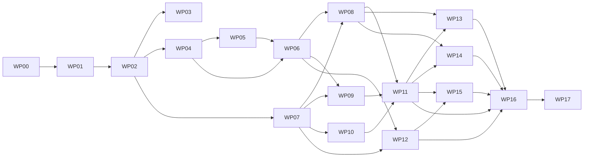

# wisdom-graph-implementation-plan.md
## KGF / EOIP — Implementation Plan for `wisdom-graph-requirements.md`

| Field | Value |
|---|---|
| Document | `wisdom-graph-implementation-plan.md` |
| Implements | `wisdom-graph-requirements.md` v1.0 (all requirement IDs) |
| Date | 2026-10-18 |
| Audience | The AI coding agent building KGF, and the independent verifier |
| Completion rule | A work package is done only when every requirement it covers is `VERIFIED` with an accepted Evidence Pack. Code, test files, commit hashes, coverage and green CI are never proof on their own. |

---

## 0. How to use this plan

1. Read `wisdom-graph-requirements.md` fully, then this plan fully, before writing code. Also read the sections of `ip-requirements.md`, `ip-requirements-implementation-plan.md`, `Graph-Neurons-requirements.md`, `community-ip-requirements.md` and `aspeii-reqirements.md` that §3 of this plan lists as prerequisites for the work package you are about to start.
2. Execute work packages (WPs) in the order of §4. A WP may start only when every WP it depends on, **and every cross-programme gate listed for it**, has reached its exit gate (`VERIFIED`). The tracker refuses to move a requirement out of `NOT-STARTED` otherwise.
3. Inside a WP, execute tasks in the listed order. Do not skip or reorder tasks across dependencies.
4. After every task, update the ledgers (§7). After every WP, produce Evidence Packs (§6) and request independent verification.
5. If your context resets, resume with §1.4. Never restart a WP from scratch without reading the ledger.

---

## 1. Rules of engagement

### 1.1 Non-negotiable rules

1. **Work inside the existing KGF repository and architecture.** Reuse the components named in requirements §0.5. Create new modules only for the components of requirements §4.1.
2. **Reuse, never duplicate.** One checkpoint path, one warrant service, one model registry, one feature store, one shadow-branch service, one impact engine, one change stream. A second implementation of any of them is a defect, even if it is smaller.
3. **No stubs on production paths.** Forbidden on non-test paths: `TODO`/`FIXME`, `NotImplemented`, empty or `pass`-only bodies, hard-coded results (fixed precedent lists, constant lesson statistics, constant similarity, constant counsel effect), mocks or fakes, random or constant model outputs, always-on/always-off flags. `make wg-stub-scan` (§6.6) enforces this.
4. **Decision-time context, never present-day state,** for precedent features, lesson induction, calibration, replay and counterfactuals. Using present-day state where decision-time context is required is a defect (requirements §28.4).
5. **Everything behind its feature flag**, default off (requirements §27.1). Flag off restores pre-feature behaviour.
6. **Local-first and private.** No calls to external model endpoints or internet services. Models are local files or registry artifacts.
7. **No public release.** The IP CI gate covers Wisdom module paths. Do not write "patent", "patented" or "novel" in code or docs.
8. **Exact names.** Use schema fields, enum values, endpoint paths, event topics, metric names, configuration keys, error codes and permission names exactly as written in the requirements.
9. **No invented behaviour.** If something is not specified, apply the absent-capability rule in the requirement. If none applies, write `DR-WG-NNN` proposing the smallest option consistent with the requirements, mark the requirement `BLOCKED` until the owner accepts the DR, and continue with other tasks.
10. **Branches and commits.** One branch per WP, named `wg/WG-WP-NN-short-name`. Commit messages start with requirement IDs (`WG-PRE-001 WG-PRE-002: implement W2 fingerprint and W3 ranking`). If the owner has not authorised branching for the repository (cross-programme decision XP-21 also applies to this programme), stop at WG-WP-00 and ask.
11. **Tests are necessary, not sufficient.** Write unit, property-based, integration, end-to-end and UI tests as listed per WP, run the kill-switch control (§6.5), then produce the Evidence Pack from a running instance.
12. **Thresholds are never lowered.** If a benchmark misses, re-check for defects (leakage, wrong split, wrong labels), try the documented parameters once, then record the measured numbers and open `CONFLICT-WG-NNN` for the owner. Do not edit the threshold.

### 1.2 Status values

Use exactly: `NOT-STARTED`, `IN-PROGRESS`, `CODE-COMPLETE`, `EVIDENCED`, `VERIFIED`, `BLOCKED` (requirements §0.2). Only `VERIFIED` counts.

### 1.3 Conflict protocol

If existing code or another requirements document in the repository contradicts `wisdom-graph-requirements.md`:

1. Add `CONFLICT-WG-NNN` to the ledger with both citations (`file:line`), the requirement IDs affected and a proposed resolution. Add the same entry to the programme tracker's decision log with the affected item ids and "blocks" ticked.
2. Mark only the affected requirements `BLOCKED`.
3. Continue other work.

### 1.4 Resume protocol (after context loss)

1. Read `docs/wisdom/wg-progress-ledger.md` top to bottom, then `docs/programme/programme-ledger.json`.
2. Read `docs/wisdom/wg-binding-map.md` and all DRs in `docs/wisdom/decisions/`.
3. Run `node tools/tracker/verify_programme_ledger.mjs --programme WG --repo .` and correct any requirement whose recorded state the verifier rejects, citing what you observed.
4. Find the first WP not at its exit gate; within it, the first task not `CODE-COMPLETE` or later.
5. Run `git status` and the WP's test suite to confirm the recorded state matches reality; if not, correct the ledger first.
6. Continue from that task.

---

## 2. Artifacts the agent creates and maintains

| Path | Purpose | Created in |
|---|---|---|
| `docs/wisdom/wg-binding-map.md` | Component → module path, language, reused modules, integration points (checkpoint SDK hooks, consequence-service multiplier hook, CTAR artifact registration), absent capabilities with DR references | WG-WP-00 |
| `docs/wisdom/wg-progress-ledger.md` | One row per `WG-` requirement (format §7), totals, last reconciliation date | WG-WP-00 |
| `docs/wisdom/decisions/DR-WG-NNN.md` | Decision Records | as needed |
| `docs/ip/reference-hardware.md` | Reused reference hardware for every performance acceptance (add a Wisdom section) | WG-WP-00 |
| `schemas/wisdom/*.schema.json`, `schemas/events/wisdom/*.json`, `schemas/openapi/wisdom.yaml` | Canonical schemas | WG-WP-01 onward |
| `seed/wisdom-demo/**` | Deterministic Wisdom seed generator (§5) | WG-WP-01 |
| `evals/wisdom/**` | Benchmarks of requirements §28.5 (generated by the seed, content-hashed) | WG-WP-01 and owning WPs |
| `evidence/<WG-ID>/**` | Evidence Packs | every WP |
| `evidence/E2E-WG-001/**` | Final end-to-end Evidence Pack | WG-WP-17 |
| `docs/wisdom/verification/WG-WP-NN-report.md` | Independent verification reports | every WP |
| `<module>/INVENTION.md` | Internal invention record (WG-IPH-004) for candidate modules (requirements §29.2) | WG-WP-08, 09, 11, 13 |
| `docs/programme/programme-ledger.json` | Consolidated programme ledger read by the tracker and verifier | every task |

---

## 3. Cross-programme prerequisites

The Wisdom Graph reuses components built by the other programmes. Each Wisdom WP lists the gates it needs. If a prerequisite gate is not `VERIFIED`, the Wisdom WP is `BLOCKED` and the agent works on the prerequisite (in its own programme, under its own plan) or on another unblocked Wisdom WP. Never build a substitute.

| Wisdom WP | Prerequisite gates in other programmes (tracker ids) | What is reused |
|---|---|---|
| WG-WP-01 | `IP-WP-01.GATE`, `IP-WP-02.GATE` | Flags, configuration, audit chain, tenant guard, events; warrant schema and store |
| WG-WP-02 | `IP-WP-03.GATE`, `IP-WP-05.GATE`, `IP-WP-08.GATE`, `IP-WP-28.GATE` | Checkpoint SDK and commit checkpoint; change stream and leases; escalations; deliberations |
| WG-WP-03 | `IP-WP-04.GATE` | SASI for extracted rationale |
| WG-WP-04 | `IP-WP-02.GATE`, `IP-WP-05.GATE`, `IP-WP-06b.GATE` | As-of reconstruction; change stream; shadow branches for replay |
| WG-WP-05 | `IP-WP-18.GATE` | Smart dedup blocking and candidates |
| WG-WP-06 | `GN-PH0b.GATE` | Numerical stack, feature store, evaluation harness, registry |
| WG-WP-07 | `IP-WP-07.GATE`, `IP-WP-27.GATE`, `IP-WP-28.GATE` | Impact runs for attribution; commitments; dissent vindication |
| WG-WP-08 | `IP-WP-05.GATE` | A7 half-life fitting for lesson freshness |
| WG-WP-09 | `IP-WP-11.GATE` | Meaning releases for policy amendment drafts |
| WG-WP-10 | `IP-WP-28.GATE` | Dissent records for vindication credit |
| WG-WP-11 | `IP-WP-08.GATE`, `IP-WP-28.GATE` | Consequence budgets (κ multiplier); deliberation isolation |
| WG-WP-12 | `IP-WP-06b.GATE`, `IP-WP-07.GATE`, `GN-PH0b.GATE` | Shadow branches, impact, evaluation discipline and anti-stub probes |
| WG-WP-13 | `IP-WP-10.GATE`, `IP-WP-13.GATE` | Status-preserving consolidation; Ontology Advisor |
| WG-WP-14 | `CIP-P4.GATE`, `IP-WP-22.GATE` | CTAR impact and repair; signed export and replay |
| WG-WP-15 | `IP-WP-09.GATE`, `IP-WP-14.GATE`, `IP-WP-23.GATE` | Derivation guard; Ask the Brain; MCP wrapper |
| WG-WP-16 | `IP-WP-24.GATE`, `IP-WP-26.GATE` | Governance process machinery; discipline registry |

ASPEII action certificates and receipts are referenced when they exist (requirements §4.2); no ASPEII gate blocks this programme.

---

## 4. Work package overview and order

| WP | Name | Requirements covered | Depends on | Cross-programme prerequisites |
|---|---|---|---|---|
| WG-WP-00 | Discovery, binding map, ledger, baseline | — (mapping and ledger only) | — | — |
| WG-WP-01 | Foundations: platform, IP handling, system ontology, seed | WG-PLT-001..012, WG-IPH-001..004, WG-ONT-001..006 | WG-WP-00 | IP-WP-01, IP-WP-02 |
| WG-WP-02 | Decision capture at commit | WG-CAP-001..006, WG-CAP-011..014 | WG-WP-01 | IP-WP-03, IP-WP-05, IP-WP-08, IP-WP-28 |
| WG-WP-03 | Off-system decisions and ingest safety | WG-CAP-007..010, WG-SEC-001..002 | WG-WP-02 | IP-WP-04 |
| WG-WP-04 | Decision-time context, event clock, replay | WG-CTX-001..010 | WG-WP-02 | IP-WP-02, IP-WP-05, IP-WP-06b |
| WG-WP-05 | Cross-system identity and joins | WG-ENT-001..006 | WG-WP-04 | IP-WP-18 |
| WG-WP-06 | Precedent | WG-PRE-001..010 | WG-WP-04, WG-WP-05 | GN-PH0b |
| WG-WP-07 | Outcomes and attribution | WG-OUT-001..010 | WG-WP-02 | IP-WP-07, IP-WP-27, IP-WP-28 |
| WG-WP-08 | Lessons | WG-LES-001..014 | WG-WP-06, WG-WP-07 | IP-WP-05 |
| WG-WP-09 | Policies, exceptions, values | WG-POL-001..007, WG-VAL-001..007 | WG-WP-06, WG-WP-07 | IP-WP-11 |
| WG-WP-10 | Judgment calibration | WG-CAL-001..008, WG-SEC-004 | WG-WP-07 | IP-WP-28 |
| WG-WP-11 | Counsel at checkpoints | WG-CNS-001..012 | WG-WP-08, WG-WP-09, WG-WP-10 | IP-WP-08, IP-WP-28 |
| WG-WP-12 | World model and what-if | WG-WLD-001..009 | WG-WP-06, WG-WP-07 | IP-WP-06b, IP-WP-07, GN-PH0b |
| WG-WP-13 | Schema emergence, consolidation, critic | WG-EMG-001..006, WG-MEM-001..007 | WG-WP-08, WG-WP-11 | IP-WP-10, IP-WP-13 |
| WG-WP-14 | Coherence, observability, security hardening | WG-COH-001..006, WG-OBS-001..008, WG-SEC-003, WG-SEC-005, WG-SEC-006 | WG-WP-08, WG-WP-11 | CIP-P4, IP-WP-22 |
| WG-WP-15 | Ask Wisdom and agent tools | WG-ASK-001..006, WG-TLS-001..006 | WG-WP-11, WG-WP-12 | IP-WP-09, IP-WP-14, IP-WP-23 |
| WG-WP-16 | UI, metrics, Wisdom Index, governance | WG-UI-001..015, WG-MET-001..006, WG-PRC-001..005 | WG-WP-11, WG-WP-12, WG-WP-13, WG-WP-14, WG-WP-15 | IP-WP-24, IP-WP-26 |
| WG-WP-17 | Hardening, performance, end-to-end verification (runs last) | requirements §30 (`WG-DOD-1..7`, `E2E-WG-001`) | all of WG-WP-00..16 | — |



Parallel tracks are allowed where the graph permits (for example WG-WP-03, WG-WP-04 and WG-WP-07 after WG-WP-02).

Every requirement belongs to exactly one WP. The allocation above is complete: 200 requirement IDs, each listed once (the tracker parser checks this).

---

## 5. Seeded Wisdom data (`seed/wisdom-demo`)

All evidence runs use the IP demo tenant `acme-demo` (IP plan §4) plus this seed. The generator is deterministic (random seed `20261018`), idempotent, and writes every benchmark under `evals/wisdom/` with a manifest of content hashes. `beta-demo` receives 200 Wisdom decisions for isolation tests only.

### 5.1 Decision types and outcome specs

| Decision type | Domain | Action class | Outcome spec (`spec_id`, metric, horizon, success) | Situation features (`wg:situationFeature`) |
|---|---|---|---|---|
| `DeploymentApproval` | delivery | EXTERNAL_WRITE | `os-deploy-1`, `deploy_rolled_back_or_sev1`, P7D, value == false | service criticality, weekday, canary (bool), change_size_loc, author_team, test_pass_rate, open_incidents |
| `RenewalDiscount` | revenue | EXTERNAL_WRITE | `os-renewal-1`, `churned_180d`, P180D, value == false | discount_pct, service_impact_exception (bool), account_tenure_years, arr_band, open_sev1_incident (bool), quarter_end (bool) |
| `IncidentRemediation` | operations | EXTERNAL_WRITE | `os-incident-1`, `resolved_within_2h`, PT2H, value == true | option (restart_db, failover, scale_out, rollback), replication_lag_seconds, read_replica_available (bool), incident_severity, weekday |
| `AccessGrant` | security | EXTERNAL_WRITE | `os-access-1`, `access_violation_90d`, P90D, value == false | grant_type, requester_team == owner_team (bool), access_review_scheduled_days, system criticality |
| `VendorException` | procurement | INTERNAL_WRITE | `os-vendor-1`, `sla_met_90d`, P90D, value == true | vendor_tier, contract_months, escrow (bool), vendor_region |
| `DataRetentionException` | compliance | INTERNAL_WRITE | `os-retention-1`, `audit_finding_180d`, P180D, value == false | data_class, retention_extension_days, legal_hold_active (bool), system |

Each type has 400 decisions spread over the last 365 days of the IP seed history (2,400 in total), made by `agent-std-1`, `agent-elev-1`, `agent-plan-1` (new STANDARD_AGENT principal added by this seed), `bob` and `carol`, each with options, rationale propositions with warrants, policies applied, approvals and, where planted, exceptions.

### 5.2 Planted lessons, exclusions and null effects

| Id | Decision type | Scope (planted) | Planted rates | Exclusion planted in the counterexample stream |
|---|---|---|---|---|
| L1 | DeploymentApproval | criticality = 5 AND weekday = Fri AND canary = false | failure 0.31 vs baseline 0.07 | change_size_loc < 50 → failure 0.06 |
| L2 | RenewalDiscount | discount_pct > 15 AND service_impact_exception = false | failure (churn) 0.38 vs 0.12 | account_tenure_years ≥ 5 → 0.11 |
| L3 | IncidentRemediation | option = restart_db AND replication_lag_seconds > 300 | failure 0.55 vs 0.15 | read_replica_available = true → 0.14 |
| L4 | AccessGrant | grant_type = standing_admin AND requester_team ≠ owner_team | failure 0.22 vs 0.03 | access_review_scheduled_days ≤ 30 → 0.04 |
| L5 | VendorException | vendor_tier = 3 AND contract_months > 24 | failure 0.40 vs 0.10 | escrow = true → 0.09 |
| L6 | DataRetentionException | data_class = restricted AND retention_extension_days > 180 | failure 0.30 vs 0.05 | legal_hold_active = true → 0.05 |
| N1–N4 | Deployment, Renewal, Incident, Vendor | author_team, quarter_end, weekday, vendor_region | no effect (rates equal to baseline ± sampling noise) | — |

Each lesson scope contains at least 80 of its type's 400 decisions, so every planted effect is learnable at the default `wisdom.lesson_min_leaf` (30). The initial 2,400 decisions contain the lesson effects but almost no decisions inside the exclusion regions. A **counterexample stream** of 120 additional decisions per type (720) inside the lesson scopes, half of them inside the exclusion region, is injected by `make wg-demo-stream` with outcomes arriving over simulated time; W6 must discover the exclusions from it.

### 5.3 Other planted structures

| Item | Content | Used by |
|---|---|---|
| Confounded outcomes | 60 outcomes where two decisions affect the same entity within the horizon with planted true contributions | WG-OUT-009 |
| Attribution truth | For 300 outcomes, the planted responsible decision | WG-OUT-009 |
| Recurring exception | 9 `RenewalDiscount` exceptions to policy `pol-discount-cap-10` in the last 90 days, all with `open_sev1_incident = true`, outcomes successful | WG-POL-007 |
| Random exceptions | 6 exceptions to `pol-vendor-tier3` with no shared condition | WG-POL-007 (no proposal) |
| Judges | `agent-std-1` calibrated; `agent-elev-1` over-confident by +0.2; `agent-plan-1` under-confident by −0.15; 400 decisions each with `stated_confidence` | WG-CAL-007 |
| Vindicated minority | 12 deliberations whose minority position was later right (links to IP seed §4.5) | WG-CAL-008, WG-LES-007 |
| Situation kinds | 2 recurring kinds: "peak-season freeze breach" (DeploymentApproval, 40 decisions) and "multi-region failover" (IncidentRemediation, 35 decisions) | WG-EMG-006 |
| Unwritten rule | Rationale "notified the account owner before approving" in 24 RenewalDiscount decisions with discount > 10%, no policy for it | WG-EMG-004/006 |
| Off-system corpus | 320 labelled items: 120 decisions in chat exports, 60 approvals in email (`.eml`), 40 exceptions in ticket exports (`.csv`), 100 non-decisions (proposals, hypotheticals, reported speech) incl. 30 call transcripts (`.vtt`) | WG-CAP-010 (`evals/wisdom/extract-v1`) |
| Identity pairs | 400 labelled pairs across CRM, ticketing and incident-tool identifiers for the same customers/services, 50% true matches, 20% hard negatives | WG-ENT-006 (`evals/wisdom/identity-v1`) |
| Precedent queries | 200 query situations generated from planted situation families with relevant precedents defined by family membership; a steward spot-checks 20 queries and the check is recorded in a DR | WG-PRE-008 (`evals/wisdom/precedent-v1`) |
| Out-of-distribution set | 50 situations with feature values outside training ranges or unseen label combinations | WG-PRE-003, WG-WLD-004 |
| Replay set | Chronologically last 20% of the 2,400 decisions with decision-time contexts | W12, WG-MET-003 (`evals/wisdom/replay-v1`) |
| Ask set | 150 questions across the seven intents with expected answers; 20 asked as `dave` with expected redactions | WG-ASK-005 (`evals/wisdom/ask-v1`) |
| Injection corpus | 50 off-system items containing instructions aimed at the extractor | WG-SEC-001 |
| Secret canaries | 20 fake secrets and identifiers inside off-system items | WG-SEC-002 |
| Simulation truth | 100 past decisions whose actual assertion changes are recorded; tools have `simulate` | WG-WLD-006 |
| Scale set | Generator option `--scale` producing 1,000,000 decisions with contexts for performance acceptance (not loaded by default) | WG-PRE-009, WG-CNS-004 |

### 5.4 Make targets

- `make wg-demo-up`: runs `make ip-demo-up`, then loads `seed/wisdom-demo` for `acme-demo` and `beta-demo`, enables only the flags the requirement under test needs (passed as `FLAGS=...`), and prints the tenant ids.
- `make wg-demo-stream`: injects the counterexample stream and advances simulated time for outcome observation.
- `make wg-demo-down`: tears the deployment down.
- `make wg-stub-scan`: the stub scan of §6.6 over Wisdom module paths.
- Seed determinism test: two runs produce identical content hashes in `evals/wisdom/manifest.json`.

---

## 6. Evidence protocol

### 6.1 Evidence Pack layout

```text
evidence/<WG-ID>/
  README.md          what was demonstrated; environment (commit, build id, flags, configuration values); date; who ran it
  run.sh             reproduces the demonstration from `make wg-demo-up` (and `make wg-demo-stream` when needed)
  transcript/        HTTP request/response pairs (*.http or HAR) with trace ids; secrets redacted
  state/             exported persisted state: Wisdom records (traces, contexts, outcomes, lessons, counsel), warrants, edges, ledger rows
  negative/          negative-path runs with their error codes
  ui/                screenshots (PNG) or recordings for every screen state of requirements §26
  metrics/           /metrics scrape excerpts before and after
  logs/              audit events filtered by trace id
  tests.md           test commands, pass/fail counts, kill-switch control result
  benchmarks/        command, dataset version and content hash, results, all baselines (numeric requirements)
```

### 6.2 `run.sh` conventions

- Starts from `make wg-demo-up FLAGS=<only the flags the requirement needs>`.
- Uses only public KGF APIs and UI automation (Playwright for UI). No direct database writes; database reads only to export `state/`.
- Asserts every expected outcome inside the script and exits non-zero on any mismatch. Prose descriptions of outcomes are not assertions.
- Prints the trace ids it produced and the content hash of every benchmark dataset it used.

### 6.3 What counts as evidence

| Accepted | Not accepted on its own |
|---|---|
| Responses captured from a running instance seeded with `seed/wisdom-demo` | Pointing at the code that "would" produce the response |
| Persisted Wisdom records exported after the run | A unit test asserting an in-memory object |
| A negative path observed live with its error code | A test named `test_escalates_repeat_mistake` |
| Benchmark output with dataset hash and all baselines | A statement that quality is adequate |
| UI screenshot of the real screen with seeded data | A Storybook or design-tool image |
| Metric values scraped from `/metrics` | A metric declaration in code |
| Replay output against decision-time context | A lesson or precedent computed from present-day state |

### 6.4 UI evidence

For each screen of requirements §26: populated, empty, loading (throttled network), error (fault-injection flag), permission-denied (as `dave`), keyboard-only recording, dark theme, and 390 px mobile width with no horizontal page scroll.

### 6.5 Kill-switch control

Use the IP test-only flag override (`KGF_TEST_FLAG_OVERRIDE`, ignored in production builds). For each requirement: run its behaviour tests with the flag on (pass) and off — or with the implementing component replaced by a no-op through dependency injection for pure functions (W2–W12) — (behaviour tests fail). Record both runs in `tests.md`. A suite that passes both ways is rejected and strengthened.

### 6.6 Stub scan

`make wg-stub-scan` fails if any Wisdom module path (excluding test folders) matches:

```text
TODO|FIXME|XXX|NotImplemented|raise NotImplementedError|throw new Error\(['"]not implemented|pass\s*$  (Python function bodies)
mock|fake|dummy|stub  (identifiers in non-test code)
return (0\.5|0|1|true|false|None|null|\[\]|\{\})\s*$  (flagged for manual review in functions documented to compute results)
random\.(random|rand)|Math\.random  (in similarity, lesson, calibration, counsel or prediction paths)
@skip|xit\(|it\.skip|pytest\.mark\.skip
now\(\)|datetime\.utcnow\(\)|Date\.now\(\)  inside feature extraction for lessons/precedent/calibration (flagged: must use decision-time context)
```

Every flagged line is removed or justified in the verification report.

### 6.7 Independent verification procedure

The verifier is a separate agent session (no access to the implementing session) or a human.

1. Check out the WP branch at the recorded commit; build from scratch.
2. `make wg-demo-up` (and `make wg-demo-stream` where the requirement needs it).
3. For each requirement: run `evidence/<WG-ID>/run.sh`; compare with `transcript/` and `state/` (ids and timestamps may differ; values, decisions, counts, error codes, lesson conditions and benchmark numbers must match within the documented tolerance: exact for counts and codes, 1e-4 for metrics under fixed seeds).
4. Inspect `ui/` against the live UI for at least one state per screen.
5. Run `make wg-stub-scan` and the kill-switch control for the WP.
6. Review the DRs the WP used and the cross-programme decisions that hold any of its requirements.
7. Write `docs/wisdom/verification/WG-WP-NN-report.md` (template §8.2). Set each requirement to `VERIFIED` or back to `IN-PROGRESS` with reasons, in both ledgers.

---

## 7. Ledgers

`docs/wisdom/wg-progress-ledger.md` contains one row per requirement ID, generated in WG-WP-00 by parsing `wisdom-graph-requirements.md` for definition rows (`| WG-<AREA>-<NNN> |` first cells before §28; parser count 200, recorded at the top and re-checked in WG-WP-17):

```markdown
| WG ID | WP | Status | Branch / commit | Evidence | Verifier / report | Updated | Notes / DR / CONFLICT |
|---|---|---|---|---|---|---|---|
| WG-PRE-001 | WG-WP-06 | VERIFIED | wg/WG-WP-06-precedent @ 3f2a9c1 | evidence/WG-PRE-001 | verifier-2 / WG-WP-06-report.md | 2026-12-02 | DR-WG-004 |
```

The same states are recorded in `docs/programme/programme-ledger.json` (schema `eoip-programme-ledger-v1`) so the EOIP programme tracker shows Wisdom progress beside ASPEII, CIP, IP and Graph Neurons. The tracker's "Wisdom progress ledger" export regenerates the Markdown ledger from the JSON ledger; do not edit both by hand. Top of the Markdown ledger: totals by status, by WP, and the date of the last full reconciliation.

---

## 8. Templates

### 8.1 Decision Record

```markdown
# DR-WG-NNN: <title>
- Date:
- Requirements affected:
- Context: (what the repository has / lacks, with file:line citations)
- Options considered:
- Decision:
- Consequences:
- Owner acceptance: (pending | accepted on <date> by <name>)
```

### 8.2 Verification report

```markdown
# WG-WP-NN verification report
- Verifier:            - Date:            - Commit:
- Environment: reference hardware per docs/ip/reference-hardware.md (Wisdom section)
| WG ID | run.sh result | transcript match | state match | UI checked | kill-switch | stub scan | benchmark (value / threshold) | Verdict | Notes |
|---|---|---|---|---|---|---|---|---|---|
- DRs reviewed:
- Cross-programme decisions checked (XP ids):
- Issues found:
- Overall WP verdict: PASS | FAIL
```

### 8.3 Task card (written before each task)

```yaml
task: WG-WP-06/3
requirement_ids: [WG-PRE-001]
behaviour_hypothesis: "W2 similarity ranks same-family seeded situations above other families"
falsifying_check: "precedent-v1 nDCG@10 per component ablation"
write_scope: [precedent_service/]
reused_components: [GN-004 FeatureStore, sasi.embed_model]
decision_time_context_used: true
commands: []
evidence_path: evidence/WG-PRE-001/
status: IN-PROGRESS
```

---

## 9. Work packages in detail

Each WP lists goal, tasks, tests, evidence demonstrations and exit gate. "Implement WG-X" means implement exactly what the requirements specify for that ID.

### WG-WP-00 — Discovery, binding map, ledger, baseline

**Goal:** know exactly where every component goes and what already exists before writing feature code.

Tasks:

1. Read the IP binding map (`docs/ip/ip-binding-map.md`) and record which IP components exist and at which gate (tracker states). Do the same for Graph Neurons (feature store, registry), CIP (CTAR artifact registry) and ASPEII (action certificates, receipts).
2. Inventory the repository for anything decision-, precedent-, outcome- or lesson-like that already exists (e.g., `agents/proposals.py`, `provenance/`, `state/`, audit, `mlops/`), with `file:line` citations, and decide reuse/extend/replace per item (DR when replacing).
3. Record the policy store situation (WG-POL-001), connector availability for off-system sources (WG-CAP-009) and the agent identity source (requirements §4.2).
4. Generate `docs/wisdom/wg-progress-ledger.md` from the requirements (200 rows, `NOT-STARTED`) and add the Wisdom items to `docs/programme/programme-ledger.json` (run `node tools/tracker/verify_programme_ledger.mjs --init` only if the ledger does not exist; otherwise merge).
5. Run the existing KGF test suites and record baseline pass/fail counts (needed for requirements §30 item 5).
6. Create `docs/wisdom/wg-binding-map.md`: component → module path, language, reused modules and hooks (checkpoint SDK capture hook, counsel hook, consequence-service κ-multiplier hook, CTAR artifact registration, MCP tool registration), absent capabilities with DR references.
7. Log the cross-programme decisions that hold Wisdom items (XP-29, XP-30) in the tracker decision log if not already present, and ask the owner to decide them.

Exit gate: binding map, ledger and baseline committed; owner notified of DRs and decisions needing acceptance. No feature code in this WP.

### WG-WP-01 — Foundations

Tasks:

1. Feature flags of requirements §27.1 with dependency checks, registered in the IP flag system (WG-PLT-002).
2. Configuration keys of §27.6 with types, validation and tenant scope, readable/updatable through the IP configuration admin API with audit.
3. Tenant guard on every Wisdom store and the cross-tenant denial test (WG-PLT-001).
4. Permissions of §27.3 with the seed role mapping; error codes of §27.5 in the shared error model; event topics and schemas of §27.2 with `event_seq` assignment.
5. Health, readiness and metrics endpoints for new services; OpenTelemetry propagation (WG-PLT-009).
6. System ontology migration (WG-ONT-001), warrant linkage and rejection of unwarranted records (WG-ONT-002), append-only/supersession semantics (WG-ONT-003), JSON Schemas and generated types (WG-ONT-004), decision-type declaration and `UNCLASSIFIED` handling (WG-ONT-005), meaning-migration registration (WG-ONT-006).
7. IP handling: CI gate coverage of Wisdom paths, licence headers, registry-only tuned parameters, wording check (WG-IPH-001..004).
8. Seed generator `seed/wisdom-demo` (§5) with determinism test; `make wg-demo-up/-stream/-down`, `make wg-stub-scan`.
9. Spooling and readiness behaviour for capture outage (WG-PLT-011) and the "counsel only adds caution" platform rule hook (WG-PLT-012; full property test in WG-WP-11).
10. Kill-switch override wiring and flag-off regression run (WG-PLT-010).

Tests: flag dependency matrix; configuration validation; cross-tenant access attempts on every store; schema conformance fixtures for every record type (valid and invalid per field); supersession immutability; seed determinism; audit chain covers Wisdom events.

Evidence demonstrations: toggle a Wisdom flag at runtime and show behaviour change without restart; cross-tenant read denied and audited; schema rejection with JSON pointer; migration dry run and real run counts; seed manifest hashes identical across two runs.

Exit gate: WG-PLT-*, WG-IPH-*, WG-ONT-* `VERIFIED`.

### WG-WP-02 — Decision capture at commit

Tasks:

1. Implement W1 in `decision-trace-service`, invoked from the checkpoint SDK for the commit, escalation-decision and deliberation-decision paths (WG-CAP-001).
2. SDK `record_decision` and `POST /wisdom/decisions` with actor checks (WG-CAP-002).
3. Idempotency and multi-path merge with the 1,000-interleaving property test (WG-CAP-003).
4. Context hook calling the context service (stubbed only by its feature flag being off — when `wg.context.enabled` is off the trace stores `context_id = null` with reason `CONTEXT_UNAVAILABLE`, which is specified behaviour) (WG-CAP-004).
5. `stated_confidence` capture in SDK and UI prompt (WG-CAP-005); automatic linking of in-KGF approvals, exceptions and escalations (WG-CAP-006).
6. Trajectory recording for SDK agent runs (WG-CAP-011).
7. Latency budget and asynchronous completion (WG-CAP-012); durable spool with the 500-commit chaos test (WG-CAP-013); capture coverage metric (WG-CAP-014).

Tests: W1 table-driven tests per path; BLOCK/ESCALATE evaluations are not boundaries; duplicate and cross-path captures; actor mismatch; latency benchmark at 50 decisions/s; chaos test; coverage metric on seeded commits.

Evidence demonstrations: `agent-std-1` commits an `INTERNAL_WRITE` action → trace with situation, rationale statuses, policies, leases, κ and warrant visible via API; an escalation approved by `carol` → one trace with the approval linked; a deliberation decided → trace linked to the deliberation and minority report; store killed mid-run → no capture lost.

Exit gate: WG-CAP-001..006, 011..014 `VERIFIED`.

### WG-WP-03 — Off-system decisions and ingest safety

Tasks:

1. File import for `.eml`, `.mbox`, chat `.json`, `.vtt`/`.txt`, ticket `.csv` and connector-backed sources when present; `GET /wisdom/ingest/sources` (WG-CAP-009).
2. Extractor operator `wg.extract.v1` registered as GENERATOR with prompt template and local model; spans; `PROPOSED` traces with `GENERATED` status (WG-CAP-007).
3. Decision Inbox verification flow with `ATTESTED` confirmation, edit and rejection reasons (WG-CAP-008); UI part of WG-UI-001 is delivered in WG-WP-16 but the API flow is verified here.
4. Benchmark `evals/wisdom/extract-v1` (WG-CAP-010).
5. Injection corpus handling (WG-SEC-001) and redaction with canaries (WG-SEC-002).

Tests: per-format parsers; span correctness; unverified traces excluded from precedent and lessons; injection corpus; canary scan over stores, logs, metrics and model inputs.

Evidence demonstrations: import the seeded email approval for a discount → proposed trace in the inbox → `bob` confirms → trace `VERIFIED` with `channel = EXTERNAL_VERIFIED`; benchmark report; injection items produce zero approvals.

Exit gate: WG-CAP-007..010, WG-SEC-001..002 `VERIFIED`.

### WG-WP-04 — Decision-time context, event clock, replay

Tasks:

1. `DecisionContext` capture with read set, neighbourhood, versions and digest (WG-CTX-001).
2. Context reconstruction through `GET /graph/as-of` with permission filtering and `EXACT/PARTIAL` (WG-CTX-002).
3. Event clock index with `event_seq` and the timeline API (WG-CTX-003); context rebuild (WG-CTX-004).
4. Temporal join operators in `POST /wisdom/query` with hand-computed fixtures (WG-CTX-005); supersession marking (WG-CTX-006).
5. Replay on a shadow branch and reconsider against present state (WG-CTX-007/008).
6. Performance and retention (WG-CTX-009/010).

Tests: digest determinism; partial reconstruction after a purge; timeline ordering under concurrent writes (ties by `event_seq`); temporal-join fixtures; replay `SAME` for an unchanged decision and `DIFFERENT` after a policy change; retention keeps contexts referenced by active lessons.

Evidence demonstrations: reconstruct the decision-time state of a seeded deployment decision and show a fact that has since changed; timeline of `customer-db` with decisions and events in order; replay and reconsider outputs.

Exit gate: WG-CTX-* `VERIFIED`.

### WG-WP-05 — Cross-system identity and joins

Tasks: `SAME_AS` candidates from Invention 11 and identity keys (WG-ENT-001); usage rules (WG-ENT-002); event joins (WG-ENT-003); semantic join proposals (WG-ENT-004); APIs (WG-ENT-005); benchmark (WG-ENT-006).

Tests: no entity merge ever happens through this service; candidate links unused below threshold; event grouping evidence stored.

Evidence demonstrations: the same customer in CRM, ticketing and incident tool resolved into one timeline; benchmark report.

Exit gate: WG-ENT-* `VERIFIED`.

### WG-WP-06 — Precedent

Tasks:

1. Feature extraction from decision-time context per decision type; W2 fingerprints in the GN-004 FeatureStore, with the FastRP-style numpy fallback for the structural vector until GN-102 is `VERIFIED` (record the active method in `fingerprint_version`) (WG-PRE-001).
2. W3 ranking with authorization before ranking, MMR diversity, failed-precedent inclusion and `NO_PRECEDENT` (WG-PRE-002, 003).
3. Cited and computed precedent edges (WG-PRE-004); Louvain decision communities with stable ids (WG-PRE-005); decision-to-decision causal chains (WG-PRE-006); exception precedents (WG-PRE-007).
4. Benchmark with component ablations (WG-PRE-008); performance at scale (WG-PRE-009); precedent warrants (WG-PRE-010).

Tests: hand-computed similarity on a 10-decision fixture (to 1e-9); authorization-before-ranking (counts identical for an unauthorized caller whether hidden records exist or not); OOD set returns `NO_PRECEDENT` 50/50; community id stability across two runs; chain depth limits.

Evidence demonstrations: precedent search for a Friday deployment shows the two planted rollbacks with why-similar chips; exception-only search for `pol-discount-cap-10`; benchmark report with ablations; scale benchmark.

Exit gate: WG-PRE-* `VERIFIED`.

### WG-WP-07 — Outcomes and attribution

Tasks: outcome spec registry and versioning (WG-OUT-001); observation scheduling with registered observers (WG-OUT-002, 003); `NOT_OBSERVABLE` handling (WG-OUT-004); W4 attribution with confounding (WG-OUT-005); delayed and revised outcomes (WG-OUT-006); commitment and dissent links (WG-OUT-007); APIs (WG-OUT-008); acceptance on seeded truth (WG-OUT-009); coverage metric (WG-OUT-010).

Tests: spec version immutability for past outcomes; observer class validation; retry schedule; attribution fixtures with hand-computed weights; confounding flag; supersession of revised outcomes.

Evidence demonstrations: simulated time advances past the deployment horizon → outcome observed with an `OBSERVED` warrant → attribution weights shown; a confounded case flagged; a manual attested outcome by `carol`.

Exit gate: WG-OUT-* `VERIFIED`.

### WG-WP-08 — Lessons

Tasks:

1. W5 induction job and on-demand run with stored run reports (WG-LES-001); no-upgrade enforcement (WG-LES-002).
2. Lifecycle and approvals (WG-LES-003); applicability evaluation with excluded and near-boundary results (WG-LES-004); credible intervals (WG-LES-005); conflicts (WG-LES-006); dissent links (WG-LES-007).
3. Incremental updates and W6 boundary refinement driven by `make wg-demo-stream` (WG-LES-008); W7 freshness using A7 (WG-LES-001, 014).
4. Planted-lesson benchmark (WG-LES-009); leakage control (WG-LES-010); APIs (WG-LES-011); manual lessons (WG-LES-012); statement format (WG-LES-013); lesson calibration (WG-LES-014).
5. `INVENTION.md` for candidate WG-C1.

Tests: CART and Fisher/BH computations against a fixture computed independently with scipy (same seed); null effects never promoted; future-dated outcome excluded; lesson cannot be written with `OBSERVED` status (`WSD_LESSON_UPGRADE`); W6 proposes the planted exclusion after the stream; freshness decay over simulated time.

Evidence demonstrations: nightly induction on the seed shows L1–L6 candidates with statistics; `bob` approves L1; the counterexample stream adds the L1 exclusion as a new version; benchmark report with recovered/spurious counts.

Exit gate: WG-LES-* `VERIFIED`.

### WG-WP-09 — Policies, exceptions and values

Tasks: policy versions in traces and the authoritative policy store DR (WG-POL-001); exception records with justification (WG-POL-002); exception routing in counsel inputs (WG-POL-003); W10 exception recurrence with proposals feeding meaning-release drafts (WG-POL-004, 007); approval provenance (WG-POL-005); conflict-resolution records (WG-POL-006); value registry, trade-off rules with cycle validation, value conflict detection, value outcomes, APIs and advisory-only guarantee (WG-VAL-001..007); `INVENTION.md` for WG-C4.

Tests: exception without justification rejected; recurrence fixture; trade-off cycle detection; value conflict truth table.

Evidence demonstrations: the planted recurring exception yields one amendment proposal and, after approval, a meaning-release draft; the random exceptions yield none; a value conflict detected for a discount that risks "customer trust" ranked above "revenue".

Exit gate: WG-POL-*, WG-VAL-* `VERIFIED`.

### WG-WP-10 — Judgment calibration

Tasks: W8 for agent judges with incremental and nightly computations (WG-CAL-001, 004); person calibration disabled by default with the DR gate and visibility rules (WG-CAL-002, WG-SEC-004); counsel and deliberation use (WG-CAL-003); APIs (WG-CAL-005); confidence capture metric (WG-CAL-006); synthetic validation (WG-CAL-007); vindication credit (WG-CAL-008).

Tests: incremental equals nightly to 1e-9; shrinkage formula fixture; person endpoints return `WSD_PERSON_CALIBRATION_DISABLED` by default; no bulk person export exists (route sweep).

Evidence demonstrations: reliability diagrams for the three seeded agents; `agent-elev-1` flagged uncalibrated; person calibration request denied.

Exit gate: WG-CAL-*, WG-SEC-004 `VERIFIED`.

### WG-WP-11 — Counsel at checkpoints

Tasks:

1. W9 in `counsel-service`, wired into `commit`, `handoff` and `answer` (WG-CNS-001); effect mapping into checkpoint responses and escalations (WG-CNS-002).
2. κ multiplier hook in `consequence-service` showing κ before/after (WG-CNS-003); timeout fail-open for advice only (WG-CNS-004); out-of-band counsel API (WG-CNS-005).
3. The "counsel only adds caution" property test with ≥ 10,000 cases (WG-CNS-006, WG-PLT-012).
4. Acknowledgements with `ATTESTED` warrants (WG-CNS-007); counsel text through SDK with links and lesson numbers (WG-CNS-008); shadow mode and holdout recording (WG-CNS-009).
5. Repeat-mistake and novelty demonstrations (WG-CNS-010, 011); deliberation round-0 counsel preserving isolation (WG-CNS-012).
6. `INVENTION.md` for WG-C2.

Tests: effect truth table for every combination of guard inputs; κ never lowered; timeout path; agent cannot acknowledge when `wisdom.agents_may_ack = false`; isolation breach detection still passes with counsel in round 0.

Evidence demonstrations: the WG-CNS-010 scenario end to end in API and UI; the WG-CNS-011 novelty scenario; counsel latency benchmark at 1,000,000 decisions.

Exit gate: WG-CNS-* `VERIFIED`.

### WG-WP-12 — World model and what-if

Tasks: W11 training with chronological splits, baselines, calibration, gates and registry entries with seed and environment (WG-WLD-001, 008); `predict` (WG-WLD-002); what-if and counterfactual with shadow-branch simulation (WG-WLD-003); OOD abstention (WG-WLD-004); no-write guarantee (WG-WLD-005); simulation fidelity (WG-WLD-006); acceptance per decision type (WG-WLD-007); performance (WG-WLD-009).

Tests: leakage test; anti-stub probes P1–P4 (P3 permutation gap ≥ 0.10) for every trained model; abstention 50/50 on the OOD set; counterfactual uses decision-time context (a present-day change does not alter the counterfactual answer).

Evidence demonstrations: what-if for the Friday deployment with and without canary shows calibrated probabilities and the shadow-branch diff; a counterfactual for a past discount decision; a decision type reported as "no world model — baselines sufficient" if that is the measured result.

Exit gate: WG-WLD-* `VERIFIED`.

### WG-WP-13 — Schema emergence, consolidation and the critic

Tasks: situation-kind clustering and stability (WG-EMG-001); Ontology Advisor submission (WG-EMG-002); trajectory-informed feature proposals (WG-EMG-003); unwritten rules (WG-EMG-004); APIs (WG-EMG-005); acceptance (WG-EMG-006); W12 archetypes, critic, pruning, rebuild and agent-memory integration (WG-MEM-001..007); `INVENTION.md` for WG-C3.

Tests: critic rejects the harmful negative control; pruning leaves source digests unchanged; rebuild equivalence; stable-cluster criterion.

Evidence demonstrations: the two planted situation kinds proposed and sent to the Ontology Advisor; the planted unwritten rule listed; a critic run accepting a beneficial weight change and rejecting the harmful one.

Exit gate: WG-EMG-*, WG-MEM-* `VERIFIED`.

### WG-WP-14 — Coherence, observability and security hardening

Tasks: CTAR artifact registration and impact for Wisdom records (WG-COH-001); superseded contexts and lesson staling (WG-COH-002); revocation-time filtering without leaks (WG-COH-003); version-change repair (WG-COH-004); trace conflicts (WG-COH-005); coherence metrics (WG-COH-006); "why", entity decisions, agent stats, replay UI hooks, audit, signed export, failed-decision debug view, performance (WG-OBS-001..008); lesson poisoning defence (WG-SEC-003); retention and purge (WG-SEC-005); isolation and membership-inference tests (WG-SEC-006).

Tests: correct a fact used by L1's supporting decisions → lesson `STALE` with `SUPPORT_CORRECTED` when support drops below the minimum; revoke a source → filtered before any worker runs; concentrated evidence flagged; purge under legal hold denied; three-channel membership-inference probe.

Evidence demonstrations: the CTAR correction scenario end to end; a signed `why` export verified by replay; `dave` sees lesson statistics with the hidden-records notice and no drill-down.

Exit gate: WG-COH-*, WG-OBS-*, WG-SEC-003, WG-SEC-005, WG-SEC-006 `VERIFIED`.

### WG-WP-15 — Ask Wisdom and agent tools

Tasks: intent classifier and seven intents through Ask the Brain (WG-ASK-001); deterministic queries shown to the user, warrants, labels (WG-ASK-002); entity and time resolution with ask-back (WG-ASK-003); derivation guard (WG-ASK-004); eval set (WG-ASK-005); streaming API (WG-ASK-006); SDK methods, MCP tools with warrants and write restrictions, schema generation and contract tests over stdio and HTTP, authorization and guard, demonstration (WG-TLS-001..006).

Tests: intent confusion matrix; zero status upgrades in answers; restricted-principal subset; MCP write tool cannot approve or acknowledge on behalf of a person.

Evidence demonstrations: "Why did we approve the 20% discount for Acme?", "What did we do last time customer-db lagged?", "What would happen if we deployed payments on Friday without a canary?" answered with warrants, generated queries, precedents and labels; an external MCP client session per WG-TLS-006.

Exit gate: WG-ASK-*, WG-TLS-* `VERIFIED`.

### WG-WP-16 — UI, metrics, Wisdom Index and governance

Tasks: the 15 screens of requirements §26 with all UI evidence states (WG-UI-001..015); metrics service, holdout uplift with bootstrap CI, replay uplift, Wisdom Index, discipline registry entry and dashboard (WG-MET-001..006); the five governance processes with queues, signed reports and sign-off (WG-PRC-001..005).

Tests: accessibility (axe-core zero serious/critical), keyboard-only flows, 390 px mobile, permission-denied states; metric formulas on hand-built data; Wisdom Index level boundaries (exactly at, just above, just below each threshold); holdout never applied to `REQUIRE_ACK`/`ESCALATE`.

Evidence demonstrations: on `acme-demo` the Wisdom Index starts at W0 with flags off and rises to W1–W3 as features are enabled and scenarios run, with the W4 criteria listing what is still missing; each governance process run once with a signed report.

Exit gate: WG-UI-*, WG-MET-*, WG-PRC-* `VERIFIED`.

### WG-WP-17 — Hardening, performance and end-to-end verification (runs last)

Tasks:

1. Performance runs for every latency requirement on the reference hardware with the scale set; record in `benchmarks/`.
2. Security review: tenant isolation across all Wisdom stores, APIs, MCP tools, metrics and exports with `beta-demo`; permission matrix tests per endpoint and role; input fuzzing (≥ 10,000 requests per endpoint family, no 5xx); secrets never logged.
3. Accessibility audit of all Wisdom screens.
4. Flags-off regression: disable every `wg.*` flag, run the full pre-existing suites, compare with the WG-WP-00 baseline (must match).
5. Stub scan clean; licence headers; CI gate active.
6. Ledger reconciliation: parser count of definition rows in `wisdom-graph-requirements.md` (200) equals ledger rows; every row `VERIFIED`; tracker verifier exits 0 for `--programme WG`.
7. Final end-to-end scenario `evidence/E2E-WG-001/run.sh`, executed by the verifier on a fresh deployment:

| Step | Action | Expected observable result |
|---|---|---|
| 1 | `make wg-demo-up` with all `wg.*` flags and their IP prerequisites on; `wisdom.counsel_mode = ENFORCE` | Wisdom Index W0→ computed; seed decisions visible |
| 2 | `agent-std-1` commits an `INTERNAL_WRITE` change to svc-payments configuration | Trace captured with situation, decision-time context, rationale statuses, policies, leases, κ |
| 3 | Import the seeded email in which `carol` approved a discount above cap on a call | Proposed trace in the inbox; `bob` verifies it; `channel = EXTERNAL_VERIFIED` |
| 4 | Search precedents for a Friday deployment of a criticality-5 service without canary | Ranked precedents including two rollbacks; why-similar chips; novelty shown |
| 5 | Advance simulated time past the deployment horizon | Outcomes observed with `OBSERVED` warrants; attribution weights; one confounded case flagged |
| 6 | Run nightly induction | L1–L6 candidates with statistics; N1–N4 not promoted; `bob` approves L1 |
| 7 | `agent-std-1` plans the same kind of Friday deployment without canary and commits | `ESCALATE` with `WSD_REPEAT_MISTAKE`; κ multiplied; escalation shows lesson, precedents, values |
| 8 | `carol` adds a canary stage and approves | New plan is outside L1's scope; counsel `ADVISE`; action executes; trace links counsel and approval |
| 9 | `make wg-demo-stream` | W6 adds the L1 exclusion (change_size_loc < 50) as a new lesson version |
| 10 | A decision of a seeded type in a situation with no precedent, `EXTERNAL_WRITE` | `REQUIRE_ACK` with `WSD_NOVEL_SITUATION`; acknowledgement by a person; κ multiplier shown |
| 11 | Exception recurrence job | One amendment proposal for `pol-discount-cap-10`; approval creates a meaning-release draft |
| 12 | What-if for the step-7 plan with and without canary; what-if on an OOD situation | Calibrated predictions labelled predicted; abstention on the OOD situation |
| 13 | Correct a fact in the read set of L3's supporting decisions | CTAR marks contexts superseded; L3 `STALE` with `SUPPORT_CORRECTED` if support falls below minimum; counsel cites it as weakened |
| 14 | Ask Wisdom: "Why did we approve the discount in step 3?", "What did we do last time customer-db lagged?", "What would happen if…?" | Warranted answers with generated queries, precedents, lessons with n/rate/baseline, predicted labels |
| 15 | Propose a harmful similarity-weight change | Critic rejects it with the report |
| 16 | Export the step-7 decision's `why` bundle and verify | Signature valid; replay `SAME` against the recorded snapshot |
| 17 | Open the Wisdom Dashboard | Metrics reflect the run; Wisdom Index level with met and unmet criteria |
| 18 | Turn every `wg.*` flag off | KGF behaves as before; existing suites pass; Wisdom records readable read-only |

8. Final report to the owner (§10).

Exit gate: requirements §30 satisfied (`WG-DOD-1..7`), every `E2E-WG-001.Snn` step `VERIFIED`, all WG-WP verification reports PASS.

---

## 10. Reporting to the owner

At each WP exit and at the end, report:

1. WP id and verdict, with the verification report link.
2. Requirement counts by status (from the ledger and `verify_programme_ledger.mjs --programme WG`).
3. DRs needing owner acceptance, one line each.
4. Open `CONFLICT-WG` entries and cross-programme decisions holding Wisdom items.
5. Benchmark results against thresholds (table with baselines).
6. The date each candidate invention's first Evidence Pack was produced (WG-IPH-004).
7. The IP gate status (`ip.public_release_allowed`).

---

## 11. Risk register and prescribed responses

| Risk | Detection | Prescribed response (not optional) |
|---|---|---|
| A prerequisite gate in another programme is not verified | Tracker start gating | Work on the prerequisite under its own plan or another unblocked Wisdom WP; never build a substitute |
| Too few decisions with outcomes for lesson induction in a real tenant | W5 `INSUFFICIENT_DATA` | Report it; counsel shows precedents only; manual lessons (WG-LES-012) remain available; requirement can be `VERIFIED` on the seeded tenant because the behaviour is specified |
| Spurious lessons | Benchmark spurious count, BH q-values | Keep thresholds; review CART depth and leaf size via DR; never lower `wisdom.lesson_min_effect` silently |
| Confounded outcomes mislead lessons | `confounded` flag rate | Excluded by WG-OUT-005; steward attestation path |
| Counsel adds latency to commits | WG-CNS-004 metric | Optimise retrieval and caching; timeout is fail-open for advice only; never skip existing controls |
| People feel monitored by calibration | Owner/legal review | Person calibration stays disabled (WG-CAL-002, XP-30); agents only |
| Off-system extraction over-detects decisions | WG-CAP-010 benchmark | Improve prompt/model, re-run; if still below threshold, record numbers and open `CONFLICT-WG`; human verification still gates every extracted trace |
| Lesson poisoning by one actor | WG-SEC-003 flag | Second approval required; attestation rate limit |
| World model does not beat baselines | WG-WLD-007 | Report "no world model — baselines sufficient" for that type; counsel omits predictions; this is a valid outcome |
| Present-day state leaks into features | Stub scan rule, leakage tests | Defect; fix before evidence |
| Duplicate decision records across ASPEII, IP and Wisdom | XP-29 decision | Wisdom references ASPEII certificates/receipts and IP warrants; never copies them |

<!-- tracker-integration -->

## 12. Tracker procedure

### 12.1 Files

| File | Purpose |
|---|---|
| `tools/tracker/EOIP-programme-tracker.html` | Interactive tracker for ASPEII, CIP, IP, Graph Neurons and the Wisdom Graph |
| `tools/tracker/EOIP-programme-registry.json` | Every tracked item with id, programme, kind, work package, source `file:line`, normative text and its SHA-256 |
| `tools/tracker/programme_rules.js` | The single rules engine used by the tracker page and the verifier |
| `tools/tracker/verify_programme_ledger.mjs` | Command-line verifier; exit 0 only when the requested scope is complete with no problem |
| `docs/programme/programme-ledger.json` | Consolidated ledger (`eoip-programme-ledger-v1`) |

`docs/wisdom/wg-progress-ledger.md` stays the programme's own ledger; the tracker's "Wisdom progress ledger" export regenerates it from the consolidated JSON ledger.

### 12.2 Per-task update loop

1. Write the task card (§8.3). Set the requirement to `IN-PROGRESS` in the tracker (or in `docs/programme/programme-ledger.json`). The tracker refuses this while a prerequisite WG-WP gate or cross-programme gate (§3) is not `VERIFIED`.
2. When code lands, optionally record `CODE-COMPLETE` with the commit and changed paths. This earns nothing.
3. Produce the Evidence Pack from `make wg-demo-up` and record `EVIDENCED` with the fields in §12.3.
4. Only the independent verifier of §6.7 records `VERIFIED`, with `docs/wisdom/verification/WG-WP-NN-report.md` as the verification reference.
5. Log every `CONFLICT-WG-NNN` and `DR-WG-NNN` in the tracker decision log with the affected ids; a blocking entry keeps them below `VERIFIED`.
6. Regenerate `docs/wisdom/wg-progress-ledger.md`, then run:

```bash
node tools/tracker/verify_programme_ledger.mjs --ledger docs/programme/programme-ledger.json --repo . --programme WG
```

### 12.3 Evidence required per transition

A file path, class or function name, test-file name, test count, commit hash, green CI badge, screenshot or an agent's statement is never proof of completion on its own. The tracker and the verifier refuse EVIDENCED unless an executed run is recorded (command, exit code 0, environment, evidence path and its SHA-256, bound to the current requirement text), and refuse VERIFIED unless a reviewer who is not the producer re-ran it and recorded the verification reference.

| Target state | Required evidence (checked by the tracker and by `verify_programme_ledger.mjs`) |
|---|---|
| IN_PROGRESS | Owner and work reference (task card or branch `wg/WG-WP-NN-…`); every prerequisite WG-WP gate and every cross-programme gate of the requirement's WP VERIFIED |
| CODE_COMPLETE | 40-hex commit and changed paths (navigation only, never proof) |
| EVIDENCED | Commit; evidence path `evidence/<WG-ID>/` (requirements), `evidence/E2E-WG-001/` (end-to-end steps) or `docs/wisdom/verification/WG-WP-NN-report.md` (gates) and its SHA-256; producer; `run.sh` command; exit code 0; environment; Evidence Pack complete (README.md, run.sh, transcript/, state/, negative/, metrics/, logs/, tests.md, plus ui/ and benchmarks/ where applicable); kill-switch control (flag on passes, flag off fails); `make wg-stub-scan` clean |
| VERIFIED | Everything above plus an independent verifier (not the implementing session), review date, verification reference `docs/wisdom/verification/WG-WP-NN-report.md` for the requirement's own WP, re-run attestation, and no open CONFLICT-WG or cross-programme decision holding the item |
| FAILED | Failure note with observed numbers or error and a reference to the failing run |
| BLOCKED | Blocking dependency, decision id or missing input |
| STALE | What changed (source, artifact, environment or requirement text) |

Evidence digest: for a file, the SHA-256 of its bytes; for a directory, the SHA-256 of the UTF-8 text made of one line `<path relative to the directory>\t<sha256 of that file>\n` per file, sorted by path.

### 12.4 Decisions to obtain in WG-WP-00

| Decision | Subject | Items held below VERIFIED until DECIDED | Record as |
|---|---|---|---|
| XP-29 | Decision records in three programmes | `WG-CAP-001`, `WG-CAP-003` | DR-WG (binding map) + ASPEII decision ledger |
| XP-30 | Calibrating people's judgment | `WG-CAL-002` | OWNER- / LEGAL- decision record |

- **XP-29 Decision records in three programmes.** The Wisdom decision trace is the only record of the decision's situation, rationale, options, precedents and outcomes. It references the ASPEII certificate, receipt and action digest and the IP warrant, escalation and deliberation by id; it never copies or re-signs them. W1 step 2 merges captures of one action from different paths into one trace.
- **XP-30 Calibrating people's judgment.** Ship with person calibration disabled (agents only). A tenant may enable it only after an owner decision that names the legal basis and the employee notice; records stay visible to the person unless they grant access; never used for personnel decisions.
