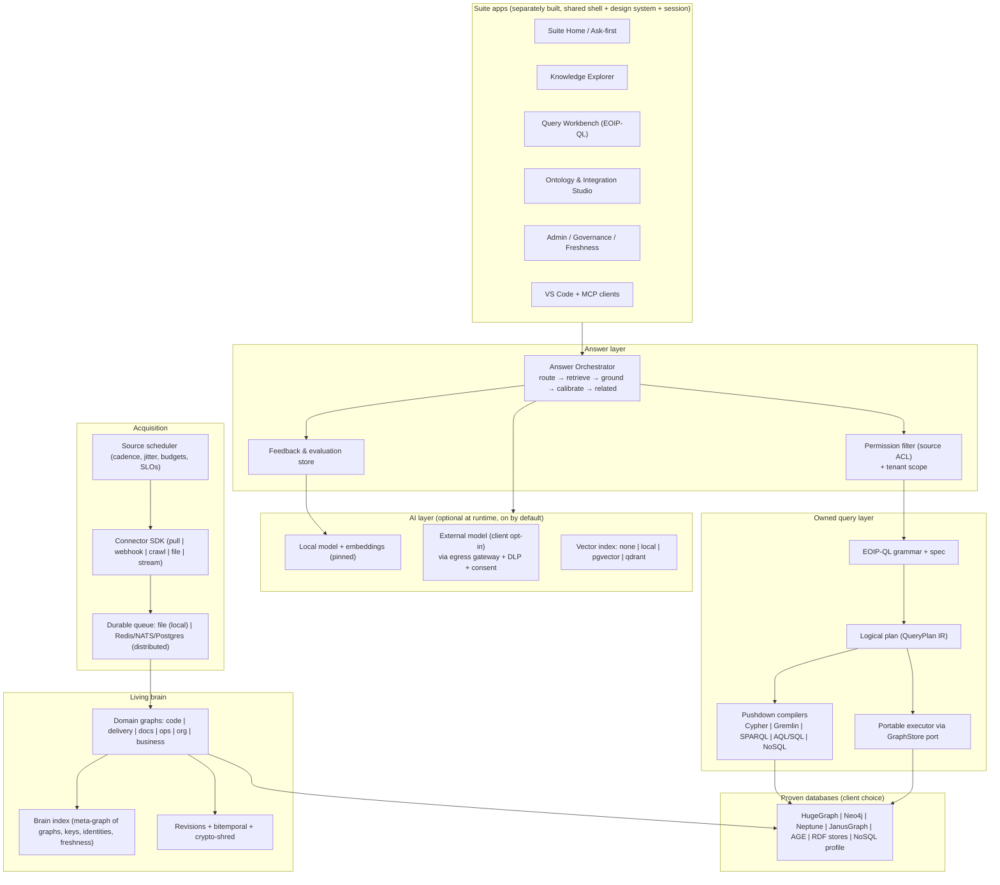

# EOIP Intent Alignment & Drift Analysis

**Date:** 2026-10-27
**Baseline inspected:** branch `dev_local`
**Audience:** the product owner, and the AI coding agent that will execute the corrective work
**Status:** an analysis and a work plan. It does not mark anything complete, and it does not replace the programme acceptance gates.

---

## 0. How an AI coding agent must use this document

1. **Read §2 (the intent) first.** It is the north star. When any other document in this repository conflicts with §2, §2 wins, until the owner rewrites [01-project-vision.md](EOIP-engg-doc-pkg/01-project-vision.md) to match it (work package WP-00).
2. **Work the packages in §9 in phase order.** Phase 0 is non-negotiable. It removes outputs that look real but are simulated, and every later phase depends on users being able to trust what the system returns.
3. **Only executed results count as evidence.** Acceptance means a test or journey ran against the real API, storage, worker and UI boundary, and its output is recorded. A module, a class, a test file, a backlog checkbox, or a passing unit test of a stub is **not** proof of completion. This rule is the repository's own policy ([README.md](README.md) "Current Completion Status"), and the owner has stated it explicitly.
4. **Hard constraints, which an agent must never violate:**
   - No GPL or AGPL dependencies, linked or bundled. See [LICENSING.md](LICENSING.md) and [THIRD_PARTY_NOTICES.md](THIRD_PARTY_NOTICES.md).
   - Use proven databases for storage. Bridge to W3C standards (RDF, SPARQL, SHACL) at the boundary; never build a triplestore, DL reasoner or graph database engine. The owner wants *their own query language and algorithms*, not their own storage engine.
   - The core must keep working offline, with the model stopped, and with no vector database.
   - History is never destroyed. The only exception is lawful erasure, and that must be done by crypto-shredding with an audit record (WP-B05).
   - Never commit secrets. Never weaken [packages/eoip/models/provider.py](packages/eoip/models/provider.py) endpoint validation (CC3-001).
   - Do not commit or push unless the owner asks.
5. **Don't add breadth.** Do not create new packages, programmes, requirement files or "moonshot" modules while Phase 0–2 is open. Most of the drift came from adding breadth (§5, D2).

---

## 1. Executive verdict

**Overall alignment: about 50% (2.6 / 5).** The foundation is aligned and well engineered. The headline promise — a *living organizational brain* that anyone can ask anything and get an evidenced, confidence-scored answer with related answers — is mostly unbuilt, or built as simulation.

### What is genuinely on track

The **governed core** is right, and better than most competitors in this category:

- **Typed graph-store port.** [graph/store.py](packages/eoip/graph/store.py) has real HugeGraph, Neo4j, Neptune, in-memory and RDF (Fuseki/GraphDB) backends, plus Apache AGE and JanusGraph adapters.
- **Provenance-first edges.** [ingestion/pipeline.py](packages/eoip/ingestion/pipeline.py) and [provenance/](packages/eoip/provenance/).
- **A revision-based bitemporal history.** [graph/bitemporal.py](packages/eoip/graph/bitemporal.py) and [graph/evolution.py](packages/eoip/graph/evolution.py).
- **Questions compile to plans, not code.** Natural language becomes a validated `QueryPlan`, never executable Gremlin ([query/executor.py](packages/eoip/query/executor.py)).
- **A hardened local-only model provider.** [models/provider.py](packages/eoip/models/provider.py).
- **An egress gateway with data-flow manifests.** [egress/](packages/eoip/egress/).
- **An honest embedding fallback.** Test hashing embeddings are labelled as such and refused in production ([models/embeddings.py](packages/eoip/models/embeddings.py)).
- **A well-designed connector protocol.** [connectors/base.py](packages/eoip/connectors/base.py): `discover / baseline / poll_changes / handle_event / replay`.
- **Strong evidence and CI discipline.** About 5,221 automated tests, a CP registry, REVA, and receipts.
- **The "three questions" MVP is real.** The `WHY`, `IMPACT`, `PATH` and `WHAT CHANGED` operators are in [query/eql.py](packages/eoip/query/eql.py).

### Where it has drifted

There are two codebases in one repository: a **governed core** and an **aspirational layer** (`brain/`, `moonshot/`, `enterprise/`, the polyglot engine, the "39-database" adapter registry, and `self_llm`). The aspirational layer:

- **Simulates rather than executes.**
  - [graph/database_adapters.py](packages/eoip/graph/database_adapters.py) claims 39+ databases. With no native client injected, `connect()` returns `True`, and queries are translated by regular expressions.
  - [query/polyglot_engine.py](packages/eoip/query/polyglot_engine.py) claims "71 dialects" in 6 functions. It executes by pulling one label and one `WHERE` clause out of the translated text with a regex.
  - [models/self_llm.py](packages/eoip/models/self_llm.py) presents "OPUS_FRONTIER / SONNET_BALANCED" tiers. When no model is configured it generates templated text, plus *invented* XAI: token salience from fixed constants such as `0.4 + 0.35`, and "conformal coverage" computed from those invented numbers.
- **Is the default path for the flagship "ask the brain" endpoint.** [brain/router.py](packages/eoip/brain/router.py) `POST /api/v1/ask` defaults to `target_database=NEO4J` (the dry-run adapter) and `tier=OPUS_FRONTIER`. [brain/brain_os.py](packages/eoip/brain/brain_os.py) hard-codes `confidence=1.0` on the deterministic route and returns simulated XAI on the other.

This directly contradicts the intent: "answer with proper evidence and confidence".

### The ten findings that matter most

| # | Finding | Severity | Evidence |
|---|---|---|---|
| F1 | The flagship `/api/v1/ask` "brain" can return simulated answers, simulated XAI and a hard-coded confidence of 1.0 | **Critical (trust)** | [brain_os.py](packages/eoip/brain/brain_os.py) `ask()`, [self_llm.py](packages/eoip/models/self_llm.py) `generate()` and `_compute_xai_explanation`, [brain/router.py](packages/eoip/brain/router.py) |
| F2 | The organization brain is not *living*: nothing schedules connector syncs; the worker only runs jobs someone submits; only 6 connector modules implement incremental `poll_changes` | **Critical (core promise)** | [apps/worker/main.py](apps/worker/main.py), `grep "def poll_changes" packages/eoip/connectors` |
| F3 | "Anyone in the organization can ask" is unsafe: source-system permissions are never mirrored or enforced in answers. `source_acl_vector` is declared but never written or read | **Critical (security)** | [contracts/canonical.py:76](packages/eoip/contracts/canonical.py#L76); no other references |
| F4 | "Every link carries its evidence" is not enforced at the write port. `evidence_refs` defaults to `[]`, so an edge can be stored with no evidence | High | [ingestion/pipeline.py:121-137](packages/eoip/ingestion/pipeline.py#L121-L137) |
| F5 | The owned query language is fragmented, with no grammar, no specification and no pushdown. There are at least five dialects (EQL, EOQL, OSQL, "semantic QL", QueryPlan) plus the 71-dialect regex engine. Execution traverses on the client through the port, which means N+1 round-trips on remote databases | High | [query/eql.py](packages/eoip/query/eql.py), [query/languages.py](packages/eoip/query/languages.py), [query/ast_compiler.py](packages/eoip/query/ast_compiler.py) (not referenced by other modules), [qlang/](packages/eoip/qlang/) |
| F6 | No NoSQL or other graph database is actually supported beyond the four real backends plus RDF, AGE and Janus. The "39+" list is a contract stub | High | [database_adapters.py](packages/eoip/graph/database_adapters.py) |
| F7 | AI is "required from day 0", but no model ships by default: `EOIP_OLLAMA_MODEL` is empty and Ollama sits behind the opt-in `ai` profile. Nothing captures user feedback, so the model cannot "improve over time" | High | [deploy/docker-compose.yml](deploy/docker-compose.yml) lines 27 and 198-200; no feedback route |
| F8 | Clients cannot choose a governed external or cloud LLM. The provider is local-only by design, and the egress gateway and provider manifests exist but are not wired to model calls | Medium | [models/provider.py](packages/eoip/models/provider.py), [egress/provider.py](packages/eoip/egress/provider.py) |
| F9 | The suite is a proposal, not the current deployment. There are two competing frontends: `apps/web` (deployed) and `frontend/` (preview, with the only dedicated `Ask` screen) | Medium | [docs/EOIP-suite-architecture-plan.md](docs/EOIP-suite-architecture-plan.md), [frontend/src/screens/Ask.tsx](frontend/src/screens/Ask.tsx) |
| F10 | Breadth runaway: about 140 subpackages, about 180k lines of Python, about 806 API operations, 45 root-level markdown files, 548 engineering documents, 13+ overlapping programmes, and **2,603 requirement records, all `UNTRIAGED`** | High (delivery) | `requirements-registry.json`, the root directory listing |

---

## 2. The intention, normalized (canonical intent statements)

The owner's statement, decomposed into testable intent atoms. **I-21 to I-26 are additions from this analysis.** They are implied by the intent, and the product fails without them. The owner invited such additions.

| ID | Intent statement |
|---|---|
| I-01 | Self-hosted at the client, deployable **centrally or distributed**. |
| I-02 | Delivered as a **suite of applications** (preferred), each usable on its own or together as one suite; a single-application mode is also possible. |
| I-03 | **Local-first**, but not local-only. The **client decides** to connect external cloud services or applications, and EOIP provides the connection, fetch, store and governance for that. |
| I-04 | Stores the brain in **proven databases**: HugeGraph, Neo4j, Neptune, other graph databases, **and NoSQL databases**. The database is the client's choice. |
| I-05 | **An owned graph query language** that answers identically from **any** supported database. |
| I-06 | **Every link carries its evidence** (source, extraction method, time, confidence). |
| I-07 | Answers the first three questions **with proof**: *what implements this requirement*, *what changes if this code changes*, *why we believe a link exists*. |
| I-08 | Answers **any** question: deterministic (graph facts), non-deterministic (reasoning or synthesis) and semantic (meaning or similarity). |
| I-09 | Every answer comes with **evidence, a confidence score, and probable related answers**, "and beyond" (follow-ups, impact, who to ask). |
| I-10 | **Anyone in the organization, in any role or type of work**, can ask. |
| I-11 | **Adapters as an SDK or framework** for Jira, Confluence, ServiceNow, GitHub, GitLab and other version control systems, plus "all other systems", using **multiple acquisition methods** (pull, webhook or push, crawl, file, stream). |
| I-12 | The brain is **living**: it is updated continuously or at frequent intervals from every connected system. |
| I-13 | Builds **knowledge graphs, code graphs, meta graphs, and a graph of graphs** (keys and connections across graphs), which together form **one** enterprise living brain. |
| I-14 | Uses **its own algorithms** for building graphs, linking and inference. |
| I-15 | Uses **its own agents**. |
| I-16 | AI is **mandatory but secured**: the organization is never fully exposed to an LLM. |
| I-17 | A **local model is the default from day 0**. It must be trained and ready to work as expected, and it **improves over time**. |
| I-18 | The core works **online and offline, with the model stopped, and with or without a vector database**. |
| I-19 | **History is never destroyed.** |
| I-20 | Features come from **continuous competitive research**. Take what is best from each competitor, turn their weaknesses into EOIP strengths, and become **#1 in the category**. This means absorbing and improving features, not copying or embedding the competitors. |
| I-21 *(added)* | **No fabrication.** Simulated, heuristic or degraded outputs are always labelled, never shown as real answers, and never carry invented confidence. |
| I-22 *(added)* | **Permission-aware answers.** A user only receives facts and evidence they are entitled to in the source system (ACL mirroring and enforcement at query time). This is a prerequisite for I-10. |
| I-23 *(added)* | **Lawful erasure without destroying history.** Crypto-shredding and redaction preserve graph structure and the audit trail while meeting GDPR/DSAR obligations, which reconciles I-19 with the law. |
| I-24 *(added)* | **Measured answer quality.** Golden question sets per role and per domain, with tracked accuracy, citation precision and calibration, because "the best in category" must be measurable. |
| I-25 *(added)* | **Operable at enterprise scale.** Durable distributed job execution, backpressure, freshness SLOs and multi-tenant isolation. |
| I-26 *(added)* | **Explainable freshness.** Every answer states how current its sources are (last sync per source), because a "living" brain must show whether it is alive. |

---

## 3. Method and evidence levels

- **Source inspection** of the packages, routes, configuration, deployment files, documentation and registries listed in the appendix (§12). It was done read-only, at the baseline above.
- **Executed evidence available from this session:** the full Python suite ran once, with 5,221 tests and 1 failure, a Windows timing flake that has since been fixed. All CI static gates, the QA lane and the REVA lanes passed locally. These runs prove that the *components* behave as their tests specify. They **do not** prove any end-to-end user journey in §2.
- **Not done:** no live vendor connectors, no live Neo4j, Neptune or HugeGraph, no live Ollama run, and no UI journey was executed for this analysis. Scores are judgments from source inspection and are labelled that way.

**Score scale:** 0 = absent, 1 = documents or stubs only, 2 = partial code, mostly not wired or simulated, 3 = real and wired, with significant gaps, 4 = real, wired and tested, with minor gaps, 5 = verified end to end at product quality.

---

## 4. Alignment scorecard

| ID | Intent | Score | Verdict | Key evidence | Principal gap |
|---|---|---|---|---|---|
| I-01 | Self-hosted, central or distributed | 3 | Partly aligned | [deploy/](deploy/): Compose, Helm, ArgoCD, HA Compose; [federation/](packages/eoip/federation/) | Job queue is a single filesystem-backed worker ([jobs.py](packages/eoip/jobs.py)), so it is not distributed. No multi-site topology has been proven. |
| I-02 | Suite of applications | 1.5 | Drifted | [suite plan](docs/EOIP-suite-architecture-plan.md) (proposed), [eopisuite/multi/docs](eopisuite/multi/docs/) (documents only) | One deployed web app plus a second, unreconciled frontend. No suite home, no shared session, no per-app builds. |
| I-03 | Local-first, client-controlled external connections | 3 | Partly aligned | [egress/](packages/eoip/egress/) gateway, DLP, vault, provider manifests | Reference cloud adapters are an "External gate". LLM calls are not routed through egress. There is no admin UI for approving data flows. |
| I-04 | Proven databases, any graph or NoSQL database | 2.5 | Partly aligned; overstated | [graph/backends.py](packages/eoip/graph/backends.py) (hugegraph, neptune, neo4j, memory, fuseki, graphdb), [adapters/](packages/eoip/adapters/) (AGE, Janus) | No NoSQL backend. The "39+ databases" registry is a regex dry-run. There is no conformance suite run against each live backend in CI. |
| I-05 | Owned query language, any database | 2 | Drifted (fragmented) | [eql.py](packages/eoip/query/eql.py) (portable through the port), [languages.py](packages/eoip/query/languages.py), [ast_compiler.py](packages/eoip/query/ast_compiler.py), [qlang/manifests](packages/eoip/qlang/manifests/) | No single language, grammar, specification or versioning. No pushdown, so traversal on a remote database costs N+1 calls. Several dialects overlap. |
| I-06 | Evidence on every link | 3 | Partly aligned | [ingestion/pipeline.py](packages/eoip/ingestion/pipeline.py), [provenance/](packages/eoip/provenance/), [contracts/evidence.py](packages/eoip/contracts/evidence.py) | Not enforced at the write port (`evidence_refs=[]` is allowed). No coverage metric is published per domain. |
| I-07 | Three questions with proof | 4 | Aligned | EQL `WHY / IMPACT / PATH / WHAT CHANGED`; `/api/v1/query/why`, `why-not`, `what-changed`, `what-if` ([route_policy.py:58](apps/api/route_policy.py#L58)) | Not exercised against a live backend. No "proof bundle" export per answer. |
| I-08 | Any question (deterministic, non-deterministic, semantic) | 2 | Partly aligned; risky | Governed NL→QueryPlan ([nl.py](packages/eoip/query/nl.py), [nlq.py](packages/eoip/query/nlq.py)), [retrieval/](packages/eoip/retrieval/), [ragx/](packages/eoip/ragx/) | Semantic search needs a configured embedding model. The "brain" path simulates. There is no router that classifies a question and picks deterministic, semantic or synthesis execution with a declared fallback. |
| I-09 | Evidence + confidence + related answers | 2 | Drifted | [contracts/retrieval.py](packages/eoip/contracts/retrieval.py) (citations, evidence manifest) | No calibrated answer-level confidence. No related or alternative answers. Brain confidence is hard-coded. |
| I-10 | Anyone, any role | 1.5 | Drifted | [authz/](packages/eoip/authz/) roles (admin, analyst, viewer, steward) | No persona experiences (developer, QA, PO, executive, support). Source permissions are not mirrored (F3). |
| I-11 | Adapter SDK and framework | 3 | Partly aligned | [connectors/base.py](packages/eoip/connectors/base.py), 34 connector classes, [descriptor.py](packages/eoip/connectors/descriptor.py), [custom_system.py](packages/eoip/connectors/custom_system.py), [connectors/README.md](packages/eoip/connectors/README.md), webhook route `POST /api/v1/sources/{id}/webhooks` | Only 6 modules implement incremental polling. No published, separately versioned SDK package with a certification kit. Live qualification is absent. |
| I-12 | Living brain, continuous updates | 1.5 | **Drifted (core)** | Worker job loop, webhook ingestion, [scheduling/executor.py](packages/eoip/scheduling/executor.py) (an in-process scheduler used by the brain and platform router, not by the connectors) | No connector scheduling, freshness SLOs, freshness indicator or lag dashboard per source. |
| I-13 | Many graph types forming one brain | 2.5 | Partly aligned | 14 domains, 75 vertex labels, 68 edge labels ([ontology/manifest.py](packages/eoip/ontology/manifest.py)); [graph/meta.py](packages/eoip/graph/meta.py); [graph_graph/engine.py](packages/eoip/graph_graph/engine.py) | Graph-of-graphs projections are built in a throwaway `MemoryGraphStore`, not persisted. There is no persisted "brain index" of cross-graph keys. |
| I-14 | Own algorithms | 3 | Partly aligned | [graphbuild/](packages/eoip/graphbuild/) (linking, co-change, link prediction, repair), [identity/](packages/eoip/identity/), [analytics/](packages/eoip/analytics/), [graph/community.py](packages/eoip/graph/community.py) | No benchmark of link precision and recall on labelled data per algorithm. The value of the "own algorithms" is unmeasured. |
| I-15 | Own agents | 3 | Partly aligned | [agents/](packages/eoip/agents/) (governed, firewall, proposals, blast radius), [agentarch/](packages/eoip/agentarch/) | Agent archetypes in the brain path (`RouterAgent`, `LAYAAgent`) sit on simulated generation. No agent evaluation is tied to golden tasks. |
| I-16 | Secure AI | 4 | Aligned | [provider.py](packages/eoip/models/provider.py) (allowlist, DNS-rebinding defence, no redirects), [egress/dlp.py](packages/eoip/egress/dlp.py), [ai/boundary.py](packages/eoip/ai/boundary.py), [models/guardrails.py](packages/eoip/models/guardrails.py) | DLP and redaction are not on the model path, which matters once external models are allowed (I-03). |
| I-17 | Local model from day 0, improving | 1.5 | **Drifted** | Ollama service ([docker-compose.yml](deploy/docker-compose.yml), `profiles: [ai]`), [models/catalog.py](packages/eoip/models/catalog.py), [models/governance.py](packages/eoip/models/governance.py) | No default model is pinned or shipped. No feedback capture. No evaluation-gated update loop (a LoRA adapter, a retrieval tuner or a prompt registry). `self_llm` fakes the capability. |
| I-18 | Works without the model or a vector database | 4 | Aligned | Design rule in the [vision](EOIP-engg-doc-pkg/01-project-vision.md); labelled hashing fallback; memory backend | `brain/*` breaks the rule in spirit: it substitutes simulation instead of degrading honestly. |
| I-19 | History never destroyed | 3.5 | Mostly aligned | Revision vertices, bitemporal queries, tombstones ([pipeline.py](packages/eoip/ingestion/pipeline.py), [bitemporal.py](packages/eoip/graph/bitemporal.py)) | `GraphStore.clear()` is on the public port. Erasure versus immutability is unresolved (crypto-shredding is an "External gate", [privacy/retention.py](packages/eoip/privacy/retention.py)). |
| I-20 | Research-driven, best-in-category | 2.5 | Strong research, weak conversion | [competitive-research-v3](EOIP-engg-doc-pkg/competitive-research-v3/) (matrix, gap register, deep dives), [competitive-research-matrix.csv](competitive-research-matrix.csv) | Research becomes *new programmes and modules* instead of deltas to the existing capability. All 2,603 requirements are untriaged. Competitors' headline numbers become claims inside the code (for example "< 5ms"). |
| I-21 | No fabrication | 1.5 | **Drifted** | Honest: [embeddings.py](packages/eoip/models/embeddings.py), [README](README.md). Dishonest: brain, self_llm, database_adapters, polyglot | See F1 and F6. |
| I-22 | Permission-aware answers | 0.5 | **Absent** | Field only ([canonical.py:76](packages/eoip/contracts/canonical.py#L76)) | See F3. |
| I-23 | Lawful erasure without destroying history | 2 | Partial | [privacy/dsar.py](packages/eoip/privacy/dsar.py), [privacy/governance.py](packages/eoip/privacy/governance.py) | Crypto-shredding is deferred. |
| I-24 | Measured answer quality | 1.5 | Weak | [agents/evaluation.py](packages/eoip/agents/evaluation.py), [evaluation/](packages/eoip/evaluation/), [qa_bench/](qa_bench/) | No golden question set per role with tracked accuracy, citation precision or calibration. |
| I-25 | Enterprise-scale operations | 2 | Partial | HA Compose, Helm, observability Compose | File-backed queue; the API files are oversized and hard to own (`apps/api/main.py` is 1,982 lines, `platform_router.py` 2,051, `app.py` 1,703). |
| I-26 | Explainable freshness | 0.5 | Absent | — | No per-source freshness is attached to answers. |

**Weighted overall:** the core intents (I-04 to I-13 and I-17), weighted ×2, average about 2.3. All intents together average about 2.6 out of 5.

---

## 5. Cross-cutting drift themes

### D1. Two-speed codebase: a governed core and a simulation layer

The repository contains two styles of code:

- **Governed core** (`graph/store` and its backends, `ingestion/pipeline`, `query/executor`, `query/nl`, `retrieval`, `contracts`, `provenance`, `models/provider`, `egress`, `authn`, `authz`). Typed, bounded, honest about what it cannot do, and tested at its boundary.
- **Aspirational layer** (`brain/`, `moonshot/` with 22 modules including `quantum_optimizer.py`, `enterprise/`, `query/polyglot_engine.py`, `query/multi_paradigm_dispatcher.py`, `graph/database_adapters.py`, `graph/vector_graph.py`, `models/self_llm.py`, `graph_graph/`). Docstrings advertise frontier capabilities. The implementation is heuristic, regex-based or simulated, and the fallback is silent: the result's metadata is labelled, but the user-facing answer is not.

The aspirational layer is wired into the public API: [apps/api/app.py:267](apps/api/app.py#L267) mounts the brain router at `/api/v1`, and [platform_router.py](packages/eoip/platform_router.py) has 166 routes. So simulated outputs can reach users and clients through the MCP server.

**Why it matters:** the product's whole value is *trusted answers with proof*. One simulated answer with `confidence: 1.0` discredits the evidenced answers next to it.

### D2. Breadth over depth (programme sprawl)

- **Requirement programmes:** ASPEII, Community/IP, IP/Warrant, Graph Neurons, Wisdom Graph, REVA, CRAr, GUI-UIX, Processing Units, Neural Schema, Living-AI Graffin, Diamond Moonshots, Gaps-audit CP, KGR-G and the master backlog. Each has its own requirements and implementation plan, and they overlap.
- **The requirement registry** holds 2,740 entries, and **every one of the 2,603 records with a status is `UNTRIAGED`**. Nobody can say which requirements are done, partial, duplicated or obsolete.
- **About 806 API operations** (the Postman catalog). Many have no UI consumer and no end-to-end journey.
- **Every competitive research pass creates a new programme**, instead of improving existing capabilities. This is the mechanism behind D1.

### D3. The owned query language is fragmented

The owner wants **one owned language that answers from any database**. What exists instead:

| Artifact | Nature | Problem |
|---|---|---|
| [EQL](packages/eoip/query/eql.py) | Keyword commands (`FIND / PATH / IMPACT / WHY …`) executed through `GraphStore` methods | Portable, but no grammar or composition. It traverses on the client. |
| [EOQL, OSQL, Semantic QL](packages/eoip/query/languages.py) | SQL-flavoured regex parsers | They overlap EQL. |
| [QueryPlan](packages/eoip/contracts/query_plan.py) + [executor](packages/eoip/query/executor.py) | Typed plan with bounded templates | **The best foundation.** It is the IR the language should compile to. |
| [ast_compiler.py](packages/eoip/query/ast_compiler.py) | Typed AST that compiles to Cypher, Gremlin and SPARQL | Not referenced by any other module, so it is never used. |
| [polyglot_engine.py](packages/eoip/query/polyglot_engine.py), [qlang/](packages/eoip/qlang/) | Claims 71 dialects | Executes through a regex. |

**What is missing:** a formal grammar, a versioned specification, a logical plan, a cost-based pushdown to each backend's native language with a client-side fallback, a conformance suite that runs the same query on every backend and expects identical results, and an explain output.

### D4. The brain is not alive

- The ingestion contracts (`baseline`, `poll_changes`, cursors, DLQ, replay) are good.
- **Nothing drives them on a schedule.** There is no per-source cadence, jitter, rate budget, freshness SLO, lag metric, or "last synced" field on answers.
- Push is partial: webhooks exist (`POST /api/v1/sources/{id}/webhooks`).
- Only GitHub, GitLab, Jira, Kubernetes and the generic and factory connectors implement `poll_changes`. Confluence, ServiceNow, Slack, Datadog and the others are batch or demo only.

### D5. The "ask the brain" experience is split and unfinished

- There are three ask paths: `/api/v1/query/nl` (governed), the retrieval/GraphRAG routes, and `/api/v1/ask` (simulated brain). There is no single answer contract.
- Two frontends: `apps/web` (deployed by Compose; NL query is buried in `App.jsx` and the knowledge explorer) and `frontend/` (preview; it has the only dedicated [Ask screen](frontend/src/screens/Ask.tsx), and a bootstrap-admin fallback the suite plan flags as unsafe).
- No answer-level confidence calibration, related answers, follow-up suggestions, "who to ask" (expertise), freshness, or feedback (thumbs up or down, corrections).

### D6. Security posture versus "anyone can ask"

Authentication, route policy, tenancy and egress are strong. But a viewer can receive facts drawn from a Confluence space or Jira project they cannot open in the source system, because source ACLs are never ingested or enforced (F3). Before this is fixed, the product cannot be opened to "anyone in the organization".

### D7. AI posture: secure but static

- **The good:** security hardening (CC3-001), a local-only default, and an honest embedding policy.
- **The gaps:**
  - **(a)** No model is shipped or pinned by default, so on day 0 the AI features are off or simulated.
  - **(b)** No improvement loop: feedback leads to evaluation, which gates a promotion.
  - **(c)** No *governed* option for external or cloud models, which the client should be able to choose. It belongs behind the egress gateway, the DLP and redaction, and per-tenant consent, all of which already exist in [egress/](packages/eoip/egress/).

### D8. The documented vision lags the real intention

[01-project-vision.md](EOIP-engg-doc-pkg/01-project-vision.md) still describes the narrower product (three questions, HugeGraph authoritative, Phase 1 slice). It does not mention any of the following:

- the living brain;
- any question;
- any database, including NoSQL;
- the suite;
- client-chosen cloud connections;
- a model that improves;
- role-based asking;
- related answers.

Agents that read the docs build to the old vision, while research passes add new programmes on top. The result is a large codebase without a single north star.

### D9. Evidence exists but isn't required

The provenance model is excellent. But the write port does not *require* evidence for inferred or bridge edges, and no metric reports "% of edges with evidence, by domain and source".

---

## 6. Role-by-role assessment

Each role gives **aligned** (keep), **drifted** (fix) and **must-do** (that role's top action).

### CTO
- **Aligned:** local-first architecture, a portable storage port, security hardening, and a culture of evidence.
- **Drifted:** spending goes to breadth (moonshots, "71 dialects", "39 databases") instead of the three things that make the product sell: a living brain, trustworthy answers, and permission safety. Simulated outputs are a reputational and legal risk with enterprise buyers.
- **Must-do:** freeze new programmes. Fund Phases 0–2 (§9). Adopt the rule "no simulated output reaches a user".

### Enterprise architect
- **Aligned:** ports and adapters (`GraphStore`, `SourceConnector`), a multi-domain ontology, ontology GitOps ([ontology/gitops.py](packages/eoip/ontology/gitops.py)), bitemporal revisions, and the egress manifest model.
- **Drifted:** no reference architecture for **distributed** deployment (multi-site, federated brains, or a hub-and-spoke "org brain" over departmental brains). Graph-of-graphs projections aren't persisted. There are no NoSQL storage profiles.
- **Must-do:** define the **brain topology** (WP-D03): a persisted meta-graph ("brain index") of graphs, sources, keys and cross-graph identities. Define the federation contract between brains.

### Solution architect
- **Aligned:** the API, worker, MCP and web separation; Compose and Helm; the backend capability registry ([backends.py](packages/eoip/graph/backends.py)).
- **Drifted:** the file-backed single-worker queue blocks the distributed intent. API composition sits in three oversized files with duplicated responsibilities. Two frontends.
- **Must-do:** a queue abstraction with file (local) and Redis Streams, NATS or Postgres (distributed) implementations (WP-E02). Split the API by bounded context (WP-E03). Reconcile the frontends (WP-F01).

### AI architect
- **Aligned:** questions compile to a validated plan, never to generated code; local-only endpoint hardening; guardrails; honest hashing fallback.
- **Drifted:** `self_llm` invents capability and XAI. Nothing routes questions by type (deterministic, semantic or synthesis). No calibration.
- **Must-do:** one **answer orchestrator** (WP-C01) with explicit routing, declared degradation modes and calibrated confidence. Delete or quarantine `self_llm` simulation (WP-A01).

### GenAI architect
- **Aligned:** GraphRAG with citation chains and per-sentence answer citations (CRA-026.7), and RAG variants in `ragx/`.
- **Drifted:** no grounding check (does every sentence cite evidence the user may see?), no answer abstention policy, and no evaluation harness for retrieval or generation.
- **Must-do:** grounded generation with abstention ("I don't have evidence for that") plus a **golden question set** per role (WP-C04). Feed the evaluation results into model and prompt promotion (WP-G02).

### Lead QA
- **Aligned:** large automated suite, sharding, evidence receipts, the REVA mutation lane, and the rule that "skipped ≠ passed".
- **Drifted:** tests prove that stubs behave like stubs. For example, tests for `database_adapters` and `polyglot_engine` pass without any real database. There are no journey tests for the intent atoms.
- **Must-do:** an **intent acceptance suite** (WP-H01), with one executable journey per intent atom (I-01 to I-26) against real services, plus a **backend conformance suite** (WP-D02). Add an anti-simulation test that fails if any user-facing response lacks `execution_mode` or carries a fixed confidence.

### Lead developer
- **Aligned:** typed contracts (pydantic), clear ports, a consistent lint and CI toolchain.
- **Drifted:** overlapping modules for the same concern (5 query languages, 3 ask paths, 2 frontends, several "router" packages: `brain/router`, `moonshot/router`, `enterprise/router`, `advanced_router`, `platform_router`). Oversized files of about 2,000 lines.
- **Must-do:** a consolidation map (§10). Enforce "one concern, one module". Add import-boundary checks (core must not import the aspirational layer).

### UI/UX engineer
- **Aligned:** a design-system start ([design-system/](apps/web/src/design-system/)), an admin console, graph canvas, lenses and i18n.
- **Drifted:** navigation is organized by *engine* ("Cognitive Engineering", "Cognitive Dashboards") instead of *user goal*. No persona home. No "ask anything" box as the primary entry. Answers don't show freshness, confidence or evidence trust in a consistent way.
- **Must-do:** an **Ask-first suite home** (WP-F02): a single search-and-ask bar, an answer card (answer, confidence band, evidence chips, freshness, related answers, follow-ups, "who knows"), and role-tailored starter questions.

### AI engineer
- **Aligned:** model catalog, hardware profiles, embedding versioning and re-embedding jobs.
- **Drifted:** no default model pinned. No feedback dataset. No evaluation-gated promotion. Neural tiers are "unqualified".
- **Must-do:** pin a default local model plus an embedding model that fits the hardware profiles. Ship them through the `ai` profile *on by default* when resources allow. Build the feedback → evaluation → promotion loop (WP-G01, WP-G02).

### Software engineer
- **Aligned:** a clear way to add a connector ([connectors/README.md](packages/eoip/connectors/README.md)).
- **Drifted:** the connector SDK is not packaged or versioned for third parties. There is no scaffolding or certification command.
- **Must-do:** an `eoip-connector-sdk` package with a `eoip connector new <name>` scaffold and a certification harness (WP-B03).

### Digital product owner
- **Aligned:** a strong differentiator story: "every link carries its evidence", local-first, and works offline.
- **Drifted:** no measurable product KPIs: time-to-answer, answer acceptance rate, freshness, evidence coverage, number of active sources.
- **Must-do:** define and publish the product scorecard (WP-H02). Gate releases on it.

### Product owner
- **Aligned:** a deep backlog and research inputs.
- **Drifted:** 2,603 untriaged requirements across overlapping programmes make it impossible to plan.
- **Must-do:** triage (WP-00b). Map every requirement to an intent atom. Mark each as Keep, Merge, Defer or Drop. Collapse the programmes into one roadmap keyed to I-01 to I-26.

### Business analyst
- **Aligned:** domain coverage across engineering, delivery, operations, compliance and documentation domains.
- **Drifted:** the ontology is engineering-centric. Business domains (customers, contracts, finance, HR or organization structure, processes, KPIs) are thin, so "anyone in any role" lacks content to ask about.
- **Must-do:** business domain packs ([config/domain-packs/](config/domain-packs/)) for organization structure, process and service catalog, and decision records, plus the connectors that feed them (HRIS or a directory first: LDAP or Entra ID).

### Systems analyst
- **Aligned:** source registry, drift detection ([connectors/drift.py](packages/eoip/connectors/drift.py)), reconciliation and DLQ.
- **Drifted:** no end-to-end data-flow map per source (cadence, volume, mapping, retention, ACL model). Identity resolution across systems (one person spread across Jira, Git, Slack and the directory) is not shown end to end.
- **Must-do:** a source qualification sheet for each connector (WP-B04), plus the identity-resolution journey (WP-D04).

---

## 7. Feature and capability analysis

| Capability area | Current state | Alignment | What "best in category" requires | Work package |
|---|---|---|---|---|
| Source acquisition | 34 connectors, a good protocol, webhooks, DLQ, replay | 3 | Every Tier-1 source incremental and scheduled, with ACL capture, deletion propagation and freshness SLOs | WP-B01, B02 |
| Connector SDK | Protocol plus README; descriptor and custom-system connectors | 3 | Versioned SDK package, scaffold, certification kit, sandbox replay fixtures | WP-B03 |
| Graph storage | 4 real backends plus RDF, AGE and Janus | 3 | A conformance-certified backend matrix, plus at least 1 document or NoSQL profile (MongoDB or Cassandra-compatible, through a property-graph mapping) | WP-D01, D02 |
| Owned query language | Fragmented | 2 | One grammar, a specification, a plan, pushdown and conformance | WP-D05, D06 |
| NL Q&A | Governed NL→plan, plus a simulated brain | 2 | A single orchestrator: route, retrieve, ground, calibrate, offer related answers, explain | WP-C01–C03 |
| Semantic and vector search | Versioned embedding service; in-memory HNSW claims | 2.5 | A pluggable vector index (none, local file index, pgvector or Qdrant) with an honest fallback when there is none | WP-C05 |
| Provenance and evidence | Strong model, not enforced | 3 | Evidence required for every non-asserted edge; a coverage metric; a proof bundle export | WP-A03, C06 |
| Temporal and history | Revisions and bitemporal | 3.5 | `clear()` removed from the production port, plus crypto-shredding | WP-B05 |
| Ontology | 14 domains, packs, GitOps | 3.5 | Business packs, W3C bridge (SHACL, OWL export), ontology induction from sources with human approval | WP-D07 |
| Graph building algorithms | Linking, co-change, link prediction, ER | 3 | Benchmarked precision and recall per algorithm on labelled sets, with confidence that feeds edge evidence | WP-D08 |
| Meta graph and graph of graphs | Seeded domains; projections in memory | 2.5 | A persisted brain index (graphs, sources, key mappings, cross-graph identities, freshness) | WP-D03 |
| Agents | Governed agents, firewall, proposals | 3 | Agents only on the real orchestrator; evaluated on golden tasks; human approval for writes | WP-C07 |
| Local AI | Hardened provider, no default model | 1.5 | A pinned default model, an evaluation-gated improvement loop, and a governed external option | WP-G01–G03 |
| Security and authorization | Strong authentication and tenancy; no source ACL mirroring | 2.5 | Source ACLs enforced on every retrieval and answer (document-level and edge-level) | WP-A02 |
| Privacy | DSAR, retention, governance | 2.5 | Crypto-shredding, PII classification at ingestion, redaction at egress | WP-B05, G03 |
| UI and suite | Two frontends, organized by engine | 1.5 | Ask-first suite home, persona workspaces, separately built apps on shared foundations | WP-F01–F04 |
| Ops and scale | Single file queue; HA Compose | 2 | A distributed queue, freshness and lag observability, backpressure | WP-E01–E03 |
| Quality and evidence | Strong CI; journey tests missing | 3 | Intent acceptance suite, backend conformance, answer-quality evaluations, product scorecard | WP-H01–H03 |
| Research intake | Strong research; poor conversion | 2.5 | A research-to-delta pipeline: each finding becomes a scored delta on an existing capability, not a new programme | WP-00c |

---

## 8. Recommendations: principles and target architecture

### 8.1 Principles (add to the vision document)

1. **Truth over breadth.** Something that works and is evidenced beats ten simulated features.
2. **Every answer is a contract.** It always includes: the answer, its execution mode, evidence refs the caller is allowed to see, a calibrated confidence, freshness, related answers, and any degradation notice.
3. **Degrade honestly.** With the model off, the vector database absent or a backend offline, return a smaller answer and say why. Never substitute a simulation.
4. **One concern, one module.** One query language, one answer orchestrator, one frontend foundation.
5. **Every research finding becomes a delta on an existing capability**, with a competitor reference and an acceptance test. Never a new programme.
6. **Permissions travel with the data,** from source ACL to edge to retrieval to answer.

### 8.2 Target architecture (layers)



---

## 9. Corrective work packages (execute in phase order)

**Format:** each package lists Goal, Scope (files), Acceptance (executed evidence required) and Dependencies. Sizes: S ≤ 2 days, M ≤ 1 week, L ≤ 3 weeks, for one agent with human review.

### Phase 0: north star and honesty (blocking everything else)

**WP-00 (S). Rewrite the vision.**
- **Goal:** make §2 normative.
- **Scope:**
  - Rewrite [01-project-vision.md](EOIP-engg-doc-pkg/01-project-vision.md) and [02-scope-and-objectives.md](EOIP-engg-doc-pkg/02-scope-and-objectives.md) around I-01 to I-26 and the principles in §8.1.
  - Link them from [README.md](README.md).
  - The owner must approve the result.
- **Acceptance:** the owner signs off, and the documentation audit (`python -m scripts.documentation_audit`) runs clean.

**WP-00b (M). Triage the requirement registry.**
- **Goal:** turn 2,603 untriaged records into a plannable backlog.
- **Scope:**
  - Add `intent_id` (I-xx) and a `disposition` (KEEP, MERGE→id, DEFER, DROP) to [requirements-registry.json](requirements-registry.json) and the CP registry.
  - Programme files stay, but are marked as *sources*. One roadmap file, `EOIP-roadmap.md`, keyed by intent, becomes authoritative.
- **Acceptance:**
  - 100% of records have an `intent_id` and a disposition, and `cp_registry --check` passes.
  - A count per intent is published.
  - Duplicates are merged, with back-references.
- **Note:** the owner decides KEEP or DROP for anything that is ambiguous (§11).

**WP-00c (S). Research-to-delta intake rule.**
- **Goal:** stop programme sprawl.
- **Scope:**
  - Add a template, `research/DELTA-TEMPLATE.md`, with these fields: competitor, feature, their weakness, our improvement, the existing EOIP capability affected, intent ID, acceptance test, licence check.
  - Update the research master prompt ([KNOWLEDGE_GRAPH_COMPETITIVE_RESEARCH_MASTER_PROMPT_v3.md](KNOWLEDGE_GRAPH_COMPETITIVE_RESEARCH_MASTER_PROMPT_v3.md)) to output deltas instead of programmes.
- **Acceptance:** the next research pass produces only delta records against existing intents.

**WP-A01 (M). Quarantine the simulation layer.**
- **Goal:** no simulated output can reach a user as a real answer (I-21).
- **Scope:**
  1. `brain/router.py` stops being mounted by default. It is mounted only with `EOIP_ENABLE_EXPERIMENTAL=1`, and every response then carries `execution_mode` and `is_simulation` at the top level.
  2. `self_llm.generate` raises `ModelUnavailable` instead of simulating, unless explicitly in demo mode. Delete the invented XAI (token salience constants and "conformal coverage"), or replace it with real attribution, meaning the citation overlap in the evidence.
  3. Remove the hard-coded `confidence=1.0` in `brain_os.py`.
  4. In `database_adapters.py`, `connect()` returns `False`, with a clear `status: "NOT_CONFIGURED"`, when no native client is supplied. Docstrings list only real backends. Move the "39+" list to a roadmap document.
  5. `polyglot_engine` docstring and capability manifest: state the real supported subset and mark everything else `UNSUPPORTED` (the code already has `UnsupportedCapabilityError` in `capabilities/model.py`).
  6. Move `moonshot/`, `brain/` and `enterprise/` behind an `experimental` import boundary. Add an import-lint rule that the core must not import them.
- **Acceptance:**
  - A new test, `tests/security/test_no_simulated_answers.py`, calls every answer-returning route with the model off and no backend client. It asserts either an honest degraded response or `503 ModelUnavailable`, and never a fixed confidence.
  - The full suite passes.
  - `grep -rn "OPUS_FRONTIER\|SONNET_BALANCED\|HAIKU_REALTIME" packages apps` returns nothing outside `experimental/`. Third-party model brand names must not appear as product tier names.
- **Dependencies:** none.

**WP-A02 (L). Permission-aware answers (I-22).**
- **Goal:** users only see what the source would show them.
- **Scope:**
  1. Connectors capture source ACLs (Jira project roles and issue security; Confluence space and page restrictions; GitHub and GitLab repository visibility and membership; ServiceNow ACL roles) into `source_acl_vector` on vertices and evidence ([contracts/canonical.py](packages/eoip/contracts/canonical.py)).
  2. Map principals through the identity directory (OIDC groups to source groups).
  3. Enforce the ACLs in `query/executor.py`, `retrieval/`, the answer orchestrator and the MCP server. Results are filtered *before* ranking and generation.
  4. Default deny when ACLs are unknown and the source is configured as `restricted`.
- **Acceptance:**
  - An integration test seeds two users with different source permissions. The same question returns different evidence sets, and no restricted ID appears in the answer, citations, related answers or counts.
  - A security test covers inference leakage: aggregate counts must not reveal restricted items.
- **Dependencies:** WP-B01 for live ACL capture. Start with the JSON connectors.

**WP-A03 (S). Require evidence at the write port (I-06).**
- **Scope:**
  - In [ingestion/pipeline.py](packages/eoip/ingestion/pipeline.py), every edge whose `creation_status` is not `ASSERTED_BY_SOURCE` must carry at least one evidence ref plus a confidence and a method. Otherwise raise `MutationBlocked`.
  - Add an `evidence_coverage` metric per domain and per source to `/api/v1/health` or the quality route.
- **Acceptance:** a unit test and an integration test cover rejection. The coverage metric is visible in the admin UI. Existing demo data is backfilled or labelled.

### Phase 1: make the brain alive (I-11, I-12, I-25, I-26)

**WP-B01 (L). Incremental sync for the Tier-1 sources.**
- Implement `poll_changes` with cursors, deletion propagation and ACL capture for Confluence, ServiceNow and Slack, and harden Jira, GitHub and GitLab.
- **Acceptance:** for each source, a recorded sandbox replay test covers baseline, then an incremental change, then a delete, then a replay, with an idempotent graph result. A live qualification against an authorized sandbox is recorded in [docs/connectors/](docs/connectors/).

**WP-B02 (M). Source scheduler.**
- A durable scheduler in the worker enqueues `SOURCE_SYNC` jobs per registered source, using:
  - a cadence (cron or interval);
  - jitter;
  - a rate and cost budget;
  - a backoff after errors;
  - freshness SLOs.
- It persists `last_success_at`, `lag_seconds` and `next_run_at` per source, and exposes them at `/api/v1/sources/{id}/freshness` and in the admin UI.
- **Acceptance:** an integration test with a fake clock: three sources at different cadences each sync on schedule; a failing source backs off; when its SLO is breached, an alert event is emitted. The container smoke test shows automatic syncs with no manual job submission.

**WP-B03 (M). Connector SDK package.**
- Extract `connectors/base.py`, the contracts, the test harness and the replay fixtures into `packages/eoip_connector_sdk`, with semantic versioning.
- Add `eoip connector new <name>`, which scaffolds a connector, its fixtures and its tests.
- Add `eoip connector certify <name>`, which runs the protocol conformance tests: pagination, rate limits, interruption, duplicates, deletes, ACLs and secret handling.
- **Acceptance:** scaffold a new connector (for example Azure DevOps Boards or Bitbucket), certify it, and run it through the scheduler end to end.

**WP-B04 (S). Source qualification sheets.**
- One sheet per connector, generated from the connector manifests: auth, scopes, cadence, volume, mapping, ACL model, deletion semantics, retention.

**WP-B05 (M). Lawful erasure that keeps history (I-19, I-23).**
- Encrypt PII fields with a per-subject key. Erasure destroys the key (crypto-shredding), keeps the structure, and writes an audit record.
- Remove `clear()` from the production `GraphStore` profile (keep it for tests through a separate `TestGraphStore` protocol).
- **Acceptance:** after a DSAR erasure, the PII is unreadable everywhere (graph, search index, vector index, caches), while the revision history and audit chain still verify.

**WP-E01 (S). Freshness on every answer (I-26).** Every answer includes `sources: [{source_id, last_synced_at, lag_s}]`.

### Phase 2: the "ask anything" experience (I-08, I-09, I-10, I-24)

**WP-C01 (L). Answer orchestrator, the single entry point.**
- Create `packages/eoip/answer/` with `POST /api/v1/answer`. It replaces the three ask paths, which become thin compatibility wrappers.
- The pipeline:
  1. Classify the question as structural (graph), semantic (similarity), analytical (aggregate), synthesis (generation) or mixed.
  2. Plan using EOIP-QL or `QueryPlan`.
  3. Execute under the permission filter.
  4. Retrieve evidence.
  5. Generate with grounding, only if a model is available.
  6. Calibrate confidence.
  7. Build related answers and follow-ups.
  8. Attach freshness.
- **Answer contract** (put it in [schemas/](schemas/) and [contracts/](packages/eoip/contracts/)):
  ```json
  {
    "answer": "…",
    "execution_mode": "deterministic|semantic|grounded_generation|degraded",
    "confidence": {"value": 0.0, "basis": "graph_exact|retrieval_score|calibrated_model", "calibration_set": "…"},
    "evidence": [{"ref": "…", "source_id": "…", "span": "…", "trust": 0.0}],
    "paths": [],
    "related_answers": [{"question": "…", "answer_preview": "…", "confidence": 0.0}],
    "follow_ups": ["…"],
    "experts": [{"person_ref": "…", "basis": "commits|tickets|docs"}],
    "freshness": [{"source_id": "…", "last_synced_at": "…"}],
    "degradations": ["model_unavailable", "vector_index_absent"],
    "trace_id": "…"
  }
  ```
- **Acceptance:** journey tests for each mode with the model on, the model off, and no vector index. Every answer validates against the schema. No answer has evidence the caller cannot see (re-uses WP-A02).

**WP-C02 (M). Calibrated confidence.**
- Deterministic graph answers get a confidence derived from the evidence trust on their path (not 1.0 by default).
- Semantic answers get a confidence from retrieval-score calibration.
- Generated answers get a confidence from a calibration model fitted on the golden set (WP-C04).
- **Acceptance:** a reliability diagram and expected calibration error (ECE) are reported in the evaluation output, with ECE ≤ 0.1 on the golden set.

**WP-C03 (M). Related answers, follow-ups and experts.**
- Related answers: graph neighbourhood questions (impact, owners, recent changes, linked incidents), plus semantically similar past questions.
- Experts: from the expertise graph ([graph/expertise.py](packages/eoip/graph/expertise.py)).
- **Acceptance:** golden tests: for a requirement question, the related answers include the implementing code, the tests and the latest change.

**WP-C04 (M). Golden question sets per role.**
- At least 30 questions for each of these roles: developer, QA, architect, product owner, support or SRE, manager or executive, compliance.
- Each question includes the expected evidence IDs, built over the demo enterprise dataset ([demo/demodata/enterprise/](demo/demodata/enterprise/)).
- Metrics: answer accuracy, evidence precision and recall, abstention correctness, ECE and latency. A CI lane runs it on every change to the answer, query or retrieval paths.

**WP-C05 (M). Pluggable vector index.**
- One `VectorIndex` port with these implementations:
  - `none`: lexical or BM25 only, labelled as degraded;
  - `local`: a file-backed index;
  - `pgvector`;
  - `qdrant` (Apache-2.0).
- Replace the in-memory HNSW claims in [vector_graph.py](packages/eoip/graph/vector_graph.py) with a measured benchmark, or remove them.

**WP-C06 (S). Proof bundle export.**
- `GET /api/v1/answer/{trace_id}/proof` returns a signed bundle with the evidence, source snapshots or hashes, the paths and the plan, for audits.

**WP-C07 (M). Agents on the orchestrator.**
- Agents (blast radius, test coverage, incident correlation) call `/answer` and the governed tools only.
- Write actions go through proposals and human approval.
- Evaluate agents on golden tasks.

### Phase 3: portability (I-04, I-05, I-13, I-14)

**WP-D05 (L). EOIP-QL v1, the single owned language.**
- **Spec:** a formal grammar (Lark, MIT licence, or a hand-written parser) at `packages/eoip/qlang/eoipql/grammar.lark`, plus a versioned specification at `docs/eoip-ql-spec.md`.
- **Language:** it unifies the EQL verbs (`FIND`, `PATH`, `NEIGHBORS`, `IMPACT`, `WHY`, `WHY NOT`, `WHAT CHANGED`, `CONTEXT`, `COUNT`) with composable `MATCH` patterns, filters, temporal qualifiers (`AS OF valid/known`), `WITH EVIDENCE`, `EXPLAIN` and aggregation.
- **Compilation:** it compiles to the `QueryPlan` IR (extend [contracts/query_plan.py](packages/eoip/contracts/query_plan.py)).
- **Compatibility:** EQL, EOQL and OSQL become aliases or desugarings that go through deprecation.
- **Acceptance:**
  - A grammar test corpus of at least 300 queries.
  - Every EQL test passes through the new parser.
  - `EXPLAIN` output is stable.

**WP-D06 (L). Pushdown compilers and a conformance suite.**
- Revive [ast_compiler.py](packages/eoip/query/ast_compiler.py) as the backend-native compiler: Cypher (Neo4j, AGE), Gremlin (HugeGraph, Neptune, Janus) and SPARQL (RDF stores).
- Capability negotiation per backend (from [adapters/manifests.py](packages/eoip/adapters/manifests.py)). Anything that cannot be pushed down falls back to the portable executor, and the `EXPLAIN` output says so.
- **Acceptance:** `tests/conformance/` runs the same EOIP-QL corpus on memory, HugeGraph, Neo4j and one RDF store in containers in CI, and the result sets are identical. A latency budget is recorded per backend.

**WP-D01 (M). Honest backend matrix plus one NoSQL profile.**
- Publish `docs/backend-matrix.md`, generated from the backend registry, listing each backend's certified capabilities.
- Add one NoSQL profile, for example MongoDB (SSPL: **check licensing first**; it may conflict with the redistribution policy) or an Apache-2.0 alternative such as Apache Cassandra or ScyllaDB through an adjacency-list mapping. Either way it implements `GraphStore` and passes WP-D06 conformance on the portable executor.
- **Owner decision required** on which NoSQL engine (§11).

**WP-D02 (S). Backend conformance in CI.** Container jobs for HugeGraph and Neo4j (and Neptune through an emulator where possible), running the `GraphStore` protocol suite.

**WP-D03 (M). Persisted brain index (graph of graphs).**
- Persist into the primary store:
  - `GraphDomain`, `SourceSystem`, `KeyMapping`, `CrossGraphIdentity` and `Freshness` vertices;
  - edges linking the domain graphs.
- Rework [graph_graph/engine.py](packages/eoip/graph_graph/engine.py) to read and write this index instead of `MemoryGraphStore` projections.
- **Acceptance:** "Which systems hold data about payment-service, and how are they linked?" is answered from the persisted index after a restart.

**WP-D04 (M). Cross-system identity resolution journey.**
- One person and one service are resolved across Jira, Git, Slack and the directory, using [identity/](packages/eoip/identity/) and [er/](packages/eoip/er/).
- Each merge records a confidence and evidence, and can be undone by a person.

**WP-D07 (M). Business domain packs.** Organization structure, process and service catalog, and decision records (with the Wisdom Graph). The directory connector (LDAP or Entra ID) comes first.

**WP-D08 (M). Algorithm benchmarks.**
- Labelled link sets for the linking, co-change, link-prediction and ER algorithms.
- Publish precision and recall. Thresholds feed edge confidence.
- An algorithm without a benchmark cannot write `INFERRED` edges in production.

### Phase 4: AI that ships and improves (I-03, I-16, I-17)

**WP-G01 (M). Day-0 model.**
- Pin a default local LLM and an embedding model per hardware profile ([config/benchmarks](config/benchmarks/), [models/hardware.py](packages/eoip/models/hardware.py)). Use permissive licences only: verify each model's licence against LICENSING.md, and record it in THIRD_PARTY_NOTICES.
- The `ai` Compose profile turns on automatically when the hardware check passes.
- A model-pull job runs with checksum verification and an offline bundle option.
- **Acceptance:** a fresh `container.ps1 up` on a reference machine answers the golden set in grounded-generation mode.

**WP-G02 (L). Improvement loop.**
- **Feedback:** `POST /api/v1/answer/{trace_id}/feedback` (rating, correction, missing evidence), stored with tenant scope.
- **Nightly evaluation job:** golden set plus the accumulated feedback.
- **Promotion gates** for prompt templates, retrieval parameters, re-rankers and, optionally, LoRA adapters trained locally on feedback. A candidate is promoted only when evaluation metrics improve and nothing regresses, with rollback, using [model_management/registry.py](packages/eoip/model_management/registry.py).
- **Acceptance:** one recorded cycle: inject feedback, the candidate improves the golden metrics, gets promoted, and a regression triggers rollback.

**WP-G03 (M). Governed external model option (client-controlled).**
- Add an `external` profile to [models/provider.py](packages/eoip/models/provider.py). It is *disabled by default*, and requires:
  - an admin consent record;
  - a provider plugin with a data-flow manifest ([egress/provider.py](packages/eoip/egress/provider.py));
  - routing through the egress gateway with DLP and redaction;
  - a per-tenant, per-data-class allowlist;
  - an audit record of every call.
- The local model remains the default. The orchestrator can be configured as local-first with external escalation only for permitted data classes.
- **Acceptance:** a security test proves that PII and secrets are redacted before egress, that calls are refused without consent, and that every call is audited. CC3-001 tests stay green.

### Phase 5: the suite (I-02)

- **WP-F01 (L). Reconcile the two frontends.** Follow §2.1 of the [suite plan](docs/EOIP-suite-architecture-plan.md): an inventory per route and per decision. Choose one foundation (shell, design system, API client, auth). Remove the bootstrap-admin fallback in [frontend/src/lib/auth.tsx](frontend/src/lib/auth.tsx).
- **WP-F02 (M). Ask-first suite home.** A single ask bar, the answer card (contract in WP-C01), persona starter questions, freshness and source health.
- **WP-F03 (L). Separately built apps.** Knowledge Explorer, Query Workbench (EOIP-QL editor with `EXPLAIN`), Ontology and Integration Studio, Admin and Governance (including freshness, connectors, ACL health and consent), and Reports. They share the session and run in suite or standalone mode.
- **WP-F04 (M). Persona workspaces.** Developer (impact of my PR), QA (coverage for a requirement), PO (requirement status with proof), SRE (incident correlation), executive (delivery risk), compliance (evidence for a control).
- **Acceptance for Phase 5:** Playwright journeys for each persona against the full Compose stack, with each app also built and deployed standalone.

### Phase 6: scale and maintainability (I-01, I-25)

- **WP-E02 (M). Queue abstraction.** File (local) and Redis Streams or NATS JetStream (distributed; check licences), with exactly-once effects through idempotency keys. Runs as multiple workers with leader election.
- **WP-E03 (L). Split the API by bounded context.** Break `apps/api/main.py`, `app.py`, `extended.py` and `platform_router.py` into routers per context (sources, graph, query, answer, admin, governance). The Postman catalog regenerates with identical operation IDs for retained routes.
- **WP-E04 (M). Distributed topology reference.** Hub-and-spoke org brain over departmental brains through [federation/](packages/eoip/federation/), with a documented and tested data-residency mode.

### Continuous: verification

- **WP-H01. Intent acceptance suite** at `tests/intent/test_I01..I26_*.py`. Each test runs one real journey and records a receipt. The scorecard in §4 is regenerated from these receipts, never by hand.
- **WP-H02. Product scorecard.** Time-to-answer (p50 and p95), answer acceptance rate, evidence coverage, ECE, freshness SLO attainment, active sources, permission-filter test pass rate.
- **WP-H03. Anti-regression rules in CI:**
  - an import boundary (the core must not import `experimental/`);
  - a check that no route returns a fixed confidence;
  - a check that no docstring claims a capability without a manifest entry. The claim scanner in [claims/](packages/eoip/claims/) can enforce this.

---

## 10. Consolidate, freeze or remove

| Item | Action | Reason |
|---|---|---|
| `brain/` (BrainOS, router, cognitive narrator) | Move to `experimental/`. Keep only the pieces re-implemented on the orchestrator. | Simulated answers (F1) |
| `models/self_llm.py` | Remove the simulation, or keep it only as an explicit `demo` provider | Invented generation and XAI |
| `graph/database_adapters.py` "39+ databases" | Shrink to real adapters; move the list to the roadmap | Overstated capability (F6) |
| `query/polyglot_engine.py`, `query/multi_paradigm_dispatcher.py`, `qlang/*` dialect stubs | Fold the useful parts into EOIP-QL import or translation tools; delete the rest | Fragmentation (F5) |
| `query/languages.py` (EOQL, OSQL, Semantic QL) | Convert to desugarings of EOIP-QL; deprecate | Overlap |
| `moonshot/` (22 modules) | Freeze. Each module becomes a research delta (WP-00c) or is deleted | Breadth runaway |
| `enterprise/` (duplicates of rate limiting, retry, circuit breaker, router, feature flags) | Merge into the existing `resilience/`, `ops/` and `config/` modules | Duplication |
| `graph/vector_graph.py` "< 5ms" claim | Benchmark, or remove the claim | Unverified claim |
| `frontend/` vs `apps/web/` | Reconcile (WP-F01) | Two foundations |
| Root-level markdown (45 files) | Move programme files to `EOIP-engg-doc-pkg/programmes/`; keep README, LICENSING, the roadmap and this analysis at the root | Navigability |
| `GraphStore.clear()` in production | Move to a test-only protocol | I-19 |

**Rule for removal:** never delete a module that a retained route, test or the CP registry still references without first updating the reference and recording the decision in the CP registry. Check this with the existing `scripts/ci/check_test_shards.py` and `cp_registry --check` gates.

---

## 11. Decisions the owner must make

The agent must ask for these and not assume them.

1. **NoSQL engine for the first non-graph profile:** MongoDB (SSPL, which may conflict with redistribution), Apache Cassandra, ScyllaDB, or an Apache-2.0 document store. Licensing rules out AGPL options.
2. **Default local model family** per hardware tier, plus acceptable model licences (for example Apache-2.0 or MIT only, or also community licences with usage clauses).
3. **External model policy:** which data classes may ever leave the tenant, which providers, and whether the external option ships in the product at all.
4. **Requirement triage authority:** who signs off KEEP or DROP for the 2,603 records, and whether whole programmes (for example Moonshots, Graph Neurons N2/N3) are deferred.
5. **Suite release order:** confirm the suite plan's first wave (Home, Explorer, Workbench, Configuration, Admin, DB Ops, Reports), or put Ask-first Home and the persona workspaces first, as this analysis recommends.
6. **Permission model when source ACLs are unknown:** default deny (recommended) or default allow inside the tenant.
7. **Distributed topology priority:** a single central brain first, or hub-and-spoke federation early.

---

## 12. Appendix: evidence index and metrics

**Repository metrics at the time of inspection:**
- About 179,500 lines of Python in `packages/`.
- About 140 subpackages under `packages/eoip/`.
- 499 test files; 5,221 tests collected in the last full run.
- 753 tracked markdown files: 45 at the repository root and 548 files under `EOIP-engg-doc-pkg/`.
- About 806 API operations in the Postman catalog.
- 2,740 registry entries; 2,603 with status `UNTRIAGED`.
- Ontology: 14 domains, 75 vertex labels, 68 edge labels.
- 34 connector classes; 6 modules implement `poll_changes`.

**Largest packages by lines of Python:** graph (17.0k), connectors (10.5k), ontology (9.2k), ingestion (7.9k), query (6.4k), agents (6.2k), brain (4.7k), moonshot (4.2k), enterprise (4.0k).

**Key evidence locations:**

| Claim | Location |
|---|---|
| Brain `/ask` defaults to `NEO4J` and `OPUS_FRONTIER` | [packages/eoip/brain/router.py](packages/eoip/brain/router.py) `ask_brain` |
| Hard-coded `confidence=1.0` on the deterministic route | [packages/eoip/brain/brain_os.py](packages/eoip/brain/brain_os.py) `ask()` |
| Simulation fallback when no model is available | [packages/eoip/models/self_llm.py](packages/eoip/models/self_llm.py) `generate()` (falls through after `except (RuntimeError, ValueError, OSError): pass`) |
| Heuristic XAI salience constants | [packages/eoip/models/self_llm.py](packages/eoip/models/self_llm.py) `_compute_xai_explanation` (`base_salience = 0.4`, `+0.35`, `+0.15`) |
| Adapter "connects" without a client | [packages/eoip/graph/database_adapters.py](packages/eoip/graph/database_adapters.py) `UniversalDatabaseAdapter.connect` |
| Polyglot executes through a regex | [packages/eoip/query/polyglot_engine.py](packages/eoip/query/polyglot_engine.py) `_execute_on_store` |
| `ast_compiler` not referenced by other modules | `grep -rn ast_compiler packages apps` (only self-references) |
| ACL field never written or read | [packages/eoip/contracts/canonical.py:76](packages/eoip/contracts/canonical.py#L76) |
| Evidence refs default to empty | [packages/eoip/ingestion/pipeline.py:121-137](packages/eoip/ingestion/pipeline.py#L121-L137) |
| No connector scheduler | [apps/worker/main.py](apps/worker/main.py) (job loop only) |
| Model empty by default; Ollama is opt-in | [deploy/docker-compose.yml](deploy/docker-compose.yml) lines 27 and 198-200 |
| Provider is local-only | [packages/eoip/models/provider.py](packages/eoip/models/provider.py) `LocalModelProvider` docstring |
| Egress data-flow manifests designed | [packages/eoip/egress/provider.py](packages/eoip/egress/provider.py) |
| Graph-of-graphs projections in memory | [packages/eoip/graph_graph/engine.py:195](packages/eoip/graph_graph/engine.py#L195) |
| Suite is a proposal | [docs/EOIP-suite-architecture-plan.md](docs/EOIP-suite-architecture-plan.md) status line |
| Vision is narrower than the intent | [EOIP-engg-doc-pkg/01-project-vision.md](EOIP-engg-doc-pkg/01-project-vision.md) |
| Honest embedding fallback (a model to copy) | [packages/eoip/models/embeddings.py](packages/eoip/models/embeddings.py) `refuse_test_hashing_in_production` |

**Suggested first three days for the agent:**
1. WP-A01: quarantine the simulation layer, and add the no-simulated-answers test.
2. WP-A03: require evidence at the write port.
3. WP-00 and WP-00b, in draft for owner review.

Then Phase 1. Do not start Phase 3 portability work before Phases 0–2 have their executed acceptance receipts.
