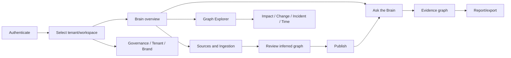

# EOIP Enterprise GUI / UI-UX Requirements

## 1. Document Control

**Version:** 1.0.0 | **Date:** 2026-10-13 | **Source:** `dev_local` / `54e31304fd089e471cef83fbc4a5e89660a36195` | **Audit:** `gaps-audit-cp.md`  
This is a build specification for a new frontend. Existing frontend visual design, route names and component choices are intentionally excluded. Backend contracts were independently confirmed from source and the live OpenAPI document.

**Glossary:** ontology = governed types/relationships/constraints; entity = graph node instance; relationship = typed directed edge; meta-graph = graph of types; tenant = security/data boundary; workspace = tenant collaboration scope; view = persisted exploration state; lens = task-specific graph encoding/filter; evidence = source-backed node/edge/document attribution; principal = authenticated human/service identity.

## 2. Product And Design Vision

EOIP is a sellable, white-label, multi-tenant, local-first enterprise ontology and living organization brain. It is domain-neutral: labels, forms, icons and workflows derive from tenant ontology, not software-only nouns.

**Principles:** graph is the primary work surface; every answer is evidence-linked; deterministic and generative computation are visibly distinct; tenant context is always visible; local operation is the default; dense information stays calm; novices get progressive disclosure while experts get keyboard control; dangerous actions show impact before confirmation; accessibility has equivalent table/tree paths; missing backends are named, never disguised with fake success.

**Visual directions:** (A) **Evidence Atlas, recommended:** light-first neutral canvas, graphite text, teal focus, amber evidence, red risk, optional dark graph focus; suited to repeated enterprise work. (B) **Operations Console:** compact, darker, telemetry-led; strong for operators but too technical as the universal shell. (C) **Editorial Intelligence:** spacious report-led layout; strong for executives, inefficient for graph/data stewardship. Tenant branding changes brand accents/assets, never semantic risk colors or contrast.

**Personas/JTBD:** executives ask and export defensible answers; analysts explore and save views; stewards shape ontology and resolve identity; integration engineers connect/map/operate sources; engineering/IT users assess impact/change/incidents/tests; security officers govern access/egress/audit; tenant/platform admins operate boundaries/quotas/backups; partners publish safe brand packs.

**Primary journeys:** connect source -> test -> ingest -> review inferred entities/relationships -> dry-run diff -> publish -> ask first question. Ask -> compare deterministic/LLM suggestions -> inspect generated query/cost -> run -> stream answer -> hover citations on graph -> save/share/export. Select entity/change -> simulate impact -> inspect hop/severity -> assign owners/tests -> export plan. Incident -> rank candidate causes -> traverse evidence -> record finding. Every journey preserves tenant/workspace and leaves an audit trail.

## 3. Technology Stack

Use React + TypeScript strict + Vite SPA; SSR adds little to an authenticated local-first workbench, while Vite/Tauri supports local and desktop packaging. TanStack Router owns typed deep links; Query owns server state; Zustand owns ephemeral shell/view state; XState is limited to ingestion, publish and long-running query lifecycles. Tailwind CSS variables implement tokens and Radix primitives supply accessible behavior. Use Motion for bounded transitions.

Sigma + Graphology is the primary WebGL graph engine; ForceAtlas2 runs in a worker. React Flow is only for editable ontology/pipeline/agent diagrams. ELK handles dependency/lineage layouts. ECharts handles timeline, Sankey, treemap, sunburst, heatmap and chord. Do not ship Cytoscape as a second primary runtime; it duplicates graph state/rendering. Optional Three.js/3D is deferred until 2D performance/a11y gates pass. TanStack Table/Virtual, Monaco, Tiptap, RHF/Zod, openapi-typescript/openapi-fetch, cmdk, scoped hotkeys, dnd-kit, resizable panels, Lucide, i18next and Dexie complete the core. Yjs is enabled only after `BACKEND-MISSING-016`; Tauri is an optional shell.

| Library | Verified version | Verification/decision |
|---|---:|---|
| React | `19.3.0` | npm registry latest stable metadata checked 2026-10-12; pin exact version and re-verify at implementation. |
| Vite | `8.3.4` | npm registry latest stable metadata checked 2026-10-12; pin exact version and re-verify at implementation. |
| TypeScript | `7.0.2` | npm registry latest stable metadata checked 2026-10-12; pin exact version and re-verify at implementation. |
| TanStack Router | `1.170.42` | npm registry latest stable metadata checked 2026-10-12; pin exact version and re-verify at implementation. |
| TanStack Query | `5.104.2` | npm registry latest stable metadata checked 2026-10-12; pin exact version and re-verify at implementation. |
| Zustand | `5.0.15` | npm registry latest stable metadata checked 2026-10-12; pin exact version and re-verify at implementation. |
| XState | `5.33.2` | npm registry latest stable metadata checked 2026-10-12; pin exact version and re-verify at implementation. |
| Tailwind CSS | `4.3.3` | npm registry latest stable metadata checked 2026-10-12; pin exact version and re-verify at implementation. |
| Radix Dialog | `1.3.0` | npm registry latest stable metadata checked 2026-10-12; pin exact version and re-verify at implementation. |
| Motion | `14.1.0` | npm registry latest stable metadata checked 2026-10-12; pin exact version and re-verify at implementation. |
| Sigma | `4.0.0` | npm registry latest stable metadata checked 2026-10-12; pin exact version and re-verify at implementation. |
| Graphology | `0.26.0` | npm registry latest stable metadata checked 2026-10-12; pin exact version and re-verify at implementation. |
| graphology-layout-forceatlas2 | `0.10.1` | npm registry latest stable metadata checked 2026-10-12; pin exact version and re-verify at implementation. |
| React Flow | `12.12.0` | npm registry latest stable metadata checked 2026-10-12; pin exact version and re-verify at implementation. |
| ELK.js | `0.12.0` | npm registry latest stable metadata checked 2026-10-12; pin exact version and re-verify at implementation. |
| Apache ECharts | `6.1.0` | npm registry latest stable metadata checked 2026-10-12; pin exact version and re-verify at implementation. |
| TanStack Table | `9.3.1` | npm registry latest stable metadata checked 2026-10-12; pin exact version and re-verify at implementation. |
| TanStack Virtual | `3.14.17` | npm registry latest stable metadata checked 2026-10-12; pin exact version and re-verify at implementation. |
| Monaco Editor | `0.57.0` | npm registry latest stable metadata checked 2026-10-12; pin exact version and re-verify at implementation. |
| Tiptap React | `3.31.4` | npm registry latest stable metadata checked 2026-10-12; pin exact version and re-verify at implementation. |
| React Hook Form | `7.90.0` | npm registry latest stable metadata checked 2026-10-12; pin exact version and re-verify at implementation. |
| Zod | `4.6.7` | npm registry latest stable metadata checked 2026-10-12; pin exact version and re-verify at implementation. |
| openapi-typescript | `7.13.0` | npm registry latest stable metadata checked 2026-10-12; pin exact version and re-verify at implementation. |
| openapi-fetch | `0.17.0` | npm registry latest stable metadata checked 2026-10-12; pin exact version and re-verify at implementation. |
| cmdk | `1.1.1` | npm registry latest stable metadata checked 2026-10-12; pin exact version and re-verify at implementation. |
| react-hotkeys-hook | `5.3.3` | npm registry latest stable metadata checked 2026-10-12; pin exact version and re-verify at implementation. |
| dnd-kit core | `6.3.1` | npm registry latest stable metadata checked 2026-10-12; pin exact version and re-verify at implementation. |
| react-resizable-panels | `4.14.4` | npm registry latest stable metadata checked 2026-10-12; pin exact version and re-verify at implementation. |
| Lucide React | `1.55.0` | npm registry latest stable metadata checked 2026-10-12; pin exact version and re-verify at implementation. |
| i18next | `26.4.4` | npm registry latest stable metadata checked 2026-10-12; pin exact version and re-verify at implementation. |
| Dexie | `4.4.6` | npm registry latest stable metadata checked 2026-10-12; pin exact version and re-verify at implementation. |
| Yjs | `13.6.33` | npm registry latest stable metadata checked 2026-10-12; pin exact version and re-verify at implementation. |
| Tauri API | `2.12.3` | npm registry latest stable metadata checked 2026-10-12; pin exact version and re-verify at implementation. |
| Vitest | `5.0.4` | npm registry latest stable metadata checked 2026-10-12; pin exact version and re-verify at implementation. |
| Playwright | `1.64.0` | npm registry latest stable metadata checked 2026-10-12; pin exact version and re-verify at implementation. |
| MSW | `3.0.3` | npm registry latest stable metadata checked 2026-10-12; pin exact version and re-verify at implementation. |
| Storybook | `10.6.1` | npm registry latest stable metadata checked 2026-10-12; pin exact version and re-verify at implementation. |
| axe-core | `4.14.0` | npm registry latest stable metadata checked 2026-10-12; pin exact version and re-verify at implementation. |

Quality stack: Vitest + Testing Library, Playwright, Storybook, MSW and axe-core; ESLint/Prettier and a bundle analyzer in CI. OpenTelemetry Web exports locally by default; self-hosted Sentry/GlitchTip is opt-in and policy-controlled. Alternatives rejected: Next.js (unneeded SSR/server coupling), AG Grid (licensing/weight), Electron (larger footprint), GSAP/Rive/Lottie (unneeded baseline complexity), deck.gl/3D (no proven requirement yet).

## 4. Information Architecture

```text
/auth/*
/t/:tenant/w/:workspace
  /ask /graph?view=&focus=&t= /entity/:id /impact /changes /incidents/:id /time /query
  /ontology /meta-graph /sources /ingestion /quality /jobs /agents /reports /collaboration
/t/:tenant/admin/governance /brand
/platform/tenants/:tenant /health
/settings /notifications /help /about /errors/:code
```

The app shell has a 56 px left rail, 48 px top context bar, full primary surface, 320-480 px right inspector and 240-480 px bottom job/console dock. Tenant/workspace switcher is persistent; breadcrumbs show object hierarchy; recents/favourites/pinned views live in the command palette. Object model: Tenant -> Workspace -> Sources -> Ontology -> Graph -> Views/Lenses -> Queries -> Reports -> Agents. Global surfaces are `Ctrl/Cmd+K`, universal search, notifications, activity tray, help/shortcuts and an evidence-aware assistant panel.

## 5. Design System

Use W3C-style tokens and CSS variables. Core light tokens: canvas `#F7F9FA`, surface `#FFFFFF`, raised `#F1F4F5`, text `#172126`, muted `#52636B`, border `#CBD5D9`, focus `#087F8C`, brand `#006D77`, accent `#D97706`, success `#16805A`, warning `#A15C00`, danger `#C33241`, info `#1769AA`. Dark: canvas `#101518`, surface `#172025`, raised `#202B31`, text `#F2F6F7`, muted `#AEC0C7`, border `#43545C`, focus `#4DD5DF`, brand `#43C3CC`, accent `#F5A623`, success `#4BC38B`, warning `#FFC857`, danger `#FF6673`, info `#67B7F7`. High-contrast modes use pure `#000/#FFF`, 2 px borders and 3 px focus outlines. Body text contrast >=4.5:1; large/icons >=3:1; focus >=3:1 against adjacent colors.

Graph tokens: node default `#5F7480`, hover `#21A5B1`, selected `#006D77` + 3 px white/black halo, dimmed alpha .16; path `#D97706`; impact low/moderate/high/critical = `#2A9D8F/#E9C46A/#F4A261/#C33241` plus shape/badge; edge default `#80939B`, hover `#087F8C`, selected `#D97706`; cluster hull alpha .12; grid `#DDE5E8` light / `#2C3940` dark. Entity categorical colors use Okabe-Ito seeds then deterministic golden-angle OKLCH hue rotation at L=.68/C=.13, with shape/icon as redundant encoding and steward override contrast validation. Sequential uses viridis; diverging uses blue-white-red with neutral midpoint; test simulations for deuteranopia/protanopia/tritanopia.

Typography: Inter/system UI, Noto Sans fallback for Indic/CJK/RTL, JetBrains Mono/system mono. Sizes 12/14/16/20/24/32 with line heights 16/20/24/28/32/40; weights 400/500/600/700; tabular numerals for metrics. Letter spacing is 0. Wrap prose; one-line labels truncate with tooltip; IDs use middle ellipsis. Spacing 4 px base; sizes 24/28/32/36/40/48; radii 2/4/6/8 (cards max 8); 1 px borders; shadows only for overlays; no decorative blur/glass. Z layers 0 canvas, 10 sticky, 20 dock, 40 popover, 60 modal, 80 toast. Density row heights: 44/36/28 px.

White-label variables support logos, favicon, app name, brand/accent, optional font, login image, email assets and domain. Publish rejects contrast failures, semantic-color overrides and font layout overflow; preview all four themes before atomic publish. Icons use Lucide at 12/16/20/24/32, 1.75 px stroke, optical alignment; labels accompany unfamiliar actions. Empty art is sparse domain-neutral line art, never an explanatory marketing panel.

## 6. Motion And Animation

Durations: instant 0, micro 100, short 160, medium 240, long 400, graph 600-1200 ms. Easing: standard cubic-bezier(.2,0,0,1), emphasized (.2,.8,.2,1), accelerate (.4,0,1,1), decelerate (0,0,.2,1), spring stiffness 320/damping 30. Route content crossfades 160 ms; panels translate <=12 px; stagger <=30 ms and 6 items; skeleton dissolves 120 ms.

Graph positions interpolate between layouts; expansion radiates from parent; cluster collapse preserves centroid; path pulse follows direction; impact ripple advances one hop per 180 ms; fly-to is 400-700 ms; time playback crossfades added/removed/changed marks; edges draw only under 2k edges. Animate transform/opacity, cap 200 simultaneous animated elements and disable graph animation above 10k. Reduced motion replaces morph/fly/ripple/draw with instant final state plus persistent outline/list announcement; no autoplay. Hover 100 ms, press scale .98 (disabled reduced motion), drop targets use border/fill, copy/save announce in live region, optimistic state displays pending glyph.

## 7. Layout, Responsiveness And Fit

Breakpoints: tablet 768-1279, desktop 1280-1919, large 1920-2559, 4K 2560-3439, ultrawide >=3440; use container queries for panels. At 1280 collapse labels in rail; at >=1920 allow inspector + dock; at >=2560 permit two inspectors; ultrawide limits text columns but graph remains full bleed. Tablet has one overlay inspector; mobile is read-only companion. Persist panel sizes per principal/workspace; Tauri may pop out inspectors for multi-monitor.

Graph fit: 48 px canvas padding, fit selection/path on command only, optional auto-fit after layout/filter, zoom .05-16, zoom-to-cursor, labels hidden below .35 and abbreviated .35-.7, full above .7; clamp label screen size 10-16 px; ResizeObserver debounced 100 ms; devicePixelRatio capped at 2 unless exporting. Tables prioritize/pin identity/status/actions and horizontally scroll rather than crush text.

## 8. Component Library Specification

| Family | Required variants and behavior |
|---|---|
| Commands | Button, icon button, split button; primary/secondary/quiet/danger; 32/36/40 px; loading preserves width; tooltip names icon-only controls. |
| Inputs | Text, number, secret, textarea, select, async combobox, chip multi-select, date/time/range, slider/time slider, toggle, checkbox, segmented control; visible label and described error. |
| Navigation | Tabs, accordion, breadcrumbs, virtual lazy tree, pagination/infinite loader, command palette, recents/favourites and scoped hotkey help. |
| Data | Virtual data grid with sort/filter/group/edit/pin/column chooser/saved view/export; entity card; relationship chip; property panel; JSON/diff viewer. |
| Feedback | Badge/status pill, skeleton, determinate/indeterminate/job progress + ETA, toast, inline alert/banner, empty/error/offline/denied/stale states. |
| Overlays | Tooltip, popover, entity hovercard, modal, drawer, sheet; modal traps focus and restores it; destructive modal requires typed confirmation only for high-impact actions. |
| Creation | Stepper/wizard, chunked resumable uploader, visual AND/OR filter builder, Monaco query/code editor, Tiptap report editor, React Flow schema/pipeline editor. |
| AI | Streaming answer, stop/regenerate, evidence/citation chips, confidence/uncertainty, local/external boundary badge, suggested-query cards with preview/cost. |
| Graph | Canvas, toolbar, layout picker, legend, minimap, timeline, lens switcher, path breadcrumb and synchronized accessible table/tree. |
| Work | Notification item, presence/avatar, comments, approval card, remediation Kanban, job log and activity tray. |

Every component exposes default, hover, focus-visible, active, selected, disabled, loading, error, read-only and empty states where applicable. Props are typed; controlled/uncontrolled behavior is explicit; `aria-*`, role, name, description and keyboard model follow the relevant WAI-ARIA Authoring Practices pattern. Motion uses section 6 tokens, and all visual values use section 5 tokens. Do not nest cards, use cards as page sections, or put visible instruction/feature prose into the application chrome.

## 9. Screen-By-Screen Specification

### SCR-001 - Authentication and tenant entry

- **Route / personas / purpose:** `/auth/*`; All users; Establish identity, MFA, session and tenant context.
- **Entry and layout:** deep link, command palette, global search or related-object action. Use shell rail + top context bar; primary work surface occupies the center; contextual inspector is right; jobs/query output uses the bottom dock. On mobile, show read-only summary, approvals and notifications; editing opens an explicit unsupported notice.
- **Components:** virtualized table/tree as appropriate, filter builder, status and evidence chips, resizable inspector, command actions, skeleton/error/empty patterns. Graph screens use the shared canvas/legend/minimap; editors use Monaco or React Flow only where specified.
- **Data and actions:** `INT-049`, `INT-050`, `INT-051`, `INT-052`, `INT-053`, `INT-054`, `INT-055`, `INT-056`, `BACKEND-MISSING-001`, `BACKEND-MISSING-002`. Mutations use idempotency keys, optimistic updates only for reversible metadata, rollback on normalized errors, and announce job/event progress. Never synthesize successful data when an endpoint is missing.
- **States:** first-run, loading skeleton, empty, partial, populated, validation error, transport/server error, offline cached, permission-denied, stale-data, and backend-missing mock. Permission denial explains the needed capability without disclosing protected object existence; offline mode displays capture age and disables unsafe mutation.
- **Validation:** Zod generated from OpenAPI plus domain checks; validate on blur and submit, debounce server checks 400 ms, focus the first error, preserve a local draft. IDs use middle ellipsis; dates are UTC on the wire and user-zone in display.
- **Keyboard / real time:** `?` shortcuts, `/` search, `Ctrl+K` command palette, `g` then screen mnemonic; all actions reachable by keyboard. Subscribe only through authenticated tenant-scoped events, reconnect with jitter, resume sequence, and mark stale on gaps.
- **Analytics:** `scr_001.viewed`, `.action_started`, `.action_succeeded`, `.action_failed`; never record query text, entity property values, credentials or AI prompts.
- **Acceptance:** Given an authorized principal and tenant, when the route opens, then every request carries trace + tenant/workspace context and rendered values are sanitized. Given loading/empty/error/offline/denied/stale/missing states, when each is induced, then the defined state is keyboard and screen-reader operable. Given a mutation, when it completes or fails, then state, audit feedback and cache invalidation are deterministic.
- **Backend readiness:** `PARTIAL`. Use MSW only for `BACKEND-MISSING-*`; show a development-only “mock contract” marker and block production builds if any required mock remains enabled.

### SCR-002 - First-run onboarding

- **Route / personas / purpose:** `/t/:tenant/onboarding`; Tenant admin, data engineer; Configure workspace, source, ingestion review and first question.
- **Entry and layout:** deep link, command palette, global search or related-object action. Use shell rail + top context bar; primary work surface occupies the center; contextual inspector is right; jobs/query output uses the bottom dock. On mobile, show read-only summary, approvals and notifications; editing opens an explicit unsupported notice.
- **Components:** virtualized table/tree as appropriate, filter builder, status and evidence chips, resizable inspector, command actions, skeleton/error/empty patterns. Graph screens use the shared canvas/legend/minimap; editors use Monaco or React Flow only where specified.
- **Data and actions:** `INT-009`, `INT-010`, `INT-011`, `INT-012`, `INT-013`, `INT-014`, `INT-015`, `INT-016`, `BACKEND-MISSING-003`. Mutations use idempotency keys, optimistic updates only for reversible metadata, rollback on normalized errors, and announce job/event progress. Never synthesize successful data when an endpoint is missing.
- **States:** first-run, loading skeleton, empty, partial, populated, validation error, transport/server error, offline cached, permission-denied, stale-data, and backend-missing mock. Permission denial explains the needed capability without disclosing protected object existence; offline mode displays capture age and disables unsafe mutation.
- **Validation:** Zod generated from OpenAPI plus domain checks; validate on blur and submit, debounce server checks 400 ms, focus the first error, preserve a local draft. IDs use middle ellipsis; dates are UTC on the wire and user-zone in display.
- **Keyboard / real time:** `?` shortcuts, `/` search, `Ctrl+K` command palette, `g` then screen mnemonic; all actions reachable by keyboard. Subscribe only through authenticated tenant-scoped events, reconnect with jitter, resume sequence, and mark stale on gaps.
- **Analytics:** `scr_002.viewed`, `.action_started`, `.action_succeeded`, `.action_failed`; never record query text, entity property values, credentials or AI prompts.
- **Acceptance:** Given an authorized principal and tenant, when the route opens, then every request carries trace + tenant/workspace context and rendered values are sanitized. Given loading/empty/error/offline/denied/stale/missing states, when each is induced, then the defined state is keyboard and screen-reader operable. Given a mutation, when it completes or fails, then state, audit feedback and cache invalidation are deterministic.
- **Backend readiness:** `PARTIAL`. Use MSW only for `BACKEND-MISSING-*`; show a development-only “mock contract” marker and block production builds if any required mock remains enabled.

### SCR-003 - Brain overview

- **Route / personas / purpose:** `/t/:tenant/w/:workspace`; All users; Summarize graph health, changes, jobs, alerts and saved work.
- **Entry and layout:** deep link, command palette, global search or related-object action. Use shell rail + top context bar; primary work surface occupies the center; contextual inspector is right; jobs/query output uses the bottom dock. On mobile, show read-only summary, approvals and notifications; editing opens an explicit unsupported notice.
- **Components:** virtualized table/tree as appropriate, filter builder, status and evidence chips, resizable inspector, command actions, skeleton/error/empty patterns. Graph screens use the shared canvas/legend/minimap; editors use Monaco or React Flow only where specified.
- **Data and actions:** `INT-020`, `INT-021`, `INT-022`, `INT-023`, `INT-049`, `INT-161`, `INT-162`, `INT-163`. Mutations use idempotency keys, optimistic updates only for reversible metadata, rollback on normalized errors, and announce job/event progress. Never synthesize successful data when an endpoint is missing.
- **States:** first-run, loading skeleton, empty, partial, populated, validation error, transport/server error, offline cached, permission-denied, stale-data, and backend-missing mock. Permission denial explains the needed capability without disclosing protected object existence; offline mode displays capture age and disables unsafe mutation.
- **Validation:** Zod generated from OpenAPI plus domain checks; validate on blur and submit, debounce server checks 400 ms, focus the first error, preserve a local draft. IDs use middle ellipsis; dates are UTC on the wire and user-zone in display.
- **Keyboard / real time:** `?` shortcuts, `/` search, `Ctrl+K` command palette, `g` then screen mnemonic; all actions reachable by keyboard. Subscribe only through authenticated tenant-scoped events, reconnect with jitter, resume sequence, and mark stale on gaps.
- **Analytics:** `scr_003.viewed`, `.action_started`, `.action_succeeded`, `.action_failed`; never record query text, entity property values, credentials or AI prompts.
- **Acceptance:** Given an authorized principal and tenant, when the route opens, then every request carries trace + tenant/workspace context and rendered values are sanitized. Given loading/empty/error/offline/denied/stale/missing states, when each is induced, then the defined state is keyboard and screen-reader operable. Given a mutation, when it completes or fails, then state, audit feedback and cache invalidation are deterministic.
- **Backend readiness:** `IMPLEMENTED-UNVERIFIED`. Use MSW only for `BACKEND-MISSING-*`; show a development-only “mock contract” marker and block production builds if any required mock remains enabled.

### SCR-004 - Ask the Brain

- **Route / personas / purpose:** `/t/:tenant/w/:workspace/ask`; Executive, analyst; Ask, compare deterministic suggestions, inspect evidence and export.
- **Entry and layout:** deep link, command palette, global search or related-object action. Use shell rail + top context bar; primary work surface occupies the center; contextual inspector is right; jobs/query output uses the bottom dock. On mobile, show read-only summary, approvals and notifications; editing opens an explicit unsupported notice.
- **Components:** virtualized table/tree as appropriate, filter builder, status and evidence chips, resizable inspector, command actions, skeleton/error/empty patterns. Graph screens use the shared canvas/legend/minimap; editors use Monaco or React Flow only where specified.
- **Data and actions:** `INT-039`, `INT-061`, `INT-062`, `INT-063`, `INT-064`, `INT-065`, `INT-066`, `INT-067`, `BACKEND-MISSING-005`. Mutations use idempotency keys, optimistic updates only for reversible metadata, rollback on normalized errors, and announce job/event progress. Never synthesize successful data when an endpoint is missing.
- **States:** first-run, loading skeleton, empty, partial, populated, validation error, transport/server error, offline cached, permission-denied, stale-data, and backend-missing mock. Permission denial explains the needed capability without disclosing protected object existence; offline mode displays capture age and disables unsafe mutation.
- **Validation:** Zod generated from OpenAPI plus domain checks; validate on blur and submit, debounce server checks 400 ms, focus the first error, preserve a local draft. IDs use middle ellipsis; dates are UTC on the wire and user-zone in display.
- **Keyboard / real time:** `?` shortcuts, `/` search, `Ctrl+K` command palette, `g` then screen mnemonic; all actions reachable by keyboard. Subscribe only through authenticated tenant-scoped events, reconnect with jitter, resume sequence, and mark stale on gaps.
- **Analytics:** `scr_004.viewed`, `.action_started`, `.action_succeeded`, `.action_failed`; never record query text, entity property values, credentials or AI prompts.
- **Acceptance:** Given an authorized principal and tenant, when the route opens, then every request carries trace + tenant/workspace context and rendered values are sanitized. Given loading/empty/error/offline/denied/stale/missing states, when each is induced, then the defined state is keyboard and screen-reader operable. Given a mutation, when it completes or fails, then state, audit feedback and cache invalidation are deterministic.
- **Backend readiness:** `PARTIAL`. Use MSW only for `BACKEND-MISSING-*`; show a development-only “mock contract” marker and block production builds if any required mock remains enabled.

### SCR-005 - Graph Explorer

- **Route / personas / purpose:** `/t/:tenant/w/:workspace/graph`; Analyst, engineer, steward; Explore, filter, path-find, cluster and save ontology-driven graphs.
- **Entry and layout:** deep link, command palette, global search or related-object action. Use shell rail + top context bar; primary work surface occupies the center; contextual inspector is right; jobs/query output uses the bottom dock. On mobile, show read-only summary, approvals and notifications; editing opens an explicit unsupported notice.
- **Components:** virtualized table/tree as appropriate, filter builder, status and evidence chips, resizable inspector, command actions, skeleton/error/empty patterns. Graph screens use the shared canvas/legend/minimap; editors use Monaco or React Flow only where specified.
- **Data and actions:** `INT-178`, `INT-216`, `INT-232`, `INT-252`, `INT-253`, `INT-254`, `INT-255`, `INT-256`, `BACKEND-MISSING-004`. Mutations use idempotency keys, optimistic updates only for reversible metadata, rollback on normalized errors, and announce job/event progress. Never synthesize successful data when an endpoint is missing.
- **States:** first-run, loading skeleton, empty, partial, populated, validation error, transport/server error, offline cached, permission-denied, stale-data, and backend-missing mock. Permission denial explains the needed capability without disclosing protected object existence; offline mode displays capture age and disables unsafe mutation.
- **Validation:** Zod generated from OpenAPI plus domain checks; validate on blur and submit, debounce server checks 400 ms, focus the first error, preserve a local draft. IDs use middle ellipsis; dates are UTC on the wire and user-zone in display.
- **Keyboard / real time:** `?` shortcuts, `/` search, `Ctrl+K` command palette, `g` then screen mnemonic; all actions reachable by keyboard. Subscribe only through authenticated tenant-scoped events, reconnect with jitter, resume sequence, and mark stale on gaps.
- **Analytics:** `scr_005.viewed`, `.action_started`, `.action_succeeded`, `.action_failed`; never record query text, entity property values, credentials or AI prompts.
- **Acceptance:** Given an authorized principal and tenant, when the route opens, then every request carries trace + tenant/workspace context and rendered values are sanitized. Given loading/empty/error/offline/denied/stale/missing states, when each is induced, then the defined state is keyboard and screen-reader operable. Given a mutation, when it completes or fails, then state, audit feedback and cache invalidation are deterministic.
- **Backend readiness:** `PARTIAL`. Use MSW only for `BACKEND-MISSING-*`; show a development-only “mock contract” marker and block production builds if any required mock remains enabled.

### SCR-006 - Entity 360

- **Route / personas / purpose:** `/t/:tenant/w/:workspace/entity/:id`; All knowledge users; Inspect properties, relations, provenance, timeline and work.
- **Entry and layout:** deep link, command palette, global search or related-object action. Use shell rail + top context bar; primary work surface occupies the center; contextual inspector is right; jobs/query output uses the bottom dock. On mobile, show read-only summary, approvals and notifications; editing opens an explicit unsupported notice.
- **Components:** virtualized table/tree as appropriate, filter builder, status and evidence chips, resizable inspector, command actions, skeleton/error/empty patterns. Graph screens use the shared canvas/legend/minimap; editors use Monaco or React Flow only where specified.
- **Data and actions:** `INT-005`, `INT-100`, `INT-102`, `INT-180`, `INT-226`, `INT-289`, `INT-290`, `INT-291`, `BACKEND-MISSING-006`. Mutations use idempotency keys, optimistic updates only for reversible metadata, rollback on normalized errors, and announce job/event progress. Never synthesize successful data when an endpoint is missing.
- **States:** first-run, loading skeleton, empty, partial, populated, validation error, transport/server error, offline cached, permission-denied, stale-data, and backend-missing mock. Permission denial explains the needed capability without disclosing protected object existence; offline mode displays capture age and disables unsafe mutation.
- **Validation:** Zod generated from OpenAPI plus domain checks; validate on blur and submit, debounce server checks 400 ms, focus the first error, preserve a local draft. IDs use middle ellipsis; dates are UTC on the wire and user-zone in display.
- **Keyboard / real time:** `?` shortcuts, `/` search, `Ctrl+K` command palette, `g` then screen mnemonic; all actions reachable by keyboard. Subscribe only through authenticated tenant-scoped events, reconnect with jitter, resume sequence, and mark stale on gaps.
- **Analytics:** `scr_006.viewed`, `.action_started`, `.action_succeeded`, `.action_failed`; never record query text, entity property values, credentials or AI prompts.
- **Acceptance:** Given an authorized principal and tenant, when the route opens, then every request carries trace + tenant/workspace context and rendered values are sanitized. Given loading/empty/error/offline/denied/stale/missing states, when each is induced, then the defined state is keyboard and screen-reader operable. Given a mutation, when it completes or fails, then state, audit feedback and cache invalidation are deterministic.
- **Backend readiness:** `PARTIAL`. Use MSW only for `BACKEND-MISSING-*`; show a development-only “mock contract” marker and block production builds if any required mock remains enabled.

### SCR-007 - Impact Analysis studio

- **Route / personas / purpose:** `/t/:tenant/w/:workspace/impact`; Engineer, analyst; Model a change, inspect blast radius and produce a test checklist.
- **Entry and layout:** deep link, command palette, global search or related-object action. Use shell rail + top context bar; primary work surface occupies the center; contextual inspector is right; jobs/query output uses the bottom dock. On mobile, show read-only summary, approvals and notifications; editing opens an explicit unsupported notice.
- **Components:** virtualized table/tree as appropriate, filter builder, status and evidence chips, resizable inspector, command actions, skeleton/error/empty patterns. Graph screens use the shared canvas/legend/minimap; editors use Monaco or React Flow only where specified.
- **Data and actions:** `INT-044`, `INT-105`, `INT-252`, `INT-262`, `INT-277`, `INT-278`, `INT-280`, `INT-292`, `BACKEND-MISSING-007`. Mutations use idempotency keys, optimistic updates only for reversible metadata, rollback on normalized errors, and announce job/event progress. Never synthesize successful data when an endpoint is missing.
- **States:** first-run, loading skeleton, empty, partial, populated, validation error, transport/server error, offline cached, permission-denied, stale-data, and backend-missing mock. Permission denial explains the needed capability without disclosing protected object existence; offline mode displays capture age and disables unsafe mutation.
- **Validation:** Zod generated from OpenAPI plus domain checks; validate on blur and submit, debounce server checks 400 ms, focus the first error, preserve a local draft. IDs use middle ellipsis; dates are UTC on the wire and user-zone in display.
- **Keyboard / real time:** `?` shortcuts, `/` search, `Ctrl+K` command palette, `g` then screen mnemonic; all actions reachable by keyboard. Subscribe only through authenticated tenant-scoped events, reconnect with jitter, resume sequence, and mark stale on gaps.
- **Analytics:** `scr_007.viewed`, `.action_started`, `.action_succeeded`, `.action_failed`; never record query text, entity property values, credentials or AI prompts.
- **Acceptance:** Given an authorized principal and tenant, when the route opens, then every request carries trace + tenant/workspace context and rendered values are sanitized. Given loading/empty/error/offline/denied/stale/missing states, when each is induced, then the defined state is keyboard and screen-reader operable. Given a mutation, when it completes or fails, then state, audit feedback and cache invalidation are deterministic.
- **Backend readiness:** `PARTIAL`. Use MSW only for `BACKEND-MISSING-*`; show a development-only “mock contract” marker and block production builds if any required mock remains enabled.

### SCR-008 - Change history

- **Route / personas / purpose:** `/t/:tenant/w/:workspace/changes`; Engineer, compliance; Trace who changed what and compare versions.
- **Entry and layout:** deep link, command palette, global search or related-object action. Use shell rail + top context bar; primary work surface occupies the center; contextual inspector is right; jobs/query output uses the bottom dock. On mobile, show read-only summary, approvals and notifications; editing opens an explicit unsupported notice.
- **Components:** virtualized table/tree as appropriate, filter builder, status and evidence chips, resizable inspector, command actions, skeleton/error/empty patterns. Graph screens use the shared canvas/legend/minimap; editors use Monaco or React Flow only where specified.
- **Data and actions:** `INT-107`, `INT-114`, `INT-115`, `INT-116`, `INT-129`, `INT-178`, `INT-179`, `INT-180`. Mutations use idempotency keys, optimistic updates only for reversible metadata, rollback on normalized errors, and announce job/event progress. Never synthesize successful data when an endpoint is missing.
- **States:** first-run, loading skeleton, empty, partial, populated, validation error, transport/server error, offline cached, permission-denied, stale-data, and backend-missing mock. Permission denial explains the needed capability without disclosing protected object existence; offline mode displays capture age and disables unsafe mutation.
- **Validation:** Zod generated from OpenAPI plus domain checks; validate on blur and submit, debounce server checks 400 ms, focus the first error, preserve a local draft. IDs use middle ellipsis; dates are UTC on the wire and user-zone in display.
- **Keyboard / real time:** `?` shortcuts, `/` search, `Ctrl+K` command palette, `g` then screen mnemonic; all actions reachable by keyboard. Subscribe only through authenticated tenant-scoped events, reconnect with jitter, resume sequence, and mark stale on gaps.
- **Analytics:** `scr_008.viewed`, `.action_started`, `.action_succeeded`, `.action_failed`; never record query text, entity property values, credentials or AI prompts.
- **Acceptance:** Given an authorized principal and tenant, when the route opens, then every request carries trace + tenant/workspace context and rendered values are sanitized. Given loading/empty/error/offline/denied/stale/missing states, when each is induced, then the defined state is keyboard and screen-reader operable. Given a mutation, when it completes or fails, then state, audit feedback and cache invalidation are deterministic.
- **Backend readiness:** `IMPLEMENTED-UNVERIFIED`. Use MSW only for `BACKEND-MISSING-*`; show a development-only “mock contract” marker and block production builds if any required mock remains enabled.

### SCR-009 - Incident root-cause workspace

- **Route / personas / purpose:** `/t/:tenant/w/:workspace/incidents/:id`; IT user, responder; Rank causes and walk evidence-backed troubleshooting paths.
- **Entry and layout:** deep link, command palette, global search or related-object action. Use shell rail + top context bar; primary work surface occupies the center; contextual inspector is right; jobs/query output uses the bottom dock. On mobile, show read-only summary, approvals and notifications; editing opens an explicit unsupported notice.
- **Components:** virtualized table/tree as appropriate, filter builder, status and evidence chips, resizable inspector, command actions, skeleton/error/empty patterns. Graph screens use the shared canvas/legend/minimap; editors use Monaco or React Flow only where specified.
- **Data and actions:** `INT-104`, `INT-175`, `INT-242`, `INT-439`, `INT-440`, `INT-441`, `INT-442`, `INT-443`, `BACKEND-MISSING-008`. Mutations use idempotency keys, optimistic updates only for reversible metadata, rollback on normalized errors, and announce job/event progress. Never synthesize successful data when an endpoint is missing.
- **States:** first-run, loading skeleton, empty, partial, populated, validation error, transport/server error, offline cached, permission-denied, stale-data, and backend-missing mock. Permission denial explains the needed capability without disclosing protected object existence; offline mode displays capture age and disables unsafe mutation.
- **Validation:** Zod generated from OpenAPI plus domain checks; validate on blur and submit, debounce server checks 400 ms, focus the first error, preserve a local draft. IDs use middle ellipsis; dates are UTC on the wire and user-zone in display.
- **Keyboard / real time:** `?` shortcuts, `/` search, `Ctrl+K` command palette, `g` then screen mnemonic; all actions reachable by keyboard. Subscribe only through authenticated tenant-scoped events, reconnect with jitter, resume sequence, and mark stale on gaps.
- **Analytics:** `scr_009.viewed`, `.action_started`, `.action_succeeded`, `.action_failed`; never record query text, entity property values, credentials or AI prompts.
- **Acceptance:** Given an authorized principal and tenant, when the route opens, then every request carries trace + tenant/workspace context and rendered values are sanitized. Given loading/empty/error/offline/denied/stale/missing states, when each is induced, then the defined state is keyboard and screen-reader operable. Given a mutation, when it completes or fails, then state, audit feedback and cache invalidation are deterministic.
- **Backend readiness:** `PARTIAL`. Use MSW only for `BACKEND-MISSING-*`; show a development-only “mock contract” marker and block production builds if any required mock remains enabled.

### SCR-010 - Temporal and time travel

- **Route / personas / purpose:** `/t/:tenant/w/:workspace/time`; Analyst, steward; Compare snapshots and play graph evolution.
- **Entry and layout:** deep link, command palette, global search or related-object action. Use shell rail + top context bar; primary work surface occupies the center; contextual inspector is right; jobs/query output uses the bottom dock. On mobile, show read-only summary, approvals and notifications; editing opens an explicit unsupported notice.
- **Components:** virtualized table/tree as appropriate, filter builder, status and evidence chips, resizable inspector, command actions, skeleton/error/empty patterns. Graph screens use the shared canvas/legend/minimap; editors use Monaco or React Flow only where specified.
- **Data and actions:** `INT-029`, `INT-083`, `INT-180`, `INT-196`, `INT-215`, `INT-216`, `INT-217`, `INT-218`. Mutations use idempotency keys, optimistic updates only for reversible metadata, rollback on normalized errors, and announce job/event progress. Never synthesize successful data when an endpoint is missing.
- **States:** first-run, loading skeleton, empty, partial, populated, validation error, transport/server error, offline cached, permission-denied, stale-data, and backend-missing mock. Permission denial explains the needed capability without disclosing protected object existence; offline mode displays capture age and disables unsafe mutation.
- **Validation:** Zod generated from OpenAPI plus domain checks; validate on blur and submit, debounce server checks 400 ms, focus the first error, preserve a local draft. IDs use middle ellipsis; dates are UTC on the wire and user-zone in display.
- **Keyboard / real time:** `?` shortcuts, `/` search, `Ctrl+K` command palette, `g` then screen mnemonic; all actions reachable by keyboard. Subscribe only through authenticated tenant-scoped events, reconnect with jitter, resume sequence, and mark stale on gaps.
- **Analytics:** `scr_010.viewed`, `.action_started`, `.action_succeeded`, `.action_failed`; never record query text, entity property values, credentials or AI prompts.
- **Acceptance:** Given an authorized principal and tenant, when the route opens, then every request carries trace + tenant/workspace context and rendered values are sanitized. Given loading/empty/error/offline/denied/stale/missing states, when each is induced, then the defined state is keyboard and screen-reader operable. Given a mutation, when it completes or fails, then state, audit feedback and cache invalidation are deterministic.
- **Backend readiness:** `IMPLEMENTED-UNVERIFIED`. Use MSW only for `BACKEND-MISSING-*`; show a development-only “mock contract” marker and block production builds if any required mock remains enabled.

### SCR-011 - Query Workbench

- **Route / personas / purpose:** `/t/:tenant/w/:workspace/query`; Analyst, data engineer; Author, validate, explain, run and save polyglot queries.
- **Entry and layout:** deep link, command palette, global search or related-object action. Use shell rail + top context bar; primary work surface occupies the center; contextual inspector is right; jobs/query output uses the bottom dock. On mobile, show read-only summary, approvals and notifications; editing opens an explicit unsupported notice.
- **Components:** virtualized table/tree as appropriate, filter builder, status and evidence chips, resizable inspector, command actions, skeleton/error/empty patterns. Graph screens use the shared canvas/legend/minimap; editors use Monaco or React Flow only where specified.
- **Data and actions:** `INT-008`, `INT-039`, `INT-062`, `INT-067`, `INT-081`, `INT-167`, `INT-230`, `INT-326`, `BACKEND-MISSING-009`. Mutations use idempotency keys, optimistic updates only for reversible metadata, rollback on normalized errors, and announce job/event progress. Never synthesize successful data when an endpoint is missing.
- **States:** first-run, loading skeleton, empty, partial, populated, validation error, transport/server error, offline cached, permission-denied, stale-data, and backend-missing mock. Permission denial explains the needed capability without disclosing protected object existence; offline mode displays capture age and disables unsafe mutation.
- **Validation:** Zod generated from OpenAPI plus domain checks; validate on blur and submit, debounce server checks 400 ms, focus the first error, preserve a local draft. IDs use middle ellipsis; dates are UTC on the wire and user-zone in display.
- **Keyboard / real time:** `?` shortcuts, `/` search, `Ctrl+K` command palette, `g` then screen mnemonic; all actions reachable by keyboard. Subscribe only through authenticated tenant-scoped events, reconnect with jitter, resume sequence, and mark stale on gaps.
- **Analytics:** `scr_011.viewed`, `.action_started`, `.action_succeeded`, `.action_failed`; never record query text, entity property values, credentials or AI prompts.
- **Acceptance:** Given an authorized principal and tenant, when the route opens, then every request carries trace + tenant/workspace context and rendered values are sanitized. Given loading/empty/error/offline/denied/stale/missing states, when each is induced, then the defined state is keyboard and screen-reader operable. Given a mutation, when it completes or fails, then state, audit feedback and cache invalidation are deterministic.
- **Backend readiness:** `PARTIAL`. Use MSW only for `BACKEND-MISSING-*`; show a development-only “mock contract” marker and block production builds if any required mock remains enabled.

### SCR-012 - Ontology Designer

- **Route / personas / purpose:** `/t/:tenant/w/:workspace/ontology`; Ontology steward; Edit, validate, diff, approve and publish schema.
- **Entry and layout:** deep link, command palette, global search or related-object action. Use shell rail + top context bar; primary work surface occupies the center; contextual inspector is right; jobs/query output uses the bottom dock. On mobile, show read-only summary, approvals and notifications; editing opens an explicit unsupported notice.
- **Components:** virtualized table/tree as appropriate, filter builder, status and evidence chips, resizable inspector, command actions, skeleton/error/empty patterns. Graph screens use the shared canvas/legend/minimap; editors use Monaco or React Flow only where specified.
- **Data and actions:** `INT-024`, `INT-066`, `INT-204`, `INT-279`, `INT-345`, `INT-346`, `INT-347`, `INT-348`, `BACKEND-MISSING-010`. Mutations use idempotency keys, optimistic updates only for reversible metadata, rollback on normalized errors, and announce job/event progress. Never synthesize successful data when an endpoint is missing.
- **States:** first-run, loading skeleton, empty, partial, populated, validation error, transport/server error, offline cached, permission-denied, stale-data, and backend-missing mock. Permission denial explains the needed capability without disclosing protected object existence; offline mode displays capture age and disables unsafe mutation.
- **Validation:** Zod generated from OpenAPI plus domain checks; validate on blur and submit, debounce server checks 400 ms, focus the first error, preserve a local draft. IDs use middle ellipsis; dates are UTC on the wire and user-zone in display.
- **Keyboard / real time:** `?` shortcuts, `/` search, `Ctrl+K` command palette, `g` then screen mnemonic; all actions reachable by keyboard. Subscribe only through authenticated tenant-scoped events, reconnect with jitter, resume sequence, and mark stale on gaps.
- **Analytics:** `scr_012.viewed`, `.action_started`, `.action_succeeded`, `.action_failed`; never record query text, entity property values, credentials or AI prompts.
- **Acceptance:** Given an authorized principal and tenant, when the route opens, then every request carries trace + tenant/workspace context and rendered values are sanitized. Given loading/empty/error/offline/denied/stale/missing states, when each is induced, then the defined state is keyboard and screen-reader operable. Given a mutation, when it completes or fails, then state, audit feedback and cache invalidation are deterministic.
- **Backend readiness:** `PARTIAL`. Use MSW only for `BACKEND-MISSING-*`; show a development-only “mock contract” marker and block production builds if any required mock remains enabled.

### SCR-013 - Meta-graph

- **Route / personas / purpose:** `/t/:tenant/w/:workspace/meta-graph`; Steward, analyst; Explore type relationships and instance counts.
- **Entry and layout:** deep link, command palette, global search or related-object action. Use shell rail + top context bar; primary work surface occupies the center; contextual inspector is right; jobs/query output uses the bottom dock. On mobile, show read-only summary, approvals and notifications; editing opens an explicit unsupported notice.
- **Components:** virtualized table/tree as appropriate, filter builder, status and evidence chips, resizable inspector, command actions, skeleton/error/empty patterns. Graph screens use the shared canvas/legend/minimap; editors use Monaco or React Flow only where specified.
- **Data and actions:** `INT-066`, `INT-345`, `INT-346`, `INT-347`, `INT-348`, `INT-349`, `INT-350`, `INT-351`. Mutations use idempotency keys, optimistic updates only for reversible metadata, rollback on normalized errors, and announce job/event progress. Never synthesize successful data when an endpoint is missing.
- **States:** first-run, loading skeleton, empty, partial, populated, validation error, transport/server error, offline cached, permission-denied, stale-data, and backend-missing mock. Permission denial explains the needed capability without disclosing protected object existence; offline mode displays capture age and disables unsafe mutation.
- **Validation:** Zod generated from OpenAPI plus domain checks; validate on blur and submit, debounce server checks 400 ms, focus the first error, preserve a local draft. IDs use middle ellipsis; dates are UTC on the wire and user-zone in display.
- **Keyboard / real time:** `?` shortcuts, `/` search, `Ctrl+K` command palette, `g` then screen mnemonic; all actions reachable by keyboard. Subscribe only through authenticated tenant-scoped events, reconnect with jitter, resume sequence, and mark stale on gaps.
- **Analytics:** `scr_013.viewed`, `.action_started`, `.action_succeeded`, `.action_failed`; never record query text, entity property values, credentials or AI prompts.
- **Acceptance:** Given an authorized principal and tenant, when the route opens, then every request carries trace + tenant/workspace context and rendered values are sanitized. Given loading/empty/error/offline/denied/stale/missing states, when each is induced, then the defined state is keyboard and screen-reader operable. Given a mutation, when it completes or fails, then state, audit feedback and cache invalidation are deterministic.
- **Backend readiness:** `IMPLEMENTED-UNVERIFIED`. Use MSW only for `BACKEND-MISSING-*`; show a development-only “mock contract” marker and block production builds if any required mock remains enabled.

### SCR-014 - Sources and connectors

- **Route / personas / purpose:** `/t/:tenant/w/:workspace/sources`; Integration engineer; Configure, test and monitor source connections.
- **Entry and layout:** deep link, command palette, global search or related-object action. Use shell rail + top context bar; primary work surface occupies the center; contextual inspector is right; jobs/query output uses the bottom dock. On mobile, show read-only summary, approvals and notifications; editing opens an explicit unsupported notice.
- **Components:** virtualized table/tree as appropriate, filter builder, status and evidence chips, resizable inspector, command actions, skeleton/error/empty patterns. Graph screens use the shared canvas/legend/minimap; editors use Monaco or React Flow only where specified.
- **Data and actions:** `INT-142`, `INT-143`, `INT-231`, `INT-444`, `INT-446`, `INT-447`, `INT-448`, `INT-620`. Mutations use idempotency keys, optimistic updates only for reversible metadata, rollback on normalized errors, and announce job/event progress. Never synthesize successful data when an endpoint is missing.
- **States:** first-run, loading skeleton, empty, partial, populated, validation error, transport/server error, offline cached, permission-denied, stale-data, and backend-missing mock. Permission denial explains the needed capability without disclosing protected object existence; offline mode displays capture age and disables unsafe mutation.
- **Validation:** Zod generated from OpenAPI plus domain checks; validate on blur and submit, debounce server checks 400 ms, focus the first error, preserve a local draft. IDs use middle ellipsis; dates are UTC on the wire and user-zone in display.
- **Keyboard / real time:** `?` shortcuts, `/` search, `Ctrl+K` command palette, `g` then screen mnemonic; all actions reachable by keyboard. Subscribe only through authenticated tenant-scoped events, reconnect with jitter, resume sequence, and mark stale on gaps.
- **Analytics:** `scr_014.viewed`, `.action_started`, `.action_succeeded`, `.action_failed`; never record query text, entity property values, credentials or AI prompts.
- **Acceptance:** Given an authorized principal and tenant, when the route opens, then every request carries trace + tenant/workspace context and rendered values are sanitized. Given loading/empty/error/offline/denied/stale/missing states, when each is induced, then the defined state is keyboard and screen-reader operable. Given a mutation, when it completes or fails, then state, audit feedback and cache invalidation are deterministic.
- **Backend readiness:** `IMPLEMENTED-UNVERIFIED`. Use MSW only for `BACKEND-MISSING-*`; show a development-only “mock contract” marker and block production builds if any required mock remains enabled.

### SCR-015 - Ingestion and Mapping studio

- **Route / personas / purpose:** `/t/:tenant/w/:workspace/ingestion`; Data engineer, steward; Infer, review, map, dry-run and publish source data.
- **Entry and layout:** deep link, command palette, global search or related-object action. Use shell rail + top context bar; primary work surface occupies the center; contextual inspector is right; jobs/query output uses the bottom dock. On mobile, show read-only summary, approvals and notifications; editing opens an explicit unsupported notice.
- **Components:** virtualized table/tree as appropriate, filter builder, status and evidence chips, resizable inspector, command actions, skeleton/error/empty patterns. Graph screens use the shared canvas/legend/minimap; editors use Monaco or React Flow only where specified.
- **Data and actions:** `INT-009`, `INT-010`, `INT-011`, `INT-012`, `INT-013`, `INT-014`, `INT-015`, `INT-016`, `BACKEND-MISSING-011`, `BACKEND-MISSING-012`. Mutations use idempotency keys, optimistic updates only for reversible metadata, rollback on normalized errors, and announce job/event progress. Never synthesize successful data when an endpoint is missing.
- **States:** first-run, loading skeleton, empty, partial, populated, validation error, transport/server error, offline cached, permission-denied, stale-data, and backend-missing mock. Permission denial explains the needed capability without disclosing protected object existence; offline mode displays capture age and disables unsafe mutation.
- **Validation:** Zod generated from OpenAPI plus domain checks; validate on blur and submit, debounce server checks 400 ms, focus the first error, preserve a local draft. IDs use middle ellipsis; dates are UTC on the wire and user-zone in display.
- **Keyboard / real time:** `?` shortcuts, `/` search, `Ctrl+K` command palette, `g` then screen mnemonic; all actions reachable by keyboard. Subscribe only through authenticated tenant-scoped events, reconnect with jitter, resume sequence, and mark stale on gaps.
- **Analytics:** `scr_015.viewed`, `.action_started`, `.action_succeeded`, `.action_failed`; never record query text, entity property values, credentials or AI prompts.
- **Acceptance:** Given an authorized principal and tenant, when the route opens, then every request carries trace + tenant/workspace context and rendered values are sanitized. Given loading/empty/error/offline/denied/stale/missing states, when each is induced, then the defined state is keyboard and screen-reader operable. Given a mutation, when it completes or fails, then state, audit feedback and cache invalidation are deterministic.
- **Backend readiness:** `PARTIAL`. Use MSW only for `BACKEND-MISSING-*`; show a development-only “mock contract” marker and block production builds if any required mock remains enabled.

### SCR-016 - Entity resolution and quality

- **Route / personas / purpose:** `/t/:tenant/w/:workspace/quality`; Data steward; Resolve duplicates and manage quality issues/rules.
- **Entry and layout:** deep link, command palette, global search or related-object action. Use shell rail + top context bar; primary work surface occupies the center; contextual inspector is right; jobs/query output uses the bottom dock. On mobile, show read-only summary, approvals and notifications; editing opens an explicit unsupported notice.
- **Components:** virtualized table/tree as appropriate, filter builder, status and evidence chips, resizable inspector, command actions, skeleton/error/empty patterns. Graph screens use the shared canvas/legend/minimap; editors use Monaco or React Flow only where specified.
- **Data and actions:** `INT-388`, `INT-414`, `BACKEND-MISSING-013`. Mutations use idempotency keys, optimistic updates only for reversible metadata, rollback on normalized errors, and announce job/event progress. Never synthesize successful data when an endpoint is missing.
- **States:** first-run, loading skeleton, empty, partial, populated, validation error, transport/server error, offline cached, permission-denied, stale-data, and backend-missing mock. Permission denial explains the needed capability without disclosing protected object existence; offline mode displays capture age and disables unsafe mutation.
- **Validation:** Zod generated from OpenAPI plus domain checks; validate on blur and submit, debounce server checks 400 ms, focus the first error, preserve a local draft. IDs use middle ellipsis; dates are UTC on the wire and user-zone in display.
- **Keyboard / real time:** `?` shortcuts, `/` search, `Ctrl+K` command palette, `g` then screen mnemonic; all actions reachable by keyboard. Subscribe only through authenticated tenant-scoped events, reconnect with jitter, resume sequence, and mark stale on gaps.
- **Analytics:** `scr_016.viewed`, `.action_started`, `.action_succeeded`, `.action_failed`; never record query text, entity property values, credentials or AI prompts.
- **Acceptance:** Given an authorized principal and tenant, when the route opens, then every request carries trace + tenant/workspace context and rendered values are sanitized. Given loading/empty/error/offline/denied/stale/missing states, when each is induced, then the defined state is keyboard and screen-reader operable. Given a mutation, when it completes or fails, then state, audit feedback and cache invalidation are deterministic.
- **Backend readiness:** `PARTIAL`. Use MSW only for `BACKEND-MISSING-*`; show a development-only “mock contract” marker and block production builds if any required mock remains enabled.

### SCR-017 - Pipelines and Jobs

- **Route / personas / purpose:** `/t/:tenant/w/:workspace/jobs`; Data engineer, operator; Monitor throughput, logs, retries, cancellation and reruns.
- **Entry and layout:** deep link, command palette, global search or related-object action. Use shell rail + top context bar; primary work surface occupies the center; contextual inspector is right; jobs/query output uses the bottom dock. On mobile, show read-only summary, approvals and notifications; editing opens an explicit unsupported notice.
- **Components:** virtualized table/tree as appropriate, filter builder, status and evidence chips, resizable inspector, command actions, skeleton/error/empty patterns. Graph screens use the shared canvas/legend/minimap; editors use Monaco or React Flow only where specified.
- **Data and actions:** `INT-020`, `INT-021`, `INT-022`, `INT-023`, `INT-025`, `INT-026`, `INT-374`, `INT-433`. Mutations use idempotency keys, optimistic updates only for reversible metadata, rollback on normalized errors, and announce job/event progress. Never synthesize successful data when an endpoint is missing.
- **States:** first-run, loading skeleton, empty, partial, populated, validation error, transport/server error, offline cached, permission-denied, stale-data, and backend-missing mock. Permission denial explains the needed capability without disclosing protected object existence; offline mode displays capture age and disables unsafe mutation.
- **Validation:** Zod generated from OpenAPI plus domain checks; validate on blur and submit, debounce server checks 400 ms, focus the first error, preserve a local draft. IDs use middle ellipsis; dates are UTC on the wire and user-zone in display.
- **Keyboard / real time:** `?` shortcuts, `/` search, `Ctrl+K` command palette, `g` then screen mnemonic; all actions reachable by keyboard. Subscribe only through authenticated tenant-scoped events, reconnect with jitter, resume sequence, and mark stale on gaps.
- **Analytics:** `scr_017.viewed`, `.action_started`, `.action_succeeded`, `.action_failed`; never record query text, entity property values, credentials or AI prompts.
- **Acceptance:** Given an authorized principal and tenant, when the route opens, then every request carries trace + tenant/workspace context and rendered values are sanitized. Given loading/empty/error/offline/denied/stale/missing states, when each is induced, then the defined state is keyboard and screen-reader operable. Given a mutation, when it completes or fails, then state, audit feedback and cache invalidation are deterministic.
- **Backend readiness:** `IMPLEMENTED-UNVERIFIED`. Use MSW only for `BACKEND-MISSING-*`; show a development-only “mock contract” marker and block production builds if any required mock remains enabled.

### SCR-018 - Agents

- **Route / personas / purpose:** `/t/:tenant/w/:workspace/agents`; Analyst, admin; Configure agents, inspect traces and approve actions.
- **Entry and layout:** deep link, command palette, global search or related-object action. Use shell rail + top context bar; primary work surface occupies the center; contextual inspector is right; jobs/query output uses the bottom dock. On mobile, show read-only summary, approvals and notifications; editing opens an explicit unsupported notice.
- **Components:** virtualized table/tree as appropriate, filter builder, status and evidence chips, resizable inspector, command actions, skeleton/error/empty patterns. Graph screens use the shared canvas/legend/minimap; editors use Monaco or React Flow only where specified.
- **Data and actions:** `INT-032`, `INT-033`, `INT-034`, `INT-035`, `INT-036`, `INT-037`, `INT-038`, `INT-039`, `BACKEND-MISSING-014`. Mutations use idempotency keys, optimistic updates only for reversible metadata, rollback on normalized errors, and announce job/event progress. Never synthesize successful data when an endpoint is missing.
- **States:** first-run, loading skeleton, empty, partial, populated, validation error, transport/server error, offline cached, permission-denied, stale-data, and backend-missing mock. Permission denial explains the needed capability without disclosing protected object existence; offline mode displays capture age and disables unsafe mutation.
- **Validation:** Zod generated from OpenAPI plus domain checks; validate on blur and submit, debounce server checks 400 ms, focus the first error, preserve a local draft. IDs use middle ellipsis; dates are UTC on the wire and user-zone in display.
- **Keyboard / real time:** `?` shortcuts, `/` search, `Ctrl+K` command palette, `g` then screen mnemonic; all actions reachable by keyboard. Subscribe only through authenticated tenant-scoped events, reconnect with jitter, resume sequence, and mark stale on gaps.
- **Analytics:** `scr_018.viewed`, `.action_started`, `.action_succeeded`, `.action_failed`; never record query text, entity property values, credentials or AI prompts.
- **Acceptance:** Given an authorized principal and tenant, when the route opens, then every request carries trace + tenant/workspace context and rendered values are sanitized. Given loading/empty/error/offline/denied/stale/missing states, when each is induced, then the defined state is keyboard and screen-reader operable. Given a mutation, when it completes or fails, then state, audit feedback and cache invalidation are deterministic.
- **Backend readiness:** `PARTIAL`. Use MSW only for `BACKEND-MISSING-*`; show a development-only “mock contract” marker and block production builds if any required mock remains enabled.

### SCR-019 - Reports and dashboards

- **Route / personas / purpose:** `/t/:tenant/w/:workspace/reports`; Executive, analyst; Build, schedule, share and export governed reports.
- **Entry and layout:** deep link, command palette, global search or related-object action. Use shell rail + top context bar; primary work surface occupies the center; contextual inspector is right; jobs/query output uses the bottom dock. On mobile, show read-only summary, approvals and notifications; editing opens an explicit unsupported notice.
- **Components:** virtualized table/tree as appropriate, filter builder, status and evidence chips, resizable inspector, command actions, skeleton/error/empty patterns. Graph screens use the shared canvas/legend/minimap; editors use Monaco or React Flow only where specified.
- **Data and actions:** `INT-057`, `INT-060`, `INT-081`, `INT-099`, `INT-132`, `INT-159`, `INT-163`, `INT-194`, `BACKEND-MISSING-015`. Mutations use idempotency keys, optimistic updates only for reversible metadata, rollback on normalized errors, and announce job/event progress. Never synthesize successful data when an endpoint is missing.
- **States:** first-run, loading skeleton, empty, partial, populated, validation error, transport/server error, offline cached, permission-denied, stale-data, and backend-missing mock. Permission denial explains the needed capability without disclosing protected object existence; offline mode displays capture age and disables unsafe mutation.
- **Validation:** Zod generated from OpenAPI plus domain checks; validate on blur and submit, debounce server checks 400 ms, focus the first error, preserve a local draft. IDs use middle ellipsis; dates are UTC on the wire and user-zone in display.
- **Keyboard / real time:** `?` shortcuts, `/` search, `Ctrl+K` command palette, `g` then screen mnemonic; all actions reachable by keyboard. Subscribe only through authenticated tenant-scoped events, reconnect with jitter, resume sequence, and mark stale on gaps.
- **Analytics:** `scr_019.viewed`, `.action_started`, `.action_succeeded`, `.action_failed`; never record query text, entity property values, credentials or AI prompts.
- **Acceptance:** Given an authorized principal and tenant, when the route opens, then every request carries trace + tenant/workspace context and rendered values are sanitized. Given loading/empty/error/offline/denied/stale/missing states, when each is induced, then the defined state is keyboard and screen-reader operable. Given a mutation, when it completes or fails, then state, audit feedback and cache invalidation are deterministic.
- **Backend readiness:** `PARTIAL`. Use MSW only for `BACKEND-MISSING-*`; show a development-only “mock contract” marker and block production builds if any required mock remains enabled.

### SCR-020 - Collaboration

- **Route / personas / purpose:** `/t/:tenant/w/:workspace/collaboration`; All collaborators; Comment, mention, share views and see presence.
- **Entry and layout:** deep link, command palette, global search or related-object action. Use shell rail + top context bar; primary work surface occupies the center; contextual inspector is right; jobs/query output uses the bottom dock. On mobile, show read-only summary, approvals and notifications; editing opens an explicit unsupported notice.
- **Components:** virtualized table/tree as appropriate, filter builder, status and evidence chips, resizable inspector, command actions, skeleton/error/empty patterns. Graph screens use the shared canvas/legend/minimap; editors use Monaco or React Flow only where specified.
- **Data and actions:** `BACKEND-MISSING-016`. Mutations use idempotency keys, optimistic updates only for reversible metadata, rollback on normalized errors, and announce job/event progress. Never synthesize successful data when an endpoint is missing.
- **States:** first-run, loading skeleton, empty, partial, populated, validation error, transport/server error, offline cached, permission-denied, stale-data, and backend-missing mock. Permission denial explains the needed capability without disclosing protected object existence; offline mode displays capture age and disables unsafe mutation.
- **Validation:** Zod generated from OpenAPI plus domain checks; validate on blur and submit, debounce server checks 400 ms, focus the first error, preserve a local draft. IDs use middle ellipsis; dates are UTC on the wire and user-zone in display.
- **Keyboard / real time:** `?` shortcuts, `/` search, `Ctrl+K` command palette, `g` then screen mnemonic; all actions reachable by keyboard. Subscribe only through authenticated tenant-scoped events, reconnect with jitter, resume sequence, and mark stale on gaps.
- **Analytics:** `scr_020.viewed`, `.action_started`, `.action_succeeded`, `.action_failed`; never record query text, entity property values, credentials or AI prompts.
- **Acceptance:** Given an authorized principal and tenant, when the route opens, then every request carries trace + tenant/workspace context and rendered values are sanitized. Given loading/empty/error/offline/denied/stale/missing states, when each is induced, then the defined state is keyboard and screen-reader operable. Given a mutation, when it completes or fails, then state, audit feedback and cache invalidation are deterministic.
- **Backend readiness:** `PARTIAL`. Use MSW only for `BACKEND-MISSING-*`; show a development-only “mock contract” marker and block production builds if any required mock remains enabled.

### SCR-021 - Governance and security

- **Route / personas / purpose:** `/t/:tenant/admin/governance`; Security officer; Manage access, classifications, model egress and audit.
- **Entry and layout:** deep link, command palette, global search or related-object action. Use shell rail + top context bar; primary work surface occupies the center; contextual inspector is right; jobs/query output uses the bottom dock. On mobile, show read-only summary, approvals and notifications; editing opens an explicit unsupported notice.
- **Components:** virtualized table/tree as appropriate, filter builder, status and evidence chips, resizable inspector, command actions, skeleton/error/empty patterns. Graph screens use the shared canvas/legend/minimap; editors use Monaco or React Flow only where specified.
- **Data and actions:** `INT-001`, `INT-051`, `INT-052`, `INT-053`, `INT-054`, `INT-055`, `INT-056`, `INT-057`, `BACKEND-MISSING-017`. Mutations use idempotency keys, optimistic updates only for reversible metadata, rollback on normalized errors, and announce job/event progress. Never synthesize successful data when an endpoint is missing.
- **States:** first-run, loading skeleton, empty, partial, populated, validation error, transport/server error, offline cached, permission-denied, stale-data, and backend-missing mock. Permission denial explains the needed capability without disclosing protected object existence; offline mode displays capture age and disables unsafe mutation.
- **Validation:** Zod generated from OpenAPI plus domain checks; validate on blur and submit, debounce server checks 400 ms, focus the first error, preserve a local draft. IDs use middle ellipsis; dates are UTC on the wire and user-zone in display.
- **Keyboard / real time:** `?` shortcuts, `/` search, `Ctrl+K` command palette, `g` then screen mnemonic; all actions reachable by keyboard. Subscribe only through authenticated tenant-scoped events, reconnect with jitter, resume sequence, and mark stale on gaps.
- **Analytics:** `scr_021.viewed`, `.action_started`, `.action_succeeded`, `.action_failed`; never record query text, entity property values, credentials or AI prompts.
- **Acceptance:** Given an authorized principal and tenant, when the route opens, then every request carries trace + tenant/workspace context and rendered values are sanitized. Given loading/empty/error/offline/denied/stale/missing states, when each is induced, then the defined state is keyboard and screen-reader operable. Given a mutation, when it completes or fails, then state, audit feedback and cache invalidation are deterministic.
- **Backend readiness:** `PARTIAL`. Use MSW only for `BACKEND-MISSING-*`; show a development-only “mock contract” marker and block production builds if any required mock remains enabled.

### SCR-022 - Tenant administration

- **Route / personas / purpose:** `/platform/tenants/:tenant`; Tenant/platform admin; Manage lifecycle, quotas, storage, licences and backups.
- **Entry and layout:** deep link, command palette, global search or related-object action. Use shell rail + top context bar; primary work surface occupies the center; contextual inspector is right; jobs/query output uses the bottom dock. On mobile, show read-only summary, approvals and notifications; editing opens an explicit unsupported notice.
- **Components:** virtualized table/tree as appropriate, filter builder, status and evidence chips, resizable inspector, command actions, skeleton/error/empty patterns. Graph screens use the shared canvas/legend/minimap; editors use Monaco or React Flow only where specified.
- **Data and actions:** `INT-188`, `INT-678`, `INT-679`, `INT-680`, `INT-681`. Mutations use idempotency keys, optimistic updates only for reversible metadata, rollback on normalized errors, and announce job/event progress. Never synthesize successful data when an endpoint is missing.
- **States:** first-run, loading skeleton, empty, partial, populated, validation error, transport/server error, offline cached, permission-denied, stale-data, and backend-missing mock. Permission denial explains the needed capability without disclosing protected object existence; offline mode displays capture age and disables unsafe mutation.
- **Validation:** Zod generated from OpenAPI plus domain checks; validate on blur and submit, debounce server checks 400 ms, focus the first error, preserve a local draft. IDs use middle ellipsis; dates are UTC on the wire and user-zone in display.
- **Keyboard / real time:** `?` shortcuts, `/` search, `Ctrl+K` command palette, `g` then screen mnemonic; all actions reachable by keyboard. Subscribe only through authenticated tenant-scoped events, reconnect with jitter, resume sequence, and mark stale on gaps.
- **Analytics:** `scr_022.viewed`, `.action_started`, `.action_succeeded`, `.action_failed`; never record query text, entity property values, credentials or AI prompts.
- **Acceptance:** Given an authorized principal and tenant, when the route opens, then every request carries trace + tenant/workspace context and rendered values are sanitized. Given loading/empty/error/offline/denied/stale/missing states, when each is induced, then the defined state is keyboard and screen-reader operable. Given a mutation, when it completes or fails, then state, audit feedback and cache invalidation are deterministic.
- **Backend readiness:** `IMPLEMENTED-UNVERIFIED`. Use MSW only for `BACKEND-MISSING-*`; show a development-only “mock contract” marker and block production builds if any required mock remains enabled.

### SCR-023 - White-label studio

- **Route / personas / purpose:** `/t/:tenant/admin/brand`; Partner, tenant admin; Edit and safely publish a tenant brand pack.
- **Entry and layout:** deep link, command palette, global search or related-object action. Use shell rail + top context bar; primary work surface occupies the center; contextual inspector is right; jobs/query output uses the bottom dock. On mobile, show read-only summary, approvals and notifications; editing opens an explicit unsupported notice.
- **Components:** virtualized table/tree as appropriate, filter builder, status and evidence chips, resizable inspector, command actions, skeleton/error/empty patterns. Graph screens use the shared canvas/legend/minimap; editors use Monaco or React Flow only where specified.
- **Data and actions:** `INT-085`, `INT-086`, `INT-087`, `INT-088`, `INT-089`, `BACKEND-MISSING-018`. Mutations use idempotency keys, optimistic updates only for reversible metadata, rollback on normalized errors, and announce job/event progress. Never synthesize successful data when an endpoint is missing.
- **States:** first-run, loading skeleton, empty, partial, populated, validation error, transport/server error, offline cached, permission-denied, stale-data, and backend-missing mock. Permission denial explains the needed capability without disclosing protected object existence; offline mode displays capture age and disables unsafe mutation.
- **Validation:** Zod generated from OpenAPI plus domain checks; validate on blur and submit, debounce server checks 400 ms, focus the first error, preserve a local draft. IDs use middle ellipsis; dates are UTC on the wire and user-zone in display.
- **Keyboard / real time:** `?` shortcuts, `/` search, `Ctrl+K` command palette, `g` then screen mnemonic; all actions reachable by keyboard. Subscribe only through authenticated tenant-scoped events, reconnect with jitter, resume sequence, and mark stale on gaps.
- **Analytics:** `scr_023.viewed`, `.action_started`, `.action_succeeded`, `.action_failed`; never record query text, entity property values, credentials or AI prompts.
- **Acceptance:** Given an authorized principal and tenant, when the route opens, then every request carries trace + tenant/workspace context and rendered values are sanitized. Given loading/empty/error/offline/denied/stale/missing states, when each is induced, then the defined state is keyboard and screen-reader operable. Given a mutation, when it completes or fails, then state, audit feedback and cache invalidation are deterministic.
- **Backend readiness:** `PARTIAL`. Use MSW only for `BACKEND-MISSING-*`; show a development-only “mock contract” marker and block production builds if any required mock remains enabled.

### SCR-024 - Platform health

- **Route / personas / purpose:** `/platform/health`; Platform admin, operator; Inspect services, queues, stores, models and nodes.
- **Entry and layout:** deep link, command palette, global search or related-object action. Use shell rail + top context bar; primary work surface occupies the center; contextual inspector is right; jobs/query output uses the bottom dock. On mobile, show read-only summary, approvals and notifications; editing opens an explicit unsupported notice.
- **Components:** virtualized table/tree as appropriate, filter builder, status and evidence chips, resizable inspector, command actions, skeleton/error/empty patterns. Graph screens use the shared canvas/legend/minimap; editors use Monaco or React Flow only where specified.
- **Data and actions:** `INT-049`, `INT-161`, `INT-162`, `INT-163`, `INT-164`, `INT-165`, `INT-166`, `INT-190`. Mutations use idempotency keys, optimistic updates only for reversible metadata, rollback on normalized errors, and announce job/event progress. Never synthesize successful data when an endpoint is missing.
- **States:** first-run, loading skeleton, empty, partial, populated, validation error, transport/server error, offline cached, permission-denied, stale-data, and backend-missing mock. Permission denial explains the needed capability without disclosing protected object existence; offline mode displays capture age and disables unsafe mutation.
- **Validation:** Zod generated from OpenAPI plus domain checks; validate on blur and submit, debounce server checks 400 ms, focus the first error, preserve a local draft. IDs use middle ellipsis; dates are UTC on the wire and user-zone in display.
- **Keyboard / real time:** `?` shortcuts, `/` search, `Ctrl+K` command palette, `g` then screen mnemonic; all actions reachable by keyboard. Subscribe only through authenticated tenant-scoped events, reconnect with jitter, resume sequence, and mark stale on gaps.
- **Analytics:** `scr_024.viewed`, `.action_started`, `.action_succeeded`, `.action_failed`; never record query text, entity property values, credentials or AI prompts.
- **Acceptance:** Given an authorized principal and tenant, when the route opens, then every request carries trace + tenant/workspace context and rendered values are sanitized. Given loading/empty/error/offline/denied/stale/missing states, when each is induced, then the defined state is keyboard and screen-reader operable. Given a mutation, when it completes or fails, then state, audit feedback and cache invalidation are deterministic.
- **Backend readiness:** `IMPLEMENTED-UNVERIFIED`. Use MSW only for `BACKEND-MISSING-*`; show a development-only “mock contract” marker and block production builds if any required mock remains enabled.

### SCR-025 - User settings

- **Route / personas / purpose:** `/settings`; All users; Manage profile, appearance, locale, shortcuts and tokens.
- **Entry and layout:** deep link, command palette, global search or related-object action. Use shell rail + top context bar; primary work surface occupies the center; contextual inspector is right; jobs/query output uses the bottom dock. On mobile, show read-only summary, approvals and notifications; editing opens an explicit unsupported notice.
- **Components:** virtualized table/tree as appropriate, filter builder, status and evidence chips, resizable inspector, command actions, skeleton/error/empty patterns. Graph screens use the shared canvas/legend/minimap; editors use Monaco or React Flow only where specified.
- **Data and actions:** `INT-058`, `INT-059`, `INT-060`, `INT-078`, `INT-236`, `INT-293`, `INT-294`, `INT-295`, `BACKEND-MISSING-019`. Mutations use idempotency keys, optimistic updates only for reversible metadata, rollback on normalized errors, and announce job/event progress. Never synthesize successful data when an endpoint is missing.
- **States:** first-run, loading skeleton, empty, partial, populated, validation error, transport/server error, offline cached, permission-denied, stale-data, and backend-missing mock. Permission denial explains the needed capability without disclosing protected object existence; offline mode displays capture age and disables unsafe mutation.
- **Validation:** Zod generated from OpenAPI plus domain checks; validate on blur and submit, debounce server checks 400 ms, focus the first error, preserve a local draft. IDs use middle ellipsis; dates are UTC on the wire and user-zone in display.
- **Keyboard / real time:** `?` shortcuts, `/` search, `Ctrl+K` command palette, `g` then screen mnemonic; all actions reachable by keyboard. Subscribe only through authenticated tenant-scoped events, reconnect with jitter, resume sequence, and mark stale on gaps.
- **Analytics:** `scr_025.viewed`, `.action_started`, `.action_succeeded`, `.action_failed`; never record query text, entity property values, credentials or AI prompts.
- **Acceptance:** Given an authorized principal and tenant, when the route opens, then every request carries trace + tenant/workspace context and rendered values are sanitized. Given loading/empty/error/offline/denied/stale/missing states, when each is induced, then the defined state is keyboard and screen-reader operable. Given a mutation, when it completes or fails, then state, audit feedback and cache invalidation are deterministic.
- **Backend readiness:** `PARTIAL`. Use MSW only for `BACKEND-MISSING-*`; show a development-only “mock contract” marker and block production builds if any required mock remains enabled.

### SCR-026 - Notifications, help and licences

- **Route / personas / purpose:** `/notifications`; All users; Review events, help, shortcuts and legal notices.
- **Entry and layout:** deep link, command palette, global search or related-object action. Use shell rail + top context bar; primary work surface occupies the center; contextual inspector is right; jobs/query output uses the bottom dock. On mobile, show read-only summary, approvals and notifications; editing opens an explicit unsupported notice.
- **Components:** virtualized table/tree as appropriate, filter builder, status and evidence chips, resizable inspector, command actions, skeleton/error/empty patterns. Graph screens use the shared canvas/legend/minimap; editors use Monaco or React Flow only where specified.
- **Data and actions:** `INT-312`, `INT-313`, `INT-314`, `INT-315`, `INT-316`, `INT-317`, `INT-468`, `INT-469`, `BACKEND-MISSING-020`. Mutations use idempotency keys, optimistic updates only for reversible metadata, rollback on normalized errors, and announce job/event progress. Never synthesize successful data when an endpoint is missing.
- **States:** first-run, loading skeleton, empty, partial, populated, validation error, transport/server error, offline cached, permission-denied, stale-data, and backend-missing mock. Permission denial explains the needed capability without disclosing protected object existence; offline mode displays capture age and disables unsafe mutation.
- **Validation:** Zod generated from OpenAPI plus domain checks; validate on blur and submit, debounce server checks 400 ms, focus the first error, preserve a local draft. IDs use middle ellipsis; dates are UTC on the wire and user-zone in display.
- **Keyboard / real time:** `?` shortcuts, `/` search, `Ctrl+K` command palette, `g` then screen mnemonic; all actions reachable by keyboard. Subscribe only through authenticated tenant-scoped events, reconnect with jitter, resume sequence, and mark stale on gaps.
- **Analytics:** `scr_026.viewed`, `.action_started`, `.action_succeeded`, `.action_failed`; never record query text, entity property values, credentials or AI prompts.
- **Acceptance:** Given an authorized principal and tenant, when the route opens, then every request carries trace + tenant/workspace context and rendered values are sanitized. Given loading/empty/error/offline/denied/stale/missing states, when each is induced, then the defined state is keyboard and screen-reader operable. Given a mutation, when it completes or fails, then state, audit feedback and cache invalidation are deterministic.
- **Backend readiness:** `PARTIAL`. Use MSW only for `BACKEND-MISSING-*`; show a development-only “mock contract” marker and block production builds if any required mock remains enabled.

### SCR-027 - Global errors

- **Route / personas / purpose:** `/errors/:code`; All users; Recover from forbidden, missing, failed, offline and mismatched states.
- **Entry and layout:** deep link, command palette, global search or related-object action. Use shell rail + top context bar; primary work surface occupies the center; contextual inspector is right; jobs/query output uses the bottom dock. On mobile, show read-only summary, approvals and notifications; editing opens an explicit unsupported notice.
- **Components:** virtualized table/tree as appropriate, filter builder, status and evidence chips, resizable inspector, command actions, skeleton/error/empty patterns. Graph screens use the shared canvas/legend/minimap; editors use Monaco or React Flow only where specified.
- **Data and actions:** `INT-049`, `INT-190`, `INT-191`, `INT-192`, `INT-193`, `INT-194`, `INT-195`, `INT-196`. Mutations use idempotency keys, optimistic updates only for reversible metadata, rollback on normalized errors, and announce job/event progress. Never synthesize successful data when an endpoint is missing.
- **States:** first-run, loading skeleton, empty, partial, populated, validation error, transport/server error, offline cached, permission-denied, stale-data, and backend-missing mock. Permission denial explains the needed capability without disclosing protected object existence; offline mode displays capture age and disables unsafe mutation.
- **Validation:** Zod generated from OpenAPI plus domain checks; validate on blur and submit, debounce server checks 400 ms, focus the first error, preserve a local draft. IDs use middle ellipsis; dates are UTC on the wire and user-zone in display.
- **Keyboard / real time:** `?` shortcuts, `/` search, `Ctrl+K` command palette, `g` then screen mnemonic; all actions reachable by keyboard. Subscribe only through authenticated tenant-scoped events, reconnect with jitter, resume sequence, and mark stale on gaps.
- **Analytics:** `scr_027.viewed`, `.action_started`, `.action_succeeded`, `.action_failed`; never record query text, entity property values, credentials or AI prompts.
- **Acceptance:** Given an authorized principal and tenant, when the route opens, then every request carries trace + tenant/workspace context and rendered values are sanitized. Given loading/empty/error/offline/denied/stale/missing states, when each is induced, then the defined state is keyboard and screen-reader operable. Given a mutation, when it completes or fails, then state, audit feedback and cache invalidation are deterministic.
- **Backend readiness:** `IMPLEMENTED-UNVERIFIED`. Use MSW only for `BACKEND-MISSING-*`; show a development-only “mock contract” marker and block production builds if any required mock remains enabled.


## 10. Graph Visualisation Specification

Rendering tiers: <=1k elements may use rich Canvas overlays; 1k-100k uses Sigma WebGL with worker layouts; >100k requires backend aggregation/sampling/LOD and displays the reduction method. Switch automatically only after preserving selection/camera and notifying the user. Layouts: ForceAtlas2, ELK layered, radial ego, concentric hop, circular, grid, timeline, geographic where coordinates exist, adjacency matrix for dense graphs; optional 3D behind an experimental flag. Impact defaults concentric, lineage layered, entity ego radial, temporal timeline.

Encode type by icon/shape, categorical color as secondary; metric by size; status by border; badges for alert/owner/freshness. Directed edges use arrows, inferred edges dash + confidence, parallel edges curve, self-loops render, labels appear on hover/near zoom. Support pan/zoom, box/lasso, multi-select, hover preview, inspect, expand, context menu, pin, cluster, hide/isolate, undo/redo and exploration breadcrumbs. Far zoom shows clusters/meta-edges, mid shows entities/labels, near shows properties. Community/type/property clustering uses labeled hulls; analytics overlays include centrality/PageRank/community/path/bridge/impact. Bundle edges and avoid label collisions.

Search/filter dims nonmatches instantly. Diff uses added teal + plus, removed red + minus, changed amber + delta, unchanged dimmed. Progressive pages are cancellable; guard oversized queries with estimated count and refinement suggestions. Export PNG 2x/4x, SVG/PDF via server for large graphs, GraphML/GEXF/JSON and node/edge CSV. Keyboard arrows traverse neighbours, Enter expands, Space selects; screen-reader summary and synchronized table/tree expose equivalent actions. Targets: 60 fps at 10k on reference mid-range laptop, >=30 fps at 100k WebGL, 1k-node first render <1 s after arrival; CI stores hardware/browser/dataset and frame/memory traces.

## 11. Forms, Validation And Data Entry

Generate forms from ontology/OpenAPI Zod schemas. Validate syntax on blur, full form on submit, async uniqueness/policy after 400 ms debounce; place error beneath field and in summary, map server pointer to field. Autosave local drafts after 1 s idle with version; warn on dirty navigation; command-based undo/redo. Bulk edit previews affected count. CSV/JSON import yields row-level downloadable errors. Store UTC with offset source; display user zone. High-impact delete requires impact preview and typed canonical name, then soft-delete/restore window unless policy forbids.

## 12. AI And LLM UX Patterns

Render true SSE incrementally with stop/regenerate; never simulate streaming from a completed list. Every factual clause must map to evidence; hovering citation highlights graph and source. Label deterministic query-backed vs model-inferred, show calibrated uncertainty and computation details. Suggestions display query, explanation, endpoint, estimated rows/cost and preview before execution. A persistent boundary badge states Local only or Approved external plus shared classification and redaction summary. Agent mutations require scoped approval. Feedback captures rating/correction without silently training. Sanitize Markdown, forbid raw HTML/script/tool execution, and display prompt-injection warnings as untrusted source annotations.

## 13. States, Feedback And Resilience

Use skeletons when structure is known and spinner only for sub-400 ms indeterminate commands. Optimistic updates are limited to reversible metadata; rollback with inline reason. Retry GET/network/429/503 with exponential jitter (0.5,1,2,4, max 15 s), respect Retry-After, never retry unsafe mutation without idempotency. Offline banner includes capture time; queue only explicitly sync-safe actions. Long jobs leave the screen and notify completion. Concurrent edits show base/local/remote resolution. Batch results report succeeded/failed/skipped individually.

## 14. Accessibility

WCAG 2.2 AA minimum. Provide skip links, landmarks, logical focus, 3:1 focus indicator, 24x24 CSS px minimum targets (44 preferred), keyboard completion of every journey and no color-only meaning. Test NVDA/Chrome, JAWS/Edge and VoiceOver/Safari; zoom/reflow at 400%; caption media. Virtualized controls expose row counts/positions. Graphs have table/tree equivalents and live summaries. Respect reduced motion, forced colors, high contrast and cognitive needs through plain labels/consistent action placement. Axe has zero serious/critical violations; manual keyboard/screen-reader sign-off is required.

## 15. Internationalisation And Localisation

Externalize all strings in ICU messages; never concatenate grammar. Locale-format numbers, units, dates, time zones and currencies. Mirror layout/icons that imply direction in RTL but not graphs/timelines/code. Use Noto fallbacks for Indic/CJK/Arabic and test 30% pseudo-expansion. Ontology labels/descriptions are multilingual with fallback chain tenant locale -> user locale -> canonical label.

## 16. Security, Privacy And Multi-Tenancy In The UI

Use authorization-code + PKCE and secure HttpOnly SameSite cookies; access tokens in memory only. Add CSRF tokens for cookie mutations, strict CSP nonces, Trusted Types and DOMPurify for allowed rich text. Never render graph/AI/source values with `innerHTML`. Central request middleware injects trace/workspace context but tenant authorization derives server-side from principal. Tenant/workspace is always visible; switching clears Query/Dexie caches and real-time channels. Permission rendering hides undiscoverable objects and disables discoverable actions with reason. Mask PII by default, audit reveal/copy/download, watermark governed exports, warn before session expiry and emit audit events for sensitive views.

## 17. Backend Integration Map

### Global contract defaults

Current auth is HTTP bearer with one global token; treat it as development-only. Current OpenAPI does not provide uniform scopes/tenant claims, rate limits, cache hints, idempotency, pagination or RFC 7807. The new client must normalize errors but must not invent success semantics. Proposed contracts below require principal-derived tenant, traceparent/X-Request-ID, RFC 7807, `Idempotency-Key` for retryable mutation, cursor pagination (`items,next_cursor,total_estimate`), ETag for durable resources and standard `RateLimit-*` headers.

### Complete live integration catalogue

| ID | Type | Method + path | Purpose | Request / params | Response | Errors | Page/filter/sort | Long-running/events | Status | Code | Used by |
|---|---|---|---|---|---|---|---|---|---|---|---|
| `INT-001` | REST | `GET /api/v1/admin/audit` | Audit Log | `none`; params: limit | `none` | 200,422; body not uniform | Endpoint-specific; inspect params | no declared event | `IMPLEMENTED-UNVERIFIED` | `apps/api/main.py:1441` | SCR-021 |
| `INT-002` | REST | `POST /api/v1/admin/demo` | Demo | `none`; params: none | `none` | 202; body not uniform | Endpoint-specific; inspect params | job/poll if response says so; no uniform protocol | `IMPLEMENTED-UNVERIFIED` | `apps/api/main.py:1106` | No primary screen assigned |
| `INT-003` | REST | `GET /api/v1/admin/dlq` | Dlq List | `none`; params: limit | `none` | 200,422; body not uniform | Endpoint-specific; inspect params | no declared event | `IMPLEMENTED-UNVERIFIED` | `apps/api/main.py:1365` | No primary screen assigned |
| `INT-004` | REST | `POST /api/v1/admin/dlq/{event_id}/replay` | Replay Dlq | `none`; params: event_id | `none` | 202,422; body not uniform | Endpoint-specific; inspect params | job/poll if response says so; no uniform protocol | `IMPLEMENTED-UNVERIFIED` | `apps/api/main.py:1379` | No primary screen assigned |
| `INT-005` | REST | `POST /api/v1/admin/entities/{canonical_id}/delete` | Delete Entity | `none`; params: canonical_id | `none` | 200,422; body not uniform | Endpoint-specific; inspect params | job/poll if response says so; no uniform protocol | `IMPLEMENTED-UNVERIFIED` | `packages/eoip/ingest/profile.py:982` | SCR-006 |
| `INT-006` | REST | `GET /api/v1/admin/event-consumers` | Event Consumers | `none`; params: none | `none` | 200; body not uniform | Endpoint-specific; inspect params | no declared event | `IMPLEMENTED-UNVERIFIED` | `apps/api/main.py:597` | No primary screen assigned |
| `INT-007` | REST | `POST /api/v1/admin/event-consumers/run` | Run Event Consumers | `none`; params: none | `none` | 200; body not uniform | Endpoint-specific; inspect params | job/poll if response says so; no uniform protocol | `IMPLEMENTED-UNVERIFIED` | `apps/api/main.py:607` | No primary screen assigned |
| `INT-008` | REST | `POST /api/v1/admin/gremlin` | Admin Gremlin | `object`; params: none | `none` | 200,422; body not uniform | Endpoint-specific; inspect params | job/poll if response says so; no uniform protocol | `IMPLEMENTED-UNVERIFIED` | `apps/api/main.py:1116` | SCR-011 |
| `INT-009` | REST | `POST /api/v1/admin/ingestion/confluence` | Ingest Confluence | `IncrementalSyncRequest`; params: none | `none` | 202,422; body not uniform | Endpoint-specific; inspect params | job/poll if response says so; no uniform protocol | `IMPLEMENTED-UNVERIFIED` | `apps/api/main.py:1090` | SCR-002, SCR-015 |
| `INT-010` | REST | `POST /api/v1/admin/ingestion/files` | Ingest File | `none`; params: filename, source_id, ocr, dry_run | `none` | 200,422; body not uniform | Endpoint-specific; inspect params | job/poll if response says so; no uniform protocol | `IMPLEMENTED-UNVERIFIED` | `packages/eoip/fileparse/api.py:69` | SCR-002, SCR-015 |
| `INT-011` | REST | `GET /api/v1/admin/ingestion/files/bundles/{bundle_id}/{artifact}` | Download | `none`; params: bundle_id, artifact | `none` | 200,422; body not uniform | Endpoint-specific; inspect params | no declared event | `IMPLEMENTED-UNVERIFIED` | `packages/eoip/fileparse/api.py:77` | SCR-002, SCR-015 |
| `INT-012` | REST | `POST /api/v1/admin/ingestion/files/parse` | Parse File | `none`; params: filename, source_id, ocr | `none` | 200,422; body not uniform | Endpoint-specific; inspect params | job/poll if response says so; no uniform protocol | `IMPLEMENTED-UNVERIFIED` | `packages/eoip/fileparse/api.py:62` | SCR-002, SCR-015 |
| `INT-013` | REST | `POST /api/v1/admin/ingestion/gitlab` | Ingest Gitlab | `GitLabIngestionRequest`; params: none | `none` | 202,422; body not uniform | Endpoint-specific; inspect params | job/poll if response says so; no uniform protocol | `IMPLEMENTED-UNVERIFIED` | `apps/api/main.py:1082` | SCR-002, SCR-015 |
| `INT-014` | REST | `POST /api/v1/admin/ingestion/jira` | Ingest | `IngestionRequest`; params: none | `none` | 202,422; body not uniform | Endpoint-specific; inspect params | job/poll if response says so; no uniform protocol | `IMPLEMENTED-UNVERIFIED` | `apps/api/main.py:1074` | SCR-002, SCR-015 |
| `INT-015` | REST | `POST /api/v1/admin/ingestion/json` | Ingest Json | `JsonIngestionRequest`; params: none | `none` | 200,422; body not uniform | Endpoint-specific; inspect params | job/poll if response says so; no uniform protocol | `IMPLEMENTED-UNVERIFIED` | `apps/api/app.py:768` | SCR-002, SCR-015 |
| `INT-016` | REST | `POST /api/v1/admin/ingestion/json/batch` | Ingest Json Batch | `BatchIngestionRequest`; params: none | `none` | 200,422; body not uniform | Endpoint-specific; inspect params | job/poll if response says so; no uniform protocol | `IMPLEMENTED-UNVERIFIED` | `apps/api/app.py:779` | SCR-002, SCR-015 |
| `INT-017` | REST | `POST /api/v1/admin/ingestion/process-and-convert` | Process And Convert | `JsonIngestionRequest`; params: none | `none` | 200,422; body not uniform | Endpoint-specific; inspect params | job/poll if response says so; no uniform protocol | `IMPLEMENTED-UNVERIFIED` | `apps/api/app.py:829` | No primary screen assigned |
| `INT-018` | REST | `POST /api/v1/admin/ingestion/replay` | Replay Ingestion | `ReplayRequest`; params: none | `none` | 202,422; body not uniform | Endpoint-specific; inspect params | job/poll if response says so; no uniform protocol | `IMPLEMENTED-UNVERIFIED` | `apps/api/main.py:1426` | No primary screen assigned |
| `INT-019` | REST | `POST /api/v1/admin/ingestion/servicenow` | Ingest Servicenow | `IncrementalSyncRequest`; params: none | `none` | 202,422; body not uniform | Endpoint-specific; inspect params | job/poll if response says so; no uniform protocol | `IMPLEMENTED-UNVERIFIED` | `apps/api/main.py:1098` | No primary screen assigned |
| `INT-020` | REST | `GET /api/v1/admin/jobs` | Jobs | `none`; params: none | `none` | 200; body not uniform | Endpoint-specific; inspect params | no declared event | `IMPLEMENTED-UNVERIFIED` | `apps/api/main.py:673` | SCR-003, SCR-017 |
| `INT-021` | REST | `GET /api/v1/admin/jobs/{job_id}` | Job | `none`; params: job_id | `none` | 200,422; body not uniform | Endpoint-specific; inspect params | no declared event | `IMPLEMENTED-UNVERIFIED` | `apps/api/main.py:984` | SCR-003, SCR-017 |
| `INT-022` | REST | `POST /api/v1/admin/jobs/{job_id}/cancel` | Cancel Job | `none`; params: job_id | `none` | 200,422; body not uniform | Endpoint-specific; inspect params | job/poll if response says so; no uniform protocol | `IMPLEMENTED-UNVERIFIED` | `apps/api/main.py:992` | SCR-003, SCR-017 |
| `INT-023` | REST | `POST /api/v1/admin/jobs/{job_id}/readmit` | Readmit Job | `none`; params: job_id | `none` | 202,422; body not uniform | Endpoint-specific; inspect params | job/poll if response says so; no uniform protocol | `IMPLEMENTED-UNVERIFIED` | `apps/api/main.py:1047` | SCR-003, SCR-017 |
| `INT-024` | REST | `GET /api/v1/admin/schema` | Admin Schema | `none`; params: none | `none` | 200; body not uniform | Endpoint-specific; inspect params | no declared event | `IMPLEMENTED-UNVERIFIED` | `apps/api/app.py:1347` | SCR-012 |
| `INT-025` | REST | `POST /api/v1/admin/semantic-pipeline` | Run Semantic Pipeline | `SemanticPipelineRequest`; params: none | `none` | 200,422; body not uniform | Endpoint-specific; inspect params | job/poll if response says so; no uniform protocol | `IMPLEMENTED-UNVERIFIED` | `apps/api/extended.py:937` | SCR-017 |
| `INT-026` | REST | `GET /api/v1/admin/semantic-pipeline/stages` | List Pipeline Stages | `none`; params: none | `none` | 200; body not uniform | Endpoint-specific; inspect params | no declared event | `IMPLEMENTED-UNVERIFIED` | `apps/api/extended.py:952` | SCR-017 |
| `INT-027` | REST | `GET /api/v1/admin/stats` | Stats | `none`; params: none | `none` | 200; body not uniform | Endpoint-specific; inspect params | no declared event | `IMPLEMENTED-UNVERIFIED` | `apps/api/main.py:555` | No primary screen assigned |
| `INT-028` | REST | `GET /api/v1/admin/system` | System Status | `none`; params: none | `none` | 200; body not uniform | Endpoint-specific; inspect params | no declared event | `IMPLEMENTED-UNVERIFIED` | `apps/api/main.py:624` | No primary screen assigned |
| `INT-029` | REST | `GET /api/v1/admin/timeline` | Admin Timeline | `none`; params: limit | `none` | 200,422; body not uniform | Endpoint-specific; inspect params | no declared event | `IMPLEMENTED-UNVERIFIED` | `apps/api/main.py:617` | SCR-010 |
| `INT-030` | REST | `POST /api/v1/admin/validation` | Validate | `none`; params: none | `none` | 200; body not uniform | Endpoint-specific; inspect params | job/poll if response says so; no uniform protocol | `IMPLEMENTED-UNVERIFIED` | `apps/api/main.py:1110` | No primary screen assigned |
| `INT-031` | REST | `GET /api/v1/admin/worker` | Worker Status | `none`; params: none | `none` | 200; body not uniform | Endpoint-specific; inspect params | no declared event | `IMPLEMENTED-UNVERIFIED` | `apps/api/main.py:590` | No primary screen assigned |
| `INT-032` | REST | `GET /api/v1/agents` | List Agents | `none`; params: none | `none` | 200; body not uniform | Endpoint-specific; inspect params | no declared event | `IMPLEMENTED-UNVERIFIED` | `apps/api/main.py:1141` | SCR-018 |
| `INT-033` | REST | `POST /api/v1/agents/analytics` | Run Analytics Agent | `AgentAnalyticsRequest`; params: none | `none` | 200,422; body not uniform | Endpoint-specific; inspect params | job/poll if response says so; no uniform protocol | `IMPLEMENTED-UNVERIFIED` | `apps/api/extended.py:961` | SCR-018 |
| `INT-034` | REST | `POST /api/v1/agents/mesh/recover/{recovery_id}` | Recover Bundle | `none`; params: recovery_id | `none` | 200,422; body not uniform | Endpoint-specific; inspect params | job/poll if response says so; no uniform protocol | `IMPLEMENTED-UNVERIFIED` | `packages/eoip/enterprise/advanced_router.py:163` | SCR-018 |
| `INT-035` | REST | `GET /api/v1/agents/mesh/recoveries` | List Recovery Bundles | `none`; params: status | `none` | 200,422; body not uniform | Endpoint-specific; inspect params | no declared event | `IMPLEMENTED-UNVERIFIED` | `packages/eoip/enterprise/advanced_router.py:159` | SCR-018 |
| `INT-036` | REST | `GET /api/v1/agents/proposals` | List Agent Proposals | `none`; params: status | `none` | 200,422; body not uniform | Endpoint-specific; inspect params | no declared event | `IMPLEMENTED-UNVERIFIED` | `apps/api/main.py:1206` | SCR-018 |
| `INT-037` | REST | `POST /api/v1/agents/proposals/{proposal_id}/approve` | Approve Agent Proposal | `ProposalDecisionRequest`; params: proposal_id | `none` | 200,422; body not uniform | Endpoint-specific; inspect params | job/poll if response says so; no uniform protocol | `IMPLEMENTED-UNVERIFIED` | `apps/api/main.py:1214` | SCR-018 |
| `INT-038` | REST | `POST /api/v1/agents/proposals/{proposal_id}/reject` | Reject Agent Proposal | `ProposalDecisionRequest`; params: proposal_id | `none` | 200,422; body not uniform | Endpoint-specific; inspect params | job/poll if response says so; no uniform protocol | `IMPLEMENTED-UNVERIFIED` | `apps/api/main.py:1225` | SCR-018 |
| `INT-039` | REST | `POST /api/v1/agents/query` | Agents Query | `AgentQueryRequest`; params: none | `none` | 200,422; body not uniform | Endpoint-specific; inspect params | job/poll if response says so; no uniform protocol | `IMPLEMENTED-UNVERIFIED` | `apps/api/app.py:1649` | SCR-004, SCR-011, SCR-018 |
| `INT-040` | REST | `GET /api/v1/agents/runs/{run_id}` | Get Agent Run | `none`; params: run_id | `none` | 200,422; body not uniform | Endpoint-specific; inspect params | no declared event | `IMPLEMENTED-UNVERIFIED` | `apps/api/main.py:1173` | No primary screen assigned |
| `INT-041` | REST | `GET /api/v1/agents/runs/{run_id}/explanation` | Explain Agent Run | `none`; params: run_id | `none` | 200,422; body not uniform | Endpoint-specific; inspect params | no declared event | `IMPLEMENTED-UNVERIFIED` | `apps/api/main.py:1194` | No primary screen assigned |
| `INT-042` | REST | `GET /api/v1/agents/runs/{run_id}/memory` | Get Agent Memory | `none`; params: run_id | `none` | 200,422; body not uniform | Endpoint-specific; inspect params | no declared event | `IMPLEMENTED-UNVERIFIED` | `apps/api/main.py:1184` | No primary screen assigned |
| `INT-043` | REST | `POST /api/v1/agents/semantic-index` | Run Semantic Index Agent | `AgentAnalyticsRequest`; params: none | `none` | 200,422; body not uniform | Endpoint-specific; inspect params | job/poll if response says so; no uniform protocol | `IMPLEMENTED-UNVERIFIED` | `apps/api/extended.py:976` | No primary screen assigned |
| `INT-044` | REST | `POST /api/v1/agents/trace-impact` | Trace | `TraceRequest`; params: none | `none` | 200,422; body not uniform | Endpoint-specific; inspect params | job/poll if response says so; no uniform protocol | `IMPLEMENTED-UNVERIFIED` | `apps/api/main.py:1332` | SCR-007 |
| `INT-045` | REST | `GET /api/v1/agents/types` | Agents Types | `none`; params: none | `none` | 200; body not uniform | Endpoint-specific; inspect params | no declared event | `IMPLEMENTED-UNVERIFIED` | `apps/api/app.py:1655` | No primary screen assigned |
| `INT-046` | REST | `POST /api/v1/agents/{agent_id}/runs` | Run Agent | `AgentRunRequest`; params: agent_id | `none` | 200,422; body not uniform | Endpoint-specific; inspect params | job/poll if response says so; no uniform protocol | `IMPLEMENTED-UNVERIFIED` | `apps/api/main.py:1145` | No primary screen assigned |
| `INT-047` | REST | `GET /api/v1/algorithms` | List Algorithms | `none`; params: none | `none` | 200; body not uniform | Endpoint-specific; inspect params | no declared event | `IMPLEMENTED-UNVERIFIED` | `apps/api/extended.py:876` | No primary screen assigned |
| `INT-048` | REST | `POST /api/v1/algorithms/run` | Run Algorithm | `AlgorithmRequest`; params: none | `none` | 200,422; body not uniform | Endpoint-specific; inspect params | job/poll if response says so; no uniform protocol | `IMPLEMENTED-UNVERIFIED` | `apps/api/extended.py:881` | No primary screen assigned |
| `INT-049` | REST | `GET /api/v1/auth/health` | Auth Health | `none`; params: none | `object` | 200; body not uniform | Endpoint-specific; inspect params | no declared event | `PARTIAL` | `apps/api/extended.py:1006` | SCR-001, SCR-003, SCR-024, SCR-027 |
| `INT-050` | REST | `POST /api/v1/auth/login` | Auth Login | `LoginRequest`; params: none | `object` | 200,422; body not uniform | Endpoint-specific; inspect params | job/poll if response says so; no uniform protocol | `PARTIAL` | `apps/api/extended.py:993` | SCR-001 |
| `INT-051` | REST | `GET /api/v1/authz/decisions` | Authz Decisions | `none`; params: none | `object` | 200; body not uniform | Endpoint-specific; inspect params | no declared event | `PARTIAL` | `apps/api/extended.py:1083` | SCR-001, SCR-021 |
| `INT-052` | REST | `POST /api/v1/authz/evaluate` | Authz Evaluate | `AuthzEvaluateRequest`; params: none | `object` | 200,422; body not uniform | Endpoint-specific; inspect params | job/poll if response says so; no uniform protocol | `PARTIAL` | `apps/api/extended.py:1088` | SCR-001, SCR-021 |
| `INT-053` | REST | `GET /api/v1/authz/policies` | Authz List Policies | `none`; params: none | `object` | 200; body not uniform | Endpoint-specific; inspect params | no declared event | `PARTIAL` | `apps/api/extended.py:1065` | SCR-001, SCR-021 |
| `INT-054` | REST | `POST /api/v1/authz/policies/reload` | Authz Reload Policies | `none`; params: none | `object` | 200,422; body not uniform | Endpoint-specific; inspect params | job/poll if response says so; no uniform protocol | `PARTIAL` | `apps/api/extended.py:1072` | SCR-001, SCR-021 |
| `INT-055` | REST | `GET /api/v1/authz/roles` | Authz List Roles | `none`; params: none | `object` | 200; body not uniform | Endpoint-specific; inspect params | no declared event | `PARTIAL` | `apps/api/extended.py:1040` | SCR-001, SCR-021 |
| `INT-056` | REST | `POST /api/v1/authz/roles` | Authz Create Role | `AuthzRoleRequest`; params: none | `object` | 201,422; body not uniform | Endpoint-specific; inspect params | job/poll if response says so; no uniform protocol | `PARTIAL` | `apps/api/extended.py:1045` | SCR-001, SCR-021 |
| `INT-057` | REST | `GET /api/v1/authz/roles/export` | Authz Export Roles | `none`; params: none | `none` | 200; body not uniform | Endpoint-specific; inspect params | no declared event | `PARTIAL` | `apps/api/extended.py:1058` | SCR-019, SCR-021 |
| `INT-058` | REST | `GET /api/v1/authz/users` | Authz List Users | `none`; params: none | `object` | 200; body not uniform | Endpoint-specific; inspect params | no declared event | `PARTIAL` | `apps/api/extended.py:1015` | SCR-025 |
| `INT-059` | REST | `POST /api/v1/authz/users` | Authz Create User | `AuthzUserRequest`; params: none | `object` | 201,422; body not uniform | Endpoint-specific; inspect params | job/poll if response says so; no uniform protocol | `PARTIAL` | `apps/api/extended.py:1022` | SCR-025 |
| `INT-060` | REST | `GET /api/v1/authz/users/export` | Authz Export Users | `none`; params: none | `none` | 200; body not uniform | Endpoint-specific; inspect params | no declared event | `PARTIAL` | `apps/api/extended.py:1033` | SCR-019, SCR-025 |
| `INT-061` | REST | `GET /api/v1/brain/agents` | List Agents | `none`; params: none | `array` | 200; body not uniform | Endpoint-specific; inspect params | no declared event | `IMPLEMENTED-UNVERIFIED` | `packages/eoip/brain/router.py:290` | SCR-004 |
| `INT-062` | REST | `GET /api/v1/brain/approaches` | List Query Approaches | `none`; params: none | `array` | 200; body not uniform | Endpoint-specific; inspect params | no declared event | `IMPLEMENTED-UNVERIFIED` | `packages/eoip/brain/router.py:193` | SCR-004, SCR-011 |
| `INT-063` | REST | `POST /api/v1/brain/ask` | Ask Brain | `BrainAskRequest`; params: none | `object` | 200,422; body not uniform | Endpoint-specific; inspect params | job/poll if response says so; no uniform protocol | `IMPLEMENTED-UNVERIFIED` | `packages/eoip/brain/router.py:117` | SCR-004 |
| `INT-064` | REST | `GET /api/v1/brain/databases` | List Databases | `none`; params: none | `array` | 200; body not uniform | Endpoint-specific; inspect params | no declared event | `IMPLEMENTED-UNVERIFIED` | `packages/eoip/brain/router.py:307` | SCR-004 |
| `INT-065` | REST | `GET /api/v1/brain/dialects` | List Dialects | `none`; params: none | `array` | 200; body not uniform | Endpoint-specific; inspect params | no declared event | `IMPLEMENTED-UNVERIFIED` | `packages/eoip/brain/router.py:301` | SCR-004 |
| `INT-066` | REST | `POST /api/v1/brain/induce` | Induce Ontology | `InduceRequest`; params: none | `array` | 200,422; body not uniform | Endpoint-specific; inspect params | job/poll if response says so; no uniform protocol | `IMPLEMENTED-UNVERIFIED` | `packages/eoip/brain/router.py:312` | SCR-004, SCR-012, SCR-013 |
| `INT-067` | REST | `POST /api/v1/brain/intelligent-query` | Intelligent Query | `IntelligentQueryRequest`; params: none | `object` | 200,422; body not uniform | Endpoint-specific; inspect params | job/poll if response says so; no uniform protocol | `IMPLEMENTED-UNVERIFIED` | `packages/eoip/brain/router.py:100` | SCR-004, SCR-011 |
| `INT-068` | REST | `POST /api/v1/brain/learning/load` | Load Learning State | `none`; params: directory | `object` | 200,422; body not uniform | Endpoint-specific; inspect params | job/poll if response says so; no uniform protocol | `IMPLEMENTED-UNVERIFIED` | `packages/eoip/brain/router.py:211` | No primary screen assigned |
| `INT-069` | REST | `GET /api/v1/brain/learning/policy` | Get Learned Policy | `none`; params: none | `object` | 200; body not uniform | Endpoint-specific; inspect params | no declared event | `IMPLEMENTED-UNVERIFIED` | `packages/eoip/brain/router.py:218` | No primary screen assigned |
| `INT-070` | REST | `POST /api/v1/brain/learning/save` | Save Learning State | `none`; params: directory | `object` | 200,422; body not uniform | Endpoint-specific; inspect params | job/poll if response says so; no uniform protocol | `IMPLEMENTED-UNVERIFIED` | `packages/eoip/brain/router.py:204` | No primary screen assigned |
| `INT-071` | REST | `GET /api/v1/brain/learning/status` | Get Learning Status | `none`; params: none | `object` | 200; body not uniform | Endpoint-specific; inspect params | no declared event | `IMPLEMENTED-UNVERIFIED` | `packages/eoip/authz/security_router.py:122` | No primary screen assigned |
| `INT-072` | REST | `POST /api/v1/brain/learning/train` | Train Learning Engine | `LearningTrainRequest`; params: none | `object` | 200,422; body not uniform | Endpoint-specific; inspect params | job/poll if response says so; no uniform protocol | `IMPLEMENTED-UNVERIFIED` | `packages/eoip/brain/router.py:224` | No primary screen assigned |
| `INT-073` | REST | `POST /api/v1/brain/llm/embed` | Embed Text | `LLMEmbedRequest`; params: none | `object` | 200,422; body not uniform | Endpoint-specific; inspect params | job/poll if response says so; no uniform protocol | `IMPLEMENTED-UNVERIFIED` | `packages/eoip/brain/router.py:461` | No primary screen assigned |
| `INT-074` | REST | `POST /api/v1/brain/llm/explain` | Explain Llm | `LLMGenerateRequest`; params: none | `object` | 200,422; body not uniform | Endpoint-specific; inspect params | job/poll if response says so; no uniform protocol | `IMPLEMENTED-UNVERIFIED` | `packages/eoip/brain/router.py:440` | No primary screen assigned |
| `INT-075` | REST | `POST /api/v1/brain/llm/generate` | Generate Llm | `LLMGenerateRequest`; params: none | `object` | 200,422; body not uniform | Endpoint-specific; inspect params | job/poll if response says so; no uniform protocol | `IMPLEMENTED-UNVERIFIED` | `packages/eoip/brain/router.py:363` | No primary screen assigned |
| `INT-076` | REST | `GET /api/v1/brain/llm/models` | List Llm Models | `none`; params: none | `array` | 200; body not uniform | Endpoint-specific; inspect params | no declared event | `IMPLEMENTED-UNVERIFIED` | `packages/eoip/brain/router.py:343` | No primary screen assigned |
| `INT-077` | REST | `POST /api/v1/brain/llm/stream` | Stream Llm | `LLMGenerateRequest`; params: none | `array` | 200,422; body not uniform | Endpoint-specific; inspect params | job/poll if response says so; no uniform protocol | `PARTIAL` | `packages/eoip/brain/router.py:418` | No primary screen assigned |
| `INT-078` | REST | `POST /api/v1/brain/llm/tokenize` | Tokenize Text | `LLMTokenizeRequest`; params: none | `object` | 200,422; body not uniform | Endpoint-specific; inspect params | job/poll if response says so; no uniform protocol | `IMPLEMENTED-UNVERIFIED` | `packages/eoip/brain/router.py:452` | SCR-025 |
| `INT-079` | REST | `GET /api/v1/brain/loops` | List Loops | `none`; params: none | `array` | 200; body not uniform | Endpoint-specific; inspect params | no declared event | `IMPLEMENTED-UNVERIFIED` | `packages/eoip/brain/router.py:285` | No primary screen assigned |
| `INT-080` | REST | `POST /api/v1/brain/narrate` | Narrate Brain Inquiry | `CognitiveNarrateRequest`; params: none | `object` | 200,422; body not uniform | Endpoint-specific; inspect params | job/poll if response says so; no uniform protocol | `IMPLEMENTED-UNVERIFIED` | `packages/eoip/brain/router.py:178` | No primary screen assigned |
| `INT-081` | REST | `POST /api/v1/brain/query` | Query Brain Report | `BrainQueryReportRequest`; params: none | `object` | 200,422; body not uniform | Endpoint-specific; inspect params | job/poll if response says so; no uniform protocol | `IMPLEMENTED-UNVERIFIED` | `packages/eoip/brain/router.py:157` | SCR-011, SCR-019 |
| `INT-082` | REST | `GET /api/v1/brain/rag-modes` | List Rag Modes | `none`; params: none | `array` | 200; body not uniform | Endpoint-specific; inspect params | no declared event | `IMPLEMENTED-UNVERIFIED` | `packages/eoip/brain/router.py:296` | No primary screen assigned |
| `INT-083` | REST | `GET /api/v1/brain/snapshot` | Get Brain Snapshot | `none`; params: none | `object` | 200; body not uniform | Endpoint-specific; inspect params | no declared event | `IMPLEMENTED-UNVERIFIED` | `packages/eoip/brain/router.py:329` | SCR-010 |
| `INT-084` | REST | `GET /api/v1/brain/telemetry` | Get Telemetry | `none`; params: none | `object` | 200; body not uniform | Endpoint-specific; inspect params | no declared event | `IMPLEMENTED-UNVERIFIED` | `packages/eoip/brain/router.py:279` | No primary screen assigned |
| `INT-085` | REST | `GET /api/v1/branding/legal` | Legal Content | `none`; params: tenant_id, kind | `none` | 200,422; body not uniform | Endpoint-specific; inspect params | no declared event | `IMPLEMENTED-UNVERIFIED` | `packages/eoip/branding/router.py:64` | SCR-023 |
| `INT-086` | REST | `GET /api/v1/branding/locales/{locale}/message` | Locale Message | `none`; params: locale, key, tenant_id, default | `none` | 200,422; body not uniform | Endpoint-specific; inspect params | no declared event | `IMPLEMENTED-UNVERIFIED` | `packages/eoip/branding/router.py:60` | SCR-023 |
| `INT-087` | REST | `POST /api/v1/branding/terminology/canonicalize` | Canonicalize | `CanonicalizeRequest`; params: tenant_id | `none` | 200,422; body not uniform | Endpoint-specific; inspect params | job/poll if response says so; no uniform protocol | `IMPLEMENTED-UNVERIFIED` | `packages/eoip/branding/router.py:56` | SCR-023 |
| `INT-088` | REST | `POST /api/v1/branding/terminology/rename` | Rename | `RenameRequest`; params: tenant_id | `none` | 200,422; body not uniform | Endpoint-specific; inspect params | job/poll if response says so; no uniform protocol | `IMPLEMENTED-UNVERIFIED` | `packages/eoip/branding/router.py:52` | SCR-023 |
| `INT-089` | REST | `GET /api/v1/branding/theme` | Theme View | `none`; params: tenant_id, mode | `none` | 200,422; body not uniform | Endpoint-specific; inspect params | no declared event | `IMPLEMENTED-UNVERIFIED` | `packages/eoip/branding/router.py:48` | SCR-023 |
| `INT-090` | REST | `GET /api/v1/capsules` | List Capsules | `none`; params: none | `none` | 200; body not uniform | Endpoint-specific; inspect params | no declared event | `IMPLEMENTED-UNVERIFIED` | `apps/api/main.py:737` | No primary screen assigned |
| `INT-091` | REST | `POST /api/v1/capsules` | Build Capsule | `CapsuleRequest`; params: none | `none` | 201,422; body not uniform | Endpoint-specific; inspect params | job/poll if response says so; no uniform protocol | `IMPLEMENTED-UNVERIFIED` | `apps/api/main.py:708` | No primary screen assigned |
| `INT-092` | REST | `GET /api/v1/capsules/{name}` | Get Capsule | `none`; params: name | `none` | 200,422; body not uniform | Endpoint-specific; inspect params | no declared event | `IMPLEMENTED-UNVERIFIED` | `apps/api/main.py:743` | No primary screen assigned |
| `INT-093` | REST | `GET /api/v1/catalog/products` | Catalog List Products | `none`; params: owner, domain, state, access_policy, consumer | `object` | 200,422; body not uniform | Endpoint-specific; inspect params | no declared event | `IMPLEMENTED-UNVERIFIED` | `apps/api/extended.py:561` | No primary screen assigned |
| `INT-094` | REST | `POST /api/v1/catalog/products` | Catalog Create Product | `KnowledgeProduct`; params: none | `KnowledgeProduct` | 201,422; body not uniform | Endpoint-specific; inspect params | job/poll if response says so; no uniform protocol | `IMPLEMENTED-UNVERIFIED` | `apps/api/extended.py:582` | No primary screen assigned |
| `INT-095` | REST | `POST /api/v1/catalog/products/import` | Catalog Import Product | `KnowledgeProduct`; params: none | `KnowledgeProduct` | 201,422; body not uniform | Endpoint-specific; inspect params | job/poll if response says so; no uniform protocol | `IMPLEMENTED-UNVERIFIED` | `apps/api/extended.py:647` | No primary screen assigned |
| `INT-096` | REST | `GET /api/v1/catalog/products/{product_id}` | Catalog Get Product | `none`; params: product_id | `KnowledgeProduct` | 200,422; body not uniform | Endpoint-specific; inspect params | no declared event | `IMPLEMENTED-UNVERIFIED` | `apps/api/extended.py:590` | No primary screen assigned |
| `INT-097` | REST | `PUT /api/v1/catalog/products/{product_id}` | Catalog Update Product | `KnowledgeProduct`; params: product_id | `KnowledgeProduct` | 200,422; body not uniform | Endpoint-specific; inspect params | no declared event | `IMPLEMENTED-UNVERIFIED` | `apps/api/extended.py:598` | No primary screen assigned |
| `INT-098` | REST | `DELETE /api/v1/catalog/products/{product_id}` | Catalog Delete Product | `none`; params: product_id | `object` | 200,422; body not uniform | Endpoint-specific; inspect params | no declared event | `IMPLEMENTED-UNVERIFIED` | `apps/api/extended.py:609` | No primary screen assigned |
| `INT-099` | REST | `GET /api/v1/catalog/products/{product_id}/export` | Catalog Export Product | `none`; params: product_id | `none` | 200,422; body not uniform | Endpoint-specific; inspect params | no declared event | `PARTIAL` | `apps/api/extended.py:638` | SCR-019 |
| `INT-100` | REST | `GET /api/v1/catalog/products/{product_id}/lineage` | Catalog Product Lineage | `none`; params: product_id | `object` | 200,422; body not uniform | Endpoint-specific; inspect params | no declared event | `IMPLEMENTED-UNVERIFIED` | `apps/api/extended.py:630` | SCR-006 |
| `INT-101` | REST | `POST /api/v1/catalog/products/{product_id}/transition` | Catalog Transition Product | `CatalogTransitionRequest`; params: product_id | `KnowledgeProduct` | 200,422; body not uniform | Endpoint-specific; inspect params | job/poll if response says so; no uniform protocol | `IMPLEMENTED-UNVERIFIED` | `apps/api/extended.py:618` | No primary screen assigned |
| `INT-102` | REST | `POST /api/v1/causal/correlations/{entity_cid}` | Causal Correlations | `inline`; params: entity_cid | `none` | 200,422; body not uniform | Endpoint-specific; inspect params | job/poll if response says so; no uniform protocol | `IMPLEMENTED-UNVERIFIED` | `packages/eoip/ingest/profile.py:982` | SCR-006 |
| `INT-103` | REST | `POST /api/v1/causal/counterfactual-intervention` | Counterfactual Intervention | `CounterfactualInterventionRequest`; params: none | `none` | 200,422; body not uniform | Endpoint-specific; inspect params | job/poll if response says so; no uniform protocol | `IMPLEMENTED-UNVERIFIED` | `packages/eoip/enterprise/advanced_router.py:86` | No primary screen assigned |
| `INT-104` | REST | `POST /api/v1/causal/hypotheses/{incident_cid}` | Causal Hypotheses | `inline`; params: incident_cid | `none` | 200,422; body not uniform | Endpoint-specific; inspect params | job/poll if response says so; no uniform protocol | `IMPLEMENTED-UNVERIFIED` | `packages/eoip/ingest/profile.py:982` | SCR-009 |
| `INT-105` | REST | `POST /api/v1/causal/live-blast-radius` | Live Blast Radius | `LiveBlastRadiusRequest`; params: none | `none` | 200,422; body not uniform | Endpoint-specific; inspect params | job/poll if response says so; no uniform protocol | `IMPLEMENTED-UNVERIFIED` | `packages/eoip/enterprise/advanced_router.py:77` | SCR-007 |
| `INT-106` | REST | `POST /api/v1/causal/prerequisites` | Causal Prerequisites | `object`; params: none | `none` | 200,422; body not uniform | Endpoint-specific; inspect params | job/poll if response says so; no uniform protocol | `IMPLEMENTED-UNVERIFIED` | `apps/api/app.py:1281` | No primary screen assigned |
| `INT-107` | REST | `GET /api/v1/change-journal` | Semantic Change Journal | `none`; params: after, limit | `none` | 200,422; body not uniform | Endpoint-specific; inspect params | no declared event | `IMPLEMENTED-UNVERIFIED` | `apps/api/main.py:702` | SCR-008 |
| `INT-108` | REST | `GET /api/v1/compliance/ai/evaluations` | List Evaluations | `none`; params: model_card_id | `array<EvaluationRecord>` | 200,422; body not uniform | Endpoint-specific; inspect params | no declared event | `IMPLEMENTED-UNVERIFIED` | `packages/eoip/compliance/router.py:86` | No primary screen assigned |
| `INT-109` | REST | `POST /api/v1/compliance/ai/evaluations` | Record Evaluation | `EvaluationRecord`; params: none | `EvaluationRecord` | 201,422; body not uniform | Endpoint-specific; inspect params | job/poll if response says so; no uniform protocol | `IMPLEMENTED-UNVERIFIED` | `packages/eoip/compliance/router.py:90` | No primary screen assigned |
| `INT-110` | REST | `GET /api/v1/compliance/ai/model-cards` | List Model Cards | `none`; params: none | `array<ModelCard>` | 200; body not uniform | Endpoint-specific; inspect params | no declared event | `IMPLEMENTED-UNVERIFIED` | `packages/eoip/compliance/router.py:74` | No primary screen assigned |
| `INT-111` | REST | `POST /api/v1/compliance/ai/model-cards` | Register Model Card | `ModelCard`; params: none | `ModelCard` | 201,422; body not uniform | Endpoint-specific; inspect params | job/poll if response says so; no uniform protocol | `IMPLEMENTED-UNVERIFIED` | `packages/eoip/compliance/router.py:78` | No primary screen assigned |
| `INT-112` | REST | `GET /api/v1/compliance/ai/model-cards/{model_card_id}/label` | Ai Label | `none`; params: model_card_id | `object` | 200,422; body not uniform | Endpoint-specific; inspect params | no declared event | `IMPLEMENTED-UNVERIFIED` | `packages/eoip/compliance/router.py:82` | No primary screen assigned |
| `INT-113` | REST | `POST /api/v1/compliance/ai/oversight` | Configure Oversight | `HumanOversightConfig`; params: none | `HumanOversightConfig` | 201,422; body not uniform | Endpoint-specific; inspect params | job/poll if response says so; no uniform protocol | `IMPLEMENTED-UNVERIFIED` | `packages/eoip/compliance/router.py:94` | No primary screen assigned |
| `INT-114` | REST | `GET /api/v1/compliance/changes` | List Changes | `none`; params: state, kind | `array` | 200,422; body not uniform | Endpoint-specific; inspect params | no declared event | `IMPLEMENTED-UNVERIFIED` | `packages/eoip/compliance/router.py:99` | SCR-008 |
| `INT-115` | REST | `POST /api/v1/compliance/changes` | Create Change | `none`; params: kind, title, description, requested_by, created_at | `object` | 201,422; body not uniform | Endpoint-specific; inspect params | job/poll if response says so; no uniform protocol | `IMPLEMENTED-UNVERIFIED` | `packages/eoip/compliance/router.py:106` | SCR-008 |
| `INT-116` | REST | `POST /api/v1/compliance/changes/{proposal_id}/transition` | Transition Change | `none`; params: proposal_id, to_state, actor, at, reason | `object` | 200,422; body not uniform | Endpoint-specific; inspect params | job/poll if response says so; no uniform protocol | `IMPLEMENTED-UNVERIFIED` | `packages/eoip/compliance/router.py:118` | SCR-008 |
| `INT-117` | REST | `GET /api/v1/compliance/exceptions` | List Exceptions | `none`; params: active_only | `array` | 200,422; body not uniform | Endpoint-specific; inspect params | no declared event | `IMPLEMENTED-UNVERIFIED` | `packages/eoip/compliance/router.py:152` | No primary screen assigned |
| `INT-118` | REST | `POST /api/v1/compliance/exceptions` | Create Exception | `none`; params: policy_ref, subject, justification, approved_by, expires_at | `object` | 201,422; body not uniform | Endpoint-specific; inspect params | job/poll if response says so; no uniform protocol | `IMPLEMENTED-UNVERIFIED` | `packages/eoip/compliance/router.py:156` | No primary screen assigned |
| `INT-119` | REST | `POST /api/v1/compliance/exceptions/{exception_id}/revoke` | Revoke Exception | `none`; params: exception_id, actor | `object` | 200,422; body not uniform | Endpoint-specific; inspect params | job/poll if response says so; no uniform protocol | `IMPLEMENTED-UNVERIFIED` | `packages/eoip/compliance/router.py:168` | No primary screen assigned |
| `INT-120` | REST | `GET /api/v1/compliance/packs` | List Packs | `none`; params: none | `array<CompliancePack>` | 200; body not uniform | Endpoint-specific; inspect params | no declared event | `IMPLEMENTED-UNVERIFIED` | `packages/eoip/compliance/router.py:53` | No primary screen assigned |
| `INT-121` | REST | `GET /api/v1/compliance/packs/{framework}` | Get Pack | `none`; params: framework | `CompliancePack` | 200,422; body not uniform | Endpoint-specific; inspect params | no declared event | `IMPLEMENTED-UNVERIFIED` | `packages/eoip/compliance/router.py:57` | No primary screen assigned |
| `INT-122` | REST | `POST /api/v1/compliance/packs/{framework}/gap-analysis` | Gap Analysis | `none`; params: framework | `object` | 200,422; body not uniform | Endpoint-specific; inspect params | job/poll if response says so; no uniform protocol | `IMPLEMENTED-UNVERIFIED` | `packages/eoip/compliance/router.py:64` | No primary screen assigned |
| `INT-123` | REST | `GET /api/v1/compliance/roles` | List Roles | `none`; params: none | `array` | 200; body not uniform | Endpoint-specific; inspect params | no declared event | `IMPLEMENTED-UNVERIFIED` | `packages/eoip/compliance/router.py:136` | No primary screen assigned |
| `INT-124` | REST | `GET /api/v1/compliance/roles/auditor-view` | Auditor View | `none`; params: none | `object` | 200; body not uniform | Endpoint-specific; inspect params | no declared event | `IMPLEMENTED-UNVERIFIED` | `packages/eoip/compliance/router.py:140` | No primary screen assigned |
| `INT-125` | REST | `GET /api/v1/compliance/roles/{role}` | Get Role | `none`; params: role | `object` | 200,422; body not uniform | Endpoint-specific; inspect params | no declared event | `IMPLEMENTED-UNVERIFIED` | `packages/eoip/compliance/router.py:144` | No primary screen assigned |
| `INT-126` | REST | `GET /api/v1/config/audit` | Audit | `none`; params: key | `array<ConfigChangeRecord>` | 200,422; body not uniform | Endpoint-specific; inspect params | no declared event | `IMPLEMENTED-UNVERIFIED` | `packages/eoip/config/router.py:118` | No primary screen assigned |
| `INT-127` | REST | `POST /api/v1/config/bounds` | Bounds | `object`; params: none | `ConfigChangeRecord` | 200,422; body not uniform | Endpoint-specific; inspect params | job/poll if response says so; no uniform protocol | `IMPLEMENTED-UNVERIFIED` | `packages/eoip/config/router.py:105` | No primary screen assigned |
| `INT-128` | REST | `GET /api/v1/config/definitions` | Definitions | `none`; params: none | `array<SettingDef>` | 200; body not uniform | Endpoint-specific; inspect params | no declared event | `IMPLEMENTED-UNVERIFIED` | `packages/eoip/config/router.py:58` | No primary screen assigned |
| `INT-129` | REST | `POST /api/v1/config/diff` | Diff | `object`; params: none | `object` | 200,422; body not uniform | Endpoint-specific; inspect params | job/poll if response says so; no uniform protocol | `IMPLEMENTED-UNVERIFIED` | `packages/eoip/config/router.py:168` | SCR-008 |
| `INT-130` | REST | `GET /api/v1/config/effective` | Effective | `none`; params: key, tenant, business_unit, workspace, user_id | `object` | 200,422; body not uniform | Endpoint-specific; inspect params | no declared event | `IMPLEMENTED-UNVERIFIED` | `packages/eoip/config/router.py:62` | No primary screen assigned |
| `INT-131` | REST | `GET /api/v1/config/explain` | Explain | `none`; params: key, tenant, business_unit, workspace, user_id | `ExplainResult` | 200,422; body not uniform | Endpoint-specific; inspect params | no declared event | `IMPLEMENTED-UNVERIFIED` | `packages/eoip/config/router.py:76` | No primary screen assigned |
| `INT-132` | REST | `POST /api/v1/config/export` | Export | `object`; params: none | `ConfigArchive` | 200,422; body not uniform | Endpoint-specific; inspect params | job/poll if response says so; no uniform protocol | `PARTIAL` | `packages/eoip/config/router.py:140` | SCR-019 |
| `INT-133` | REST | `GET /api/v1/config/flags` | List Flags | `none`; params: none | `array<FeatureFlag>` | 200; body not uniform | Endpoint-specific; inspect params | no declared event | `IMPLEMENTED-UNVERIFIED` | `packages/eoip/config/router.py:177` | No primary screen assigned |
| `INT-134` | REST | `POST /api/v1/config/flags` | Set Flag | `object`; params: none | `FeatureFlag` | 200,422; body not uniform | Endpoint-specific; inspect params | job/poll if response says so; no uniform protocol | `IMPLEMENTED-UNVERIFIED` | `packages/eoip/config/router.py:181` | No primary screen assigned |
| `INT-135` | REST | `POST /api/v1/config/import` | Import | `object`; params: none | `object` | 200,422; body not uniform | Endpoint-specific; inspect params | job/poll if response says so; no uniform protocol | `IMPLEMENTED-UNVERIFIED` | `packages/eoip/config/router.py:147` | No primary screen assigned |
| `INT-136` | REST | `POST /api/v1/config/reload-subscribe` | Reload Subscribe | `object`; params: none | `object` | 200,422; body not uniform | Endpoint-specific; inspect params | job/poll if response says so; no uniform protocol | `IMPLEMENTED-UNVERIFIED` | `packages/eoip/config/router.py:188` | No primary screen assigned |
| `INT-137` | REST | `POST /api/v1/config/rollback` | Rollback | `object`; params: none | `ConfigChangeRecord` | 200,422; body not uniform | Endpoint-specific; inspect params | job/poll if response says so; no uniform protocol | `IMPLEMENTED-UNVERIFIED` | `packages/eoip/config/router.py:125` | No primary screen assigned |
| `INT-138` | REST | `POST /api/v1/config/set` | Set | `object`; params: none | `ConfigChangeRecord` | 200,422; body not uniform | Endpoint-specific; inspect params | job/poll if response says so; no uniform protocol | `IMPLEMENTED-UNVERIFIED` | `packages/eoip/config/router.py:90` | No primary screen assigned |
| `INT-139` | REST | `POST /api/v1/conformance/check` | Conformance Check | `object`; params: none | `none` | 200,422; body not uniform | Endpoint-specific; inspect params | job/poll if response says so; no uniform protocol | `IMPLEMENTED-UNVERIFIED` | `apps/api/app.py:975` | No primary screen assigned |
| `INT-140` | REST | `GET /api/v1/conformance/rules` | Conformance Rule Sets | `none`; params: none | `none` | 200; body not uniform | Endpoint-specific; inspect params | no declared event | `IMPLEMENTED-UNVERIFIED` | `apps/api/app.py:1001` | No primary screen assigned |
| `INT-141` | REST | `PUT /api/v1/conformance/rules/{name}` | Save Conformance Rule Set | `object`; params: name | `none` | 200,422; body not uniform | Endpoint-specific; inspect params | no declared event | `IMPLEMENTED-UNVERIFIED` | `apps/api/app.py:1007` | No primary screen assigned |
| `INT-142` | REST | `GET /api/v1/connectors/catalog` | Connectors Catalog | `none`; params: none | `none` | 200; body not uniform | Endpoint-specific; inspect params | no declared event | `IMPLEMENTED-UNVERIFIED` | `apps/api/app.py:1583` | SCR-014 |
| `INT-143` | REST | `GET /api/v1/connectors/files/formats` | Formats | `none`; params: none | `none` | 200; body not uniform | Endpoint-specific; inspect params | no declared event | `IMPLEMENTED-UNVERIFIED` | `packages/eoip/fileparse/api.py:24` | SCR-014 |
| `INT-144` | REST | `GET /api/v1/demo/scenarios` | Demo Scenarios | `none`; params: none | `none` | 200; body not uniform | Endpoint-specific; inspect params | no declared event | `IMPLEMENTED-UNVERIFIED` | `apps/api/app.py:355` | No primary screen assigned |
| `INT-145` | REST | `GET /api/v1/domain-packs` | List Domain Packs | `none`; params: none | `none` | 200; body not uniform | Endpoint-specific; inspect params | no declared event | `IMPLEMENTED-UNVERIFIED` | `packages/eoip/enterprise/advanced_router.py:119` | No primary screen assigned |
| `INT-146` | REST | `GET /api/v1/domain-packs/{pack_name}` | Get Domain Pack | `none`; params: pack_name | `none` | 200,422; body not uniform | Endpoint-specific; inspect params | no declared event | `IMPLEMENTED-UNVERIFIED` | `packages/eoip/enterprise/advanced_router.py:123` | No primary screen assigned |
| `INT-147` | REST | `POST /api/v1/domain-packs/{pack_name}/activate` | Activate Domain Pack | `ActivateDomainPackRequest`; params: pack_name | `none` | 200,422; body not uniform | Endpoint-specific; inspect params | job/poll if response says so; no uniform protocol | `IMPLEMENTED-UNVERIFIED` | `packages/eoip/enterprise/advanced_router.py:130` | No primary screen assigned |
| `INT-148` | REST | `POST /api/v1/egress/call` | Call | `CallRequest`; params: none | `object` | 200,422; body not uniform | Endpoint-specific; inspect params | job/poll if response says so; no uniform protocol | `IMPLEMENTED-UNVERIFIED` | `packages/eoip/egress/router.py:140` | No primary screen assigned |
| `INT-149` | REST | `GET /api/v1/egress/endpoints` | List Endpoints | `none`; params: none | `object` | 200; body not uniform | Endpoint-specific; inspect params | no declared event | `IMPLEMENTED-UNVERIFIED` | `packages/eoip/egress/router.py:126` | No primary screen assigned |
| `INT-150` | REST | `POST /api/v1/egress/endpoints/{endpoint_id}/disable` | Disable Endpoint | `KillRequest`; params: endpoint_id | `object` | 200,422; body not uniform | Endpoint-specific; inspect params | job/poll if response says so; no uniform protocol | `IMPLEMENTED-UNVERIFIED` | `packages/eoip/egress/router.py:118` | No primary screen assigned |
| `INT-151` | REST | `POST /api/v1/egress/endpoints/{endpoint_id}/enable` | Enable Endpoint | `EnableEndpointRequest`; params: endpoint_id | `object` | 200,422; body not uniform | Endpoint-specific; inspect params | job/poll if response says so; no uniform protocol | `IMPLEMENTED-UNVERIFIED` | `packages/eoip/egress/router.py:96` | No primary screen assigned |
| `INT-152` | REST | `POST /api/v1/egress/kill` | Kill | `KillRequest`; params: none | `object` | 200,422; body not uniform | Endpoint-specific; inspect params | job/poll if response says so; no uniform protocol | `IMPLEMENTED-UNVERIFIED` | `packages/eoip/egress/router.py:172` | No primary screen assigned |
| `INT-153` | REST | `GET /api/v1/egress/manifests` | Manifests | `none`; params: none | `object` | 200; body not uniform | Endpoint-specific; inspect params | no declared event | `IMPLEMENTED-UNVERIFIED` | `packages/eoip/egress/router.py:180` | No primary screen assigned |
| `INT-154` | REST | `GET /api/v1/egress/plugins` | List Plugins | `none`; params: none | `object` | 200; body not uniform | Endpoint-specific; inspect params | no declared event | `IMPLEMENTED-UNVERIFIED` | `packages/eoip/egress/router.py:204` | No primary screen assigned |
| `INT-155` | REST | `POST /api/v1/egress/plugins/install` | Install Plugin | `InstallPluginRequest`; params: none | `object` | 200,422; body not uniform | Endpoint-specific; inspect params | job/poll if response says so; no uniform protocol | `IMPLEMENTED-UNVERIFIED` | `packages/eoip/egress/router.py:193` | No primary screen assigned |
| `INT-156` | REST | `POST /api/v1/egress/plugins/submit` | Submit Plugin | `SubmitPluginRequest`; params: none | `object` | 200,422; body not uniform | Endpoint-specific; inspect params | job/poll if response says so; no uniform protocol | `IMPLEMENTED-UNVERIFIED` | `packages/eoip/egress/router.py:188` | No primary screen assigned |
| `INT-157` | REST | `GET /api/v1/egress/policy/rules` | List Rules | `none`; params: none | `object` | 200; body not uniform | Endpoint-specific; inspect params | no declared event | `IMPLEMENTED-UNVERIFIED` | `packages/eoip/egress/router.py:167` | No primary screen assigned |
| `INT-158` | REST | `POST /api/v1/egress/policy/rules` | Add Rule | `AddRuleRequest`; params: none | `object` | 200,422; body not uniform | Endpoint-specific; inspect params | job/poll if response says so; no uniform protocol | `IMPLEMENTED-UNVERIFIED` | `packages/eoip/egress/router.py:162` | No primary screen assigned |
| `INT-159` | REST | `GET /api/v1/egress/report` | Report | `none`; params: none | `object` | 200; body not uniform | Endpoint-specific; inspect params | no declared event | `IMPLEMENTED-UNVERIFIED` | `packages/eoip/egress/router.py:184` | SCR-019 |
| `INT-160` | REST | `POST /api/v1/engineering/{discipline}` | Engineering Execute | `EngineeringRequest`; params: discipline | `none` | 200,422; body not uniform | Endpoint-specific; inspect params | job/poll if response says so; no uniform protocol | `IMPLEMENTED-UNVERIFIED` | `apps/api/app.py:1661` | No primary screen assigned |
| `INT-161` | REST | `GET /api/v1/enterprise/analytics/anomalies/{metric}` | Detect anomalies | `none`; params: metric, threshold | `object` | 200,422; body not uniform | Endpoint-specific; inspect params | no declared event | `IMPLEMENTED-UNVERIFIED` | `packages/eoip/enterprise/router.py:454` | SCR-003, SCR-024 |
| `INT-162` | REST | `GET /api/v1/enterprise/analytics/forecast/{metric}` | Forecast metric values | `none`; params: metric, horizon, method | `object` | 200,422; body not uniform | Endpoint-specific; inspect params | no declared event | `IMPLEMENTED-UNVERIFIED` | `packages/eoip/enterprise/router.py:461` | SCR-003, SCR-024 |
| `INT-163` | REST | `GET /api/v1/enterprise/analytics/growth/{metric}` | Growth report | `none`; params: metric, threshold | `object` | 200,422; body not uniform | Endpoint-specific; inspect params | no declared event | `IMPLEMENTED-UNVERIFIED` | `packages/eoip/enterprise/router.py:469` | SCR-003, SCR-019, SCR-024 |
| `INT-164` | REST | `GET /api/v1/enterprise/analytics/metrics` | List tracked metrics | `none`; params: none | `object` | 200; body not uniform | Endpoint-specific; inspect params | no declared event | `IMPLEMENTED-UNVERIFIED` | `apps/api/extended.py:1358` | SCR-024 |
| `INT-165` | REST | `POST /api/v1/enterprise/analytics/record` | Record metric data point | `RecordMetricRequest`; params: none | `object` | 200,422; body not uniform | Endpoint-specific; inspect params | job/poll if response says so; no uniform protocol | `IMPLEMENTED-UNVERIFIED` | `packages/eoip/enterprise/router.py:442` | SCR-024 |
| `INT-166` | REST | `GET /api/v1/enterprise/analytics/trend/{metric}` | Analyze metric trend | `none`; params: metric, window | `object` | 200,422; body not uniform | Endpoint-specific; inspect params | no declared event | `IMPLEMENTED-UNVERIFIED` | `packages/eoip/enterprise/router.py:449` | SCR-024 |
| `INT-167` | REST | `GET /api/v1/enterprise/audit/events` | Query audit events | `none`; params: category, actor, resource, limit | `array` | 200,422; body not uniform | Endpoint-specific; inspect params | no declared event | `IMPLEMENTED-UNVERIFIED` | `packages/eoip/enterprise/router.py:547` | SCR-011 |
| `INT-168` | REST | `GET /api/v1/enterprise/audit/stats` | Audit log statistics | `none`; params: none | `object` | 200; body not uniform | Endpoint-specific; inspect params | no declared event | `IMPLEMENTED-UNVERIFIED` | `packages/eoip/enterprise/router.py:561` | No primary screen assigned |
| `INT-169` | REST | `GET /api/v1/enterprise/audit/verify` | Verify audit chain integrity | `none`; params: none | `object` | 200; body not uniform | Endpoint-specific; inspect params | no declared event | `IMPLEMENTED-UNVERIFIED` | `packages/eoip/enterprise/router.py:567` | No primary screen assigned |
| `INT-170` | REST | `POST /api/v1/enterprise/cache/clear` | Clear cache | `none`; params: none | `object` | 200; body not uniform | Endpoint-specific; inspect params | job/poll if response says so; no uniform protocol | `IMPLEMENTED-UNVERIFIED` | `packages/eoip/enterprise/router.py:592` | No primary screen assigned |
| `INT-171` | REST | `GET /api/v1/enterprise/cache/stats` | Cache statistics | `none`; params: none | `object` | 200; body not uniform | Endpoint-specific; inspect params | no declared event | `IMPLEMENTED-UNVERIFIED` | `packages/eoip/enterprise/router.py:578` | No primary screen assigned |
| `INT-172` | REST | `GET /api/v1/enterprise/chaos/experiments` | List chaos experiments | `none`; params: none | `object` | 200; body not uniform | Endpoint-specific; inspect params | no declared event | `IMPLEMENTED-UNVERIFIED` | `packages/eoip/enterprise/router.py:334` | No primary screen assigned |
| `INT-173` | REST | `POST /api/v1/enterprise/chaos/experiments` | Create chaos experiment | `ChaosExperimentRequest`; params: none | `object` | 200,422; body not uniform | Endpoint-specific; inspect params | job/poll if response says so; no uniform protocol | `IMPLEMENTED-UNVERIFIED` | `packages/eoip/enterprise/router.py:326` | No primary screen assigned |
| `INT-174` | REST | `POST /api/v1/enterprise/chaos/experiments/{experiment_id}/run` | Run chaos experiment | `none`; params: experiment_id | `object` | 200,422; body not uniform | Endpoint-specific; inspect params | job/poll if response says so; no uniform protocol | `IMPLEMENTED-UNVERIFIED` | `packages/eoip/enterprise/router.py:339` | No primary screen assigned |
| `INT-175` | REST | `POST /api/v1/enterprise/correlation/analyze/{event_id}` | Root cause analysis | `none`; params: event_id | `object` | 200,422; body not uniform | Endpoint-specific; inspect params | job/poll if response says so; no uniform protocol | `IMPLEMENTED-UNVERIFIED` | `packages/eoip/enterprise/router.py:414` | SCR-009 |
| `INT-176` | REST | `GET /api/v1/enterprise/correlation/events` | Event stream | `none`; params: system_id, limit | `object` | 200,422; body not uniform | Endpoint-specific; inspect params | no declared event | `PARTIAL` | `packages/eoip/enterprise/router.py:407` | No primary screen assigned |
| `INT-177` | REST | `GET /api/v1/enterprise/correlation/stats` | Correlation statistics | `none`; params: none | `object` | 200; body not uniform | Endpoint-specific; inspect params | no declared event | `IMPLEMENTED-UNVERIFIED` | `packages/eoip/enterprise/router.py:421` | No primary screen assigned |
| `INT-178` | REST | `GET /api/v1/enterprise/diff/changes` | Recent graph changes | `none`; params: limit | `object` | 200,422; body not uniform | Endpoint-specific; inspect params | no declared event | `IMPLEMENTED-UNVERIFIED` | `packages/eoip/compliance/router.py:99` | SCR-005, SCR-008 |
| `INT-179` | REST | `GET /api/v1/enterprise/diff/stats` | Change statistics | `none`; params: none | `object` | 200; body not uniform | Endpoint-specific; inspect params | no declared event | `IMPLEMENTED-UNVERIFIED` | `packages/eoip/enterprise/router.py:355` | SCR-008 |
| `INT-180` | REST | `GET /api/v1/enterprise/diff/timeline/{entity_id}` | Entity change timeline | `none`; params: entity_id | `object` | 200,422; body not uniform | Endpoint-specific; inspect params | no declared event | `IMPLEMENTED-UNVERIFIED` | `packages/eoip/enterprise/router.py:360` | SCR-006, SCR-008, SCR-010 |
| `INT-181` | REST | `GET /api/v1/enterprise/dlq/entries` | List DLQ entries | `none`; params: source, limit | `object` | 200,422; body not uniform | Endpoint-specific; inspect params | no declared event | `IMPLEMENTED-UNVERIFIED` | `packages/eoip/enterprise/router.py:232` | No primary screen assigned |
| `INT-182` | REST | `POST /api/v1/enterprise/dlq/replay` | Replay DLQ entries | `DLQReplayRequest`; params: none | `object` | 200,422; body not uniform | Endpoint-specific; inspect params | job/poll if response says so; no uniform protocol | `IMPLEMENTED-UNVERIFIED` | `packages/eoip/enterprise/router.py:244` | No primary screen assigned |
| `INT-183` | REST | `GET /api/v1/enterprise/dlq/stats` | DLQ statistics | `none`; params: none | `object` | 200; body not uniform | Endpoint-specific; inspect params | no declared event | `IMPLEMENTED-UNVERIFIED` | `packages/eoip/enterprise/router.py:239` | No primary screen assigned |
| `INT-184` | REST | `DELETE /api/v1/enterprise/dlq/{entry_id}` | Discard DLQ entry | `none`; params: entry_id | `object` | 200,422; body not uniform | Endpoint-specific; inspect params | no declared event | `IMPLEMENTED-UNVERIFIED` | `packages/eoip/enterprise/router.py:251` | No primary screen assigned |
| `INT-185` | REST | `GET /api/v1/enterprise/feature-flags` | List all feature flags | `none`; params: none | `array` | 200; body not uniform | Endpoint-specific; inspect params | no declared event | `IMPLEMENTED-UNVERIFIED` | `packages/eoip/enterprise/router.py:637` | No primary screen assigned |
| `INT-186` | REST | `POST /api/v1/enterprise/feature-flags` | Define a feature flag | `FeatureFlagRequest`; params: none | `object` | 200,422; body not uniform | Endpoint-specific; inspect params | job/poll if response says so; no uniform protocol | `IMPLEMENTED-UNVERIFIED` | `packages/eoip/enterprise/router.py:643` | No primary screen assigned |
| `INT-187` | REST | `POST /api/v1/enterprise/feature-flags/evaluate` | Evaluate a feature flag | `FlagEvalRequest`; params: none | `object` | 200,422; body not uniform | Endpoint-specific; inspect params | job/poll if response says so; no uniform protocol | `IMPLEMENTED-UNVERIFIED` | `packages/eoip/enterprise/router.py:655` | No primary screen assigned |
| `INT-188` | REST | `POST /api/v1/enterprise/feature-flags/override` | Set tenant override | `FlagOverrideRequest`; params: none | `object` | 200,422; body not uniform | Endpoint-specific; inspect params | job/poll if response says so; no uniform protocol | `PARTIAL` | `packages/eoip/enterprise/router.py:667` | SCR-022 |
| `INT-189` | REST | `GET /api/v1/enterprise/feature-flags/stats` | Feature flag statistics | `none`; params: none | `object` | 200; body not uniform | Endpoint-specific; inspect params | no declared event | `IMPLEMENTED-UNVERIFIED` | `packages/eoip/enterprise/router.py:674` | No primary screen assigned |
| `INT-190` | REST | `GET /api/v1/enterprise/health/aggregate` | Aggregate health status | `none`; params: none | `object` | 200; body not uniform | Endpoint-specific; inspect params | no declared event | `IMPLEMENTED-UNVERIFIED` | `packages/eoip/enterprise/router.py:259` | SCR-024, SCR-027 |
| `INT-191` | REST | `POST /api/v1/enterprise/health/check-all` | Run all health checks | `none`; params: none | `object` | 200; body not uniform | Endpoint-specific; inspect params | job/poll if response says so; no uniform protocol | `IMPLEMENTED-UNVERIFIED` | `packages/eoip/enterprise/router.py:264` | SCR-027 |
| `INT-192` | REST | `GET /api/v1/enterprise/health/live` | Liveness probe | `none`; params: none | `object` | 200; body not uniform | Endpoint-specific; inspect params | no declared event | `IMPLEMENTED-UNVERIFIED` | `apps/api/app.py:318` | SCR-027 |
| `INT-193` | REST | `GET /api/v1/enterprise/health/ready` | Readiness probe | `none`; params: none | `object` | 200; body not uniform | Endpoint-specific; inspect params | no declared event | `IMPLEMENTED-UNVERIFIED` | `apps/api/app.py:322` | SCR-027 |
| `INT-194` | REST | `GET /api/v1/enterprise/health/sla` | SLA report | `none`; params: none | `object` | 200; body not uniform | Endpoint-specific; inspect params | no declared event | `IMPLEMENTED-UNVERIFIED` | `packages/eoip/enterprise/router.py:271` | SCR-019, SCR-027 |
| `INT-195` | REST | `GET /api/v1/enterprise/health/startup` | Startup probe | `none`; params: none | `object` | 200; body not uniform | Endpoint-specific; inspect params | no declared event | `IMPLEMENTED-UNVERIFIED` | `packages/eoip/enterprise/router.py:509` | SCR-027 |
| `INT-196` | REST | `GET /api/v1/enterprise/health/uptime` | System uptime | `none`; params: none | `object` | 200; body not uniform | Endpoint-specific; inspect params | no declared event | `IMPLEMENTED-UNVERIFIED` | `packages/eoip/enterprise/router.py:276` | SCR-010, SCR-027 |
| `INT-197` | REST | `POST /api/v1/enterprise/learning/feedback` | Submit learning feedback | `FeedbackRequest`; params: none | `object` | 200,422; body not uniform | Endpoint-specific; inspect params | job/poll if response says so; no uniform protocol | `IMPLEMENTED-UNVERIFIED` | `packages/eoip/enterprise/router.py:374` | No primary screen assigned |
| `INT-198` | REST | `POST /api/v1/enterprise/learning/prune` | Prune weak rules | `none`; params: threshold | `object` | 200,422; body not uniform | Endpoint-specific; inspect params | job/poll if response says so; no uniform protocol | `IMPLEMENTED-UNVERIFIED` | `packages/eoip/enterprise/router.py:398` | No primary screen assigned |
| `INT-199` | REST | `GET /api/v1/enterprise/learning/rules` | List active learning rules | `none`; params: none | `object` | 200; body not uniform | Endpoint-specific; inspect params | no declared event | `IMPLEMENTED-UNVERIFIED` | `packages/eoip/enterprise/router.py:388` | No primary screen assigned |
| `INT-200` | REST | `GET /api/v1/enterprise/learning/stats` | Learning statistics | `none`; params: none | `object` | 200; body not uniform | Endpoint-specific; inspect params | no declared event | `IMPLEMENTED-UNVERIFIED` | `packages/eoip/enterprise/router.py:394` | No primary screen assigned |
| `INT-201` | REST | `POST /api/v1/enterprise/lifecycle/drain` | Initiate graceful drain | `none`; params: none | `object` | 200; body not uniform | Endpoint-specific; inspect params | job/poll if response says so; no uniform protocol | `IMPLEMENTED-UNVERIFIED` | `packages/eoip/enterprise/router.py:625` | No primary screen assigned |
| `INT-202` | REST | `GET /api/v1/enterprise/lifecycle/status` | Application lifecycle status | `none`; params: none | `object` | 200; body not uniform | Endpoint-specific; inspect params | no declared event | `IMPLEMENTED-UNVERIFIED` | `packages/eoip/authz/security_router.py:122` | No primary screen assigned |
| `INT-203` | REST | `GET /api/v1/enterprise/migrations` | List migrations | `none`; params: none | `object` | 200; body not uniform | Endpoint-specific; inspect params | no declared event | `IMPLEMENTED-UNVERIFIED` | `packages/eoip/enterprise/router.py:293` | No primary screen assigned |
| `INT-204` | REST | `POST /api/v1/enterprise/migrations` | Create schema migration | `MigrationRequest`; params: none | `object` | 200,422; body not uniform | Endpoint-specific; inspect params | job/poll if response says so; no uniform protocol | `IMPLEMENTED-UNVERIFIED` | `packages/eoip/enterprise/router.py:283` | SCR-012 |
| `INT-205` | REST | `POST /api/v1/enterprise/migrations/apply-all` | Apply all pending migrations | `none`; params: none | `object` | 200; body not uniform | Endpoint-specific; inspect params | job/poll if response says so; no uniform protocol | `IMPLEMENTED-UNVERIFIED` | `packages/eoip/enterprise/router.py:319` | No primary screen assigned |
| `INT-206` | REST | `POST /api/v1/enterprise/migrations/{migration_id}/apply` | Apply migration | `none`; params: migration_id | `object` | 200,422; body not uniform | Endpoint-specific; inspect params | job/poll if response says so; no uniform protocol | `IMPLEMENTED-UNVERIFIED` | `packages/eoip/enterprise/router.py:301` | No primary screen assigned |
| `INT-207` | REST | `POST /api/v1/enterprise/migrations/{migration_id}/rollback` | Rollback migration | `none`; params: migration_id | `object` | 200,422; body not uniform | Endpoint-specific; inspect params | job/poll if response says so; no uniform protocol | `IMPLEMENTED-UNVERIFIED` | `packages/eoip/config/router.py:125` | No primary screen assigned |
| `INT-208` | REST | `POST /api/v1/enterprise/nlconfig/execute` | Execute natural language command | `NLConfigRequest`; params: none | `object` | 200,422; body not uniform | Endpoint-specific; inspect params | job/poll if response says so; no uniform protocol | `IMPLEMENTED-UNVERIFIED` | `packages/eoip/enterprise/router.py:427` | No primary screen assigned |
| `INT-209` | REST | `POST /api/v1/enterprise/nlconfig/suggest` | Suggest commands | `NLConfigRequest`; params: none | `object` | 200,422; body not uniform | Endpoint-specific; inspect params | job/poll if response says so; no uniform protocol | `IMPLEMENTED-UNVERIFIED` | `packages/eoip/enterprise/router.py:434` | No primary screen assigned |
| `INT-210` | REST | `GET /api/v1/enterprise/observability/metrics` | Enterprise metrics | `none`; params: none | `object` | 200; body not uniform | Endpoint-specific; inspect params | no declared event | `IMPLEMENTED-UNVERIFIED` | `apps/api/extended.py:1358` | No primary screen assigned |
| `INT-211` | REST | `GET /api/v1/enterprise/plugins` | List plugins | `none`; params: none | `array` | 200; body not uniform | Endpoint-specific; inspect params | no declared event | `IMPLEMENTED-UNVERIFIED` | `packages/eoip/egress/router.py:204` | No primary screen assigned |
| `INT-212` | REST | `GET /api/v1/enterprise/plugins/stats` | Plugin system stats | `none`; params: none | `object` | 200; body not uniform | Endpoint-specific; inspect params | no declared event | `IMPLEMENTED-UNVERIFIED` | `packages/eoip/enterprise/router.py:609` | No primary screen assigned |
| `INT-213` | REST | `GET /api/v1/enterprise/resilience/circuit-breakers` | Circuit breaker status | `none`; params: none | `array` | 200; body not uniform | Endpoint-specific; inspect params | no declared event | `IMPLEMENTED-UNVERIFIED` | `packages/eoip/enterprise/router.py:520` | No primary screen assigned |
| `INT-214` | REST | `POST /api/v1/enterprise/resilience/circuit-breakers/reset` | Reset all circuit breakers | `none`; params: none | `object` | 200; body not uniform | Endpoint-specific; inspect params | job/poll if response says so; no uniform protocol | `IMPLEMENTED-UNVERIFIED` | `packages/eoip/enterprise/router.py:536` | No primary screen assigned |
| `INT-215` | REST | `GET /api/v1/enterprise/snapshots` | List all snapshots | `none`; params: none | `object` | 200; body not uniform | Endpoint-specific; inspect params | no declared event | `IMPLEMENTED-UNVERIFIED` | `packages/eoip/enterprise/router.py:192` | SCR-010 |
| `INT-216` | REST | `POST /api/v1/enterprise/snapshots` | Create graph snapshot | `SnapshotRequest`; params: none | `object` | 200,422; body not uniform | Endpoint-specific; inspect params | job/poll if response says so; no uniform protocol | `IMPLEMENTED-UNVERIFIED` | `packages/eoip/enterprise/router.py:182` | SCR-005, SCR-010 |
| `INT-217` | REST | `POST /api/v1/enterprise/snapshots/compare` | Compare two snapshots | `none`; params: id_a, id_b | `object` | 200,422; body not uniform | Endpoint-specific; inspect params | job/poll if response says so; no uniform protocol | `IMPLEMENTED-UNVERIFIED` | `packages/eoip/enterprise/router.py:225` | SCR-010 |
| `INT-218` | REST | `POST /api/v1/enterprise/snapshots/restore` | Restore from snapshot | `RestoreRequest`; params: none | `object` | 200,422; body not uniform | Endpoint-specific; inspect params | job/poll if response says so; no uniform protocol | `IMPLEMENTED-UNVERIFIED` | `packages/eoip/enterprise/router.py:198` | SCR-010 |
| `INT-219` | REST | `GET /api/v1/enterprise/snapshots/{snapshot_id}` | Get snapshot details | `none`; params: snapshot_id | `object` | 200,422; body not uniform | Endpoint-specific; inspect params | no declared event | `IMPLEMENTED-UNVERIFIED` | `packages/eoip/enterprise/router.py:210` | No primary screen assigned |
| `INT-220` | REST | `DELETE /api/v1/enterprise/snapshots/{snapshot_id}` | Delete snapshot | `none`; params: snapshot_id | `object` | 200,422; body not uniform | Endpoint-specific; inspect params | no declared event | `IMPLEMENTED-UNVERIFIED` | `packages/eoip/enterprise/router.py:218` | No primary screen assigned |
| `INT-221` | REST | `GET /api/v1/enterprise/webhooks` | List webhook subscriptions | `none`; params: none | `array` | 200; body not uniform | Endpoint-specific; inspect params | no declared event | `IMPLEMENTED-UNVERIFIED` | `packages/eoip/enterprise/router.py:683` | No primary screen assigned |
| `INT-222` | REST | `GET /api/v1/enterprise/webhooks/dead-letters` | View dead-letter queue | `none`; params: limit | `array` | 200,422; body not uniform | Endpoint-specific; inspect params | no declared event | `IMPLEMENTED-UNVERIFIED` | `packages/eoip/enterprise/router.py:714` | No primary screen assigned |
| `INT-223` | REST | `GET /api/v1/enterprise/webhooks/stats` | Webhook delivery statistics | `none`; params: none | `object` | 200; body not uniform | Endpoint-specific; inspect params | no declared event | `IMPLEMENTED-UNVERIFIED` | `packages/eoip/enterprise/router.py:720` | No primary screen assigned |
| `INT-224` | REST | `POST /api/v1/enterprise/webhooks/subscribe` | Register webhook | `WebhookSubscribeRequest`; params: none | `object` | 200,422; body not uniform | Endpoint-specific; inspect params | job/poll if response says so; no uniform protocol | `IMPLEMENTED-UNVERIFIED` | `packages/eoip/enterprise/router.py:689` | No primary screen assigned |
| `INT-225` | REST | `DELETE /api/v1/enterprise/webhooks/{subscription_id}` | Unsubscribe webhook | `none`; params: subscription_id | `object` | 200,422; body not uniform | Endpoint-specific; inspect params | no declared event | `IMPLEMENTED-UNVERIFIED` | `packages/eoip/enterprise/router.py:706` | No primary screen assigned |
| `INT-226` | REST | `GET /api/v1/entities/{canonical_id}` | Entity | `none`; params: canonical_id, include_deleted | `none` | 200,422; body not uniform | Endpoint-specific; inspect params | no declared event | `IMPLEMENTED-UNVERIFIED` | `packages/eoip/reports/router.py:52` | SCR-006 |
| `INT-227` | REST | `POST /api/v1/evidence/manifest` | Evidence Manifest | `EvidenceManifestRequest`; params: none | `none` | 200,422; body not uniform | Endpoint-specific; inspect params | job/poll if response says so; no uniform protocol | `IMPLEMENTED-UNVERIFIED` | `apps/api/app.py:1388` | No primary screen assigned |
| `INT-228` | REST | `GET /api/v1/experts/{canonical_id}` | Experts For Component | `none`; params: canonical_id | `none` | 200,422; body not uniform | Endpoint-specific; inspect params | no declared event | `IMPLEMENTED-UNVERIFIED` | `packages/eoip/reports/router.py:52` | No primary screen assigned |
| `INT-229` | REST | `GET /api/v1/export/formats` | List Export Formats | `none`; params: none | `none` | 200; body not uniform | Endpoint-specific; inspect params | no declared event | `PARTIAL` | `apps/api/extended.py:929` | No primary screen assigned |
| `INT-230` | REST | `POST /api/v1/federation/query` | Federation Query | `FederationQueryRequest`; params: none | `object` | 200,422; body not uniform | Endpoint-specific; inspect params | job/poll if response says so; no uniform protocol | `IMPLEMENTED-UNVERIFIED` | `apps/api/extended.py:482` | SCR-011 |
| `INT-231` | REST | `GET /api/v1/federation/sources` | Federation Sources | `none`; params: none | `object` | 200; body not uniform | Endpoint-specific; inspect params | no declared event | `IMPLEMENTED-UNVERIFIED` | `apps/api/extended.py:475` | SCR-014 |
| `INT-232` | REST | `GET /api/v1/files/{path}` | Get File | `none`; params: path | `none` | 200,422; body not uniform | Endpoint-specific; inspect params | no declared event | `IMPLEMENTED-UNVERIFIED` | `packages/eoip/reports/router.py:52` | SCR-005 |
| `INT-233` | REST | `GET /api/v1/gaps/completion-gate` | Gaps Completion Gate | `none`; params: doc_set, max_priority, include_requirements | `none` | 200,422; body not uniform | Endpoint-specific; inspect params | no declared event | `IMPLEMENTED-UNVERIFIED` | `apps/api/app.py:1436` | No primary screen assigned |
| `INT-234` | REST | `GET /api/v1/gaps/coverage` | Gaps Coverage | `none`; params: status, priority, include_requirements, doc_set | `none` | 200,422; body not uniform | Endpoint-specific; inspect params | no declared event | `IMPLEMENTED-UNVERIFIED` | `apps/api/app.py:1404` | No primary screen assigned |
| `INT-235` | REST | `GET /api/v1/gaps/g2/architecture-guardrails` | G2 Architecture Guardrails | `none`; params: none | `none` | 200; body not uniform | Endpoint-specific; inspect params | no declared event | `IMPLEMENTED-UNVERIFIED` | `apps/api/app.py:1489` | No primary screen assigned |
| `INT-236` | REST | `POST /api/v1/gaps/g2/architecture-guardrails` | G2 Architecture Guardrails For Profile | `object`; params: none | `none` | 200,422; body not uniform | Endpoint-specific; inspect params | job/poll if response says so; no uniform protocol | `IMPLEMENTED-UNVERIFIED` | `apps/api/app.py:1495` | SCR-025 |
| `INT-237` | REST | `GET /api/v1/gaps/g2/observability-contract` | G2 Observability Contract Endpoint | `none`; params: none | `none` | 200; body not uniform | Endpoint-specific; inspect params | no declared event | `IMPLEMENTED-UNVERIFIED` | `apps/api/app.py:1501` | No primary screen assigned |
| `INT-238` | REST | `POST /api/v1/gaps/g2/observability-contract` | G2 Observability Contract Validate | `object`; params: none | `none` | 200,422; body not uniform | Endpoint-specific; inspect params | job/poll if response says so; no uniform protocol | `IMPLEMENTED-UNVERIFIED` | `apps/api/app.py:1507` | No primary screen assigned |
| `INT-239` | REST | `GET /api/v1/gaps/g2/readiness` | G2 Readiness | `none`; params: none | `none` | 200; body not uniform | Endpoint-specific; inspect params | no declared event | `IMPLEMENTED-UNVERIFIED` | `apps/api/app.py:1513` | No primary screen assigned |
| `INT-240` | REST | `GET /api/v1/gaps/requirements/{requirement_id}` | Gap Requirement | `none`; params: requirement_id, doc_set | `none` | 200,422; body not uniform | Endpoint-specific; inspect params | no declared event | `IMPLEMENTED-UNVERIFIED` | `apps/api/app.py:1465` | No primary screen assigned |
| `INT-241` | REST | `POST /api/v1/governance/evaluate` | Governance Evaluate | `ModelOutput`; params: none | `object` | 200,422; body not uniform | Endpoint-specific; inspect params | job/poll if response says so; no uniform protocol | `IMPLEMENTED-UNVERIFIED` | `apps/api/extended.py:1195` | No primary screen assigned |
| `INT-242` | REST | `GET /api/v1/governance/incidents` | Governance Incidents | `none`; params: none | `object` | 200; body not uniform | Endpoint-specific; inspect params | no declared event | `IMPLEMENTED-UNVERIFIED` | `apps/api/extended.py:1190` | SCR-009 |
| `INT-243` | REST | `GET /api/v1/governance/kill-switch` | Governance Kill Switch Status | `none`; params: none | `object` | 200; body not uniform | Endpoint-specific; inspect params | no declared event | `IMPLEMENTED-UNVERIFIED` | `apps/api/extended.py:1149` | No primary screen assigned |
| `INT-244` | REST | `POST /api/v1/governance/kill-switch` | Governance Set Kill Switch | `KillSwitchRequest`; params: none | `object` | 200,422; body not uniform | Endpoint-specific; inspect params | job/poll if response says so; no uniform protocol | `IMPLEMENTED-UNVERIFIED` | `apps/api/extended.py:1158` | No primary screen assigned |
| `INT-245` | REST | `POST /api/v1/governance/kill-switch/features/{feature}` | Governance Set Feature Kill Switch | `KillSwitchFeatureRequest`; params: feature | `object` | 200,422; body not uniform | Endpoint-specific; inspect params | job/poll if response says so; no uniform protocol | `IMPLEMENTED-UNVERIFIED` | `apps/api/extended.py:1172` | No primary screen assigned |
| `INT-246` | REST | `GET /api/v1/governance/models` | Governance List Models | `none`; params: none | `object` | 200; body not uniform | Endpoint-specific; inspect params | no declared event | `IMPLEMENTED-UNVERIFIED` | `apps/api/extended.py:1104` | No primary screen assigned |
| `INT-247` | REST | `POST /api/v1/governance/models` | Governance Register Model | `ModelEntry`; params: none | `object` | 201,422; body not uniform | Endpoint-specific; inspect params | job/poll if response says so; no uniform protocol | `IMPLEMENTED-UNVERIFIED` | `apps/api/extended.py:1111` | No primary screen assigned |
| `INT-248` | REST | `POST /api/v1/governance/models/{model_id}/approval` | Governance Approve Model | `none`; params: model_id | `object` | 200,422; body not uniform | Endpoint-specific; inspect params | job/poll if response says so; no uniform protocol | `IMPLEMENTED-UNVERIFIED` | `apps/api/extended.py:1117` | No primary screen assigned |
| `INT-249` | REST | `DELETE /api/v1/governance/models/{model_id}/approval` | Governance Revoke Model | `none`; params: model_id | `object` | 200,422; body not uniform | Endpoint-specific; inspect params | no declared event | `IMPLEMENTED-UNVERIFIED` | `apps/api/extended.py:1126` | No primary screen assigned |
| `INT-250` | REST | `GET /api/v1/governance/templates` | Governance List Templates | `none`; params: none | `object` | 200; body not uniform | Endpoint-specific; inspect params | no declared event | `IMPLEMENTED-UNVERIFIED` | `apps/api/extended.py:1135` | No primary screen assigned |
| `INT-251` | REST | `POST /api/v1/governance/templates` | Governance Register Template | `PromptTemplate`; params: none | `object` | 201,422; body not uniform | Endpoint-specific; inspect params | job/poll if response says so; no uniform protocol | `IMPLEMENTED-UNVERIFIED` | `apps/api/extended.py:1144` | No primary screen assigned |
| `INT-252` | REST | `POST /api/v1/graph-tests/run` | Graph Tests Run | `object`; params: none | `object` | 200,422; body not uniform | Endpoint-specific; inspect params | job/poll if response says so; no uniform protocol | `IMPLEMENTED-UNVERIFIED` | `apps/api/extended.py:750` | SCR-005, SCR-007 |
| `INT-253` | REST | `POST /api/v1/graph/anomalies` | Graph Anomalies | `AnomalyRequest`; params: none | `none` | 200,422; body not uniform | Endpoint-specific; inspect params | job/poll if response says so; no uniform protocol | `IMPLEMENTED-UNVERIFIED` | `apps/api/app.py:626` | SCR-005 |
| `INT-254` | REST | `GET /api/v1/graph/as-of` | Graph As Of | `none`; params: at, limit | `none` | 200,422; body not uniform | Endpoint-specific; inspect params | no declared event | `IMPLEMENTED-UNVERIFIED` | `apps/api/main.py:681` | SCR-005 |
| `INT-255` | REST | `GET /api/v1/graph/backend` | Graph Backend | `none`; params: none | `object` | 200; body not uniform | Endpoint-specific; inspect params | no declared event | `IMPLEMENTED-UNVERIFIED` | `apps/api/app.py:329` | SCR-005 |
| `INT-256` | REST | `GET /api/v1/graph/backends` | Graph Backends | `none`; params: none | `object` | 200; body not uniform | Endpoint-specific; inspect params | no declared event | `IMPLEMENTED-UNVERIFIED` | `apps/api/app.py:351` | SCR-005 |
| `INT-257` | REST | `POST /api/v1/graph/bitemporal/diff` | Diff | `BitemporalDiffRequest`; params: none | `BitemporalDiff` | 200,422; body not uniform | Endpoint-specific; inspect params | job/poll if response says so; no uniform protocol | `IMPLEMENTED-UNVERIFIED` | `packages/eoip/config/router.py:168` | No primary screen assigned |
| `INT-258` | REST | `POST /api/v1/graph/bitemporal/known-at` | Known At | `BitemporalCoordinate`; params: none | `BitemporalSlice` | 200,422; body not uniform | Endpoint-specific; inspect params | job/poll if response says so; no uniform protocol | `IMPLEMENTED-UNVERIFIED` | `packages/eoip/graph/bitemporal.py:368` | No primary screen assigned |
| `INT-259` | REST | `POST /api/v1/graph/bitemporal/slice` | Slice | `BitemporalCoordinate`; params: none | `BitemporalSlice` | 200,422; body not uniform | Endpoint-specific; inspect params | job/poll if response says so; no uniform protocol | `IMPLEMENTED-UNVERIFIED` | `packages/eoip/graph/bitemporal.py:376` | No primary screen assigned |
| `INT-260` | REST | `POST /api/v1/graph/bitemporal/topology` | Topology | `BitemporalCoordinate`; params: none | `BitemporalTopology` | 200,422; body not uniform | Endpoint-specific; inspect params | job/poll if response says so; no uniform protocol | `IMPLEMENTED-UNVERIFIED` | `packages/eoip/graph/bitemporal.py:380` | No primary screen assigned |
| `INT-261` | REST | `POST /api/v1/graph/bitemporal/valid-at` | Valid At | `BitemporalCoordinate`; params: none | `BitemporalSlice` | 200,422; body not uniform | Endpoint-specific; inspect params | job/poll if response says so; no uniform protocol | `IMPLEMENTED-UNVERIFIED` | `packages/eoip/graph/bitemporal.py:372` | No primary screen assigned |
| `INT-262` | REST | `POST /api/v1/graph/blast-radius` | Blast Radius | `BlastRadiusRequest`; params: none | `none` | 200,422; body not uniform | Endpoint-specific; inspect params | job/poll if response says so; no uniform protocol | `IMPLEMENTED-UNVERIFIED` | `apps/api/app.py:531` | SCR-007 |
| `INT-263` | REST | `POST /api/v1/graph/centrality/full` | Full Centrality | `FullCentralityRequest`; params: none | `none` | 200,422; body not uniform | Endpoint-specific; inspect params | job/poll if response says so; no uniform protocol | `IMPLEMENTED-UNVERIFIED` | `apps/api/app.py:558` | No primary screen assigned |
| `INT-264` | REST | `POST /api/v1/graph/cluster` | Graph Cluster | `ClusterRequest`; params: none | `none` | 200,422; body not uniform | Endpoint-specific; inspect params | job/poll if response says so; no uniform protocol | `IMPLEMENTED-UNVERIFIED` | `apps/api/app.py:563` | No primary screen assigned |
| `INT-265` | REST | `POST /api/v1/graph/components` | Components | `ComponentsRequest`; params: none | `none` | 200,422; body not uniform | Endpoint-specific; inspect params | job/poll if response says so; no uniform protocol | `IMPLEMENTED-UNVERIFIED` | `apps/api/app.py:603` | No primary screen assigned |
| `INT-266` | REST | `POST /api/v1/graph/convert` | Convert Graph | `FormatConvertRequest`; params: none | `none` | 200,422; body not uniform | Endpoint-specific; inspect params | job/poll if response says so; no uniform protocol | `IMPLEMENTED-UNVERIFIED` | `apps/api/app.py:809` | No primary screen assigned |
| `INT-267` | REST | `POST /api/v1/graph/degree-distribution` | Degree Distribution | `none`; params: none | `none` | 200; body not uniform | Endpoint-specific; inspect params | job/poll if response says so; no uniform protocol | `IMPLEMENTED-UNVERIFIED` | `apps/api/app.py:611` | No primary screen assigned |
| `INT-268` | REST | `POST /api/v1/graph/diff` | Graph Diff | `apps__api__app__DiffRequest`; params: none | `none` | 200,422; body not uniform | Endpoint-specific; inspect params | job/poll if response says so; no uniform protocol | `IMPLEMENTED-UNVERIFIED` | `apps/api/app.py:743` | No primary screen assigned |
| `INT-269` | REST | `GET /api/v1/graph/diff` | Graph Diff | `none`; params: from, to, limit | `none` | 200,422; body not uniform | Endpoint-specific; inspect params | no declared event | `IMPLEMENTED-UNVERIFIED` | `apps/api/main.py:689` | No primary screen assigned |
| `INT-270` | REST | `GET /api/v1/graph/events` | Poll Events | `none`; params: since, since_id, limit | `none` | 200,422; body not uniform | Endpoint-specific; inspect params | no declared event | `IMPLEMENTED-UNVERIFIED` | `apps/api/main.py:1502` | No primary screen assigned |
| `INT-271` | REST | `GET /api/v1/graph/formats` | Available Formats | `none`; params: none | `none` | 200; body not uniform | Endpoint-specific; inspect params | no declared event | `IMPLEMENTED-UNVERIFIED` | `apps/api/app.py:824` | No primary screen assigned |
| `INT-272` | REST | `POST /api/v1/graph/k-core` | K Core | `KCoreRequest`; params: none | `none` | 200,422; body not uniform | Endpoint-specific; inspect params | job/poll if response says so; no uniform protocol | `IMPLEMENTED-UNVERIFIED` | `apps/api/app.py:596` | No primary screen assigned |
| `INT-273` | REST | `POST /api/v1/graph/link-prediction` | Link Prediction | `LinkPredictionRequest`; params: none | `none` | 200,422; body not uniform | Endpoint-specific; inspect params | job/poll if response says so; no uniform protocol | `IMPLEMENTED-UNVERIFIED` | `apps/api/app.py:639` | No primary screen assigned |
| `INT-274` | REST | `POST /api/v1/graph/merge` | Graph Merge | `GraphMergePayload`; params: none | `none` | 200,422; body not uniform | Endpoint-specific; inspect params | job/poll if response says so; no uniform protocol | `IMPLEMENTED-UNVERIFIED` | `apps/api/app.py:1606` | No primary screen assigned |
| `INT-275` | REST | `POST /api/v1/graph/metrics` | Graph Metrics | `MetricsRequest`; params: none | `none` | 200,422; body not uniform | Endpoint-specific; inspect params | job/poll if response says so; no uniform protocol | `IMPLEMENTED-UNVERIFIED` | `apps/api/app.py:545` | No primary screen assigned |
| `INT-276` | REST | `GET /api/v1/graph/orphaned` | Graph Orphaned | `none`; params: entity_types | `none` | 200,422; body not uniform | Endpoint-specific; inspect params | no declared event | `IMPLEMENTED-UNVERIFIED` | `apps/api/app.py:655` | No primary screen assigned |
| `INT-277` | REST | `GET /api/v1/graph/pr-impact` | Graph Pr Impact | `none`; params: none | `none` | 200; body not uniform | Endpoint-specific; inspect params | no declared event | `IMPLEMENTED-UNVERIFIED` | `apps/api/app.py:674` | SCR-007 |
| `INT-278` | REST | `POST /api/v1/graph/reverse-impact` | Reverse Impact | `BlastRadiusRequest`; params: none | `none` | 200,422; body not uniform | Endpoint-specific; inspect params | job/poll if response says so; no uniform protocol | `IMPLEMENTED-UNVERIFIED` | `apps/api/app.py:538` | SCR-007 |
| `INT-279` | REST | `GET /api/v1/graph/schema` | Graph Schema | `none`; params: none | `none` | 200; body not uniform | Endpoint-specific; inspect params | no declared event | `IMPLEMENTED-UNVERIFIED` | `apps/api/app.py:550` | SCR-012 |
| `INT-280` | REST | `POST /api/v1/graph/shortest-paths` | Shortest Paths | `ShortestPathsRequest`; params: none | `none` | 200,422; body not uniform | Endpoint-specific; inspect params | job/poll if response says so; no uniform protocol | `IMPLEMENTED-UNVERIFIED` | `apps/api/app.py:575` | SCR-007 |
| `INT-281` | REST | `POST /api/v1/graph/similarity` | Graph Similarity | `SimilarityRequest`; params: none | `none` | 200,422; body not uniform | Endpoint-specific; inspect params | job/poll if response says so; no uniform protocol | `IMPLEMENTED-UNVERIFIED` | `apps/api/app.py:584` | No primary screen assigned |
| `INT-282` | REST | `GET /api/v1/graph/stale` | Graph Stale | `none`; params: threshold_hours | `none` | 200,422; body not uniform | Endpoint-specific; inspect params | no declared event | `IMPLEMENTED-UNVERIFIED` | `apps/api/app.py:665` | No primary screen assigned |
| `INT-283` | REST | `GET /api/v1/graph/statistics` | Graph Statistics | `none`; params: none | `none` | 200; body not uniform | Endpoint-specific; inspect params | no declared event | `IMPLEMENTED-UNVERIFIED` | `apps/api/app.py:554` | No primary screen assigned |
| `INT-284` | REST | `POST /api/v1/graph/surprises` | Graph Surprises | `SurpriseRequest`; params: none | `none` | 200,422; body not uniform | Endpoint-specific; inspect params | job/poll if response says so; no uniform protocol | `IMPLEMENTED-UNVERIFIED` | `apps/api/app.py:649` | No primary screen assigned |
| `INT-285` | REST | `GET /api/v1/graph/versions` | Graph Versions | `none`; params: limit | `none` | 200,422; body not uniform | Endpoint-specific; inspect params | no declared event | `IMPLEMENTED-UNVERIFIED` | `apps/api/main.py:677` | No primary screen assigned |
| `INT-286` | REST | `POST /api/v1/graph/what-if` | What If | `WhatIfRequest`; params: none | `none` | 200,422; body not uniform | Endpoint-specific; inspect params | job/poll if response says so; no uniform protocol | `IMPLEMENTED-UNVERIFIED` | `apps/api/app.py:616` | No primary screen assigned |
| `INT-287` | REST | `GET /api/v1/health/embeddings` | Health Embeddings | `none`; params: none | `object` | 200; body not uniform | Endpoint-specific; inspect params | no declared event | `IMPLEMENTED-UNVERIFIED` | `apps/api/extended.py:1365` | No primary screen assigned |
| `INT-288` | REST | `GET /api/v1/health/graph` | Graph Health | `none`; params: none | `none` | 200; body not uniform | Endpoint-specific; inspect params | no declared event | `IMPLEMENTED-UNVERIFIED` | `apps/api/app.py:1336` | No primary screen assigned |
| `INT-289` | REST | `GET /api/v1/identity/candidates` | List Identity Candidates | `none`; params: status | `none` | 200,422; body not uniform | Endpoint-specific; inspect params | no declared event | `IMPLEMENTED-UNVERIFIED` | `apps/api/main.py:1261` | SCR-006 |
| `INT-290` | REST | `POST /api/v1/identity/candidates/{candidate_id}/decide` | Decide Identity Candidate | `ProposalDecisionRequest`; params: candidate_id | `none` | 200,422; body not uniform | Endpoint-specific; inspect params | job/poll if response says so; no uniform protocol | `IMPLEMENTED-UNVERIFIED` | `apps/api/main.py:1270` | SCR-006 |
| `INT-291` | REST | `POST /api/v1/identity/candidates/{candidate_id}/reject` | Reject Identity Candidate | `ProposalDecisionRequest`; params: candidate_id | `none` | 200,422; body not uniform | Endpoint-specific; inspect params | job/poll if response says so; no uniform protocol | `IMPLEMENTED-UNVERIFIED` | `apps/api/main.py:1284` | SCR-006 |
| `INT-292` | REST | `POST /api/v1/impact` | Impact | `apps__api__app__ImpactRequest`; params: none | `TraversalGraphResult` | 200,422; body not uniform | Endpoint-specific; inspect params | job/poll if response says so; no uniform protocol | `IMPLEMENTED-UNVERIFIED` | `apps/api/app.py:429` | SCR-007 |
| `INT-293` | REST | `POST /api/v1/ingest/profile` | Profile | `ProfileRequest`; params: none | `ProfileReport` | 200,422; body not uniform | Endpoint-specific; inspect params | job/poll if response says so; no uniform protocol | `IMPLEMENTED-UNVERIFIED` | `packages/eoip/ingest/profile.py:982` | SCR-025 |
| `INT-294` | REST | `POST /api/v1/ingest/profile/drift` | Drift | `DriftRequest`; params: none | `ProfileDrift` | 200,422; body not uniform | Endpoint-specific; inspect params | job/poll if response says so; no uniform protocol | `IMPLEMENTED-UNVERIFIED` | `packages/eoip/ingest/profile.py:982` | SCR-025 |
| `INT-295` | REST | `POST /api/v1/ingest/profile/keys` | Keys | `ProfileRequest`; params: none | `array<KeyCandidate>` | 200,422; body not uniform | Endpoint-specific; inspect params | job/poll if response says so; no uniform protocol | `IMPLEMENTED-UNVERIFIED` | `packages/eoip/ingest/profile.py:982` | SCR-025 |
| `INT-296` | REST | `POST /api/v1/ingest/profile/relationships` | Relationships | `RelationshipsRequest`; params: none | `array<RelationshipCandidate>` | 200,422; body not uniform | Endpoint-specific; inspect params | job/poll if response says so; no uniform protocol | `IMPLEMENTED-UNVERIFIED` | `packages/eoip/ingest/profile.py:982` | No primary screen assigned |
| `INT-297` | REST | `GET /api/v1/ingestion/dlq` | Ingestion Dlq List | `none`; params: limit | `none` | 200,422; body not uniform | Endpoint-specific; inspect params | no declared event | `IMPLEMENTED-UNVERIFIED` | `apps/api/main.py:1375` | No primary screen assigned |
| `INT-298` | REST | `POST /api/v1/ingestion/jira-json` | Public Ingest Jira | `IngestionRequest`; params: none | `none` | 202,422; body not uniform | Endpoint-specific; inspect params | job/poll if response says so; no uniform protocol | `IMPLEMENTED-UNVERIFIED` | `apps/api/main.py:1481` | No primary screen assigned |
| `INT-299` | REST | `POST /api/v1/ingestion/replay` | Replay Ingestion Alias | `ReplayRequest`; params: none | `none` | 202,422; body not uniform | Endpoint-specific; inspect params | job/poll if response says so; no uniform protocol | `IMPLEMENTED-UNVERIFIED` | `apps/api/main.py:1437` | No primary screen assigned |
| `INT-300` | REST | `GET /api/v1/ingestion/runs` | Ingestion Runs | `none`; params: limit | `none` | 200,422; body not uniform | Endpoint-specific; inspect params | no declared event | `IMPLEMENTED-UNVERIFIED` | `apps/api/main.py:1472` | No primary screen assigned |
| `INT-301` | REST | `GET /api/v1/kgci/report` | Kgci Last Report | `none`; params: none | `object` | 200; body not uniform | Endpoint-specific; inspect params | no declared event | `IMPLEMENTED-UNVERIFIED` | `apps/api/extended.py:1296` | No primary screen assigned |
| `INT-302` | REST | `POST /api/v1/kgci/run` | Kgci Run | `inline`; params: none | `object` | 200,422; body not uniform | Endpoint-specific; inspect params | job/poll if response says so; no uniform protocol | `IMPLEMENTED-UNVERIFIED` | `apps/api/extended.py:1276` | No primary screen assigned |
| `INT-303` | REST | `GET /api/v1/knowledge-debt` | Knowledge Debt Required Alias | `none`; params: none | `none` | 200; body not uniform | Endpoint-specific; inspect params | no declared event | `IMPLEMENTED-UNVERIFIED` | `apps/api/app.py:1066` | No primary screen assigned |
| `INT-304` | REST | `GET /api/v1/knowledge-slos` | Knowledge Slos Required Alias | `none`; params: none | `none` | 200; body not uniform | Endpoint-specific; inspect params | no declared event | `IMPLEMENTED-UNVERIFIED` | `apps/api/app.py:1080` | No primary screen assigned |
| `INT-305` | REST | `GET /api/v1/knowledge/debt` | Knowledge Debt | `none`; params: none | `none` | 200; body not uniform | Endpoint-specific; inspect params | no declared event | `IMPLEMENTED-UNVERIFIED` | `apps/api/app.py:1061` | No primary screen assigned |
| `INT-306` | REST | `POST /api/v1/knowledge/firewall/inspect` | Knowledge Firewall Inspect | `FirewallInspectRequest`; params: none | `none` | 200,422; body not uniform | Endpoint-specific; inspect params | job/poll if response says so; no uniform protocol | `IMPLEMENTED-UNVERIFIED` | `apps/api/app.py:1359` | No primary screen assigned |
| `INT-307` | REST | `GET /api/v1/knowledge/freshness` | Knowledge Freshness | `none`; params: stale_days | `none` | 200,422; body not uniform | Endpoint-specific; inspect params | no declared event | `IMPLEMENTED-UNVERIFIED` | `apps/api/app.py:1027` | No primary screen assigned |
| `INT-308` | REST | `POST /api/v1/knowledge/slo` | Knowledge Slo | `object`; params: none | `none` | 200,422; body not uniform | Endpoint-specific; inspect params | job/poll if response says so; no uniform protocol | `IMPLEMENTED-UNVERIFIED` | `apps/api/app.py:1071` | No primary screen assigned |
| `INT-309` | REST | `GET /api/v1/knowledge/trust/states` | Knowledge Trust States | `none`; params: none | `none` | 200; body not uniform | Endpoint-specific; inspect params | no declared event | `IMPLEMENTED-UNVERIFIED` | `apps/api/app.py:1379` | No primary screen assigned |
| `INT-310` | REST | `GET /api/v1/lens/catalog` | Lens Catalog | `none`; params: none | `none` | 200; body not uniform | Endpoint-specific; inspect params | no declared event | `IMPLEMENTED-UNVERIFIED` | `apps/api/app.py:1300` | No primary screen assigned |
| `INT-311` | REST | `POST /api/v1/lens/{lens_id}` | Lens View | `inline`; params: lens_id | `none` | 200,422; body not uniform | Endpoint-specific; inspect params | job/poll if response says so; no uniform protocol | `IMPLEMENTED-UNVERIFIED` | `apps/api/app.py:1305` | No primary screen assigned |
| `INT-312` | REST | `POST /api/v1/licensing/check-module` | Check Module | `ModuleCheckRequest`; params: none | `CheckOutcome` | 200,422; body not uniform | Endpoint-specific; inspect params | job/poll if response says so; no uniform protocol | `IMPLEMENTED-UNVERIFIED` | `packages/eoip/ingest/profile.py:982` | SCR-026 |
| `INT-313` | REST | `GET /api/v1/licensing/meter/export` | Meter Export | `none`; params: none | `object` | 200; body not uniform | Endpoint-specific; inspect params | no declared event | `PARTIAL` | `packages/eoip/licensing/api.py:90` | SCR-026 |
| `INT-314` | REST | `POST /api/v1/licensing/meter/record` | Meter Record | `MeterRecordRequest`; params: none | `object` | 200,422; body not uniform | Endpoint-specific; inspect params | job/poll if response says so; no uniform protocol | `IMPLEMENTED-UNVERIFIED` | `packages/eoip/ingest/profile.py:982` | SCR-026 |
| `INT-315` | REST | `GET /api/v1/licensing/meter/verify` | Meter Verify | `none`; params: none | `object` | 200; body not uniform | Endpoint-specific; inspect params | no declared event | `IMPLEMENTED-UNVERIFIED` | `packages/eoip/licensing/api.py:86` | SCR-026 |
| `INT-316` | REST | `GET /api/v1/licensing/status` | Status | `none`; params: none | `object` | 200; body not uniform | Endpoint-specific; inspect params | no declared event | `IMPLEMENTED-UNVERIFIED` | `packages/eoip/authz/security_router.py:122` | SCR-026 |
| `INT-317` | REST | `POST /api/v1/licensing/verify` | Verify | `LicenseVerifyRequest`; params: none | `LicenseVerification` | 200,422; body not uniform | Endpoint-specific; inspect params | job/poll if response says so; no uniform protocol | `IMPLEMENTED-UNVERIFIED` | `packages/eoip/ingest/profile.py:982` | SCR-026 |
| `INT-318` | REST | `POST /api/v1/lineage` | Lineage | `LineageRequest`; params: none | `GraphResult` | 200,422; body not uniform | Endpoint-specific; inspect params | job/poll if response says so; no uniform protocol | `IMPLEMENTED-UNVERIFIED` | `apps/api/app.py:448` | No primary screen assigned |
| `INT-319` | REST | `POST /api/v1/loops/approvals/decide` | Decide | `DecideRequest`; params: none | `object` | 200,422; body not uniform | Endpoint-specific; inspect params | job/poll if response says so; no uniform protocol | `IMPLEMENTED-UNVERIFIED` | `packages/eoip/ingest/profile.py:982` | No primary screen assigned |
| `INT-320` | REST | `GET /api/v1/loops/approvals/pending` | Pending Approvals | `none`; params: none | `array<ApprovalRequest>` | 200; body not uniform | Endpoint-specific; inspect params | no declared event | `IMPLEMENTED-UNVERIFIED` | `packages/eoip/loops/router.py:174` | No primary screen assigned |
| `INT-321` | REST | `GET /api/v1/loops/catalog` | Catalog | `none`; params: none | `LoopCatalog` | 200; body not uniform | Endpoint-specific; inspect params | no declared event | `IMPLEMENTED-UNVERIFIED` | `packages/eoip/loops/router.py:108` | No primary screen assigned |
| `INT-322` | REST | `POST /api/v1/loops/run/{loop_name}` | Run Loop Http | `RunLoopRequest`; params: loop_name | `LoopResult` | 200,422; body not uniform | Endpoint-specific; inspect params | job/poll if response says so; no uniform protocol | `IMPLEMENTED-UNVERIFIED` | `packages/eoip/ingest/profile.py:982` | No primary screen assigned |
| `INT-323` | REST | `POST /api/v1/marketplace/build/agent-workflow` | Build Agent Workflow Pkg | `BuildAgentWorkflowPackageRequest`; params: none | `none` | 200,422; body not uniform | Endpoint-specific; inspect params | job/poll if response says so; no uniform protocol | `IMPLEMENTED-UNVERIFIED` | `packages/eoip/ingest/profile.py:982` | No primary screen assigned |
| `INT-324` | REST | `POST /api/v1/marketplace/build/dashboard` | Build Dashboard Pkg | `BuildDashboardPackageRequest`; params: none | `none` | 200,422; body not uniform | Endpoint-specific; inspect params | job/poll if response says so; no uniform protocol | `IMPLEMENTED-UNVERIFIED` | `packages/eoip/ingest/profile.py:982` | No primary screen assigned |
| `INT-325` | REST | `POST /api/v1/marketplace/build/mapping` | Build Mapping Pkg | `BuildMappingPackageRequest`; params: none | `none` | 200,422; body not uniform | Endpoint-specific; inspect params | job/poll if response says so; no uniform protocol | `IMPLEMENTED-UNVERIFIED` | `packages/eoip/ingest/profile.py:982` | No primary screen assigned |
| `INT-326` | REST | `POST /api/v1/marketplace/build/query-template` | Build Query Template Pkg | `BuildQueryTemplatePackageRequest`; params: none | `none` | 200,422; body not uniform | Endpoint-specific; inspect params | job/poll if response says so; no uniform protocol | `IMPLEMENTED-UNVERIFIED` | `packages/eoip/ingest/profile.py:982` | SCR-011 |
| `INT-327` | REST | `POST /api/v1/marketplace/build/validator` | Build Validator Pkg | `BuildValidatorPackageRequest`; params: none | `none` | 200,422; body not uniform | Endpoint-specific; inspect params | job/poll if response says so; no uniform protocol | `IMPLEMENTED-UNVERIFIED` | `packages/eoip/ingest/profile.py:982` | No primary screen assigned |
| `INT-328` | REST | `POST /api/v1/marketplace/install` | Marketplace Install | `none`; params: none | `object` | 201,422; body not uniform | Endpoint-specific; inspect params | job/poll if response says so; no uniform protocol | `IMPLEMENTED-UNVERIFIED` | `apps/api/extended.py:1216` | No primary screen assigned |
| `INT-329` | REST | `GET /api/v1/marketplace/installed` | Marketplace Installed | `none`; params: none | `object` | 200; body not uniform | Endpoint-specific; inspect params | no declared event | `IMPLEMENTED-UNVERIFIED` | `apps/api/extended.py:1202` | No primary screen assigned |
| `INT-330` | REST | `GET /api/v1/marketplace/installed/search` | Marketplace Search | `none`; params: q | `object` | 200,422; body not uniform | Endpoint-specific; inspect params | no declared event | `IMPLEMENTED-UNVERIFIED` | `apps/api/extended.py:1209` | No primary screen assigned |
| `INT-331` | REST | `GET /api/v1/marketplace/packages` | List Marketplace Packages | `none`; params: q | `none` | 200,422; body not uniform | Endpoint-specific; inspect params | no declared event | `IMPLEMENTED-UNVERIFIED` | `packages/eoip/ontology/gitops_router.py:287` | No primary screen assigned |
| `INT-332` | REST | `POST /api/v1/marketplace/packages/install` | Install Package | `InstallPackageRequest`; params: none | `none` | 200,422; body not uniform | Endpoint-specific; inspect params | job/poll if response says so; no uniform protocol | `IMPLEMENTED-UNVERIFIED` | `packages/eoip/ingest/profile.py:982` | No primary screen assigned |
| `INT-333` | REST | `DELETE /api/v1/marketplace/packages/{name}` | Uninstall Package | `none`; params: name | `none` | 200,422; body not uniform | Endpoint-specific; inspect params | no declared event | `IMPLEMENTED-UNVERIFIED` | `packages/eoip/ontology/gitops_router.py:308` | No primary screen assigned |
| `INT-334` | REST | `POST /api/v1/marketplace/uninstall/{name}` | Marketplace Uninstall | `none`; params: name | `object` | 200,422; body not uniform | Endpoint-specific; inspect params | job/poll if response says so; no uniform protocol | `IMPLEMENTED-UNVERIFIED` | `apps/api/extended.py:1231` | No primary screen assigned |
| `INT-335` | REST | `POST /api/v1/moonshot/bitemporal/branch` | Create Branch | `object`; params: none | `object` | 200,422; body not uniform | Endpoint-specific; inspect params | job/poll if response says so; no uniform protocol | `IMPLEMENTED-UNVERIFIED` | `packages/eoip/ingest/profile.py:982` | No primary screen assigned |
| `INT-336` | REST | `POST /api/v1/moonshot/bitemporal/time-warp` | Time Warp Replay | `object`; params: none | `object` | 200,422; body not uniform | Endpoint-specific; inspect params | job/poll if response says so; no uniform protocol | `IMPLEMENTED-UNVERIFIED` | `packages/eoip/ingest/profile.py:982` | No primary screen assigned |
| `INT-337` | REST | `POST /api/v1/moonshot/causal/simulate` | Simulate Cascade | `object`; params: none | `object` | 200,422; body not uniform | Endpoint-specific; inspect params | job/poll if response says so; no uniform protocol | `IMPLEMENTED-UNVERIFIED` | `packages/eoip/ingest/profile.py:982` | No primary screen assigned |
| `INT-338` | REST | `POST /api/v1/moonshot/compliance/audit` | Audit Compliance | `object`; params: none | `object` | 200,422; body not uniform | Endpoint-specific; inspect params | job/poll if response says so; no uniform protocol | `IMPLEMENTED-UNVERIFIED` | `packages/eoip/ingest/profile.py:982` | No primary screen assigned |
| `INT-339` | REST | `POST /api/v1/moonshot/confidential/zk-proof` | Generate Zk Proof | `object`; params: none | `object` | 200,422; body not uniform | Endpoint-specific; inspect params | job/poll if response says so; no uniform protocol | `IMPLEMENTED-UNVERIFIED` | `packages/eoip/ingest/profile.py:982` | No primary screen assigned |
| `INT-340` | REST | `POST /api/v1/moonshot/memory/consolidate` | Consolidate Memory | `object`; params: none | `object` | 200,422; body not uniform | Endpoint-specific; inspect params | job/poll if response says so; no uniform protocol | `IMPLEMENTED-UNVERIFIED` | `packages/eoip/ingest/profile.py:982` | No primary screen assigned |
| `INT-341` | REST | `POST /api/v1/moonshot/self-healing/scan` | Scan Drift | `object`; params: none | `object` | 200,422; body not uniform | Endpoint-specific; inspect params | job/poll if response says so; no uniform protocol | `IMPLEMENTED-UNVERIFIED` | `packages/eoip/ingest/profile.py:982` | No primary screen assigned |
| `INT-342` | REST | `POST /api/v1/moonshot/studio/induce` | Induce Domain Pack | `object`; params: none | `object` | 200,422; body not uniform | Endpoint-specific; inspect params | job/poll if response says so; no uniform protocol | `IMPLEMENTED-UNVERIFIED` | `packages/eoip/brain/router.py:312` | No primary screen assigned |
| `INT-343` | REST | `POST /api/v1/moonshot/transpile` | Transpile Query | `object`; params: none | `object` | 200,422; body not uniform | Endpoint-specific; inspect params | job/poll if response says so; no uniform protocol | `IMPLEMENTED-UNVERIFIED` | `packages/eoip/ingest/profile.py:982` | No primary screen assigned |
| `INT-344` | REST | `POST /api/v1/neighborhood` | Neighborhood | `NeighborhoodRequest`; params: none | `GraphResult` | 200,422; body not uniform | Endpoint-specific; inspect params | job/poll if response says so; no uniform protocol | `IMPLEMENTED-UNVERIFIED` | `apps/api/app.py:465` | No primary screen assigned |
| `INT-345` | REST | `POST /api/v1/ontology/diff` | Ontology Diff | `object`; params: none | `none` | 200,422; body not uniform | Endpoint-specific; inspect params | job/poll if response says so; no uniform protocol | `IMPLEMENTED-UNVERIFIED` | `apps/api/main.py:1243` | SCR-012, SCR-013 |
| `INT-346` | REST | `GET /api/v1/ontology/drift` | Ontology Drift | `none`; params: none | `none` | 200; body not uniform | Endpoint-specific; inspect params | no declared event | `IMPLEMENTED-UNVERIFIED` | `apps/api/main.py:1236` | SCR-012, SCR-013 |
| `INT-347` | REST | `GET /api/v1/ontology/export` | Ontology Export | `none`; params: limit | `none` | 200,422; body not uniform | Endpoint-specific; inspect params | no declared event | `PARTIAL` | `apps/api/main.py:527` | SCR-012, SCR-013 |
| `INT-348` | REST | `GET /api/v1/ontology/gitops/branches` | List Branches | `none`; params: none | `none` | 200; body not uniform | Endpoint-specific; inspect params | no declared event | `IMPLEMENTED-UNVERIFIED` | `packages/eoip/ontology/gitops_router.py:162` | SCR-012, SCR-013 |
| `INT-349` | REST | `POST /api/v1/ontology/gitops/branches` | Create Branch | `CreateBranchRequest`; params: none | `none` | 200,422; body not uniform | Endpoint-specific; inspect params | job/poll if response says so; no uniform protocol | `IMPLEMENTED-UNVERIFIED` | `packages/eoip/ingest/profile.py:982` | SCR-013 |
| `INT-350` | REST | `POST /api/v1/ontology/gitops/branches/commit` | Commit Branch | `CommitManifestRequest`; params: none | `none` | 200,422; body not uniform | Endpoint-specific; inspect params | job/poll if response says so; no uniform protocol | `IMPLEMENTED-UNVERIFIED` | `packages/eoip/ingest/profile.py:982` | SCR-013 |
| `INT-351` | REST | `POST /api/v1/ontology/gitops/diff` | Generate Diff | `eoip__ontology__gitops_router__DiffRequest`; params: none | `none` | 200,422; body not uniform | Endpoint-specific; inspect params | job/poll if response says so; no uniform protocol | `IMPLEMENTED-UNVERIFIED` | `packages/eoip/config/router.py:168` | SCR-013 |
| `INT-352` | REST | `POST /api/v1/ontology/gitops/impact` | Impact Analysis | `eoip__ontology__gitops_router__ImpactRequest`; params: none | `none` | 200,422; body not uniform | Endpoint-specific; inspect params | job/poll if response says so; no uniform protocol | `IMPLEMENTED-UNVERIFIED` | `packages/eoip/ingest/profile.py:982` | No primary screen assigned |
| `INT-353` | REST | `POST /api/v1/ontology/gitops/migration` | Generate Migration | `MigrationGenRequest`; params: none | `none` | 200,422; body not uniform | Endpoint-specific; inspect params | job/poll if response says so; no uniform protocol | `IMPLEMENTED-UNVERIFIED` | `packages/eoip/ingest/profile.py:982` | No primary screen assigned |
| `INT-354` | REST | `POST /api/v1/ontology/gitops/package-release` | Package Release | `PackageReleaseRequest`; params: none | `none` | 200,422; body not uniform | Endpoint-specific; inspect params | job/poll if response says so; no uniform protocol | `IMPLEMENTED-UNVERIFIED` | `packages/eoip/ingest/profile.py:982` | No primary screen assigned |
| `INT-355` | REST | `POST /api/v1/ontology/gitops/prs` | Create Pr | `CreatePRRequest`; params: none | `none` | 200,422; body not uniform | Endpoint-specific; inspect params | job/poll if response says so; no uniform protocol | `IMPLEMENTED-UNVERIFIED` | `packages/eoip/ingest/profile.py:982` | No primary screen assigned |
| `INT-356` | REST | `GET /api/v1/ontology/gitops/prs` | List Prs | `none`; params: status | `none` | 200,422; body not uniform | Endpoint-specific; inspect params | no declared event | `IMPLEMENTED-UNVERIFIED` | `packages/eoip/ontology/gitops_router.py:187` | No primary screen assigned |
| `INT-357` | REST | `POST /api/v1/ontology/gitops/prs/{pr_id}/merge` | Merge Pr | `MergePRRequest`; params: pr_id | `none` | 200,422; body not uniform | Endpoint-specific; inspect params | job/poll if response says so; no uniform protocol | `IMPLEMENTED-UNVERIFIED` | `packages/eoip/ingest/profile.py:982` | No primary screen assigned |
| `INT-358` | REST | `POST /api/v1/ontology/gitops/prs/{pr_id}/review` | Review Pr | `ReviewPRRequest`; params: pr_id | `none` | 200,422; body not uniform | Endpoint-specific; inspect params | job/poll if response says so; no uniform protocol | `IMPLEMENTED-UNVERIFIED` | `packages/eoip/ingest/profile.py:982` | No primary screen assigned |
| `INT-359` | REST | `POST /api/v1/ontology/gitops/rollback` | Rollback Version | `RollbackRequest`; params: none | `none` | 200,422; body not uniform | Endpoint-specific; inspect params | job/poll if response says so; no uniform protocol | `IMPLEMENTED-UNVERIFIED` | `packages/eoip/config/router.py:125` | No primary screen assigned |
| `INT-360` | REST | `POST /api/v1/ontology/gitops/validate` | Validate Ontology | `eoip__ontology__gitops_router__DiffRequest`; params: none | `none` | 200,422; body not uniform | Endpoint-specific; inspect params | job/poll if response says so; no uniform protocol | `IMPLEMENTED-UNVERIFIED` | `packages/eoip/ingest/profile.py:982` | No primary screen assigned |
| `INT-361` | REST | `POST /api/v1/ontology/import` | Ontology Import | `object`; params: clear | `none` | 200,422; body not uniform | Endpoint-specific; inspect params | job/poll if response says so; no uniform protocol | `IMPLEMENTED-UNVERIFIED` | `apps/api/main.py:535` | No primary screen assigned |
| `INT-362` | REST | `GET /api/v1/ontology/packs` | Ontology List Packs | `none`; params: none | `object` | 200; body not uniform | Endpoint-specific; inspect params | no declared event | `IMPLEMENTED-UNVERIFIED` | `apps/api/extended.py:1244` | No primary screen assigned |
| `INT-363` | REST | `GET /api/v1/ontology/packs/{name}` | Ontology Pack Detail | `none`; params: name | `object` | 200,422; body not uniform | Endpoint-specific; inspect params | no declared event | `IMPLEMENTED-UNVERIFIED` | `apps/api/extended.py:1251` | No primary screen assigned |
| `INT-364` | REST | `POST /api/v1/ontology/proposals` | Generate Ontology Proposals | `none`; params: none | `none` | 201; body not uniform | Endpoint-specific; inspect params | job/poll if response says so; no uniform protocol | `IMPLEMENTED-UNVERIFIED` | `apps/api/main.py:1297` | No primary screen assigned |
| `INT-365` | REST | `GET /api/v1/ontology/shacl` | Ontology Shacl | `none`; params: none | `none` | 200; body not uniform | Endpoint-specific; inspect params | no declared event | `IMPLEMENTED-UNVERIFIED` | `apps/api/main.py:542` | No primary screen assigned |
| `INT-366` | REST | `GET /api/v1/ontology/validate` | Ontology Validate | `none`; params: limit | `none` | 200,422; body not uniform | Endpoint-specific; inspect params | no declared event | `IMPLEMENTED-UNVERIFIED` | `apps/api/main.py:549` | No primary screen assigned |
| `INT-367` | REST | `GET /api/v1/ops/ha-topology` | Ops Ha Topology | `none`; params: none | `object` | 200; body not uniform | Endpoint-specific; inspect params | no declared event | `IMPLEMENTED-UNVERIFIED` | `apps/api/extended.py:1337` | No primary screen assigned |
| `INT-368` | REST | `POST /api/v1/ops/helm-summary` | Ops Helm Summary | `inline`; params: none | `object` | 200,422; body not uniform | Endpoint-specific; inspect params | job/poll if response says so; no uniform protocol | `IMPLEMENTED-UNVERIFIED` | `apps/api/extended.py:1351` | No primary screen assigned |
| `INT-369` | REST | `GET /api/v1/ops/preflight` | Ops Preflight | `none`; params: none | `object` | 200; body not uniform | Endpoint-specific; inspect params | no declared event | `IMPLEMENTED-UNVERIFIED` | `apps/api/extended.py:1305` | No primary screen assigned |
| `INT-370` | REST | `POST /api/v1/ops/shard-plan` | Ops Shard Plan | `ShardPlanRequest`; params: none | `object` | 200,422; body not uniform | Endpoint-specific; inspect params | job/poll if response says so; no uniform protocol | `IMPLEMENTED-UNVERIFIED` | `apps/api/extended.py:1342` | No primary screen assigned |
| `INT-371` | REST | `GET /api/v1/ops/support-bundle` | Ops Support Bundle | `none`; params: none | `object` | 200; body not uniform | Endpoint-specific; inspect params | no declared event | `IMPLEMENTED-UNVERIFIED` | `apps/api/extended.py:1329` | No primary screen assigned |
| `INT-372` | REST | `POST /api/v1/ops/upgrade-plan` | Ops Upgrade Plan | `UpgradePlanRequest`; params: none | `object` | 200,422; body not uniform | Endpoint-specific; inspect params | job/poll if response says so; no uniform protocol | `IMPLEMENTED-UNVERIFIED` | `apps/api/extended.py:1318` | No primary screen assigned |
| `INT-373` | REST | `POST /api/v1/path` | Find Path | `PathRequest`; params: none | `GraphResult` | 200,422; body not uniform | Endpoint-specific; inspect params | job/poll if response says so; no uniform protocol | `IMPLEMENTED-UNVERIFIED` | `apps/api/app.py:414` | No primary screen assigned |
| `INT-374` | REST | `GET /api/v1/pipeline/status` | Pipeline Status | `none`; params: none | `none` | 200; body not uniform | Endpoint-specific; inspect params | no declared event | `IMPLEMENTED-UNVERIFIED` | `apps/api/app.py:1667` | SCR-017 |
| `INT-375` | REST | `POST /api/v1/platform/aiml/hallucination/check` | Check for hallucinations | `HallucinationCheckRequest`; params: none | `object` | 200,422; body not uniform | Endpoint-specific; inspect params | job/poll if response says so; no uniform protocol | `IMPLEMENTED-UNVERIFIED` | `packages/eoip/ingest/profile.py:982` | No primary screen assigned |
| `INT-376` | REST | `GET /api/v1/platform/aiml/hallucination/stats` | Hallucination detection stats | `none`; params: none | `object` | 200; body not uniform | Endpoint-specific; inspect params | no declared event | `IMPLEMENTED-UNVERIFIED` | `packages/eoip/platform_router.py:1177` | No primary screen assigned |
| `INT-377` | REST | `POST /api/v1/platform/aiml/rlhf/preference` | Add RLHF preference pair | `RLHFPreferenceRequest`; params: none | `object` | 200,422; body not uniform | Endpoint-specific; inspect params | job/poll if response says so; no uniform protocol | `IMPLEMENTED-UNVERIFIED` | `packages/eoip/ingest/profile.py:982` | No primary screen assigned |
| `INT-378` | REST | `POST /api/v1/platform/aiml/rlhf/reward` | Compute reward score | `RewardScoreRequest`; params: none | `object` | 200,422; body not uniform | Endpoint-specific; inspect params | job/poll if response says so; no uniform protocol | `IMPLEMENTED-UNVERIFIED` | `packages/eoip/ingest/profile.py:982` | No primary screen assigned |
| `INT-379` | REST | `GET /api/v1/platform/aiml/rlhf/stats` | RLHF statistics | `none`; params: none | `object` | 200; body not uniform | Endpoint-specific; inspect params | no declared event | `IMPLEMENTED-UNVERIFIED` | `packages/eoip/platform_router.py:1162` | No primary screen assigned |
| `INT-380` | REST | `GET /api/v1/platform/aiml/stats` | AI/ML Ops unified statistics | `none`; params: none | `object` | 200; body not uniform | Endpoint-specific; inspect params | no declared event | `IMPLEMENTED-UNVERIFIED` | `packages/eoip/platform_router.py:1234` | No primary screen assigned |
| `INT-381` | REST | `GET /api/v1/platform/aiml/temperature/best` | Best sampling config | `none`; params: none | `object` | 200; body not uniform | Endpoint-specific; inspect params | no declared event | `IMPLEMENTED-UNVERIFIED` | `packages/eoip/platform_router.py:1206` | No primary screen assigned |
| `INT-382` | REST | `POST /api/v1/platform/aiml/temperature/experiment` | Create sampling experiment | `SamplingExperimentRequest`; params: none | `object` | 200,422; body not uniform | Endpoint-specific; inspect params | job/poll if response says so; no uniform protocol | `IMPLEMENTED-UNVERIFIED` | `packages/eoip/ingest/profile.py:982` | No primary screen assigned |
| `INT-383` | REST | `POST /api/v1/platform/aiml/temperature/trial` | Record experiment trial | `TrialRecordRequest`; params: none | `object` | 200,422; body not uniform | Endpoint-specific; inspect params | job/poll if response says so; no uniform protocol | `IMPLEMENTED-UNVERIFIED` | `packages/eoip/ingest/profile.py:982` | No primary screen assigned |
| `INT-384` | REST | `POST /api/v1/platform/aiml/tokens/budget` | Create token budget | `TokenBudgetRequest`; params: none | `object` | 200,422; body not uniform | Endpoint-specific; inspect params | job/poll if response says so; no uniform protocol | `IMPLEMENTED-UNVERIFIED` | `packages/eoip/ingest/profile.py:982` | No primary screen assigned |
| `INT-385` | REST | `POST /api/v1/platform/aiml/tokens/consume` | Consume token budget | `TokenConsumeRequest`; params: none | `object` | 200,422; body not uniform | Endpoint-specific; inspect params | job/poll if response says so; no uniform protocol | `IMPLEMENTED-UNVERIFIED` | `packages/eoip/ingest/profile.py:982` | No primary screen assigned |
| `INT-386` | REST | `GET /api/v1/platform/compliance/frameworks` | List compliance frameworks | `none`; params: none | `object` | 200; body not uniform | Endpoint-specific; inspect params | no declared event | `IMPLEMENTED-UNVERIFIED` | `packages/eoip/platform_router.py:762` | No primary screen assigned |
| `INT-387` | REST | `POST /api/v1/platform/context/bitemporal-slate` | Build comparative bitemporal delta context slate | `BitemporalSlateRequest`; params: none | `object` | 200,422; body not uniform | Endpoint-specific; inspect params | job/poll if response says so; no uniform protocol | `IMPLEMENTED-UNVERIFIED` | `packages/eoip/ingest/profile.py:982` | No primary screen assigned |
| `INT-388` | REST | `POST /api/v1/platform/context/build` | Build ranked & deduplicated context window | `ContextBuildRequest`; params: none | `object` | 200,422; body not uniform | Endpoint-specific; inspect params | job/poll if response says so; no uniform protocol | `IMPLEMENTED-UNVERIFIED` | `packages/eoip/ingest/profile.py:982` | SCR-016 |
| `INT-389` | REST | `POST /api/v1/platform/context/item` | Add item to context candidates | `ContextItemAddRequest`; params: none | `object` | 200,422; body not uniform | Endpoint-specific; inspect params | job/poll if response says so; no uniform protocol | `IMPLEMENTED-UNVERIFIED` | `packages/eoip/ingest/profile.py:982` | No primary screen assigned |
| `INT-390` | REST | `GET /api/v1/platform/context/items` | List registered context items | `none`; params: none | `object` | 200; body not uniform | Endpoint-specific; inspect params | no declared event | `IMPLEMENTED-UNVERIFIED` | `packages/eoip/platform_router.py:1471` | No primary screen assigned |
| `INT-391` | REST | `POST /api/v1/platform/context/slice-graph` | Extract attention-weighted compressed subgraph context | `GraphSliceRequest`; params: none | `object` | 200,422; body not uniform | Endpoint-specific; inspect params | job/poll if response says so; no uniform protocol | `IMPLEMENTED-UNVERIFIED` | `packages/eoip/ingest/profile.py:982` | No primary screen assigned |
| `INT-392` | REST | `GET /api/v1/platform/context/stats` | Context engineering stats | `none`; params: none | `object` | 200; body not uniform | Endpoint-specific; inspect params | no declared event | `IMPLEMENTED-UNVERIFIED` | `packages/eoip/platform_router.py:1478` | No primary screen assigned |
| `INT-393` | REST | `POST /api/v1/platform/copilot/insights` | Generate proactive insights | `CopilotInsightRequest`; params: none | `object` | 200,422; body not uniform | Endpoint-specific; inspect params | job/poll if response says so; no uniform protocol | `IMPLEMENTED-UNVERIFIED` | `packages/eoip/ingest/profile.py:982` | No primary screen assigned |
| `INT-394` | REST | `GET /api/v1/platform/copilot/insights` | List active insights | `none`; params: limit | `object` | 200,422; body not uniform | Endpoint-specific; inspect params | no declared event | `IMPLEMENTED-UNVERIFIED` | `packages/eoip/platform_router.py:1100` | No primary screen assigned |
| `INT-395` | REST | `POST /api/v1/platform/copilot/message` | Process copilot message | `CopilotMessageRequest`; params: none | `object` | 200,422; body not uniform | Endpoint-specific; inspect params | job/poll if response says so; no uniform protocol | `IMPLEMENTED-UNVERIFIED` | `packages/eoip/ingest/profile.py:982` | No primary screen assigned |
| `INT-396` | REST | `GET /api/v1/platform/copilot/rules` | List automation rules | `none`; params: none | `object` | 200; body not uniform | Endpoint-specific; inspect params | no declared event | `IMPLEMENTED-UNVERIFIED` | `packages/eoip/platform_router.py:1118` | No primary screen assigned |
| `INT-397` | REST | `POST /api/v1/platform/copilot/rules` | Add automation rule | `CopilotRuleRequest`; params: none | `object` | 200,422; body not uniform | Endpoint-specific; inspect params | job/poll if response says so; no uniform protocol | `IMPLEMENTED-UNVERIFIED` | `packages/eoip/ingest/profile.py:982` | No primary screen assigned |
| `INT-398` | REST | `GET /api/v1/platform/copilot/sessions` | List copilot sessions | `none`; params: none | `object` | 200; body not uniform | Endpoint-specific; inspect params | no declared event | `IMPLEMENTED-UNVERIFIED` | `packages/eoip/platform_router.py:1125` | No primary screen assigned |
| `INT-399` | REST | `GET /api/v1/platform/copilot/stats` | Copilot statistics | `none`; params: none | `object` | 200; body not uniform | Endpoint-specific; inspect params | no declared event | `IMPLEMENTED-UNVERIFIED` | `packages/eoip/platform_router.py:1132` | No primary screen assigned |
| `INT-400` | REST | `GET /api/v1/platform/copilot/suggest/{session_id}` | Get suggested questions | `none`; params: session_id, limit | `object` | 200,422; body not uniform | Endpoint-specific; inspect params | no declared event | `IMPLEMENTED-UNVERIFIED` | `packages/eoip/platform_router.py:1081` | No primary screen assigned |
| `INT-401` | REST | `GET /api/v1/platform/cost/recommendations` | Get optimization recommendations | `none`; params: none | `object` | 200; body not uniform | Endpoint-specific; inspect params | no declared event | `IMPLEMENTED-UNVERIFIED` | `packages/eoip/platform_router.py:1428` | No primary screen assigned |
| `INT-402` | REST | `POST /api/v1/platform/cost/record` | Record cost event | `CostRecordRequest`; params: none | `object` | 200,422; body not uniform | Endpoint-specific; inspect params | job/poll if response says so; no uniform protocol | `IMPLEMENTED-UNVERIFIED` | `packages/eoip/ingest/profile.py:982` | No primary screen assigned |
| `INT-403` | REST | `GET /api/v1/platform/cost/stats` | Cost optimization stats | `none`; params: none | `object` | 200; body not uniform | Endpoint-specific; inspect params | no declared event | `IMPLEMENTED-UNVERIFIED` | `packages/eoip/platform_router.py:1438` | No primary screen assigned |
| `INT-404` | REST | `POST /api/v1/platform/edge/nodes` | Register edge node | `EdgeNodeRequest`; params: none | `object` | 200,422; body not uniform | Endpoint-specific; inspect params | job/poll if response says so; no uniform protocol | `IMPLEMENTED-UNVERIFIED` | `packages/eoip/ingest/profile.py:982` | No primary screen assigned |
| `INT-405` | REST | `GET /api/v1/platform/edge/nodes` | List edge nodes | `none`; params: region, status | `object` | 200,422; body not uniform | Endpoint-specific; inspect params | no declared event | `IMPLEMENTED-UNVERIFIED` | `packages/eoip/platform_router.py:851` | No primary screen assigned |
| `INT-406` | REST | `GET /api/v1/platform/edge/nodes/{node_id}/query` | Offline query | `none`; params: node_id, entity_type, limit | `object` | 200,422; body not uniform | Endpoint-specific; inspect params | no declared event | `IMPLEMENTED-UNVERIFIED` | `packages/eoip/platform_router.py:874` | No primary screen assigned |
| `INT-407` | REST | `POST /api/v1/platform/edge/promote` | Promote edge entities to cloud | `EdgePromoteRequest`; params: none | `object` | 200,422; body not uniform | Endpoint-specific; inspect params | job/poll if response says so; no uniform protocol | `IMPLEMENTED-UNVERIFIED` | `packages/eoip/ingest/profile.py:982` | No primary screen assigned |
| `INT-408` | REST | `GET /api/v1/platform/edge/stats` | Edge runtime statistics | `none`; params: none | `object` | 200; body not uniform | Endpoint-specific; inspect params | no declared event | `IMPLEMENTED-UNVERIFIED` | `packages/eoip/platform_router.py:885` | No primary screen assigned |
| `INT-409` | REST | `POST /api/v1/platform/edge/sync` | Sync edge node | `EdgeSyncRequest`; params: none | `object` | 200,422; body not uniform | Endpoint-specific; inspect params | job/poll if response says so; no uniform protocol | `IMPLEMENTED-UNVERIFIED` | `packages/eoip/ingest/profile.py:982` | No primary screen assigned |
| `INT-410` | REST | `POST /api/v1/platform/embeddings/drift` | Detect semantic embedding drift | `EmbeddingDriftRequest`; params: none | `object` | 200,422; body not uniform | Endpoint-specific; inspect params | job/poll if response says so; no uniform protocol | `IMPLEMENTED-UNVERIFIED` | `packages/eoip/ingest/profile.py:982` | No primary screen assigned |
| `INT-411` | REST | `POST /api/v1/platform/embeddings/versions` | Register embedding model version | `EmbeddingRegisterRequest`; params: none | `object` | 200,422; body not uniform | Endpoint-specific; inspect params | job/poll if response says so; no uniform protocol | `IMPLEMENTED-UNVERIFIED` | `packages/eoip/ingest/profile.py:982` | No primary screen assigned |
| `INT-412` | REST | `POST /api/v1/platform/eval/distill-prompts` | Distill few-shot exemplars from benchmarks into prompt template | `PromptDistillRequest`; params: none | `object` | 200,422; body not uniform | Endpoint-specific; inspect params | job/poll if response says so; no uniform protocol | `IMPLEMENTED-UNVERIFIED` | `packages/eoip/ingest/profile.py:982` | No primary screen assigned |
| `INT-413` | REST | `POST /api/v1/platform/eval/graph-repair-sentinel` | Detect broken graph topologies and trigger repair loops | `GraphRepairSentinelRequest`; params: none | `object` | 200,422; body not uniform | Endpoint-specific; inspect params | job/poll if response says so; no uniform protocol | `IMPLEMENTED-UNVERIFIED` | `packages/eoip/ingest/profile.py:982` | No primary screen assigned |
| `INT-414` | REST | `POST /api/v1/platform/eval/run` | Evaluate prompt quality | `EvalRunRequest`; params: none | `object` | 200,422; body not uniform | Endpoint-specific; inspect params | job/poll if response says so; no uniform protocol | `IMPLEMENTED-UNVERIFIED` | `packages/eoip/ingest/profile.py:982` | SCR-016 |
| `INT-415` | REST | `GET /api/v1/platform/eval/stats` | Evaluation & benchmarking stats | `none`; params: none | `object` | 200; body not uniform | Endpoint-specific; inspect params | no declared event | `IMPLEMENTED-UNVERIFIED` | `packages/eoip/platform_router.py:1630` | No primary screen assigned |
| `INT-416` | REST | `POST /api/v1/platform/eval/suite/run` | Run benchmark suite with regression detection | `BenchmarkRunRequest`; params: none | `object` | 200,422; body not uniform | Endpoint-specific; inspect params | job/poll if response says so; no uniform protocol | `IMPLEMENTED-UNVERIFIED` | `packages/eoip/ingest/profile.py:982` | No primary screen assigned |
| `INT-417` | REST | `POST /api/v1/platform/features/extract` | Extract features for entity | `FeatureExtractRequest`; params: none | `object` | 200,422; body not uniform | Endpoint-specific; inspect params | job/poll if response says so; no uniform protocol | `IMPLEMENTED-UNVERIFIED` | `packages/eoip/ingest/profile.py:982` | No primary screen assigned |
| `INT-418` | REST | `GET /api/v1/platform/features/stats` | Feature engineering stats | `none`; params: none | `object` | 200; body not uniform | Endpoint-specific; inspect params | no declared event | `IMPLEMENTED-UNVERIFIED` | `packages/eoip/platform_router.py:1363` | No primary screen assigned |
| `INT-419` | REST | `GET /api/v1/platform/gateway/introspect` | Schema introspection | `none`; params: none | `object` | 200; body not uniform | Endpoint-specific; inspect params | no declared event | `IMPLEMENTED-UNVERIFIED` | `packages/eoip/platform_router.py:910` | No primary screen assigned |
| `INT-420` | REST | `GET /api/v1/platform/gateway/openapi` | Export OpenAPI spec | `none`; params: none | `object` | 200; body not uniform | Endpoint-specific; inspect params | no declared event | `PARTIAL` | `packages/eoip/platform_router.py:916` | No primary screen assigned |
| `INT-421` | REST | `GET /api/v1/platform/gateway/playground` | API playground metadata | `none`; params: none | `object` | 200; body not uniform | Endpoint-specific; inspect params | no declared event | `IMPLEMENTED-UNVERIFIED` | `packages/eoip/platform_router.py:922` | No primary screen assigned |
| `INT-422` | REST | `POST /api/v1/platform/gateway/query` | Execute gateway query | `GatewayQueryRequest`; params: none | `object` | 200,422; body not uniform | Endpoint-specific; inspect params | job/poll if response says so; no uniform protocol | `IMPLEMENTED-UNVERIFIED` | `packages/eoip/brain/router.py:157` | No primary screen assigned |
| `INT-423` | REST | `GET /api/v1/platform/gateway/stats` | Gateway statistics | `none`; params: none | `object` | 200; body not uniform | Endpoint-specific; inspect params | no declared event | `IMPLEMENTED-UNVERIFIED` | `packages/eoip/platform_router.py:928` | No primary screen assigned |
| `INT-424` | REST | `POST /api/v1/platform/gateway/types` | Register schema type | `GatewayTypeRequest`; params: none | `object` | 200,422; body not uniform | Endpoint-specific; inspect params | job/poll if response says so; no uniform protocol | `IMPLEMENTED-UNVERIFIED` | `packages/eoip/ingest/profile.py:982` | No primary screen assigned |
| `INT-425` | REST | `POST /api/v1/platform/graph-graph/cross-layer-query` | Execute cross-layer query | `CrossLayerQueryRequest`; params: none | `object` | 200,422; body not uniform | Endpoint-specific; inspect params | job/poll if response says so; no uniform protocol | `IMPLEMENTED-UNVERIFIED` | `packages/eoip/ingest/profile.py:982` | No primary screen assigned |
| `INT-426` | REST | `POST /api/v1/platform/graph-graph/diff` | Compute diff between two layers | `none`; params: layer_a, layer_b | `object` | 200,422; body not uniform | Endpoint-specific; inspect params | job/poll if response says so; no uniform protocol | `IMPLEMENTED-UNVERIFIED` | `packages/eoip/config/router.py:168` | No primary screen assigned |
| `INT-427` | REST | `POST /api/v1/platform/graph-graph/layers` | Register or retrieve a graph layer | `GraphLayerCreateRequest`; params: none | `object` | 200,422; body not uniform | Endpoint-specific; inspect params | job/poll if response says so; no uniform protocol | `IMPLEMENTED-UNVERIFIED` | `packages/eoip/ingest/profile.py:982` | No primary screen assigned |
| `INT-428` | REST | `POST /api/v1/platform/graph-loop/execute` | Execute Graph-over-Loop or Loop-over-Graph algorithm | `GraphLoopExecuteRequest`; params: none | `object` | 200,422; body not uniform | Endpoint-specific; inspect params | job/poll if response says so; no uniform protocol | `IMPLEMENTED-UNVERIFIED` | `packages/eoip/ingest/profile.py:982` | No primary screen assigned |
| `INT-429` | REST | `POST /api/v1/platform/graph-loop/plan` | Generate graph-loop execution plan | `GraphLoopPlanRequest`; params: none | `object` | 200,422; body not uniform | Endpoint-specific; inspect params | job/poll if response says so; no uniform protocol | `IMPLEMENTED-UNVERIFIED` | `packages/eoip/ingest/profile.py:982` | No primary screen assigned |
| `INT-430` | REST | `GET /api/v1/platform/graph-loop/stats` | Graph-loop engineering stats | `none`; params: none | `object` | 200; body not uniform | Endpoint-specific; inspect params | no declared event | `IMPLEMENTED-UNVERIFIED` | `packages/eoip/platform_router.py:1607` | No primary screen assigned |
| `INT-431` | REST | `POST /api/v1/platform/guardrails/inoculate` | Inoculate prompt template with active defenses | `JailbreakInoculateRequest`; params: none | `object` | 200,422; body not uniform | Endpoint-specific; inspect params | job/poll if response says so; no uniform protocol | `IMPLEMENTED-UNVERIFIED` | `packages/eoip/ingest/profile.py:982` | No primary screen assigned |
| `INT-432` | REST | `POST /api/v1/platform/guardrails/reflection-sandbox` | Execute agent action inside formal invariance sandbox | `ReflectionSandboxRequest`; params: none | `object` | 200,422; body not uniform | Endpoint-specific; inspect params | job/poll if response says so; no uniform protocol | `IMPLEMENTED-UNVERIFIED` | `packages/eoip/ingest/profile.py:982` | No primary screen assigned |
| `INT-433` | REST | `GET /api/v1/platform/harness/pipelines` | List registered harness pipelines | `none`; params: none | `object` | 200; body not uniform | Endpoint-specific; inspect params | no declared event | `IMPLEMENTED-UNVERIFIED` | `packages/eoip/platform_router.py:1537` | SCR-017 |
| `INT-434` | REST | `POST /api/v1/platform/harness/run` | Execute named pipeline or DAG | `HarnessRunRequest`; params: none | `object` | 200,422; body not uniform | Endpoint-specific; inspect params | job/poll if response says so; no uniform protocol | `IMPLEMENTED-UNVERIFIED` | `packages/eoip/ingest/profile.py:982` | No primary screen assigned |
| `INT-435` | REST | `GET /api/v1/platform/harness/stats` | Harness engineering stats | `none`; params: none | `object` | 200; body not uniform | Endpoint-specific; inspect params | no declared event | `IMPLEMENTED-UNVERIFIED` | `packages/eoip/platform_router.py:1543` | No primary screen assigned |
| `INT-436` | REST | `POST /api/v1/platform/imports/csv` | Import CSV data | `ImportCSVRequest`; params: none | `object` | 200,422; body not uniform | Endpoint-specific; inspect params | job/poll if response says so; no uniform protocol | `IMPLEMENTED-UNVERIFIED` | `packages/eoip/ingest/profile.py:982` | No primary screen assigned |
| `INT-437` | REST | `GET /api/v1/platform/imports/jobs` | List import jobs | `none`; params: limit | `object` | 200,422; body not uniform | Endpoint-specific; inspect params | no declared event | `IMPLEMENTED-UNVERIFIED` | `packages/eoip/platform_router.py:670` | No primary screen assigned |
| `INT-438` | REST | `GET /api/v1/platform/imports/stats` | Import statistics | `none`; params: none | `object` | 200; body not uniform | Endpoint-specific; inspect params | no declared event | `IMPLEMENTED-UNVERIFIED` | `packages/eoip/platform_router.py:677` | No primary screen assigned |
| `INT-439` | REST | `POST /api/v1/platform/incidents` | Create incident | `IncidentCreateRequest`; params: none | `object` | 200,422; body not uniform | Endpoint-specific; inspect params | job/poll if response says so; no uniform protocol | `IMPLEMENTED-UNVERIFIED` | `packages/eoip/ingest/profile.py:982` | SCR-009 |
| `INT-440` | REST | `GET /api/v1/platform/incidents` | List incidents | `none`; params: state, severity, limit | `object` | 200,422; body not uniform | Endpoint-specific; inspect params | no declared event | `IMPLEMENTED-UNVERIFIED` | `packages/eoip/platform_router.py:621` | SCR-009 |
| `INT-441` | REST | `GET /api/v1/platform/incidents/stats` | Incident statistics | `none`; params: none | `object` | 200; body not uniform | Endpoint-specific; inspect params | no declared event | `IMPLEMENTED-UNVERIFIED` | `packages/eoip/platform_router.py:652` | SCR-009 |
| `INT-442` | REST | `GET /api/v1/platform/incidents/{incident_id}` | Get incident | `none`; params: incident_id | `object` | 200,422; body not uniform | Endpoint-specific; inspect params | no declared event | `IMPLEMENTED-UNVERIFIED` | `packages/eoip/platform_router.py:632` | SCR-009 |
| `INT-443` | REST | `POST /api/v1/platform/incidents/{incident_id}/transition` | Transition incident state | `IncidentTransitionRequest`; params: incident_id | `object` | 200,422; body not uniform | Endpoint-specific; inspect params | job/poll if response says so; no uniform protocol | `IMPLEMENTED-UNVERIFIED` | `packages/eoip/ingest/profile.py:982` | SCR-009 |
| `INT-444` | REST | `GET /api/v1/platform/integrations` | List integration connectors | `none`; params: connector_type | `object` | 200,422; body not uniform | Endpoint-specific; inspect params | no declared event | `IMPLEMENTED-UNVERIFIED` | `packages/eoip/platform_router.py:779` | SCR-014 |
| `INT-445` | REST | `GET /api/v1/platform/integrations/stats` | Integration statistics | `none`; params: none | `object` | 200; body not uniform | Endpoint-specific; inspect params | no declared event | `IMPLEMENTED-UNVERIFIED` | `packages/eoip/platform_router.py:810` | No primary screen assigned |
| `INT-446` | REST | `POST /api/v1/platform/integrations/{connector_id}/health` | Check connector health | `none`; params: connector_id | `object` | 200,422; body not uniform | Endpoint-specific; inspect params | job/poll if response says so; no uniform protocol | `IMPLEMENTED-UNVERIFIED` | `packages/eoip/ingest/profile.py:982` | SCR-014 |
| `INT-447` | REST | `GET /api/v1/platform/integrations/{connector_id}/history` | Sync history | `none`; params: connector_id, limit | `object` | 200,422; body not uniform | Endpoint-specific; inspect params | no declared event | `IMPLEMENTED-UNVERIFIED` | `packages/eoip/platform_router.py:802` | SCR-014 |
| `INT-448` | REST | `POST /api/v1/platform/integrations/{connector_id}/sync` | Trigger sync | `none`; params: connector_id | `object` | 200,422; body not uniform | Endpoint-specific; inspect params | job/poll if response says so; no uniform protocol | `IMPLEMENTED-UNVERIFIED` | `packages/eoip/ingest/profile.py:982` | SCR-014 |
| `INT-449` | REST | `POST /api/v1/platform/intelligence/analyze` | Analyze task complexity and requirements | `IntelligenceAnalyzeRequest`; params: none | `object` | 200,422; body not uniform | Endpoint-specific; inspect params | job/poll if response says so; no uniform protocol | `IMPLEMENTED-UNVERIFIED` | `packages/eoip/ingest/profile.py:982` | No primary screen assigned |
| `INT-450` | REST | `GET /api/v1/platform/intelligence/autonomy/{query}` | Get recommended autonomy level for a query | `none`; params: query | `object` | 200,422; body not uniform | Endpoint-specific; inspect params | no declared event | `IMPLEMENTED-UNVERIFIED` | `packages/eoip/platform_router.py:1714` | No primary screen assigned |
| `INT-451` | REST | `GET /api/v1/platform/intelligence/capabilities` | List all platform capabilities | `none`; params: none | `object` | 200; body not uniform | Endpoint-specific; inspect params | no declared event | `IMPLEMENTED-UNVERIFIED` | `packages/eoip/platform_router.py:1720` | No primary screen assigned |
| `INT-452` | REST | `POST /api/v1/platform/intelligence/pipeline` | Run full cognitive pipeline (analyze → plan → execute) | `IntelligencePipelineRequest`; params: none | `object` | 200,422; body not uniform | Endpoint-specific; inspect params | job/poll if response says so; no uniform protocol | `IMPLEMENTED-UNVERIFIED` | `packages/eoip/ingest/profile.py:982` | No primary screen assigned |
| `INT-453` | REST | `POST /api/v1/platform/intelligence/plan` | Generate cognitive execution plan | `IntelligencePlanRequest`; params: none | `object` | 200,422; body not uniform | Endpoint-specific; inspect params | job/poll if response says so; no uniform protocol | `IMPLEMENTED-UNVERIFIED` | `packages/eoip/ingest/profile.py:982` | No primary screen assigned |
| `INT-454` | REST | `GET /api/v1/platform/intelligence/stats` | Intelligence engineering stats | `none`; params: none | `object` | 200; body not uniform | Endpoint-specific; inspect params | no declared event | `IMPLEMENTED-UNVERIFIED` | `packages/eoip/platform_router.py:1726` | No primary screen assigned |
| `INT-455` | REST | `POST /api/v1/platform/intelligence/supervisory-loop` | Execute supervisory outer loop over inner loops | `SupervisoryLoopExecuteRequest`; params: none | `object` | 200,422; body not uniform | Endpoint-specific; inspect params | job/poll if response says so; no uniform protocol | `IMPLEMENTED-UNVERIFIED` | `packages/eoip/ingest/profile.py:982` | No primary screen assigned |
| `INT-456` | REST | `GET /api/v1/platform/maintenance/enrichments` | Get enrichment queue | `none`; params: status, limit | `object` | 200,422; body not uniform | Endpoint-specific; inspect params | no declared event | `IMPLEMENTED-UNVERIFIED` | `packages/eoip/platform_router.py:720` | No primary screen assigned |
| `INT-457` | REST | `GET /api/v1/platform/maintenance/entity/{entity_id}` | Get entity health | `none`; params: entity_id | `object` | 200,422; body not uniform | Endpoint-specific; inspect params | no declared event | `IMPLEMENTED-UNVERIFIED` | `packages/eoip/platform_router.py:711` | No primary screen assigned |
| `INT-458` | REST | `POST /api/v1/platform/maintenance/scan` | Run staleness scan | `none`; params: threshold_days | `object` | 200,422; body not uniform | Endpoint-specific; inspect params | job/poll if response says so; no uniform protocol | `IMPLEMENTED-UNVERIFIED` | `packages/eoip/ingest/profile.py:982` | No primary screen assigned |
| `INT-459` | REST | `GET /api/v1/platform/maintenance/stats` | Maintenance statistics | `none`; params: none | `object` | 200; body not uniform | Endpoint-specific; inspect params | no declared event | `IMPLEMENTED-UNVERIFIED` | `packages/eoip/platform_router.py:728` | No primary screen assigned |
| `INT-460` | REST | `POST /api/v1/platform/memory/recall` | Recall memories by query | `MemoryRecallRequest`; params: none | `object` | 200,422; body not uniform | Endpoint-specific; inspect params | job/poll if response says so; no uniform protocol | `IMPLEMENTED-UNVERIFIED` | `packages/eoip/ingest/profile.py:982` | No primary screen assigned |
| `INT-461` | REST | `GET /api/v1/platform/memory/stats` | Memory engineering stats | `none`; params: none | `object` | 200; body not uniform | Endpoint-specific; inspect params | no declared event | `IMPLEMENTED-UNVERIFIED` | `packages/eoip/platform_router.py:1660` | No primary screen assigned |
| `INT-462` | REST | `POST /api/v1/platform/memory/store` | Store a memory entry | `MemoryStoreRequest`; params: none | `object` | 200,422; body not uniform | Endpoint-specific; inspect params | job/poll if response says so; no uniform protocol | `IMPLEMENTED-UNVERIFIED` | `packages/eoip/ingest/profile.py:982` | No primary screen assigned |
| `INT-463` | REST | `POST /api/v1/platform/mlops/experiments` | Create MLOps experiment | `ExperimentCreateRequest`; params: none | `object` | 200,422; body not uniform | Endpoint-specific; inspect params | job/poll if response says so; no uniform protocol | `IMPLEMENTED-UNVERIFIED` | `packages/eoip/ingest/profile.py:982` | No primary screen assigned |
| `INT-464` | REST | `POST /api/v1/platform/mlops/runs/start` | Start experiment run | `RunStartRequest`; params: none | `object` | 200,422; body not uniform | Endpoint-specific; inspect params | job/poll if response says so; no uniform protocol | `IMPLEMENTED-UNVERIFIED` | `packages/eoip/ingest/profile.py:982` | No primary screen assigned |
| `INT-465` | REST | `POST /api/v1/platform/mlops/runs/{run_id}/metrics` | Log run metric | `RunLogMetricRequest`; params: run_id, exp_id | `object` | 200,422; body not uniform | Endpoint-specific; inspect params | job/poll if response says so; no uniform protocol | `IMPLEMENTED-UNVERIFIED` | `packages/eoip/ingest/profile.py:982` | No primary screen assigned |
| `INT-466` | REST | `GET /api/v1/platform/models` | List AI models | `none`; params: status, model_type | `object` | 200,422; body not uniform | Endpoint-specific; inspect params | no declared event | `IMPLEMENTED-UNVERIFIED` | `packages/eoip/platform_router.py:685` | No primary screen assigned |
| `INT-467` | REST | `GET /api/v1/platform/models/stats` | Model registry statistics | `none`; params: none | `object` | 200; body not uniform | Endpoint-specific; inspect params | no declared event | `IMPLEMENTED-UNVERIFIED` | `packages/eoip/platform_router.py:694` | No primary screen assigned |
| `INT-468` | REST | `GET /api/v1/platform/notifications/inbox/{recipient}` | Get inbox | `none`; params: recipient, unread_only, limit | `object` | 200,422; body not uniform | Endpoint-specific; inspect params | no declared event | `IMPLEMENTED-UNVERIFIED` | `packages/eoip/platform_router.py:552` | SCR-026 |
| `INT-469` | REST | `POST /api/v1/platform/notifications/send` | Send notification | `NotifSendRequest`; params: none | `object` | 200,422; body not uniform | Endpoint-specific; inspect params | job/poll if response says so; no uniform protocol | `IMPLEMENTED-UNVERIFIED` | `packages/eoip/ingest/profile.py:982` | SCR-026 |
| `INT-470` | REST | `GET /api/v1/platform/notifications/stats` | Notification statistics | `none`; params: none | `object` | 200; body not uniform | Endpoint-specific; inspect params | no declared event | `IMPLEMENTED-UNVERIFIED` | `packages/eoip/platform_router.py:568` | No primary screen assigned |
| `INT-471` | REST | `POST /api/v1/platform/notifications/{notification_id}/read` | Mark as read | `none`; params: notification_id | `object` | 200,422; body not uniform | Endpoint-specific; inspect params | job/poll if response says so; no uniform protocol | `IMPLEMENTED-UNVERIFIED` | `packages/eoip/ingest/profile.py:982` | No primary screen assigned |
| `INT-472` | REST | `GET /api/v1/platform/prompts/list` | List registered prompts | `none`; params: none | `object` | 200; body not uniform | Endpoint-specific; inspect params | no declared event | `IMPLEMENTED-UNVERIFIED` | `packages/eoip/platform_router.py:1340` | No primary screen assigned |
| `INT-473` | REST | `POST /api/v1/platform/prompts/register` | Register prompt template | `PromptRegisterRequest`; params: none | `object` | 200,422; body not uniform | Endpoint-specific; inspect params | job/poll if response says so; no uniform protocol | `IMPLEMENTED-UNVERIFIED` | `packages/eoip/ingest/profile.py:982` | No primary screen assigned |
| `INT-474` | REST | `POST /api/v1/platform/prompts/render` | Render prompt with variables | `PromptRenderRequest`; params: none | `object` | 200,422; body not uniform | Endpoint-specific; inspect params | job/poll if response says so; no uniform protocol | `IMPLEMENTED-UNVERIFIED` | `packages/eoip/ingest/profile.py:982` | No primary screen assigned |
| `INT-475` | REST | `GET /api/v1/platform/prompts/stats` | Prompt engineering stats | `none`; params: none | `object` | 200; body not uniform | Endpoint-specific; inspect params | no declared event | `IMPLEMENTED-UNVERIFIED` | `packages/eoip/platform_router.py:1346` | No primary screen assigned |
| `INT-476` | REST | `GET /api/v1/platform/reasoning/inferences` | Recent inferences | `none`; params: limit | `object` | 200,422; body not uniform | Endpoint-specific; inspect params | no declared event | `IMPLEMENTED-UNVERIFIED` | `packages/eoip/platform_router.py:825` | No primary screen assigned |
| `INT-477` | REST | `GET /api/v1/platform/reasoning/rules` | List inference rules | `none`; params: none | `object` | 200; body not uniform | Endpoint-specific; inspect params | no declared event | `IMPLEMENTED-UNVERIFIED` | `packages/eoip/platform_router.py:818` | No primary screen assigned |
| `INT-478` | REST | `GET /api/v1/platform/reasoning/stats` | Reasoning statistics | `none`; params: none | `object` | 200; body not uniform | Endpoint-specific; inspect params | no declared event | `IMPLEMENTED-UNVERIFIED` | `packages/eoip/platform_router.py:832` | No primary screen assigned |
| `INT-479` | REST | `POST /api/v1/platform/recovery/checkpoint` | Create checkpoint | `none`; params: label | `object` | 200,422; body not uniform | Endpoint-specific; inspect params | job/poll if response says so; no uniform protocol | `IMPLEMENTED-UNVERIFIED` | `packages/eoip/ingest/profile.py:982` | No primary screen assigned |
| `INT-480` | REST | `GET /api/v1/platform/recovery/checkpoints` | List checkpoints | `none`; params: limit | `object` | 200,422; body not uniform | Endpoint-specific; inspect params | no declared event | `IMPLEMENTED-UNVERIFIED` | `packages/eoip/platform_router.py:1029` | No primary screen assigned |
| `INT-481` | REST | `GET /api/v1/platform/recovery/peers` | List replication peers | `none`; params: none | `object` | 200; body not uniform | Endpoint-specific; inspect params | no declared event | `IMPLEMENTED-UNVERIFIED` | `packages/eoip/platform_router.py:1052` | No primary screen assigned |
| `INT-482` | REST | `POST /api/v1/platform/recovery/peers` | Add replication peer | `WALPeerRequest`; params: none | `object` | 200,422; body not uniform | Endpoint-specific; inspect params | job/poll if response says so; no uniform protocol | `IMPLEMENTED-UNVERIFIED` | `packages/eoip/ingest/profile.py:982` | No primary screen assigned |
| `INT-483` | REST | `POST /api/v1/platform/recovery/restore/{point_id}` | Restore to checkpoint | `none`; params: point_id | `object` | 200,422; body not uniform | Endpoint-specific; inspect params | job/poll if response says so; no uniform protocol | `IMPLEMENTED-UNVERIFIED` | `packages/eoip/ingest/profile.py:982` | No primary screen assigned |
| `INT-484` | REST | `GET /api/v1/platform/recovery/rpo` | RPO/RTO status | `none`; params: none | `object` | 200; body not uniform | Endpoint-specific; inspect params | no declared event | `IMPLEMENTED-UNVERIFIED` | `packages/eoip/platform_router.py:1059` | No primary screen assigned |
| `INT-485` | REST | `GET /api/v1/platform/recovery/stats` | Recovery statistics | `none`; params: none | `object` | 200; body not uniform | Endpoint-specific; inspect params | no declared event | `IMPLEMENTED-UNVERIFIED` | `packages/eoip/platform_router.py:1065` | No primary screen assigned |
| `INT-486` | REST | `POST /api/v1/platform/recovery/wal/append` | Append WAL entry | `WALAppendRequest`; params: none | `object` | 200,422; body not uniform | Endpoint-specific; inspect params | job/poll if response says so; no uniform protocol | `IMPLEMENTED-UNVERIFIED` | `packages/eoip/ingest/profile.py:982` | No primary screen assigned |
| `INT-487` | REST | `GET /api/v1/platform/recovery/wal/read` | Read WAL from LSN | `none`; params: start_lsn, limit | `object` | 200,422; body not uniform | Endpoint-specific; inspect params | no declared event | `IMPLEMENTED-UNVERIFIED` | `packages/eoip/platform_router.py:1014` | No primary screen assigned |
| `INT-488` | REST | `POST /api/v1/platform/routing/classify-and-route` | Fast deterministic intent routing front-door | `RoutingClassifyRequest`; params: none | `object` | 200,422; body not uniform | Endpoint-specific; inspect params | job/poll if response says so; no uniform protocol | `IMPLEMENTED-UNVERIFIED` | `packages/eoip/ingest/profile.py:982` | No primary screen assigned |
| `INT-489` | REST | `GET /api/v1/platform/routing/stats` | Intent router latency and cost feedback metrics | `none`; params: none | `object` | 200; body not uniform | Endpoint-specific; inspect params | no declared event | `IMPLEMENTED-UNVERIFIED` | `packages/eoip/platform_router.py:1877` | No primary screen assigned |
| `INT-490` | REST | `POST /api/v1/platform/search/edge` | Add graph edge for search | `HybridSearchEdgeRequest`; params: none | `object` | 200,422; body not uniform | Endpoint-specific; inspect params | job/poll if response says so; no uniform protocol | `IMPLEMENTED-UNVERIFIED` | `packages/eoip/ingest/profile.py:982` | No primary screen assigned |
| `INT-491` | REST | `POST /api/v1/platform/search/index` | Index entity for hybrid search | `HybridSearchIndexRequest`; params: none | `object` | 200,422; body not uniform | Endpoint-specific; inspect params | job/poll if response says so; no uniform protocol | `IMPLEMENTED-UNVERIFIED` | `packages/eoip/ingest/profile.py:982` | No primary screen assigned |
| `INT-492` | REST | `GET /api/v1/platform/search/metrics` | Search performance metrics | `none`; params: limit | `object` | 200,422; body not uniform | Endpoint-specific; inspect params | no declared event | `IMPLEMENTED-UNVERIFIED` | `apps/api/extended.py:1358` | No primary screen assigned |
| `INT-493` | REST | `GET /api/v1/platform/search/plan` | Get search execution plan | `none`; params: query | `object` | 200,422; body not uniform | Endpoint-specific; inspect params | no declared event | `IMPLEMENTED-UNVERIFIED` | `packages/eoip/platform_router.py:1299` | No primary screen assigned |
| `INT-494` | REST | `POST /api/v1/platform/search/query` | Execute unified hybrid search | `HybridSearchQueryRequest`; params: none | `object` | 200,422; body not uniform | Endpoint-specific; inspect params | job/poll if response says so; no uniform protocol | `IMPLEMENTED-UNVERIFIED` | `packages/eoip/brain/router.py:157` | No primary screen assigned |
| `INT-495` | REST | `GET /api/v1/platform/search/stats` | Hybrid search engine statistics | `none`; params: none | `object` | 200; body not uniform | Endpoint-specific; inspect params | no declared event | `IMPLEMENTED-UNVERIFIED` | `packages/eoip/platform_router.py:1313` | No primary screen assigned |
| `INT-496` | REST | `POST /api/v1/platform/search/user-context` | Register user context for contextual search | `HybridSearchUserContextRequest`; params: none | `object` | 200,422; body not uniform | Endpoint-specific; inspect params | job/poll if response says so; no uniform protocol | `IMPLEMENTED-UNVERIFIED` | `packages/eoip/ingest/profile.py:982` | No primary screen assigned |
| `INT-497` | REST | `POST /api/v1/platform/security/red-team` | Run red-team probe suite | `none`; params: none | `object` | 200; body not uniform | Endpoint-specific; inspect params | job/poll if response says so; no uniform protocol | `IMPLEMENTED-UNVERIFIED` | `packages/eoip/ingest/profile.py:982` | No primary screen assigned |
| `INT-498` | REST | `POST /api/v1/platform/security/scan` | Scan input for threats | `SecurityScanRequest`; params: none | `object` | 200,422; body not uniform | Endpoint-specific; inspect params | job/poll if response says so; no uniform protocol | `IMPLEMENTED-UNVERIFIED` | `packages/eoip/ingest/profile.py:982` | No primary screen assigned |
| `INT-499` | REST | `GET /api/v1/platform/security/stats` | Security engine stats | `none`; params: none | `object` | 200; body not uniform | Endpoint-specific; inspect params | no declared event | `IMPLEMENTED-UNVERIFIED` | `packages/eoip/platform_router.py:1410` | No primary screen assigned |
| `INT-500` | REST | `GET /api/v1/platform/semantic/drift` | Detect concept drift | `none`; params: old_snapshot, new_snapshot, threshold | `object` | 200,422; body not uniform | Endpoint-specific; inspect params | no declared event | `IMPLEMENTED-UNVERIFIED` | `packages/eoip/platform_router.py:982` | No primary screen assigned |
| `INT-501` | REST | `POST /api/v1/platform/semantic/hybrid` | Hybrid keyword + vector search | `PlatformHybridSearchRequest`; params: none | `object` | 200,422; body not uniform | Endpoint-specific; inspect params | job/poll if response says so; no uniform protocol | `IMPLEMENTED-UNVERIFIED` | `packages/eoip/ingest/profile.py:982` | No primary screen assigned |
| `INT-502` | REST | `POST /api/v1/platform/semantic/index` | Index entity for semantic search | `SemanticIndexRequest`; params: none | `object` | 200,422; body not uniform | Endpoint-specific; inspect params | job/poll if response says so; no uniform protocol | `IMPLEMENTED-UNVERIFIED` | `packages/eoip/ingest/profile.py:982` | No primary screen assigned |
| `INT-503` | REST | `POST /api/v1/platform/semantic/search` | Semantic similarity search | `SemanticSearchRequest`; params: none | `object` | 200,422; body not uniform | Endpoint-specific; inspect params | job/poll if response says so; no uniform protocol | `IMPLEMENTED-UNVERIFIED` | `packages/eoip/ingest/profile.py:982` | No primary screen assigned |
| `INT-504` | REST | `GET /api/v1/platform/semantic/similar/{entity_id}` | Find similar entities | `none`; params: entity_id, top_k | `object` | 200,422; body not uniform | Endpoint-specific; inspect params | no declared event | `IMPLEMENTED-UNVERIFIED` | `packages/eoip/platform_router.py:967` | No primary screen assigned |
| `INT-505` | REST | `POST /api/v1/platform/semantic/snapshot/{snapshot_id}` | Save vector snapshot | `none`; params: snapshot_id | `object` | 200,422; body not uniform | Endpoint-specific; inspect params | job/poll if response says so; no uniform protocol | `IMPLEMENTED-UNVERIFIED` | `packages/eoip/ingest/profile.py:982` | No primary screen assigned |
| `INT-506` | REST | `GET /api/v1/platform/semantic/stats` | Semantic search statistics | `none`; params: none | `object` | 200; body not uniform | Endpoint-specific; inspect params | no declared event | `IMPLEMENTED-UNVERIFIED` | `packages/eoip/platform_router.py:993` | No primary screen assigned |
| `INT-507` | REST | `POST /api/v1/platform/specs/define` | Define entity specification | `SpecDefineRequest`; params: none | `object` | 200,422; body not uniform | Endpoint-specific; inspect params | job/poll if response says so; no uniform protocol | `IMPLEMENTED-UNVERIFIED` | `packages/eoip/ingest/profile.py:982` | No primary screen assigned |
| `INT-508` | REST | `GET /api/v1/platform/specs/stats` | Spec engineering stats | `none`; params: none | `object` | 200; body not uniform | Endpoint-specific; inspect params | no declared event | `IMPLEMENTED-UNVERIFIED` | `packages/eoip/platform_router.py:1380` | No primary screen assigned |
| `INT-509` | REST | `POST /api/v1/platform/state/record` | Record event-sourcing state event | `StateRecordRequest`; params: none | `object` | 200,422; body not uniform | Endpoint-specific; inspect params | job/poll if response says so; no uniform protocol | `IMPLEMENTED-UNVERIFIED` | `packages/eoip/ingest/profile.py:982` | No primary screen assigned |
| `INT-510` | REST | `POST /api/v1/platform/state/restore` | Restore stream state from snapshot | `StateRestoreRequest`; params: none | `object` | 200,422; body not uniform | Endpoint-specific; inspect params | job/poll if response says so; no uniform protocol | `PARTIAL` | `packages/eoip/ingest/profile.py:982` | No primary screen assigned |
| `INT-511` | REST | `POST /api/v1/platform/state/snapshot` | Create durable snapshot of stream state | `StateSnapshotRequest`; params: none | `object` | 200,422; body not uniform | Endpoint-specific; inspect params | job/poll if response says so; no uniform protocol | `PARTIAL` | `packages/eoip/ingest/profile.py:982` | No primary screen assigned |
| `INT-512` | REST | `GET /api/v1/platform/state/snapshots` | List saved state snapshots | `none`; params: stream | `object` | 200,422; body not uniform | Endpoint-specific; inspect params | no declared event | `IMPLEMENTED-UNVERIFIED` | `packages/eoip/enterprise/router.py:192` | No primary screen assigned |
| `INT-513` | REST | `GET /api/v1/platform/state/stats` | State & persistence stats | `none`; params: none | `object` | 200; body not uniform | Endpoint-specific; inspect params | no declared event | `IMPLEMENTED-UNVERIFIED` | `packages/eoip/platform_router.py:1522` | No primary screen assigned |
| `INT-514` | REST | `GET /api/v1/platform/state/stream/{stream}` | Get current materialized stream state | `none`; params: stream | `object` | 200,422; body not uniform | Endpoint-specific; inspect params | no declared event | `PARTIAL` | `packages/eoip/platform_router.py:1509` | No primary screen assigned |
| `INT-515` | REST | `GET /api/v1/platform/streaming/channels/{channel}/latest` | Get latest events | `none`; params: channel, limit | `object` | 200,422; body not uniform | Endpoint-specific; inspect params | no declared event | `PARTIAL` | `packages/eoip/platform_router.py:736` | No primary screen assigned |
| `INT-516` | REST | `GET /api/v1/platform/streaming/stats` | Streaming statistics | `none`; params: none | `object` | 200; body not uniform | Endpoint-specific; inspect params | no declared event | `PARTIAL` | `packages/eoip/platform_router.py:754` | No primary screen assigned |
| `INT-517` | REST | `GET /api/v1/platform/streaming/subscriptions` | List stream subscriptions | `none`; params: none | `object` | 200; body not uniform | Endpoint-specific; inspect params | no declared event | `PARTIAL` | `packages/eoip/platform_router.py:747` | No primary screen assigned |
| `INT-518` | REST | `GET /api/v1/platform/tasks` | List scheduled tasks | `none`; params: tag, enabled_only | `object` | 200,422; body not uniform | Endpoint-specific; inspect params | no declared event | `IMPLEMENTED-UNVERIFIED` | `packages/eoip/platform_router.py:576` | No primary screen assigned |
| `INT-519` | REST | `GET /api/v1/platform/tasks/stats` | Scheduler statistics | `none`; params: none | `object` | 200; body not uniform | Endpoint-specific; inspect params | no declared event | `IMPLEMENTED-UNVERIFIED` | `packages/eoip/platform_router.py:601` | No primary screen assigned |
| `INT-520` | REST | `POST /api/v1/platform/tasks/{task_id}/execute` | Execute task now | `none`; params: task_id | `object` | 200,422; body not uniform | Endpoint-specific; inspect params | job/poll if response says so; no uniform protocol | `IMPLEMENTED-UNVERIFIED` | `packages/eoip/ingest/profile.py:982` | No primary screen assigned |
| `INT-521` | REST | `GET /api/v1/platform/tasks/{task_id}/history` | Task execution history | `none`; params: task_id, limit | `object` | 200,422; body not uniform | Endpoint-specific; inspect params | no declared event | `IMPLEMENTED-UNVERIFIED` | `packages/eoip/platform_router.py:594` | No primary screen assigned |
| `INT-522` | REST | `POST /api/v1/platform/token-budget/allocate` | Allocate dynamic token budget across stages | `TokenBudgetAllocateRequest`; params: none | `object` | 200,422; body not uniform | Endpoint-specific; inspect params | job/poll if response says so; no uniform protocol | `IMPLEMENTED-UNVERIFIED` | `packages/eoip/ingest/profile.py:982` | No primary screen assigned |
| `INT-523` | REST | `POST /api/v1/platform/token-budget/consume` | Record token consumption and check compression triggers | `TokenBudgetConsumeRequest`; params: none | `object` | 200,422; body not uniform | Endpoint-specific; inspect params | job/poll if response says so; no uniform protocol | `IMPLEMENTED-UNVERIFIED` | `packages/eoip/ingest/profile.py:982` | No primary screen assigned |
| `INT-524` | REST | `GET /api/v1/platform/token-budget/stats` | Get token budget engine global stats | `none`; params: none | `object` | 200; body not uniform | Endpoint-specific; inspect params | no declared event | `IMPLEMENTED-UNVERIFIED` | `packages/eoip/platform_router.py:1938` | No primary screen assigned |
| `INT-525` | REST | `POST /api/v1/platform/token-formats/benchmark` | Benchmark token reduction across all 7 formats vs JSON | `TokenFormatSerializeRequest`; params: none | `object` | 200,422; body not uniform | Endpoint-specific; inspect params | job/poll if response says so; no uniform protocol | `IMPLEMENTED-UNVERIFIED` | `packages/eoip/ingest/profile.py:982` | No primary screen assigned |
| `INT-526` | REST | `POST /api/v1/platform/token-formats/deserialize` | Deserialize payload from token format | `TokenFormatDeserializeRequest`; params: none | `object` | 200,422; body not uniform | Endpoint-specific; inspect params | job/poll if response says so; no uniform protocol | `IMPLEMENTED-UNVERIFIED` | `packages/eoip/ingest/profile.py:982` | No primary screen assigned |
| `INT-527` | REST | `POST /api/v1/platform/token-formats/serialize` | Serialize payload to token-efficient format | `TokenFormatSerializeRequest`; params: none | `object` | 200,422; body not uniform | Endpoint-specific; inspect params | job/poll if response says so; no uniform protocol | `IMPLEMENTED-UNVERIFIED` | `packages/eoip/ingest/profile.py:982` | No primary screen assigned |
| `INT-528` | REST | `POST /api/v1/platform/tools/attest-execution` | Execute and cryptographically sign tool call attestation | `ToolAttestExecutionRequest`; params: none | `object` | 200,422; body not uniform | Endpoint-specific; inspect params | job/poll if response says so; no uniform protocol | `IMPLEMENTED-UNVERIFIED` | `packages/eoip/ingest/profile.py:982` | No primary screen assigned |
| `INT-529` | REST | `GET /api/v1/platform/tools/list` | List registered tool contracts | `none`; params: none | `object` | 200; body not uniform | Endpoint-specific; inspect params | no declared event | `IMPLEMENTED-UNVERIFIED` | `packages/eoip/platform_router.py:1574` | No primary screen assigned |
| `INT-530` | REST | `POST /api/v1/platform/tools/mcp/connect-external` | Connect and discover tools from external MCP server | `ExternalMCPConnectRequest`; params: none | `object` | 200,422; body not uniform | Endpoint-specific; inspect params | job/poll if response says so; no uniform protocol | `IMPLEMENTED-UNVERIFIED` | `packages/eoip/ingest/profile.py:982` | No primary screen assigned |
| `INT-531` | REST | `GET /api/v1/platform/tools/mcp/manifest` | Export Model Context Protocol (MCP) server manifest | `none`; params: none | `object` | 200; body not uniform | Endpoint-specific; inspect params | no declared event | `PARTIAL` | `packages/eoip/platform_router.py:1561` | No primary screen assigned |
| `INT-532` | REST | `POST /api/v1/platform/tools/register` | Register tool with schema | `ToolRegisterRequest`; params: none | `object` | 200,422; body not uniform | Endpoint-specific; inspect params | job/poll if response says so; no uniform protocol | `IMPLEMENTED-UNVERIFIED` | `packages/eoip/ingest/profile.py:982` | No primary screen assigned |
| `INT-533` | REST | `GET /api/v1/platform/tools/stats` | Tool contract stats | `none`; params: none | `object` | 200; body not uniform | Endpoint-specific; inspect params | no declared event | `IMPLEMENTED-UNVERIFIED` | `packages/eoip/platform_router.py:1581` | No primary screen assigned |
| `INT-534` | REST | `POST /api/v1/platform/tools/validate-call` | Validate runtime parameters against tool schema | `ToolValidateCallRequest`; params: none | `object` | 200,422; body not uniform | Endpoint-specific; inspect params | job/poll if response says so; no uniform protocol | `IMPLEMENTED-UNVERIFIED` | `packages/eoip/ingest/profile.py:982` | No primary screen assigned |
| `INT-535` | REST | `POST /api/v1/platform/tools/verify-attestation` | Verify HMAC-SHA256 signature of tool attestation certificate | `ToolVerifyAttestationRequest`; params: none | `object` | 200,422; body not uniform | Endpoint-specific; inspect params | job/poll if response says so; no uniform protocol | `IMPLEMENTED-UNVERIFIED` | `packages/eoip/ingest/profile.py:982` | No primary screen assigned |
| `INT-536` | REST | `GET /api/v1/platform/verification/audit-trail` | Retrieve tamper-evident verification audit trail | `none`; params: limit | `object` | 200,422; body not uniform | Endpoint-specific; inspect params | no declared event | `IMPLEMENTED-UNVERIFIED` | `packages/eoip/platform_router.py:1866` | No primary screen assigned |
| `INT-537` | REST | `POST /api/v1/platform/verification/check` | Run verification rule chain against output | `VerificationCheckRequest`; params: none | `object` | 200,422; body not uniform | Endpoint-specific; inspect params | job/poll if response says so; no uniform protocol | `IMPLEMENTED-UNVERIFIED` | `packages/eoip/ingest/profile.py:982` | No primary screen assigned |
| `INT-538` | REST | `POST /api/v1/platform/verification/guardrail-interception` | Inspect agent intent before action | `GuardrailCheckRequest`; params: none | `object` | 200,422; body not uniform | Endpoint-specific; inspect params | job/poll if response says so; no uniform protocol | `IMPLEMENTED-UNVERIFIED` | `packages/eoip/ingest/profile.py:982` | No primary screen assigned |
| `INT-539` | REST | `POST /api/v1/platform/xai/calibrate` | Evaluate confidence calibration reliability | `XAICalibrateRequest`; params: none | `object` | 200,422; body not uniform | Endpoint-specific; inspect params | job/poll if response says so; no uniform protocol | `IMPLEMENTED-UNVERIFIED` | `packages/eoip/ingest/profile.py:982` | No primary screen assigned |
| `INT-540` | REST | `POST /api/v1/platform/xai/explain` | Generate Shapley-based feature attribution explanation | `XAIExplainRequest`; params: none | `object` | 200,422; body not uniform | Endpoint-specific; inspect params | job/poll if response says so; no uniform protocol | `IMPLEMENTED-UNVERIFIED` | `packages/eoip/ingest/profile.py:982` | No primary screen assigned |
| `INT-541` | REST | `POST /api/v1/playback/evidence` | Playback Evidence | `object`; params: none | `none` | 200,422; body not uniform | Endpoint-specific; inspect params | job/poll if response says so; no uniform protocol | `IMPLEMENTED-UNVERIFIED` | `apps/api/app.py:1319` | No primary screen assigned |
| `INT-542` | REST | `POST /api/v1/playback/export` | Playback Export | `object`; params: none | `none` | 200,422; body not uniform | Endpoint-specific; inspect params | job/poll if response says so; no uniform protocol | `PARTIAL` | `apps/api/app.py:1327` | No primary screen assigned |
| `INT-543` | REST | `POST /api/v1/playback/stream` | Playback Stream | `object`; params: none | `none` | 200,422; body not uniform | Endpoint-specific; inspect params | job/poll if response says so; no uniform protocol | `PARTIAL` | `apps/api/app.py:1311` | No primary screen assigned |
| `INT-544` | REST | `POST /api/v1/privacy/classify` | Classify | `ClassifyRequest`; params: none | `none` | 200,422; body not uniform | Endpoint-specific; inspect params | job/poll if response says so; no uniform protocol | `IMPLEMENTED-UNVERIFIED` | `packages/eoip/ingest/profile.py:982` | No primary screen assigned |
| `INT-545` | REST | `POST /api/v1/privacy/consents` | Record Consent | `ConsentRecord`; params: none | `none` | 200,422; body not uniform | Endpoint-specific; inspect params | job/poll if response says so; no uniform protocol | `IMPLEMENTED-UNVERIFIED` | `packages/eoip/ingest/profile.py:982` | No primary screen assigned |
| `INT-546` | REST | `GET /api/v1/privacy/consents/allowed` | Consents Allowed | `none`; params: subject_id, purpose, tenant_id, source | `none` | 200,422; body not uniform | Endpoint-specific; inspect params | no declared event | `IMPLEMENTED-UNVERIFIED` | `packages/eoip/privacy/router.py:106` | No primary screen assigned |
| `INT-547` | REST | `POST /api/v1/privacy/dsar/erase` | Dsar Erase | `LocateRequest`; params: none | `none` | 200,422; body not uniform | Endpoint-specific; inspect params | job/poll if response says so; no uniform protocol | `IMPLEMENTED-UNVERIFIED` | `packages/eoip/ingest/profile.py:982` | No primary screen assigned |
| `INT-548` | REST | `POST /api/v1/privacy/dsar/locate` | Dsar Locate | `LocateRequest`; params: none | `none` | 200,422; body not uniform | Endpoint-specific; inspect params | job/poll if response says so; no uniform protocol | `IMPLEMENTED-UNVERIFIED` | `packages/eoip/ingest/profile.py:982` | No primary screen assigned |
| `INT-549` | REST | `POST /api/v1/privacy/residency/validate` | Residency Validate | `ResidencyRequest`; params: none | `none` | 200,422; body not uniform | Endpoint-specific; inspect params | job/poll if response says so; no uniform protocol | `IMPLEMENTED-UNVERIFIED` | `packages/eoip/ingest/profile.py:982` | No primary screen assigned |
| `INT-550` | REST | `POST /api/v1/privacy/retention/evaluate` | Retention Evaluate | `RetentionRequest`; params: none | `none` | 200,422; body not uniform | Endpoint-specific; inspect params | job/poll if response says so; no uniform protocol | `IMPLEMENTED-UNVERIFIED` | `packages/eoip/ingest/profile.py:982` | No primary screen assigned |
| `INT-551` | REST | `GET /api/v1/process/cases` | Process Cases | `none`; params: source_label | `none` | 200,422; body not uniform | Endpoint-specific; inspect params | no declared event | `IMPLEMENTED-UNVERIFIED` | `apps/api/app.py:1043` | No primary screen assigned |
| `INT-552` | REST | `POST /api/v1/process/deviations` | Process Deviations | `object`; params: none | `none` | 200,422; body not uniform | Endpoint-specific; inspect params | job/poll if response says so; no uniform protocol | `IMPLEMENTED-UNVERIFIED` | `apps/api/app.py:1055` | No primary screen assigned |
| `INT-553` | REST | `GET /api/v1/process/paths` | Process Paths | `none`; params: none | `none` | 200; body not uniform | Endpoint-specific; inspect params | no declared event | `IMPLEMENTED-UNVERIFIED` | `apps/api/app.py:1049` | No primary screen assigned |
| `INT-554` | REST | `GET /api/v1/product/capabilities` | Product Capabilities | `none`; params: none | `none` | 200; body not uniform | Endpoint-specific; inspect params | no declared event | `IMPLEMENTED-UNVERIFIED` | `apps/api/app.py:1521` | No primary screen assigned |
| `INT-555` | REST | `POST /api/v1/product/capabilities/materialize` | Materialize Product Capabilities | `none`; params: none | `none` | 200; body not uniform | Endpoint-specific; inspect params | job/poll if response says so; no uniform protocol | `IMPLEMENTED-UNVERIFIED` | `apps/api/app.py:1552` | No primary screen assigned |
| `INT-556` | REST | `GET /api/v1/product/first-choice-gate` | Product First Choice Gate | `none`; params: none | `none` | 200; body not uniform | Endpoint-specific; inspect params | no declared event | `IMPLEMENTED-UNVERIFIED` | `apps/api/app.py:1534` | No primary screen assigned |
| `INT-557` | REST | `GET /api/v1/qa/dashboard` | Dashboard Report | `none`; params: requirement_ids | `object` | 200,422; body not uniform | Endpoint-specific; inspect params | no declared event | `IMPLEMENTED-UNVERIFIED` | `packages/eoip/qa/router.py:102` | No primary screen assigned |
| `INT-558` | REST | `POST /api/v1/qa/dashboard/external-gates` | Record Gate | `ExternalGateRecord`; params: none | `object` | 201,422; body not uniform | Endpoint-specific; inspect params | job/poll if response says so; no uniform protocol | `IMPLEMENTED-UNVERIFIED` | `packages/eoip/ingest/profile.py:982` | No primary screen assigned |
| `INT-559` | REST | `POST /api/v1/qa/dashboard/test-runs` | Record Run | `TestRunSummary`; params: none | `object` | 201,422; body not uniform | Endpoint-specific; inspect params | job/poll if response says so; no uniform protocol | `IMPLEMENTED-UNVERIFIED` | `packages/eoip/ingest/profile.py:982` | No primary screen assigned |
| `INT-560` | REST | `GET /api/v1/qa/evidence/coverage` | Coverage | `none`; params: requirement_ids | `object` | 200,422; body not uniform | Endpoint-specific; inspect params | no declared event | `IMPLEMENTED-UNVERIFIED` | `packages/eoip/qa/router.py:61` | No primary screen assigned |
| `INT-561` | REST | `GET /api/v1/qa/evidence/coverage/{requirement_id}` | Requirement Coverage | `none`; params: requirement_id | `object` | 200,422; body not uniform | Endpoint-specific; inspect params | no declared event | `IMPLEMENTED-UNVERIFIED` | `packages/eoip/qa/router.py:73` | No primary screen assigned |
| `INT-562` | REST | `POST /api/v1/qa/evidence/register` | Register | `EvidenceEntry`; params: none | `object` | 201,422; body not uniform | Endpoint-specific; inspect params | job/poll if response says so; no uniform protocol | `IMPLEMENTED-UNVERIFIED` | `packages/eoip/ingest/profile.py:982` | No primary screen assigned |
| `INT-563` | REST | `GET /api/v1/qa/inventory` | Inventory | `none`; params: none | `object` | 200; body not uniform | Endpoint-specific; inspect params | no declared event | `IMPLEMENTED-UNVERIFIED` | `packages/eoip/qa/router.py:116` | No primary screen assigned |
| `INT-564` | REST | `POST /api/v1/qa/inventory/validate` | Validate Inventory | `InventorySnapshot`; params: none | `object` | 200,422; body not uniform | Endpoint-specific; inspect params | job/poll if response says so; no uniform protocol | `IMPLEMENTED-UNVERIFIED` | `packages/eoip/ingest/profile.py:982` | No primary screen assigned |
| `INT-565` | REST | `GET /api/v1/qa/mutation-checks` | List Checks | `none`; params: none | `array` | 200; body not uniform | Endpoint-specific; inspect params | no declared event | `IMPLEMENTED-UNVERIFIED` | `packages/eoip/qa/router.py:93` | No primary screen assigned |
| `INT-566` | REST | `POST /api/v1/qa/mutation-checks` | Run Check | `object`; params: none | `object` | 201,422; body not uniform | Endpoint-specific; inspect params | job/poll if response says so; no uniform protocol | `IMPLEMENTED-UNVERIFIED` | `packages/eoip/ingest/profile.py:982` | No primary screen assigned |
| `INT-567` | REST | `GET /api/v1/qa/mutation-checks/release/{release}` | Release Summary | `none`; params: release | `object` | 200,422; body not uniform | Endpoint-specific; inspect params | no declared event | `IMPLEMENTED-UNVERIFIED` | `packages/eoip/qa/router.py:97` | No primary screen assigned |
| `INT-568` | REST | `GET /api/v1/qa/policy-gate/latest` | Latest Policy Gate | `none`; params: none | `object` | 200; body not uniform | Endpoint-specific; inspect params | no declared event | `IMPLEMENTED-UNVERIFIED` | `packages/eoip/qa/router.py:129` | No primary screen assigned |
| `INT-569` | REST | `POST /api/v1/qa/policy-gate/run` | Run Policy Gate | `none`; params: none | `object` | 201; body not uniform | Endpoint-specific; inspect params | job/poll if response says so; no uniform protocol | `IMPLEMENTED-UNVERIFIED` | `packages/eoip/ingest/profile.py:982` | No primary screen assigned |
| `INT-570` | REST | `POST /api/v1/query` | Query Plan | `QueryPlan`; params: none | `GraphResult` | 200,422; body not uniform | Endpoint-specific; inspect params | job/poll if response says so; no uniform protocol | `IMPLEMENTED-UNVERIFIED` | `apps/api/app.py:499` | No primary screen assigned |
| `INT-571` | REST | `GET /api/v1/query/cache/stats` | Query Cache Stats | `none`; params: none | `none` | 200; body not uniform | Endpoint-specific; inspect params | no declared event | `IMPLEMENTED-UNVERIFIED` | `apps/api/app.py:1034` | No primary screen assigned |
| `INT-572` | REST | `GET /api/v1/query/context/{entity_cid}` | Query Context Endpoint | `none`; params: entity_cid | `none` | 200,422; body not uniform | Endpoint-specific; inspect params | no declared event | `IMPLEMENTED-UNVERIFIED` | `packages/eoip/reports/router.py:52` | No primary screen assigned |
| `INT-573` | REST | `POST /api/v1/query/cost` | Query Cost | `QueryPlan`; params: none | `object` | 200,422; body not uniform | Endpoint-specific; inspect params | job/poll if response says so; no uniform protocol | `IMPLEMENTED-UNVERIFIED` | `apps/api/extended.py:662` | No primary screen assigned |
| `INT-574` | REST | `POST /api/v1/query/eql` | Eql Query | `object`; params: none | `none` | 200,422; body not uniform | Endpoint-specific; inspect params | job/poll if response says so; no uniform protocol | `IMPLEMENTED-UNVERIFIED` | `apps/api/app.py:1573` | No primary screen assigned |
| `INT-575` | REST | `POST /api/v1/query/explain` | Query Explain | `QueryPlan`; params: none | `object` | 200,422; body not uniform | Endpoint-specific; inspect params | job/poll if response says so; no uniform protocol | `IMPLEMENTED-UNVERIFIED` | `apps/api/extended.py:657` | No primary screen assigned |
| `INT-576` | REST | `GET /api/v1/query/history` | Query History | `none`; params: none | `object` | 200; body not uniform | Endpoint-specific; inspect params | no declared event | `IMPLEMENTED-UNVERIFIED` | `apps/api/extended.py:667` | No primary screen assigned |
| `INT-577` | REST | `POST /api/v1/query/language` | Query Language | `QueryLanguageRequest`; params: none | `none` | 200,422; body not uniform | Endpoint-specific; inspect params | job/poll if response says so; no uniform protocol | `IMPLEMENTED-UNVERIFIED` | `apps/api/extended.py:912` | No primary screen assigned |
| `INT-578` | REST | `POST /api/v1/query/multi-paradigm` | Multi Paradigm Query | `MultiParadigmQueryRequest`; params: none | `none` | 200,422; body not uniform | Endpoint-specific; inspect params | job/poll if response says so; no uniform protocol | `IMPLEMENTED-UNVERIFIED` | `packages/eoip/enterprise/advanced_router.py:97` | No primary screen assigned |
| `INT-579` | REST | `POST /api/v1/query/nl` | Query Nl | `NLQueryRequest`; params: none | `none` | 200,422; body not uniform | Endpoint-specific; inspect params | job/poll if response says so; no uniform protocol | `IMPLEMENTED-UNVERIFIED` | `apps/api/app.py:506` | No primary screen assigned |
| `INT-580` | REST | `GET /api/v1/query/slow` | Query Slow | `none`; params: threshold_ms, top_n | `object` | 200,422; body not uniform | Endpoint-specific; inspect params | no declared event | `IMPLEMENTED-UNVERIFIED` | `apps/api/extended.py:674` | No primary screen assigned |
| `INT-581` | REST | `GET /api/v1/query/templates` | Query List Templates | `none`; params: none | `object` | 200; body not uniform | Endpoint-specific; inspect params | no declared event | `IMPLEMENTED-UNVERIFIED` | `apps/api/extended.py:684` | No primary screen assigned |
| `INT-582` | REST | `POST /api/v1/query/templates` | Query Save Template | `TemplateSaveRequest`; params: none | `object` | 201,422; body not uniform | Endpoint-specific; inspect params | job/poll if response says so; no uniform protocol | `IMPLEMENTED-UNVERIFIED` | `apps/api/extended.py:691` | No primary screen assigned |
| `INT-583` | REST | `GET /api/v1/query/templates/{template_id}` | Query Get Template | `none`; params: template_id | `object` | 200,422; body not uniform | Endpoint-specific; inspect params | no declared event | `IMPLEMENTED-UNVERIFIED` | `apps/api/extended.py:712` | No primary screen assigned |
| `INT-584` | REST | `DELETE /api/v1/query/templates/{template_id}` | Query Delete Template | `none`; params: template_id | `object` | 200,422; body not uniform | Endpoint-specific; inspect params | no declared event | `IMPLEMENTED-UNVERIFIED` | `apps/api/extended.py:720` | No primary screen assigned |
| `INT-585` | REST | `POST /api/v1/query/templates/{template_id}/bind` | Query Bind Template | `TemplateBindRequest`; params: template_id | `object` | 200,422; body not uniform | Endpoint-specific; inspect params | job/poll if response says so; no uniform protocol | `IMPLEMENTED-UNVERIFIED` | `apps/api/extended.py:728` | No primary screen assigned |
| `INT-586` | REST | `POST /api/v1/query/what-changed` | Query What Changed Required Alias | `object`; params: none | `none` | 200,422; body not uniform | Endpoint-specific; inspect params | job/poll if response says so; no uniform protocol | `IMPLEMENTED-UNVERIFIED` | `apps/api/app.py:1137` | No primary screen assigned |
| `INT-587` | REST | `GET /api/v1/query/what-changed/{entity_cid}` | Query What Changed Endpoint | `none`; params: entity_cid | `none` | 200,422; body not uniform | Endpoint-specific; inspect params | no declared event | `IMPLEMENTED-UNVERIFIED` | `packages/eoip/reports/router.py:52` | No primary screen assigned |
| `INT-588` | REST | `POST /api/v1/query/what-if` | Query What If Required Alias | `object`; params: none | `none` | 200,422; body not uniform | Endpoint-specific; inspect params | job/poll if response says so; no uniform protocol | `IMPLEMENTED-UNVERIFIED` | `apps/api/app.py:1146` | No primary screen assigned |
| `INT-589` | REST | `POST /api/v1/query/why` | Query Why Required Alias | `object`; params: none | `none` | 200,422; body not uniform | Endpoint-specific; inspect params | job/poll if response says so; no uniform protocol | `IMPLEMENTED-UNVERIFIED` | `apps/api/app.py:1114` | No primary screen assigned |
| `INT-590` | REST | `POST /api/v1/query/why-not` | Query Why Not Endpoint | `object`; params: none | `none` | 200,422; body not uniform | Endpoint-specific; inspect params | job/poll if response says so; no uniform protocol | `IMPLEMENTED-UNVERIFIED` | `apps/api/app.py:1123` | No primary screen assigned |
| `INT-591` | REST | `GET /api/v1/query/why/{entity_cid}` | Query Why Endpoint | `none`; params: entity_cid | `none` | 200,422; body not uniform | Endpoint-specific; inspect params | no declared event | `IMPLEMENTED-UNVERIFIED` | `packages/eoip/reports/router.py:52` | No primary screen assigned |
| `INT-592` | REST | `POST /api/v1/rag` | Rag | `RetrievalRequest`; params: none | `none` | 200,422; body not uniform | Endpoint-specific; inspect params | job/poll if response says so; no uniform protocol | `IMPLEMENTED-UNVERIFIED` | `apps/api/main.py:1356` | No primary screen assigned |
| `INT-593` | REST | `GET /api/v1/rag/patterns` | Rag Patterns | `none`; params: none | `none` | 200; body not uniform | Endpoint-specific; inspect params | no declared event | `IMPLEMENTED-UNVERIFIED` | `apps/api/app.py:1643` | No primary screen assigned |
| `INT-594` | REST | `POST /api/v1/rag/query` | Rag Query | `RAGQueryRequest`; params: none | `none` | 200,422; body not uniform | Endpoint-specific; inspect params | job/poll if response says so; no uniform protocol | `IMPLEMENTED-UNVERIFIED` | `apps/api/app.py:1637` | No primary screen assigned |
| `INT-595` | REST | `GET /api/v1/reports` | Reports Capability | `none`; params: none | `object` | 200; body not uniform | Endpoint-specific; inspect params | no declared event | `IMPLEMENTED-UNVERIFIED` | `packages/eoip/reports/router.py:52` | No primary screen assigned |
| `INT-596` | REST | `GET /api/v1/reports/export/{report_id}` | Export Placeholder | `none`; params: report_id, report_format | `object` | 200,422; body not uniform | Endpoint-specific; inspect params | no declared event | `PARTIAL` | `packages/eoip/reports/router.py:52` | No primary screen assigned |
| `INT-597` | REST | `POST /api/v1/reports/render` | Render Report | `ReportContext`; params: template_id, report_format, generated_at | `object` | 200,422; body not uniform | Endpoint-specific; inspect params | job/poll if response says so; no uniform protocol | `IMPLEMENTED-UNVERIFIED` | `packages/eoip/ingest/profile.py:982` | No primary screen assigned |
| `INT-598` | REST | `GET /api/v1/reports/schedules` | List Schedules | `none`; params: none | `array` | 200; body not uniform | Endpoint-specific; inspect params | no declared event | `IMPLEMENTED-UNVERIFIED` | `packages/eoip/reports/router.py:52` | No primary screen assigned |
| `INT-599` | REST | `POST /api/v1/reports/schedules` | Create Schedule | `inline`; params: template_id, name, recurrence, report_format | `object` | 201,422; body not uniform | Endpoint-specific; inspect params | job/poll if response says so; no uniform protocol | `IMPLEMENTED-UNVERIFIED` | `packages/eoip/ingest/profile.py:982` | No primary screen assigned |
| `INT-600` | REST | `GET /api/v1/reports/schedules/due` | Due Schedules | `none`; params: none | `array` | 200; body not uniform | Endpoint-specific; inspect params | no declared event | `IMPLEMENTED-UNVERIFIED` | `packages/eoip/reports/router.py:52` | No primary screen assigned |
| `INT-601` | REST | `DELETE /api/v1/reports/schedules/{schedule_id}` | Delete Schedule | `none`; params: schedule_id | `HTTPValidationError` | 204,422; body not uniform | Endpoint-specific; inspect params | no declared event | `IMPLEMENTED-UNVERIFIED` | `packages/eoip/reports/router.py:158` | No primary screen assigned |
| `INT-602` | REST | `POST /api/v1/reports/schedules/{schedule_id}/mark-run` | Mark Run | `none`; params: schedule_id, at | `object` | 200,422; body not uniform | Endpoint-specific; inspect params | job/poll if response says so; no uniform protocol | `IMPLEMENTED-UNVERIFIED` | `packages/eoip/ingest/profile.py:982` | No primary screen assigned |
| `INT-603` | REST | `GET /api/v1/reports/templates` | List Templates | `none`; params: none | `array` | 200; body not uniform | Endpoint-specific; inspect params | no declared event | `IMPLEMENTED-UNVERIFIED` | `packages/eoip/reports/router.py:52` | No primary screen assigned |
| `INT-604` | REST | `POST /api/v1/retrieval/search` | Retrieval Search | `RetrievalSearchRequest`; params: none | `object` | 200,422; body not uniform | Endpoint-specific; inspect params | job/poll if response says so; no uniform protocol | `IMPLEMENTED-UNVERIFIED` | `apps/api/extended.py:850` | No primary screen assigned |
| `INT-605` | REST | `GET /api/v1/search` | Search | `none`; params: q, label, limit, include_deleted | `GraphResult` | 200,422; body not uniform | Endpoint-specific; inspect params | no declared event | `IMPLEMENTED-UNVERIFIED` | `apps/api/app.py:386` | No primary screen assigned |
| `INT-606` | REST | `POST /api/v1/search/faceted` | Search Faceted | `SearchRequest`; params: none | `SearchResponse` | 200,422; body not uniform | Endpoint-specific; inspect params | job/poll if response says so; no uniform protocol | `IMPLEMENTED-UNVERIFIED` | `apps/api/extended.py:742` | No primary screen assigned |
| `INT-607` | REST | `GET /api/v1/security/policy-matrix` | Policy Matrix | `none`; params: none | `object` | 200; body not uniform | Endpoint-specific; inspect params | no declared event | `IMPLEMENTED-UNVERIFIED` | `packages/eoip/authz/security_router.py:137` | No primary screen assigned |
| `INT-608` | REST | `GET /api/v1/security/status` | Security Status | `none`; params: none | `object` | 200; body not uniform | Endpoint-specific; inspect params | no declared event | `IMPLEMENTED-UNVERIFIED` | `packages/eoip/authz/security_router.py:122` | No primary screen assigned |
| `INT-609` | REST | `POST /api/v1/security/tokens/issue` | Issue Token | `IssueTokenRequest`; params: none | `object` | 200,422; body not uniform | Endpoint-specific; inspect params | job/poll if response says so; no uniform protocol | `IMPLEMENTED-UNVERIFIED` | `packages/eoip/authz/security_router.py:63` | No primary screen assigned |
| `INT-610` | REST | `POST /api/v1/security/tokens/revoke` | Revoke Token | `RevokeTokenRequest`; params: none | `object` | 200,422; body not uniform | Endpoint-specific; inspect params | job/poll if response says so; no uniform protocol | `IMPLEMENTED-UNVERIFIED` | `packages/eoip/authz/security_router.py:107` | No primary screen assigned |
| `INT-611` | REST | `POST /api/v1/security/tokens/verify` | Verify Token | `VerifyTokenRequest`; params: none | `object` | 200,422; body not uniform | Endpoint-specific; inspect params | job/poll if response says so; no uniform protocol | `IMPLEMENTED-UNVERIFIED` | `packages/eoip/authz/security_router.py:85` | No primary screen assigned |
| `INT-612` | REST | `POST /api/v1/simulation/create` | Simulation Create | `object`; params: none | `none` | 200,422; body not uniform | Endpoint-specific; inspect params | job/poll if response says so; no uniform protocol | `IMPLEMENTED-UNVERIFIED` | `apps/api/app.py:1168` | No primary screen assigned |
| `INT-613` | REST | `GET /api/v1/simulation/list` | Simulation List | `none`; params: none | `none` | 200; body not uniform | Endpoint-specific; inspect params | no declared event | `IMPLEMENTED-UNVERIFIED` | `apps/api/app.py:1201` | No primary screen assigned |
| `INT-614` | REST | `GET /api/v1/simulation/{sim_id}/analyze` | Simulation Analyze | `none`; params: sim_id, analysis_type | `none` | 200,422; body not uniform | Endpoint-specific; inspect params | no declared event | `IMPLEMENTED-UNVERIFIED` | `apps/api/app.py:1233` | No primary screen assigned |
| `INT-615` | REST | `GET /api/v1/simulation/{sim_id}/compare` | Simulation Compare | `none`; params: sim_id | `none` | 200,422; body not uniform | Endpoint-specific; inspect params | no declared event | `IMPLEMENTED-UNVERIFIED` | `apps/api/app.py:1239` | No primary screen assigned |
| `INT-616` | REST | `GET /api/v1/simulation/{sim_id}/manifest` | Simulation Manifest | `none`; params: sim_id | `none` | 200,422; body not uniform | Endpoint-specific; inspect params | no declared event | `IMPLEMENTED-UNVERIFIED` | `apps/api/app.py:1245` | No primary screen assigned |
| `INT-617` | REST | `POST /api/v1/simulation/{sim_id}/mutate` | Simulation Mutate | `object`; params: sim_id | `none` | 200,422; body not uniform | Endpoint-specific; inspect params | job/poll if response says so; no uniform protocol | `IMPLEMENTED-UNVERIFIED` | `apps/api/app.py:1216` | No primary screen assigned |
| `INT-618` | REST | `POST /api/v1/simulations` | Simulations Required Create | `object`; params: none | `none` | 200,422; body not uniform | Endpoint-specific; inspect params | job/poll if response says so; no uniform protocol | `IMPLEMENTED-UNVERIFIED` | `apps/api/app.py:1177` | No primary screen assigned |
| `INT-619` | REST | `GET /api/v1/simulations/{sim_id}` | Simulations Required Get | `none`; params: sim_id | `none` | 200,422; body not uniform | Endpoint-specific; inspect params | no declared event | `IMPLEMENTED-UNVERIFIED` | `apps/api/app.py:1207` | No primary screen assigned |
| `INT-620` | REST | `GET /api/v1/sources` | List Sources | `none`; params: none | `array<SourceRegistryEntry>` | 200; body not uniform | Endpoint-specific; inspect params | no declared event | `IMPLEMENTED-UNVERIFIED` | `apps/api/main.py:759` | SCR-014 |
| `INT-621` | REST | `POST /api/v1/sources` | Create Source | `SourceRegistryEntry`; params: none | `SourceRegistryEntry` | 201,422; body not uniform | Endpoint-specific; inspect params | job/poll if response says so; no uniform protocol | `IMPLEMENTED-UNVERIFIED` | `apps/api/main.py:752` | No primary screen assigned |
| `INT-622` | REST | `GET /api/v1/sources/{source_id}` | Get Source | `none`; params: source_id | `SourceRegistryEntry` | 200,422; body not uniform | Endpoint-specific; inspect params | no declared event | `IMPLEMENTED-UNVERIFIED` | `apps/api/main.py:763` | No primary screen assigned |
| `INT-623` | REST | `PATCH /api/v1/sources/{source_id}` | Update Source | `SourceRegistryPatch`; params: source_id | `SourceRegistryEntry` | 200,422; body not uniform | Endpoint-specific; inspect params | no declared event | `IMPLEMENTED-UNVERIFIED` | `apps/api/main.py:770` | No primary screen assigned |
| `INT-624` | REST | `DELETE /api/v1/sources/{source_id}` | Delete Source | `none`; params: source_id | `HTTPValidationError` | 204,422; body not uniform | Endpoint-specific; inspect params | no declared event | `IMPLEMENTED-UNVERIFIED` | `apps/api/main.py:782` | No primary screen assigned |
| `INT-625` | REST | `POST /api/v1/sources/{source_id}/baseline` | Baseline Source | `SourceOperationRequest`; params: source_id | `none` | 202,422; body not uniform | Endpoint-specific; inspect params | job/poll if response says so; no uniform protocol | `IMPLEMENTED-UNVERIFIED` | `apps/api/main.py:812` | No primary screen assigned |
| `INT-626` | REST | `GET /api/v1/sources/{source_id}/checkpoint` | Source Checkpoint | `none`; params: source_id | `none` | 200,422; body not uniform | Endpoint-specific; inspect params | no declared event | `IMPLEMENTED-UNVERIFIED` | `apps/api/main.py:868` | No primary screen assigned |
| `INT-627` | REST | `POST /api/v1/sources/{source_id}/discover` | Discover Source | `inline`; params: source_id | `none` | 200,422; body not uniform | Endpoint-specific; inspect params | job/poll if response says so; no uniform protocol | `IMPLEMENTED-UNVERIFIED` | `apps/api/main.py:816` | No primary screen assigned |
| `INT-628` | REST | `POST /api/v1/sources/{source_id}/dry-run` | Dry Run Source | `SourceOperationRequest`; params: source_id | `none` | 202,422; body not uniform | Endpoint-specific; inspect params | job/poll if response says so; no uniform protocol | `IMPLEMENTED-UNVERIFIED` | `apps/api/main.py:839` | No primary screen assigned |
| `INT-629` | REST | `POST /api/v1/sources/{source_id}/pause` | Pause Source | `none`; params: source_id | `AcquisitionPolicy` | 200,422; body not uniform | Endpoint-specific; inspect params | job/poll if response says so; no uniform protocol | `IMPLEMENTED-UNVERIFIED` | `apps/api/main.py:901` | No primary screen assigned |
| `INT-630` | REST | `POST /api/v1/sources/{source_id}/reconcile` | Reconcile Source | `SourceOperationRequest`; params: source_id | `none` | 202,422; body not uniform | Endpoint-specific; inspect params | job/poll if response says so; no uniform protocol | `IMPLEMENTED-UNVERIFIED` | `apps/api/main.py:852` | No primary screen assigned |
| `INT-631` | REST | `GET /api/v1/sources/{source_id}/reconciliations` | Reconciliation Runs | `none`; params: source_id, limit | `none` | 200,422; body not uniform | Endpoint-specific; inspect params | no declared event | `IMPLEMENTED-UNVERIFIED` | `apps/api/main.py:856` | No primary screen assigned |
| `INT-632` | REST | `POST /api/v1/sources/{source_id}/replay` | Replay Source | `SourceOperationRequest`; params: source_id | `none` | 202,422; body not uniform | Endpoint-specific; inspect params | job/poll if response says so; no uniform protocol | `IMPLEMENTED-UNVERIFIED` | `apps/api/main.py:883` | No primary screen assigned |
| `INT-633` | REST | `POST /api/v1/sources/{source_id}/resume` | Resume Source | `none`; params: source_id | `AcquisitionPolicy` | 200,422; body not uniform | Endpoint-specific; inspect params | job/poll if response says so; no uniform protocol | `IMPLEMENTED-UNVERIFIED` | `apps/api/main.py:908` | No primary screen assigned |
| `INT-634` | REST | `GET /api/v1/sources/{source_id}/schedule` | Source Schedule | `none`; params: source_id | `AcquisitionPolicy` | 200,422; body not uniform | Endpoint-specific; inspect params | no declared event | `IMPLEMENTED-UNVERIFIED` | `apps/api/main.py:887` | No primary screen assigned |
| `INT-635` | REST | `PUT /api/v1/sources/{source_id}/schedule` | Update Source Schedule | `AcquisitionPolicy`; params: source_id | `AcquisitionPolicy` | 200,422; body not uniform | Endpoint-specific; inspect params | no declared event | `IMPLEMENTED-UNVERIFIED` | `apps/api/main.py:894` | No primary screen assigned |
| `INT-636` | REST | `POST /api/v1/sources/{source_id}/sync` | Sync Source | `SourceOperationRequest`; params: source_id | `none` | 202,422; body not uniform | Endpoint-specific; inspect params | job/poll if response says so; no uniform protocol | `IMPLEMENTED-UNVERIFIED` | `apps/api/main.py:848` | No primary screen assigned |
| `INT-637` | REST | `POST /api/v1/sources/{source_id}/webhooks` | Receive Source Webhook | `none`; params: source_id | `none` | 202,422; body not uniform | Endpoint-specific; inspect params | job/poll if response says so; no uniform protocol | `IMPLEMENTED-UNVERIFIED` | `apps/api/main.py:915` | No primary screen assigned |
| `INT-638` | REST | `POST /api/v1/suggest` | Suggest | `SuggestionRequest`; params: none | `SuggestionResponse` | 200,422; body not uniform | Endpoint-specific; inspect params | job/poll if response says so; no uniform protocol | `IMPLEMENTED-UNVERIFIED` | `packages/eoip/ingest/profile.py:982` | No primary screen assigned |
| `INT-639` | REST | `GET /api/v1/suggest/intents` | Intents | `none`; params: none | `object` | 200; body not uniform | Endpoint-specific; inspect params | no declared event | `IMPLEMENTED-UNVERIFIED` | `packages/eoip/reports/router.py:52` | No primary screen assigned |
| `INT-640` | REST | `POST /api/v1/suggest/interpret` | Interpret | `SuggestionRequest`; params: none | `SuggestionResponse` | 200,422; body not uniform | Endpoint-specific; inspect params | job/poll if response says so; no uniform protocol | `IMPLEMENTED-UNVERIFIED` | `packages/eoip/ingest/profile.py:982` | No primary screen assigned |
| `INT-641` | REST | `GET /api/v1/systems/` | List Systems | `none`; params: status, category | `object` | 200,422; body not uniform | Endpoint-specific; inspect params | no declared event | `IMPLEMENTED-UNVERIFIED` | `packages/eoip/reports/router.py:52` | No primary screen assigned |
| `INT-642` | REST | `GET /api/v1/systems/export/config` | Export Config | `none`; params: none | `object` | 200; body not uniform | Endpoint-specific; inspect params | no declared event | `PARTIAL` | `packages/eoip/reports/router.py:52` | No primary screen assigned |
| `INT-643` | REST | `POST /api/v1/systems/import/config` | Import Config | `object`; params: none | `object` | 200,422; body not uniform | Endpoint-specific; inspect params | job/poll if response says so; no uniform protocol | `IMPLEMENTED-UNVERIFIED` | `packages/eoip/ingest/profile.py:982` | No primary screen assigned |
| `INT-644` | REST | `GET /api/v1/systems/known-types` | List Known Types | `none`; params: none | `object` | 200; body not uniform | Endpoint-specific; inspect params | no declared event | `IMPLEMENTED-UNVERIFIED` | `packages/eoip/reports/router.py:52` | No primary screen assigned |
| `INT-645` | REST | `POST /api/v1/systems/register` | Register System | `RegisterSystemRequest`; params: none | `object` | 200,422; body not uniform | Endpoint-specific; inspect params | job/poll if response says so; no uniform protocol | `IMPLEMENTED-UNVERIFIED` | `packages/eoip/ingest/profile.py:982` | No primary screen assigned |
| `INT-646` | REST | `POST /api/v1/systems/schema/from-data` | Generate Schema From Data | `SchemaFromDataRequest`; params: none | `object` | 200,422; body not uniform | Endpoint-specific; inspect params | job/poll if response says so; no uniform protocol | `IMPLEMENTED-UNVERIFIED` | `packages/eoip/ingest/profile.py:982` | No primary screen assigned |
| `INT-647` | REST | `GET /api/v1/systems/{system_id}` | Get System | `none`; params: system_id | `object` | 200,422; body not uniform | Endpoint-specific; inspect params | no declared event | `IMPLEMENTED-UNVERIFIED` | `packages/eoip/reports/router.py:52` | No primary screen assigned |
| `INT-648` | REST | `PUT /api/v1/systems/{system_id}` | Update System | `UpdateSystemRequest`; params: system_id | `object` | 200,422; body not uniform | Endpoint-specific; inspect params | no declared event | `IMPLEMENTED-UNVERIFIED` | `packages/eoip/systems/router.py:126` | No primary screen assigned |
| `INT-649` | REST | `DELETE /api/v1/systems/{system_id}` | Remove System | `none`; params: system_id | `object` | 200,422; body not uniform | Endpoint-specific; inspect params | no declared event | `IMPLEMENTED-UNVERIFIED` | `packages/eoip/systems/router.py:162` | No primary screen assigned |
| `INT-650` | REST | `POST /api/v1/systems/{system_id}/create-pipeline` | Create Pipeline | `none`; params: system_id | `object` | 200,422; body not uniform | Endpoint-specific; inspect params | job/poll if response says so; no uniform protocol | `IMPLEMENTED-UNVERIFIED` | `packages/eoip/ingest/profile.py:982` | No primary screen assigned |
| `INT-651` | REST | `POST /api/v1/systems/{system_id}/generate-schema` | Generate Schema For System | `OnboardRequest`; params: system_id | `object` | 200,422; body not uniform | Endpoint-specific; inspect params | job/poll if response says so; no uniform protocol | `IMPLEMENTED-UNVERIFIED` | `packages/eoip/ingest/profile.py:982` | No primary screen assigned |
| `INT-652` | REST | `POST /api/v1/systems/{system_id}/onboard` | Onboard System | `OnboardRequest`; params: system_id | `object` | 200,422; body not uniform | Endpoint-specific; inspect params | job/poll if response says so; no uniform protocol | `IMPLEMENTED-UNVERIFIED` | `packages/eoip/ingest/profile.py:982` | No primary screen assigned |
| `INT-653` | REST | `GET /api/v1/systems/{system_id}/onboarding-status` | Get Onboarding Status | `none`; params: system_id | `object` | 200,422; body not uniform | Endpoint-specific; inspect params | no declared event | `IMPLEMENTED-UNVERIFIED` | `packages/eoip/reports/router.py:52` | No primary screen assigned |
| `INT-654` | REST | `POST /api/v1/systems/{system_id}/set-status` | Set Status | `none`; params: system_id, status | `object` | 200,422; body not uniform | Endpoint-specific; inspect params | job/poll if response says so; no uniform protocol | `IMPLEMENTED-UNVERIFIED` | `packages/eoip/ingest/profile.py:982` | No primary screen assigned |
| `INT-655` | REST | `POST /api/v1/systems/{system_id}/test-connection` | Test Connection | `none`; params: system_id | `object` | 200,422; body not uniform | Endpoint-specific; inspect params | job/poll if response says so; no uniform protocol | `IMPLEMENTED-UNVERIFIED` | `packages/eoip/ingest/profile.py:982` | No primary screen assigned |
| `INT-656` | REST | `POST /api/v1/taxonomy/concepts` | Taxonomy Add Concept | `SkosConceptRequest`; params: none | `object` | 201,422; body not uniform | Endpoint-specific; inspect params | job/poll if response says so; no uniform protocol | `IMPLEMENTED-UNVERIFIED` | `apps/api/extended.py:781` | No primary screen assigned |
| `INT-657` | REST | `GET /api/v1/taxonomy/concepts` | Taxonomy List Concepts | `none`; params: scheme | `object` | 200,422; body not uniform | Endpoint-specific; inspect params | no declared event | `IMPLEMENTED-UNVERIFIED` | `apps/api/extended.py:798` | No primary screen assigned |
| `INT-658` | REST | `GET /api/v1/taxonomy/export.rdf` | Taxonomy Export Rdf | `none`; params: none | `none` | 200; body not uniform | Endpoint-specific; inspect params | no declared event | `PARTIAL` | `apps/api/extended.py:840` | No primary screen assigned |
| `INT-659` | REST | `GET /api/v1/taxonomy/mappings` | Taxonomy List Mappings | `none`; params: none | `object` | 200; body not uniform | Endpoint-specific; inspect params | no declared event | `IMPLEMENTED-UNVERIFIED` | `apps/api/extended.py:819` | No primary screen assigned |
| `INT-660` | REST | `POST /api/v1/taxonomy/mappings` | Taxonomy Add Mapping | `SkosMappingRequest`; params: none | `object` | 201,422; body not uniform | Endpoint-specific; inspect params | job/poll if response says so; no uniform protocol | `IMPLEMENTED-UNVERIFIED` | `apps/api/extended.py:808` | No primary screen assigned |
| `INT-661` | REST | `GET /api/v1/taxonomy/schemes` | Taxonomy List Schemes | `none`; params: none | `object` | 200; body not uniform | Endpoint-specific; inspect params | no declared event | `IMPLEMENTED-UNVERIFIED` | `apps/api/extended.py:774` | No primary screen assigned |
| `INT-662` | REST | `POST /api/v1/taxonomy/schemes` | Taxonomy Create Scheme | `SkosSchemeRequest`; params: none | `object` | 201,422; body not uniform | Endpoint-specific; inspect params | job/poll if response says so; no uniform protocol | `IMPLEMENTED-UNVERIFIED` | `apps/api/extended.py:763` | No primary screen assigned |
| `INT-663` | REST | `GET /api/v1/taxonomy/validate` | Taxonomy Validate | `none`; params: scheme | `object` | 200,422; body not uniform | Endpoint-specific; inspect params | no declared event | `IMPLEMENTED-UNVERIFIED` | `apps/api/extended.py:826` | No primary screen assigned |
| `INT-664` | REST | `GET /api/v1/tenancy/context` | Get Context | `none`; params: none | `object` | 200; body not uniform | Endpoint-specific; inspect params | no declared event | `IMPLEMENTED-UNVERIFIED` | `packages/eoip/reports/router.py:52` | No primary screen assigned |
| `INT-665` | REST | `GET /api/v1/tenancy/isolation/models` | Isolation Models | `none`; params: none | `object` | 200; body not uniform | Endpoint-specific; inspect params | no declared event | `IMPLEMENTED-UNVERIFIED` | `packages/eoip/platform_router.py:685` | No primary screen assigned |
| `INT-666` | REST | `GET /api/v1/tenancy/isolation/placement` | Get Placement | `none`; params: none | `object` | 200; body not uniform | Endpoint-specific; inspect params | no declared event | `IMPLEMENTED-UNVERIFIED` | `packages/eoip/reports/router.py:52` | No primary screen assigned |
| `INT-667` | REST | `POST /api/v1/tenancy/isolation/placement` | Set Placement | `object`; params: none | `object` | 200,422; body not uniform | Endpoint-specific; inspect params | job/poll if response says so; no uniform protocol | `IMPLEMENTED-UNVERIFIED` | `packages/eoip/ingest/profile.py:982` | No primary screen assigned |
| `INT-668` | REST | `POST /api/v1/tenancy/lifecycle/clone` | Tenancy Lifecycle Clone | `none`; params: none | `inline` | 200; body not uniform | Endpoint-specific; inspect params | job/poll if response says so; no uniform protocol | `IMPLEMENTED-UNVERIFIED` | `packages/eoip/ingest/profile.py:982` | No primary screen assigned |
| `INT-669` | REST | `POST /api/v1/tenancy/lifecycle/configure` | Tenancy Lifecycle Configure | `none`; params: none | `inline` | 200; body not uniform | Endpoint-specific; inspect params | job/poll if response says so; no uniform protocol | `IMPLEMENTED-UNVERIFIED` | `packages/eoip/ingest/profile.py:982` | No primary screen assigned |
| `INT-670` | REST | `POST /api/v1/tenancy/lifecycle/delete` | Tenancy Lifecycle Delete | `none`; params: none | `inline` | 200; body not uniform | Endpoint-specific; inspect params | job/poll if response says so; no uniform protocol | `IMPLEMENTED-UNVERIFIED` | `packages/eoip/ingest/profile.py:982` | No primary screen assigned |
| `INT-671` | REST | `POST /api/v1/tenancy/lifecycle/export` | Tenancy Lifecycle Export | `none`; params: none | `inline` | 200; body not uniform | Endpoint-specific; inspect params | job/poll if response says so; no uniform protocol | `PARTIAL` | `packages/eoip/config/router.py:140` | No primary screen assigned |
| `INT-672` | REST | `POST /api/v1/tenancy/lifecycle/provision` | Provision | `object`; params: none | `object` | 200,422; body not uniform | Endpoint-specific; inspect params | job/poll if response says so; no uniform protocol | `IMPLEMENTED-UNVERIFIED` | `packages/eoip/ingest/profile.py:982` | No primary screen assigned |
| `INT-673` | REST | `POST /api/v1/tenancy/lifecycle/resume` | Tenancy Lifecycle Resume | `none`; params: none | `inline` | 200; body not uniform | Endpoint-specific; inspect params | job/poll if response says so; no uniform protocol | `IMPLEMENTED-UNVERIFIED` | `packages/eoip/ingest/profile.py:982` | No primary screen assigned |
| `INT-674` | REST | `POST /api/v1/tenancy/lifecycle/suspend` | Tenancy Lifecycle Suspend | `none`; params: none | `inline` | 200; body not uniform | Endpoint-specific; inspect params | job/poll if response says so; no uniform protocol | `IMPLEMENTED-UNVERIFIED` | `packages/eoip/ingest/profile.py:982` | No primary screen assigned |
| `INT-675` | REST | `GET /api/v1/tenancy/metering/export` | Meter Export | `none`; params: none | `object` | 200; body not uniform | Endpoint-specific; inspect params | no declared event | `PARTIAL` | `packages/eoip/reports/router.py:52` | No primary screen assigned |
| `INT-676` | REST | `POST /api/v1/tenancy/metering/record` | Meter Record | `object`; params: none | `object` | 200,422; body not uniform | Endpoint-specific; inspect params | job/poll if response says so; no uniform protocol | `IMPLEMENTED-UNVERIFIED` | `packages/eoip/ingest/profile.py:982` | No primary screen assigned |
| `INT-677` | REST | `GET /api/v1/tenancy/metering/verify` | Meter Verify | `none`; params: none | `object` | 200; body not uniform | Endpoint-specific; inspect params | no declared event | `IMPLEMENTED-UNVERIFIED` | `packages/eoip/reports/router.py:52` | No primary screen assigned |
| `INT-678` | REST | `GET /api/v1/tenancy/quotas` | Get Quotas | `none`; params: none | `object` | 200; body not uniform | Endpoint-specific; inspect params | no declared event | `IMPLEMENTED-UNVERIFIED` | `packages/eoip/reports/router.py:52` | SCR-022 |
| `INT-679` | REST | `POST /api/v1/tenancy/quotas/check` | Quota Check | `object`; params: none | `object` | 200,422; body not uniform | Endpoint-specific; inspect params | job/poll if response says so; no uniform protocol | `IMPLEMENTED-UNVERIFIED` | `packages/eoip/ingest/profile.py:982` | SCR-022 |
| `INT-680` | REST | `POST /api/v1/tenancy/quotas/consume` | Quota Consume | `object`; params: none | `object` | 200,422; body not uniform | Endpoint-specific; inspect params | job/poll if response says so; no uniform protocol | `IMPLEMENTED-UNVERIFIED` | `packages/eoip/ingest/profile.py:982` | SCR-022 |
| `INT-681` | REST | `POST /api/v1/tenancy/quotas/refund` | Quota Refund | `object`; params: none | `object` | 200,422; body not uniform | Endpoint-specific; inspect params | job/poll if response says so; no uniform protocol | `IMPLEMENTED-UNVERIFIED` | `packages/eoip/ingest/profile.py:982` | SCR-022 |
| `INT-682` | REST | `POST /api/v1/traceability` | Traceability | `TraceabilityRequest`; params: none | `GraphResult` | 200,422; body not uniform | Endpoint-specific; inspect params | job/poll if response says so; no uniform protocol | `IMPLEMENTED-UNVERIFIED` | `apps/api/app.py:482` | No primary screen assigned |
| `INT-683` | REST | `GET /api/v1/truth/assertions/{subject_id}/{predicate}` | Truth Assertion | `none`; params: subject_id, predicate | `object` | 200,422; body not uniform | Endpoint-specific; inspect params | no declared event | `IMPLEMENTED-UNVERIFIED` | `apps/api/extended.py:535` | No primary screen assigned |
| `INT-684` | REST | `POST /api/v1/truth/claims` | Truth Add Claim | `Claim`; params: none | `Claim` | 201,422; body not uniform | Endpoint-specific; inspect params | job/poll if response says so; no uniform protocol | `IMPLEMENTED-UNVERIFIED` | `apps/api/extended.py:496` | No primary screen assigned |
| `INT-685` | REST | `GET /api/v1/truth/contradictions` | Truth Contradictions | `none`; params: none | `object` | 200; body not uniform | Endpoint-specific; inspect params | no declared event | `IMPLEMENTED-UNVERIFIED` | `apps/api/extended.py:504` | No primary screen assigned |
| `INT-686` | REST | `GET /api/v1/truth/explain/{subject_id}/{predicate}` | Truth Explain | `none`; params: subject_id, predicate | `object` | 200,422; body not uniform | Endpoint-specific; inspect params | no declared event | `IMPLEMENTED-UNVERIFIED` | `apps/api/extended.py:546` | No primary screen assigned |
| `INT-687` | REST | `GET /api/v1/truth/export` | Truth Export | `none`; params: none | `none` | 200; body not uniform | Endpoint-specific; inspect params | no declared event | `PARTIAL` | `apps/api/extended.py:551` | No primary screen assigned |
| `INT-688` | REST | `POST /api/v1/truth/resolve` | Truth Resolve | `TruthResolveRequest`; params: none | `object` | 200,422; body not uniform | Endpoint-specific; inspect params | job/poll if response says so; no uniform protocol | `IMPLEMENTED-UNVERIFIED` | `apps/api/extended.py:519` | No primary screen assigned |
| `INT-689` | REST | `POST /api/v1/twin/business/capabilities` | Create Capability | `object`; params: none | `none` | 200,422; body not uniform | Endpoint-specific; inspect params | job/poll if response says so; no uniform protocol | `IMPLEMENTED-UNVERIFIED` | `apps/api/app.py:920` | No primary screen assigned |
| `INT-690` | REST | `GET /api/v1/twin/business/chain/{objective_cid}` | Intent Chain | `none`; params: objective_cid | `none` | 200,422; body not uniform | Endpoint-specific; inspect params | no declared event | `IMPLEMENTED-UNVERIFIED` | `packages/eoip/reports/router.py:52` | No primary screen assigned |
| `INT-691` | REST | `POST /api/v1/twin/business/link` | Link Entity To Capability | `object`; params: none | `none` | 200,422; body not uniform | Endpoint-specific; inspect params | job/poll if response says so; no uniform protocol | `IMPLEMENTED-UNVERIFIED` | `apps/api/app.py:936` | No primary screen assigned |
| `INT-692` | REST | `POST /api/v1/twin/business/objectives` | Create Objective | `object`; params: none | `none` | 200,422; body not uniform | Endpoint-specific; inspect params | job/poll if response says so; no uniform protocol | `IMPLEMENTED-UNVERIFIED` | `apps/api/app.py:904` | No primary screen assigned |
| `INT-693` | REST | `GET /api/v1/twin/business/reverse-impact/{service_cid}` | Business Reverse Impact | `none`; params: service_cid | `none` | 200,422; body not uniform | Endpoint-specific; inspect params | no declared event | `IMPLEMENTED-UNVERIFIED` | `packages/eoip/reports/router.py:52` | No primary screen assigned |
| `INT-694` | REST | `GET /api/v1/twin/classify` | Twin Classify | `none`; params: none | `none` | 200; body not uniform | Endpoint-specific; inspect params | no declared event | `IMPLEMENTED-UNVERIFIED` | `apps/api/app.py:958` | No primary screen assigned |
| `INT-695` | REST | `GET /api/v1/twin/coverage` | Twin Coverage | `none`; params: none | `none` | 200; body not uniform | Endpoint-specific; inspect params | no declared event | `IMPLEMENTED-UNVERIFIED` | `apps/api/app.py:963` | No primary screen assigned |
| `INT-696` | REST | `POST /api/v1/twin/decisions/extract` | Extract Decisions | `object`; params: none | `none` | 200,422; body not uniform | Endpoint-specific; inspect params | job/poll if response says so; no uniform protocol | `IMPLEMENTED-UNVERIFIED` | `apps/api/app.py:896` | No primary screen assigned |
| `INT-697` | REST | `POST /api/v1/twin/decisions/ingest` | Ingest Decision Endpoint | `object`; params: none | `none` | 200,422; body not uniform | Endpoint-specific; inspect params | job/poll if response says so; no uniform protocol | `IMPLEMENTED-UNVERIFIED` | `apps/api/app.py:876` | No primary screen assigned |
| `INT-698` | REST | `GET /api/v1/twin/decisions/{entity_cid}` | Decisions For Entity | `none`; params: entity_cid | `none` | 200,422; body not uniform | Endpoint-specific; inspect params | no declared event | `IMPLEMENTED-UNVERIFIED` | `packages/eoip/reports/router.py:52` | No primary screen assigned |
| `INT-699` | REST | `GET /api/v1/twin/missing-links` | Twin Missing Links | `none`; params: none | `none` | 200; body not uniform | Endpoint-specific; inspect params | no declared event | `IMPLEMENTED-UNVERIFIED` | `apps/api/app.py:968` | No primary screen assigned |
| `INT-700` | REST | `GET /api/v1/twin/test-intelligence/mappings` | Test Code Mappings | `none`; params: none | `none` | 200; body not uniform | Endpoint-specific; inspect params | no declared event | `IMPLEMENTED-UNVERIFIED` | `apps/api/app.py:858` | No primary screen assigned |
| `INT-701` | REST | `GET /api/v1/twin/test-intelligence/runs` | Test Run Builds | `none`; params: none | `none` | 200; body not uniform | Endpoint-specific; inspect params | no declared event | `IMPLEMENTED-UNVERIFIED` | `apps/api/app.py:863` | No primary screen assigned |
| `INT-702` | REST | `POST /api/v1/twin/test-intelligence/select` | Select Tests | `object`; params: none | `none` | 200,422; body not uniform | Endpoint-specific; inspect params | job/poll if response says so; no uniform protocol | `IMPLEMENTED-UNVERIFIED` | `apps/api/app.py:868` | No primary screen assigned |
| `INT-703` | REST | `GET /api/v1/validation/runs` | Validation Runs | `none`; params: limit | `none` | 200,422; body not uniform | Endpoint-specific; inspect params | no declared event | `IMPLEMENTED-UNVERIFIED` | `apps/api/main.py:1463` | No primary screen assigned |
| `INT-704` | REST | `POST /api/v1/whatif/execute` | Whatif Execute | `object`; params: none | `none` | 200,422; body not uniform | Endpoint-specific; inspect params | job/poll if response says so; no uniform protocol | `IMPLEMENTED-UNVERIFIED` | `apps/api/app.py:1263` | No primary screen assigned |
| `INT-705` | REST | `POST /api/v1/whatif/plan` | Whatif Plan | `object`; params: none | `none` | 200,422; body not uniform | Endpoint-specific; inspect params | job/poll if response says so; no uniform protocol | `IMPLEMENTED-UNVERIFIED` | `apps/api/app.py:1254` | No primary screen assigned |
| `INT-706` | REST | `POST /api/v1/xai/certify-decision` | Certify Decision | `CertifyDecisionRequest`; params: none | `none` | 200,422; body not uniform | Endpoint-specific; inspect params | job/poll if response says so; no uniform protocol | `IMPLEMENTED-UNVERIFIED` | `packages/eoip/enterprise/advanced_router.py:140` | No primary screen assigned |
| `INT-707` | REST | `POST /api/v1/xai/verify-certificate` | Verify Certificate | `object`; params: none | `none` | 200,422; body not uniform | Endpoint-specific; inspect params | job/poll if response says so; no uniform protocol | `IMPLEMENTED-UNVERIFIED` | `packages/eoip/enterprise/advanced_router.py:151` | No primary screen assigned |
| `INT-708` | REST | `GET /brain/agents` | List Agents | `none`; params: none | `array` | 200; body not uniform | Endpoint-specific; inspect params | no declared event | `IMPLEMENTED-UNVERIFIED` | `packages/eoip/brain/router.py:290` | No primary screen assigned |
| `INT-709` | REST | `GET /brain/approaches` | List Query Approaches | `none`; params: none | `array` | 200; body not uniform | Endpoint-specific; inspect params | no declared event | `IMPLEMENTED-UNVERIFIED` | `packages/eoip/brain/router.py:193` | No primary screen assigned |
| `INT-710` | REST | `POST /brain/ask` | Ask Brain | `BrainAskRequest`; params: none | `object` | 200,422; body not uniform | Endpoint-specific; inspect params | job/poll if response says so; no uniform protocol | `IMPLEMENTED-UNVERIFIED` | `packages/eoip/brain/router.py:117` | No primary screen assigned |
| `INT-711` | REST | `GET /brain/databases` | List Databases | `none`; params: none | `array` | 200; body not uniform | Endpoint-specific; inspect params | no declared event | `IMPLEMENTED-UNVERIFIED` | `packages/eoip/brain/router.py:307` | No primary screen assigned |
| `INT-712` | REST | `GET /brain/dialects` | List Dialects | `none`; params: none | `array` | 200; body not uniform | Endpoint-specific; inspect params | no declared event | `IMPLEMENTED-UNVERIFIED` | `packages/eoip/brain/router.py:301` | No primary screen assigned |
| `INT-713` | REST | `POST /brain/induce` | Induce Ontology | `InduceRequest`; params: none | `array` | 200,422; body not uniform | Endpoint-specific; inspect params | job/poll if response says so; no uniform protocol | `IMPLEMENTED-UNVERIFIED` | `packages/eoip/brain/router.py:312` | No primary screen assigned |
| `INT-714` | REST | `POST /brain/intelligent-query` | Intelligent Query | `IntelligentQueryRequest`; params: none | `object` | 200,422; body not uniform | Endpoint-specific; inspect params | job/poll if response says so; no uniform protocol | `IMPLEMENTED-UNVERIFIED` | `packages/eoip/brain/router.py:100` | No primary screen assigned |
| `INT-715` | REST | `POST /brain/learning/load` | Load Learning State | `none`; params: directory | `object` | 200,422; body not uniform | Endpoint-specific; inspect params | job/poll if response says so; no uniform protocol | `IMPLEMENTED-UNVERIFIED` | `packages/eoip/brain/router.py:211` | No primary screen assigned |
| `INT-716` | REST | `GET /brain/learning/policy` | Get Learned Policy | `none`; params: none | `object` | 200; body not uniform | Endpoint-specific; inspect params | no declared event | `IMPLEMENTED-UNVERIFIED` | `packages/eoip/brain/router.py:218` | No primary screen assigned |
| `INT-717` | REST | `POST /brain/learning/save` | Save Learning State | `none`; params: directory | `object` | 200,422; body not uniform | Endpoint-specific; inspect params | job/poll if response says so; no uniform protocol | `IMPLEMENTED-UNVERIFIED` | `packages/eoip/brain/router.py:204` | No primary screen assigned |
| `INT-718` | REST | `GET /brain/learning/status` | Get Learning Status | `none`; params: none | `object` | 200; body not uniform | Endpoint-specific; inspect params | no declared event | `IMPLEMENTED-UNVERIFIED` | `packages/eoip/authz/security_router.py:122` | No primary screen assigned |
| `INT-719` | REST | `POST /brain/learning/train` | Train Learning Engine | `LearningTrainRequest`; params: none | `object` | 200,422; body not uniform | Endpoint-specific; inspect params | job/poll if response says so; no uniform protocol | `IMPLEMENTED-UNVERIFIED` | `packages/eoip/brain/router.py:224` | No primary screen assigned |
| `INT-720` | REST | `POST /brain/llm/embed` | Embed Text | `LLMEmbedRequest`; params: none | `object` | 200,422; body not uniform | Endpoint-specific; inspect params | job/poll if response says so; no uniform protocol | `IMPLEMENTED-UNVERIFIED` | `packages/eoip/brain/router.py:461` | No primary screen assigned |
| `INT-721` | REST | `POST /brain/llm/explain` | Explain Llm | `LLMGenerateRequest`; params: none | `object` | 200,422; body not uniform | Endpoint-specific; inspect params | job/poll if response says so; no uniform protocol | `IMPLEMENTED-UNVERIFIED` | `packages/eoip/brain/router.py:440` | No primary screen assigned |
| `INT-722` | REST | `POST /brain/llm/generate` | Generate Llm | `LLMGenerateRequest`; params: none | `object` | 200,422; body not uniform | Endpoint-specific; inspect params | job/poll if response says so; no uniform protocol | `IMPLEMENTED-UNVERIFIED` | `packages/eoip/brain/router.py:363` | No primary screen assigned |
| `INT-723` | REST | `GET /brain/llm/models` | List Llm Models | `none`; params: none | `array` | 200; body not uniform | Endpoint-specific; inspect params | no declared event | `IMPLEMENTED-UNVERIFIED` | `packages/eoip/brain/router.py:343` | No primary screen assigned |
| `INT-724` | REST | `POST /brain/llm/stream` | Stream Llm | `LLMGenerateRequest`; params: none | `array` | 200,422; body not uniform | Endpoint-specific; inspect params | job/poll if response says so; no uniform protocol | `PARTIAL` | `packages/eoip/brain/router.py:418` | No primary screen assigned |
| `INT-725` | REST | `POST /brain/llm/tokenize` | Tokenize Text | `LLMTokenizeRequest`; params: none | `object` | 200,422; body not uniform | Endpoint-specific; inspect params | job/poll if response says so; no uniform protocol | `IMPLEMENTED-UNVERIFIED` | `packages/eoip/brain/router.py:452` | No primary screen assigned |
| `INT-726` | REST | `GET /brain/loops` | List Loops | `none`; params: none | `array` | 200; body not uniform | Endpoint-specific; inspect params | no declared event | `IMPLEMENTED-UNVERIFIED` | `packages/eoip/brain/router.py:285` | No primary screen assigned |
| `INT-727` | REST | `POST /brain/narrate` | Narrate Brain Inquiry | `CognitiveNarrateRequest`; params: none | `object` | 200,422; body not uniform | Endpoint-specific; inspect params | job/poll if response says so; no uniform protocol | `IMPLEMENTED-UNVERIFIED` | `packages/eoip/brain/router.py:178` | No primary screen assigned |
| `INT-728` | REST | `POST /brain/query` | Query Brain Report | `BrainQueryReportRequest`; params: none | `object` | 200,422; body not uniform | Endpoint-specific; inspect params | job/poll if response says so; no uniform protocol | `IMPLEMENTED-UNVERIFIED` | `packages/eoip/brain/router.py:157` | No primary screen assigned |
| `INT-729` | REST | `GET /brain/rag-modes` | List Rag Modes | `none`; params: none | `array` | 200; body not uniform | Endpoint-specific; inspect params | no declared event | `IMPLEMENTED-UNVERIFIED` | `packages/eoip/brain/router.py:296` | No primary screen assigned |
| `INT-730` | REST | `GET /brain/snapshot` | Get Brain Snapshot | `none`; params: none | `object` | 200; body not uniform | Endpoint-specific; inspect params | no declared event | `IMPLEMENTED-UNVERIFIED` | `packages/eoip/brain/router.py:329` | No primary screen assigned |
| `INT-731` | REST | `GET /brain/telemetry` | Get Telemetry | `none`; params: none | `object` | 200; body not uniform | Endpoint-specific; inspect params | no declared event | `IMPLEMENTED-UNVERIFIED` | `packages/eoip/brain/router.py:279` | No primary screen assigned |
| `INT-732` | REST | `GET /health/live` | Live | `none`; params: none | `object` | 200; body not uniform | Endpoint-specific; inspect params | no declared event | `IMPLEMENTED-UNVERIFIED` | `apps/api/app.py:318` | No primary screen assigned |
| `INT-733` | REST | `GET /health/ready` | Ready | `none`; params: none | `object` | 200; body not uniform | Endpoint-specific; inspect params | no declared event | `IMPLEMENTED-UNVERIFIED` | `apps/api/app.py:322` | No primary screen assigned |
| `INT-734` | REST | `GET /metrics` | Metrics Render | `none`; params: none | `none` | 200; body not uniform | Endpoint-specific; inspect params | no declared event | `IMPLEMENTED-UNVERIFIED` | `apps/api/extended.py:1358` | No primary screen assigned |
| `INT-735` | WebSocket | `WS /api/v1/ws/jobs/{job_id}` | Job status subscription | path job_id; auth/tenant contract absent | JSON job events, schema not published | Handshake returned 500 without auth | n/a | Real-time; resume/cancel unspecified | `PARTIAL` | `apps/api/main.py:1489` | SCR-017, SCR-024 |

### Missing backend contracts

| ID | Proposed contract | Required semantics | Screens |
|---|---|---|---|
| `BACKEND-MISSING-001` | `POST /api/v1/session/exchange` | OIDC/SAML/local credential exchange -> secure session + principal + allowed tenants; emits session.expiring/revoked. Standard RFC 7807 errors, principal-derived tenant, trace ID, idempotency for mutation and audit event required. | SCR-001 |
| `BACKEND-MISSING-002` | `GET /api/v1/me` | Current principal, roles, effective permissions, tenant/workspace grants and preferences. Standard RFC 7807 errors, principal-derived tenant, trace ID, idempotency for mutation and audit event required. | SCR-001 |
| `BACKEND-MISSING-003` | `GET/PUT /api/v1/onboarding` | Durable per-tenant onboarding state, completed steps and resumable wizard draft. Standard RFC 7807 errors, principal-derived tenant, trace ID, idempotency for mutation and audit event required. | SCR-002 |
| `BACKEND-MISSING-004` | `POST /api/v1/workspaces/{w}/graph/views` | Persist viewport, layout, filters, pins, lens and ACL with optimistic version. Standard RFC 7807 errors, principal-derived tenant, trace ID, idempotency for mutation and audit event required. | SCR-005 |
| `BACKEND-MISSING-005` | `GET /api/v1/brain/answers/{id}/events` | Authenticated SSE stream for tokens/evidence/status with Last-Event-ID and cancel. Standard RFC 7807 errors, principal-derived tenant, trace ID, idempotency for mutation and audit event required. | SCR-004 |
| `BACKEND-MISSING-006` | `GET /api/v1/entities/{id}/360` | Tenant-scoped aggregate of properties, grouped relations, provenance, timeline and issues. Standard RFC 7807 errors, principal-derived tenant, trace ID, idempotency for mutation and audit event required. | SCR-006 |
| `BACKEND-MISSING-007` | `POST /api/v1/impact/plans` | Persist proposed change, blast radius, severity and generated test checklist; export job link. Standard RFC 7807 errors, principal-derived tenant, trace ID, idempotency for mutation and audit event required. | SCR-007 |
| `BACKEND-MISSING-008` | `POST /api/v1/incidents/{id}/workspaces` | Durable RCA candidates, evidence, troubleshooting steps, comments and decisions. Standard RFC 7807 errors, principal-derived tenant, trace ID, idempotency for mutation and audit event required. | SCR-009 |
| `BACKEND-MISSING-009` | `POST /api/v1/query/validate|explain|profile|cancel` | Uniform polyglot query lifecycle with cost guard, cancellation and typed result frames. Standard RFC 7807 errors, principal-derived tenant, trace ID, idempotency for mutation and audit event required. | SCR-011 |
| `BACKEND-MISSING-010` | `POST /api/v1/ontology/drafts/{id}/publish` | Draft/diff/validation/approval/migration plan with publish and rollback events. Standard RFC 7807 errors, principal-derived tenant, trace ID, idempotency for mutation and audit event required. | SCR-012 |
| `BACKEND-MISSING-011` | `POST/PATCH /api/v1/uploads` | Chunked resumable upload with checksum, offset, expiry, scan status and abort. Standard RFC 7807 errors, principal-derived tenant, trace ID, idempotency for mutation and audit event required. | SCR-015 |
| `BACKEND-MISSING-012` | `POST /api/v1/mappings/{id}/review` | Accept/reject/edit/merge inferred entities and relationships with reviewer audit. Standard RFC 7807 errors, principal-derived tenant, trace ID, idempotency for mutation and audit event required. | SCR-015 |
| `BACKEND-MISSING-013` | `POST /api/v1/resolution/actions` | Merge/split/undo entity resolution with impact preview and idempotency key. Standard RFC 7807 errors, principal-derived tenant, trace ID, idempotency for mutation and audit event required. | SCR-016 |
| `BACKEND-MISSING-014` | `GET /api/v1/agents/runs/{id}/events` | Authenticated run trace/approval SSE with sequence, redaction and resume. Standard RFC 7807 errors, principal-derived tenant, trace ID, idempotency for mutation and audit event required. | SCR-018 |
| `BACKEND-MISSING-015` | `POST /api/v1/reports/{id}/exports` | Durable PDF/DOCX/PPTX/CSV/PNG/SVG job and signed policy-checked download manifest. Standard RFC 7807 errors, principal-derived tenant, trace ID, idempotency for mutation and audit event required. | SCR-019 |
| `BACKEND-MISSING-016` | `WS /api/v1/collaboration/{workspace}` | Principal-bound presence, comments and optional Yjs update relay with tenant ACL. Standard RFC 7807 errors, principal-derived tenant, trace ID, idempotency for mutation and audit event required. | SCR-020 |
| `BACKEND-MISSING-017` | `PUT /api/v1/tenants/{id}/model-data-policy` | Per-classification/model endpoint sharing rules plus redaction preview and approval. Standard RFC 7807 errors, principal-derived tenant, trace ID, idempotency for mutation and audit event required. | SCR-021 |
| `BACKEND-MISSING-018` | `POST /api/v1/tenants/{id}/brand/publish` | Draft asset upload, contrast validation, preview token and atomic publish/rollback. Standard RFC 7807 errors, principal-derived tenant, trace ID, idempotency for mutation and audit event required. | SCR-023 |
| `BACKEND-MISSING-019` | `GET/PUT /api/v1/me/preferences` | Theme, density, locale, shortcuts and notification channels with sync version. Standard RFC 7807 errors, principal-derived tenant, trace ID, idempotency for mutation and audit event required. | SCR-025 |
| `BACKEND-MISSING-020` | `GET /api/v1/about/licenses` | Project/dependency licences, notices, version/build and SBOM download. Standard RFC 7807 errors, principal-derived tenant, trace ID, idempotency for mutation and audit event required. | SCR-026 |

### Screen-to-integration matrix

| Screen | Integrations |
|---|---|
| `SCR-001` | `INT-049`, `INT-050`, `INT-051`, `INT-052`, `INT-053`, `INT-054`, `INT-055`, `INT-056`, `BACKEND-MISSING-001`, `BACKEND-MISSING-002` |
| `SCR-002` | `INT-009`, `INT-010`, `INT-011`, `INT-012`, `INT-013`, `INT-014`, `INT-015`, `INT-016`, `BACKEND-MISSING-003` |
| `SCR-003` | `INT-020`, `INT-021`, `INT-022`, `INT-023`, `INT-049`, `INT-161`, `INT-162`, `INT-163` |
| `SCR-004` | `INT-039`, `INT-061`, `INT-062`, `INT-063`, `INT-064`, `INT-065`, `INT-066`, `INT-067`, `BACKEND-MISSING-005` |
| `SCR-005` | `INT-178`, `INT-216`, `INT-232`, `INT-252`, `INT-253`, `INT-254`, `INT-255`, `INT-256`, `BACKEND-MISSING-004` |
| `SCR-006` | `INT-005`, `INT-100`, `INT-102`, `INT-180`, `INT-226`, `INT-289`, `INT-290`, `INT-291`, `BACKEND-MISSING-006` |
| `SCR-007` | `INT-044`, `INT-105`, `INT-252`, `INT-262`, `INT-277`, `INT-278`, `INT-280`, `INT-292`, `BACKEND-MISSING-007` |
| `SCR-008` | `INT-107`, `INT-114`, `INT-115`, `INT-116`, `INT-129`, `INT-178`, `INT-179`, `INT-180` |
| `SCR-009` | `INT-104`, `INT-175`, `INT-242`, `INT-439`, `INT-440`, `INT-441`, `INT-442`, `INT-443`, `BACKEND-MISSING-008` |
| `SCR-010` | `INT-029`, `INT-083`, `INT-180`, `INT-196`, `INT-215`, `INT-216`, `INT-217`, `INT-218` |
| `SCR-011` | `INT-008`, `INT-039`, `INT-062`, `INT-067`, `INT-081`, `INT-167`, `INT-230`, `INT-326`, `BACKEND-MISSING-009` |
| `SCR-012` | `INT-024`, `INT-066`, `INT-204`, `INT-279`, `INT-345`, `INT-346`, `INT-347`, `INT-348`, `BACKEND-MISSING-010` |
| `SCR-013` | `INT-066`, `INT-345`, `INT-346`, `INT-347`, `INT-348`, `INT-349`, `INT-350`, `INT-351` |
| `SCR-014` | `INT-142`, `INT-143`, `INT-231`, `INT-444`, `INT-446`, `INT-447`, `INT-448`, `INT-620` |
| `SCR-015` | `INT-009`, `INT-010`, `INT-011`, `INT-012`, `INT-013`, `INT-014`, `INT-015`, `INT-016`, `BACKEND-MISSING-011`, `BACKEND-MISSING-012` |
| `SCR-016` | `INT-388`, `INT-414`, `BACKEND-MISSING-013` |
| `SCR-017` | `INT-020`, `INT-021`, `INT-022`, `INT-023`, `INT-025`, `INT-026`, `INT-374`, `INT-433` |
| `SCR-018` | `INT-032`, `INT-033`, `INT-034`, `INT-035`, `INT-036`, `INT-037`, `INT-038`, `INT-039`, `BACKEND-MISSING-014` |
| `SCR-019` | `INT-057`, `INT-060`, `INT-081`, `INT-099`, `INT-132`, `INT-159`, `INT-163`, `INT-194`, `BACKEND-MISSING-015` |
| `SCR-020` | `BACKEND-MISSING-016` |
| `SCR-021` | `INT-001`, `INT-051`, `INT-052`, `INT-053`, `INT-054`, `INT-055`, `INT-056`, `INT-057`, `BACKEND-MISSING-017` |
| `SCR-022` | `INT-188`, `INT-678`, `INT-679`, `INT-680`, `INT-681` |
| `SCR-023` | `INT-085`, `INT-086`, `INT-087`, `INT-088`, `INT-089`, `BACKEND-MISSING-018` |
| `SCR-024` | `INT-049`, `INT-161`, `INT-162`, `INT-163`, `INT-164`, `INT-165`, `INT-166`, `INT-190` |
| `SCR-025` | `INT-058`, `INT-059`, `INT-060`, `INT-078`, `INT-236`, `INT-293`, `INT-294`, `INT-295`, `BACKEND-MISSING-019` |
| `SCR-026` | `INT-312`, `INT-313`, `INT-314`, `INT-315`, `INT-316`, `INT-317`, `INT-468`, `INT-469`, `BACKEND-MISSING-020` |
| `SCR-027` | `INT-049`, `INT-190`, `INT-191`, `INT-192`, `INT-193`, `INT-194`, `INT-195`, `INT-196` |

Generate clients in CI from a committed OpenAPI snapshot; query keys are `[tenant,workspace,resource,params]`. Mutations invalidate exact detail + affected list/aggregate keys; events patch only version-matching records, otherwise invalidate. One subscription manager owns reconnect, sequence gaps and visibility pause. Long jobs use submit -> `202 Location` -> SSE/poll -> result with cancel; uploads use init -> chunk PATCH + checksum/offset -> complete -> scan. Downloads use short-lived signed manifests. Environment variables: API/WS base URL, deployment mode (`local|distributed|cloud`), feature manifest URL and build ID; model/tenant policy comes from authenticated server config, never client flags.

## 18. Performance Budgets

Reference: current mid-range 4-core/16 GB laptop, Chrome current, warm local API unless scenario says WAN. LCP <2.0 s, INP <200 ms, CLS <.1; shell <=250 kB gzip, each initial route <=150 kB gzip excluding lazy engines. The current 219.98 kB main gzip leaves little headroom; route-split graph, Monaco, editors and charts. Virtualize tables >100 rows and trees >300 nodes; worker layout/parsing/algorithms >16 ms; cap active graph heap at 800 MB and warn at 70%. Cache immutable ontology by ETag, stale-while-revalidate lists, never cache secrets/PII exports.

## 19. Observability And Product Analytics

Propagate W3C trace context; correlate route, job and event IDs. Capture errors/performance locally with field/prompt/query/credential redaction; export only under tenant consent. Events use `domain.object.action` with schema version, screen, duration bucket, result and anonymous session; no graph values. Measure onboarding completion, question-to-evidence, query cancellation, ingestion review acceptance, impact export and accessibility errors. Provide a per-tenant telemetry kill switch and retention policy.

## 20. Front-End Project Structure And Standards

```text
src/app/{router,providers,shell}
src/design-system/{tokens,primitives,components}
src/features/{auth,graph,ask,entity,impact,query,ontology,ingestion,agents,reports,governance,admin}
src/entities/{tenant,workspace,source,ontology,graph,job,report,agent}
src/shared/{api,events,auth,telemetry,i18n,workers,security,test}
```

Features may import entities/shared/design-system, never another feature's internals. Server state stays in Query; view state in URL; ephemeral UI in Zustand; complex lifecycle in XState; durable drafts in Dexie. Every component has typed props, Storybook states, unit/a11y tests. Targets: 90% branch on security/state reducers, 80% feature logic; contract tests for every client operation; Playwright for primary journeys/themes/densities; visual baselines at 1280/1920/tablet. CI blocks type/lint/a11y/contract/bundle regressions. Conventional commits and ADRs for dependency/architecture changes.

## 21. Delivery Plan

| Milestone | Screens / contracts | Exit criteria |
|---|---|---|
| M0 foundations | SCR-001, 027; tokens, shell, auth, generated client, error model, MSW | Real principal/tenant contract; four themes; keyboard shell; no production mocks. |
| M1 graph core | SCR-003, 005, 006, 013 | WebGL tiers, entity aggregate, saved views, table/tree alternative, 10k performance receipt. |
| M2 intelligence | SCR-004, 007, 008, 009, 010, 011 | True stream/cancel, evidence links, impact/time/query lifecycles, no fabricated confidence. |
| M3 data foundation | SCR-012, 014, 015, 016, 017 | Draft/publish, resumable upload, governed review, jobs/events and rollback. |
| M4 action/content | SCR-018, 019, 020 | Agent approval, durable reports/exports, collaboration auth/persistence. |
| M5 enterprise | SCR-021-026 | RBAC/ABAC, model egress, tenant ops, brand publish, settings/licences. |
| M6 hardening | all | WCAG/manual AT, i18n/RTL, offline, performance, security, HA and visual regression receipts. |

## 22. Global Definition Of Done

All screen states and Given/When/Then criteria pass; keyboard and supported screen readers pass; light/dark/high-contrast and white-label pass; budgets pass on declared hardware; unit/component/contract/E2E/visual tests pass; every component state has a Storybook story; zero console errors and serious/critical axe findings; real endpoints are wired and no required MSW handler reaches production; strings are localized; threat model, support docs and integration catalogue are current; every sensitive action is authorized, tenant-scoped and audited.

## 23. Appendices

### Token JSON seed

```json
{"$schema":"https://design-tokens.github.io/community-group/format/","color":{"light":{"canvas":{"$value":"#F7F9FA","$type":"color"},"text":{"$value":"#172126","$type":"color"},"focus":{"$value":"#087F8C","$type":"color"}},"dark":{"canvas":{"$value":"#101518","$type":"color"},"text":{"$value":"#F2F6F7","$type":"color"},"focus":{"$value":"#4DD5DF","$type":"color"}}},"motion":{"micro":{"$value":"100ms","$type":"duration"},"short":{"$value":"160ms","$type":"duration"},"medium":{"$value":"240ms","$type":"duration"}}}
```

### Derived API fragments

The authoritative machine-readable source is the live OpenAPI 3.1 document (689 paths/734 operations/303 schemas). Commit a normalized snapshot and add CI diff review. AsyncAPI is currently missing; proposed channels are `job.progress`, `answer.delta`, `agent.step`, `approval.requested`, `graph.changed`, `collaboration.presence`, `session.expiring`, each with principal/tenant envelope, sequence, event ID, trace ID, schema version and resume semantics.

### Sitemap and primary flow



### Keyboard map

`Ctrl/Cmd+K` command palette; `/` scoped search; `?` help; `g g` graph; `g a` ask; `g q` query; `g j` jobs; `f` fit; `Shift+F` fit selection; `[`/`]` inspector/dock; arrows traverse graph/table; Enter inspect/expand; Space select; Escape cancels current mode; all shortcuts rebindable and disabled in text editors unless scoped.

### Analytics dictionary

Required fields: `schema_version,event_name,occurred_at,screen_id,tenant_pseudonym,session_pseudonym,result,duration_bucket,offline,build_id`. Forbidden: prompt/query/source text, entity labels/properties, credentials, tokens, raw IDs and exported content.

### Open questions / decisions

1. Choose the legal project licence and third-party notice policy.
2. Choose the authoritative production graph topology: HugeGraph-only reference or fully supported multi-backend product matrix.
3. Choose identity providers and whether local password login is a production mode.
4. Define tenant isolation tier: shared graph partition, graph-per-tenant, infrastructure silo, or selectable tiers.
5. Decide whether Self-LLM is renamed as a deterministic simulator or replaced with a real local model runtime.
6. Approve reference hardware/datasets and commercial scale/SLO envelopes.
7. Decide supported report formats and server rendering technology/licensing.
8. Decide whether offline mutations and collaborative CRDT editing are launch requirements.
