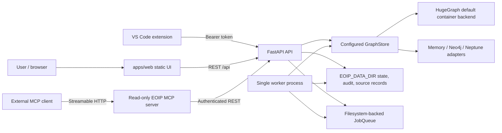

# Architecture Guide

This guide describes the current EOIP application topology, not every target architecture in the engineering specifications. Current production/runtime behavior is owned by the application factories, graph adapters, worker, MCP server, and deployment files linked below.

## Architecture Overview (System Context)

## Processes and Ownership

### API

`apps/api/main.py:create_app` is the persistent FastAPI application factory and the supported Uvicorn entrypoint. It constructs the graph store from `EOIP_GRAPH_BACKEND` and `config/graph-store.yaml`, loads principals from the credential store (`<EOIP_DATA_DIR>/state/credentials.json`) or `EOIP_ASG_FILE` (fails closed if no principals exist — see `docs/authentication.md` for `eoip-admin` provisioning), creates application services, and mounts authenticated graph, query, ingestion, agent, governance, and operations routes. API request identity is derived from the authenticated token/identity provider; write handlers must not trust caller-supplied actor or tenant values.

`apps/api/app.py:create_app(store, ...)` constructs the lower-level graph/query application around an injected `GraphStore`. The main factory uses it and adds persistent-runtime services/routes. It is not a standalone app factory with implicit default storage.

### Graph and ontology

`packages/eoip/graph/` defines the graph store interface, backend registry/configuration, in-memory implementation, and vendor adapters. The checked-in `config/graph-store.yaml` selects HugeGraph as `primary`. `EOIP_GRAPH_BACKEND` can select another configured connection such as `memory`, `neo4j`, or `neptune`. Ontology labels, properties, and validation are owned by `packages/eoip/ontology/` and `packages/eoip/validation/`.

The in-memory store is process-local and loses graph state on restart. The container default persists HugeGraph data in the `graph-data` named volume. Adapter availability does not by itself qualify production behavior, transaction semantics, tenancy, restore, or performance for every database.

### Worker and application files

`apps/worker/main.py` polls the `JobQueue` under `EOIP_DATA_DIR` and runs ingestion, replay, registered source operations, and graph consumers. The queue is filesystem-backed and intended for a single worker in the current default topology; it provides snapshotting and recovery admission. For distributed multi-worker topologies requiring WAL, heartbeats, fencing leases, outbox events, and governed DLQ, `DurableJobStore` in `packages/eoip/jobs.py` provides the transactional SQLite-backed store. Worker heartbeat is written to the data directory. Connector state, raw source events, dead-letter records, receipts, audit files, and other file state are also stored beneath this configured root.

### MCP

`apps/mcp/main.py` exposes MCP tools as a read-oriented facade and forwards requests to the API with a configured bearer token. The external client in `packages/eoip/tools_contract/mcp_bridge.py` supports Streamable HTTP and trusted-configured stdio processes. It performs real protocol initialization, discovery, and invocation; only locally allowlisted read-only tools are exposed. HTTP host policy and stdio process configuration are deployment trust boundaries. This does not qualify an external write connector or a universal action gateway.

### Web and VS Code

`apps/web/` is the React/Vite source app. The production image builds static assets and serves them through Nginx; the Vite development proxy requires `EOIP_DEV_API_URL`. The VS Code extension in `apps/vscode-extension/` calls the API/MCP surfaces, stores tokens in SecretStorage, and restricts source navigation to a configured workspace root. Neither user interface owns graph or authority state.

`frontend/` is a second React/TypeScript app with independent routing, auth and API transport. It is not the default Compose web build. `backend/server.py` is a preview shim over the real API with development defaults and synthetic seeding, not a separate domain backend. The [frontend guide](frontend-development.md) documents their differences and the auth fallback that must be resolved before suite adoption.

`EOIP_DATA_DIR` does not share process-local graphs. A separate API and worker using `MemoryGraphStore` cannot see each other's graph writes. The worker also has optional filesystem leader-lease support, but this is not a qualification of multi-host dispatch, failover or exactly-once execution.

## Request and Ingestion Flows

Read/query flow: browser or IDE request -> API authentication and policy checks -> validated query/service -> graph adapter -> response with bounded result and, where implemented, provenance/evidence metadata.

Ingestion flow: authenticated request or webhook -> durable job request -> worker reads job -> connector/parser creates source events -> mapping and canonical mutation/validation -> graph writes plus file-backed capture/DLQ/receipt state. Exact atomicity and recovery vary by adapter; do not infer exactly-once delivery from idempotent handlers or a local job queue.

MCP flow: authenticated client -> MCP initialize/list/call -> local server/tool policy -> API request with the MCP service credential -> API authorization -> result returned through MCP. External MCP discovery uses a configured host/server and tool allowlist; remote annotations alone do not grant access.

## Configuration and Deployment

Graph configuration is in `config/graph-store.yaml` with environment overrides such as `EOIP_GRAPH_BACKEND`, graph URL/database/user/password variables. `EOIP_API_TOKEN` is required and must be at least 24 characters. `EOIP_DATA_DIR` selects file-backed state. Container launchers create `deploy/.env` on the first `up` and mount named data volumes.

The default Compose stack is defined in `deploy/docker-compose.yml`; optional profiles include tests, local model, tools, restore testing, Neo4j, and observability. The network and storage model differs by profile. A local HugeGraph/worker/web run is not equivalent to a multi-worker PostgreSQL SaaS deployment.

For commands and safe lifecycle actions, see [Getting Started](getting-started.md) and the [Docker local runbook](../EOIP-engg-doc-pkg/reference/docker-local.md). For endpoint families, see [API Reference](api-reference.md).

## Security and Trust Boundaries

- Authentication and authorization are enforced at API/service boundaries; URL path separation is not authorization.
- Tenant scope and current permissions must be checked for graph reads, source jobs, evidence, exports, and MCP results.
- Source documents, connector output, model output, retrieved text, and external MCP descriptions are untrusted input.
- Agent tools are read-only or proposal-oriented unless a separately governed action path authorizes an effect. Approval strings and MCP annotations do not authorize writes.
- Hashes/signatures establish integrity or key possession only; they do not establish factual truth, authorization, or successful external effects.
- Secrets belong in deployment secret/environment configuration. Never commit or log credentials.
- Demo data is synthetic. Its presence or a successful demo does not qualify live vendor access, production policy, external effects, or release readiness.

## Known Qualification Limits

The default worker/job storage is filesystem-backed and single-process. Memory graph mode is ephemeral. Optional neural modules remain tier-gated, and hash-based embeddings are retained only as a test baseline; no model result is a fact. Several planned capabilities (durable authority storage, full action admission/dispatch, complete CTAR workflows, multi-worker recovery, full SASI, and integrated release evidence) require separate implementation and verification. See the applicable workstream plans rather than treating the architecture target as current behavior.

The [suite plan](EOIP-suite-architecture-plan.md) proposes future application/domain ownership. It does not replace this current topology. For an upgrade or extraction, use the [migration guide](migration-refactoring-guide.md); for state preservation and recovery, use [operations](operations-runbook.md).
